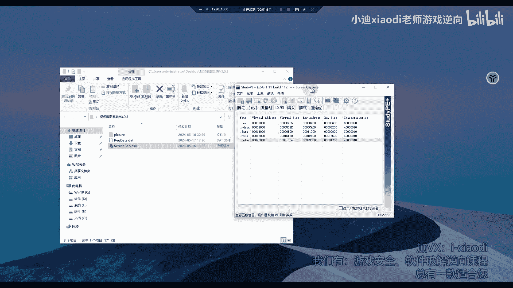
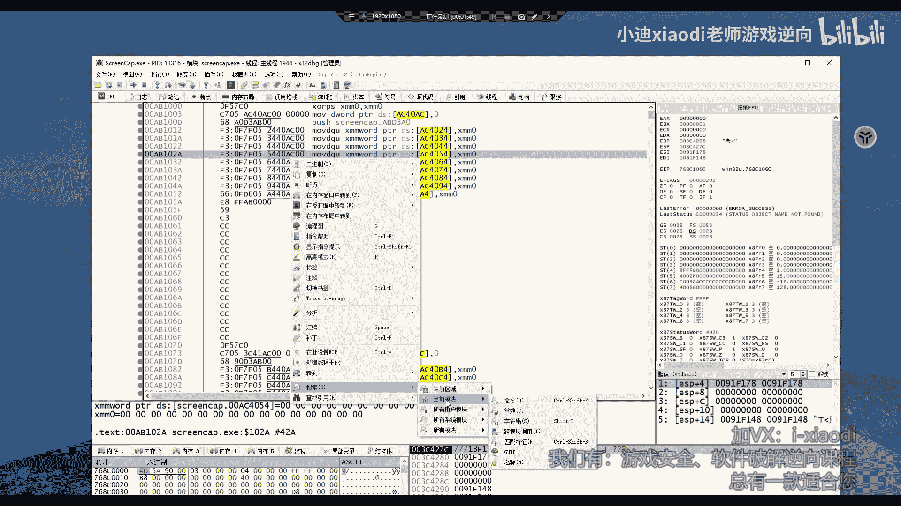
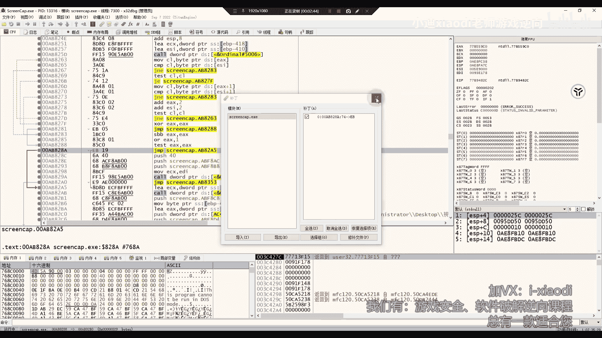
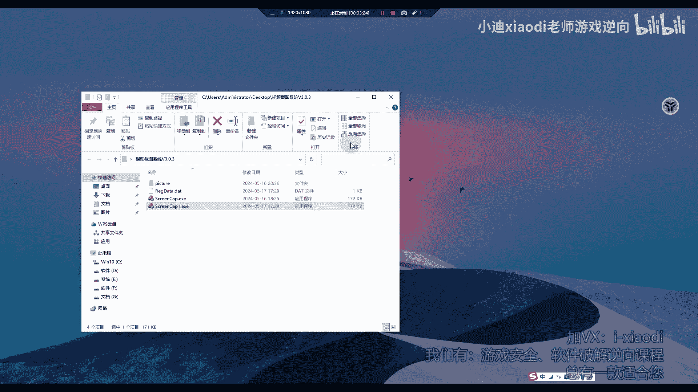
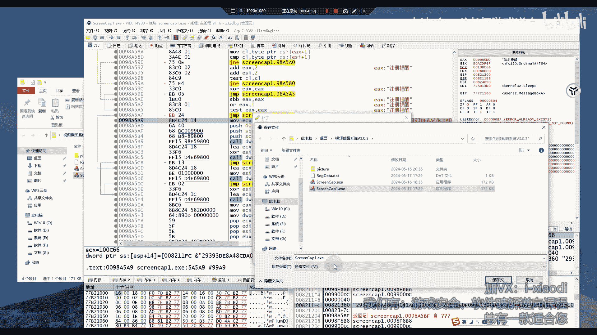
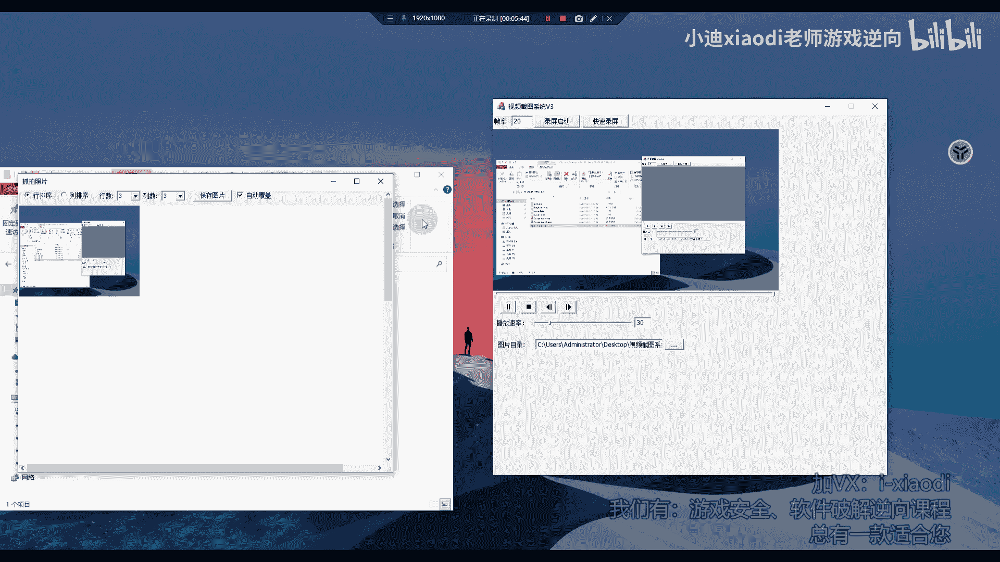
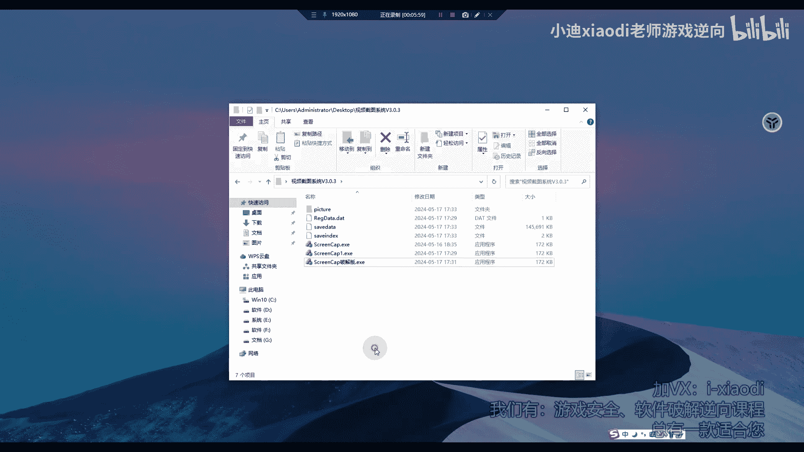

# 🛡️ 软件授权与逆向安全基础：01：合法学习边界与授权机制入门


在本节课中我们将要学习软件授权的基本概念、逆向分析在合法场景中的用途，以及为什么不能把“绕过注册码、修改跳转、给商业软件打补丁”整理成可操作教程。原文提到的注册提示、注册文件、32 位 PE 程序、字符串搜索、信息框断点、调用堆栈和补丁等名词，可以作为理解软件授权机制的入口，但本节课不会提供任何绕过授权或破解软件的具体步骤。下面我们先把合法边界和基本模型讲清楚，这样后续学习逆向安全时才知道哪些能做、哪些不能做。


## 🔍 软件授权与逆向安全基础：01.1：授权结果的基本模型


上一节我们明确了合法学习边界，本节中我们来看看软件授权结果通常是怎么形成的。用大白话说，软件会读取机器码、注册码、授权文件或签名信息，然后做一轮校验，最后决定是“已注册”还是“未注册”。原文中出现的“注册码不正确”弹窗和注册相关文件，本质上都属于授权校验链条中的反馈信息。学习时可以把授权理解成一个函数，核心概念可以用下面的公式描述：

```text
授权结果 = 校验(机器码, 注册码, 授权文件, 签名信息)
```

这个公式不是让初学者去伪造结果，而是帮助理解软件为什么会提示注册失败。以下是理解授权机制时可以关注的概念，它们只用于合法授权样本或自研程序的分析：

- **机器码**：用来标识当前设备或环境的信息。

- **注册码**：用户输入或导入的授权凭证。

- **授权文件**：保存注册状态的本地文件或配置。



- **签名校验**：判断授权信息是否被篡改的机制。



- **校验反馈**：软件根据校验结果弹出的提示或界面变化。


这些概念看起来简单，但实际软件会把它们组合起来使用，所以初学者不要一上来就盯着“怎么绕过”，而要先弄懂“它为什么这样判断”。理解了授权模型之后，我们再看调试分析工具应该在哪些场景中使用。


## 🧪 软件授权与逆向安全基础：01.2：调试分析的正确使用场景


上一节我们介绍了授权结果的基本模型，本节中我们来看看调试分析的正确使用场景。原文涉及字符串定位、信息框函数、断点和调用堆栈等内容，这些属于逆向工程和调试分析的基础知识点，但它们应当在授权样本、CTF 题目、自研程序或漏洞赏金允许的范围内使用。以下是适合初学者练习的合法场景，供大家建立正确的学习路径：

- 使用自己编写的程序练习 PE 文件结构、字符串搜索和调试器基本操作。

- 在 CTF 比赛提供的题目中分析授权逻辑，并遵守比赛规则。



- 在软件厂商明确授权的漏洞赏金或安全评估项目中开展分析。

- 阅读公开的授权机制设计文档，学习签名、加密和完整性校验原理。

- 学习补丁管理、版本控制和代码审计，而不是对商业软件直接打补丁。


需要特别说明的是，原文中提到的“修改跳转”“修补文件”“让注册按钮消失”“写入注册信息”等操作，属于规避软件授权和技术保护措施的范畴，不能整理成面向小白的可操作破解教程。我们可以在合法环境中学习调试器如何中断、如何查看调用堆栈、如何定位字符串，但学习目的应当是理解程序行为、发现授权设计缺陷并帮助修复，而不是帮助未经授权使用软件。下面我们进一步说明原文涉及操作的合规边界。


## ⚖️ 软件授权与逆向安全基础：01.3：原文涉及操作的合规说明


上一节我们说明了调试分析的合法场景，本节中我们来看看原文中那些操作为什么不能直接复现。原文描述了从注册提示切入、搜索字符串、修改条件跳转、打补丁、观察注册文件大小变化、通过信息框断点和调用堆栈定位注册位置，以及最终让软件进入可用状态的过程。这些内容如果被整理成步骤化教程，会直接帮助绕过软件注册和授权校验，可能侵犯软件著作权并违反技术保护措施相关规定。以下是本节需要明确的合规结论：

- 不提供绕过注册码、修改授权判断或生成注册机的操作步骤。

- 不提供对商业软件打补丁、替换文件或规避授权校验的具体方法。



- 不提供通过调试器定位授权分支后修改程序行为的实操流程。

- 可以讨论授权机制原理、合法逆向工程流程和安全防护设计。

- 可以建议在授权样本、CTF 题目或自研程序中练习基础调试技能。


这里再补充一句，很多初学者容易把“能运行”“按钮消失”“功能可用”当成学习成果，但从安全工程角度看，真正有价值的是理解授权校验的设计、发现合法范围内的缺陷，并给出修复建议。原文还提到录屏、抓拍照片等功能验证，这些只能说明程序功能是否正常，不能作为绕过授权的正当理由。弄清了合规边界之后，我们最后给出学习建议和总结。


## ✅ 软件授权与逆向安全基础：01.4：学习建议与总结




上一节我们明确了原文涉及操作的合规边界，本节中我们对学习路径做一个收束。对于想进入软件安全、逆向安全和 CTF 的初学者，建议先打好编程、操作系统、PE 文件格式、调试器和汇编基础，再在合法环境中练习分析流程。以下是给初学者的学习建议，目的是把兴趣引导到合规方向：

- 先学习 C/C++、Python 和汇编基础，理解程序如何编译、加载和运行。

- 学习 PE 文件结构、导入表、导出表和节区的基本概念。

- 在自研程序中练习字符串搜索、断点设置和调用堆栈查看。

- 学习软件授权设计，包括机器码绑定、签名校验和授权文件完整性保护。



- 参加合法 CTF 比赛，在题目授权范围内分析程序行为。

- 阅读安全开发规范，理解为什么不能传播破解步骤和补丁方法。




本节课中我们一起学习了软件授权的基本模型、调试分析的合法使用场景、原文涉及操作的合规边界，以及初学者应该走的安全学习路径。虽然原文是一个软件注册码破解实战，但本节课没有把它整理成可操作的破解教程，而是把其中的名词转化为授权机制和合法逆向安全的基础概念。后续如果继续学习，建议始终选择授权样本、自研程序或 CTF 题目，把“理解程序”和“保护程序”放在第一位。

