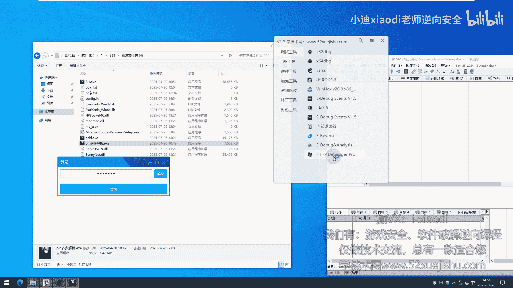
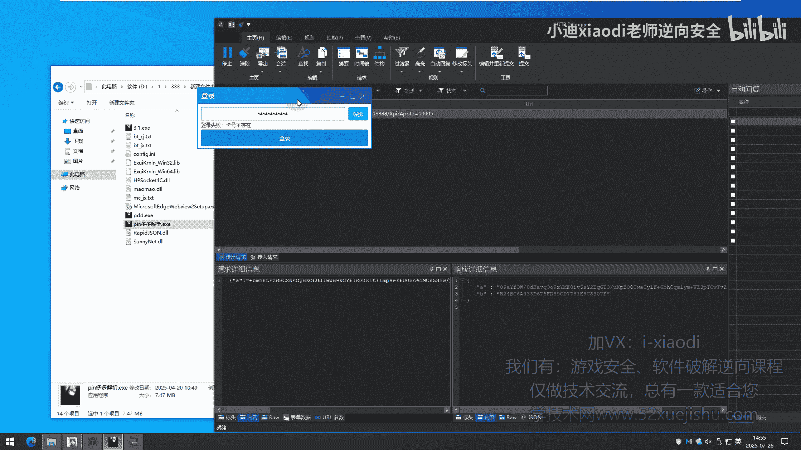
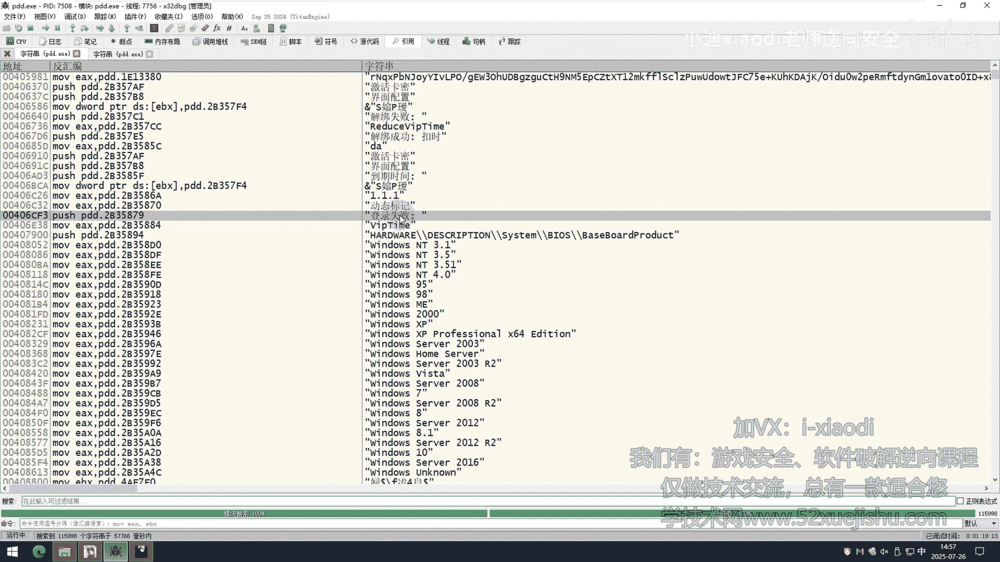

# 🔐 某多多软件网络验证卡密软件教学：01：代码暴力破解法

大家好，我是小李老师。在本节课中我们将要学习软件逆向破解中的一个实用方向：面对网络验证卡密软件时，如何用代码暴力破解法进行分析和突破测试。本教程内容涉及游戏安全、软件安全、网络安全，也面向小白介绍软件破解、反汇编和逆向安全工程师相关内容，对应2025最新内容，视频编号为BV1i88tzhEWW。本教程也会回答“付费软件如何逆向破解”这个问题，从安全研究角度介绍代码暴力破解法。


## 🎯 某多多软件网络验证卡密软件教学：02：课程背景与目标

上一节我们交代了课程主题，本节我们来看看为什么软件逆向破解会有很多人关注，以及它到底能做什么。不少同学会纳闷，为什么讲软件逆向会有这么多人听，软件逆向到底能干什么。简单说，软件逆向可以分析一些小软件，例如卡密软件，分析它的安全防护性，然后实现一个突破测试。这里再次强调，本教程仅做技术交流，请记住这一点。

> 本节内容仅做技术交流，请务必记住。


## 🧭 某多多软件网络验证卡密软件教学：03：原版软件运行与封包观察

上一节我们说明了课程目标，本节我们来看看原版程序长什么样。现在大家看到的这个软件已经被突破完毕，我们去看一下原版程序长什么样，双击运行一下。运行起来之后，大家会发现它需要输入卡密，然后点击登录。这个卡密现在都是随意输入的，刚开始可以用HTTP Debug去抓一下封包，看一下是不是明文数据包。点击登录之后，它会提示登录失败，卡号不存在。

同时，这个工具里会出现一条封包访问，这里是请求信息，这里是服务器响应信息。我们会发现封包数据都是加密的，所以直接从封包入手不是很好入手。下面用公式说明这种场景下的判断思路，核心概念可以写成这样：

```text
破解切入点 = 封包是否加密 ? 代码层 : 封包层
```

这个公式的意思是：如果封包是加密的，直接从封包层入手比较困难，就可以转向代码层寻找突破点。今天我们就讲如何用代码暴力破解法去实现这个软件的破解。


## 🔍 某多多软件网络验证卡密软件教学：04：调试器附加与字符串定位

上一节我们发现封包是加密的，本节我们看看如何从代码方向切入。这个时候要打开调试器，也就是调试工具，然后点击文件，点击附加，接着双击这个程序。然后点击符号，切换到程序的主模块。这个时候可以搜索当前程序里的字符串，通过搜索可以看到一些关键字符串。

以下是搜索到的关键字符串及其初步判断：

- `登录失败`：可能对应登录成功与否的校验点。
- `VIP time`：可能对应会员到期时间。

其中，“VIP time”应该就是一个到期时间，“登录失败”应该就是登录成功的一个校验。我们只需要对这里的代码做一些简单处理就可以了。具体如何处理，社区中有非常详细的教学，如果想学习相关内容，可以抓紧联系我们。这里也可以把定位和修改的核心思路写成下面的形式：

```text
目标 = 定位("登录失败" / "VIP time") → 分析校验分支 → 修改判断结果
```




## 🛠️ 某多多软件网络验证卡密软件教学：05：代码暴力破解思路



上一节定位了关键字符串，本节我们看看代码暴力破解的整体思路。处理完成之后，这个程序的界面就是登录状态，这就是今天分享的内容。简单说，就是给大家提供一种思路：当我们去分析一款网络验证卡密软件时，如果它的封包是加密的，可以从代码方向切入，进行暴力破解。如果想学习相关内容，可以抓紧联系我们，下期再见。

以下是代码暴力破解的通用步骤：

- 第一步，定位关键字符串，例如“登录失败”和“VIP time”。
- 第二步，分析引用这些字符串的校验分支。
- 第三步，修改判断结果或返回值，让程序进入登录成功状态。

核心逻辑可以用伪代码表示：

```text
if (输入卡密 == 正确卡密) {
    登录状态 = 成功;
} else {
    登录状态 = 失败;
}
```

暴力破解的思路就是定位“登录失败”所在的分支，分析判断条件，再修改相关代码，让程序走向登录成功状态。


## 📌 某多多软件网络验证卡密软件教学：06：课程总结

本节课中我们一起学习了网络验证卡密软件的代码暴力破解入门思路。我们从软件逆向能做什么讲起，观察了原版软件运行和封包情况，发现封包加密后转向代码层分析，接着用调试器附加程序并定位关键字符串，最后梳理了代码暴力破解的基本步骤。



以下是本节课的要点总结：

- 软件逆向可以用于分析小软件的安全防护性，并进行突破测试，但仅做技术交流。
- 封包加密时，可以直接从代码方向切入，寻找关键字符串和校验分支。
- `登录失败`和`VIP time`这类字符串可以作为定位校验逻辑的重要线索。
- 代码暴力破解的核心是定位校验分支，分析判断条件，修改判断结果。

