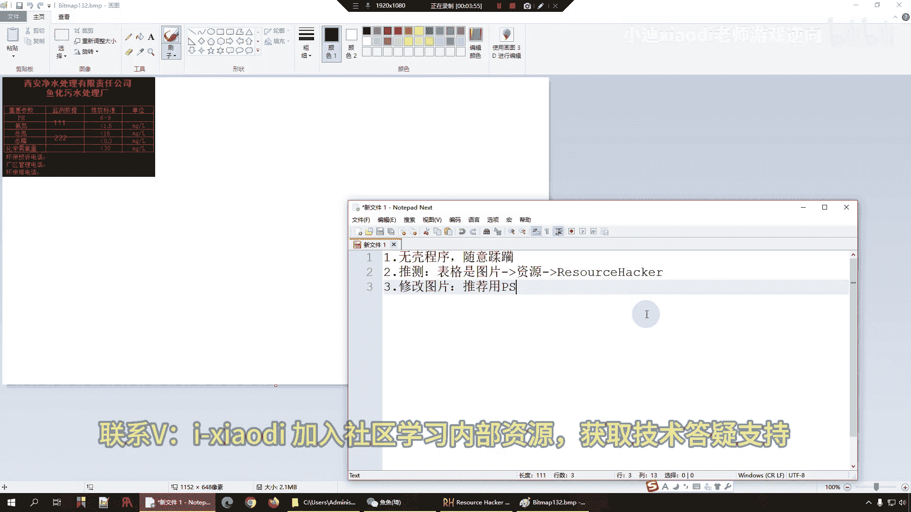
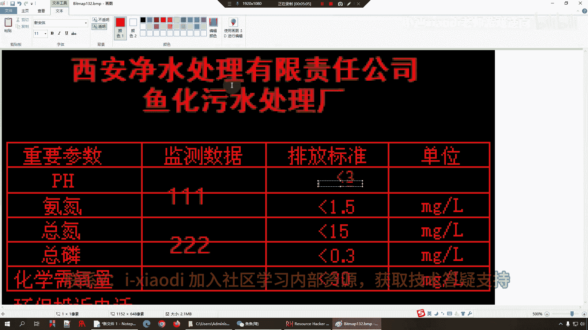
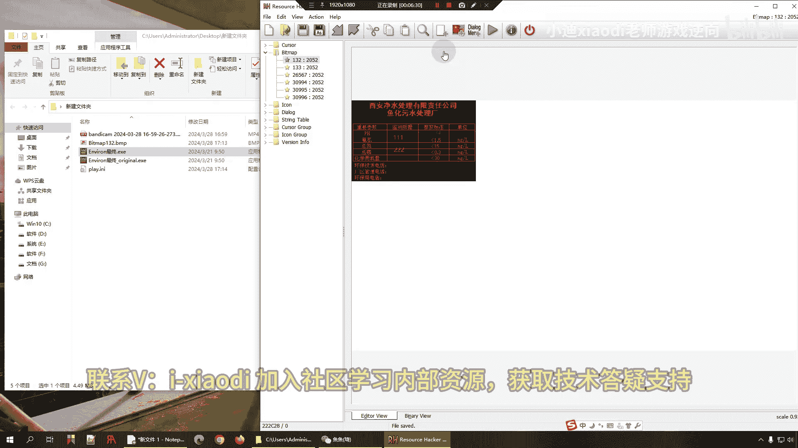

# 🔧 软件逆向修改实战：第一章：污水处理软件界面文字修改

在本节课中，我们将学习如何修改一个Windows桌面程序的界面文字。很多人可能会认为，界面上的文字一定存储在程序的代码里，但实际情况往往并非如此。在本案例中，我们将通过逆向分析的手段，逐步定位程序界面文字的真正存储位置，并使用资源编辑工具对其进行修改。这个技能在游戏安全、软件安全、网络安全以及CTF比赛中都属于必备的基础能力。接下来，我们以某污水处理软件的实际修改过程为例，进行完整演示。

## 🔍 第一步：查壳确定程序是否加壳

在开始修改任何一个程序之前，我们首先要做的操作是查壳。所谓“壳”，可以理解为一个程序的压缩或加密外壳，加壳的程序往往无法直接修改其内部资源，因此我们需要先确认目标程序是否加壳。

在本案例中，我们使用查壳工具对目标程序进行检测。检测结果发现，该程序没有加壳，在工具中显示为“Not Packed”状态。与此同时，我们还可以观察该程序的区段信息，区段也表现得非常干净，没有异常的加密或混淆特征。

以下是查壳过程的伪代码描述，帮助我们理解这一流程：

```text
打开目标程序 -> 检测壳特征 -> 无壳（Not Packed） -> 区段干净
```

既然程序没有加壳，那我们就可以基本上认定，这个程序可以被我们随意修改编辑。无壳程序的好处在于，它的资源数据通常都是直接暴露的，我们不需要先进行脱壳处理就可以直接操作。可以说，这大大降低了修改的难度，也提高了修改的成功率。

## 🖥️ 第二步：运行程序观察界面特征

确定了程序没有加壳之后，我们接下来要做的就是将程序运行起来，观察它的界面表现。这一步非常重要，因为通过运行程序，我们可以直观地看到界面上各个元素的显示效果，从而对程序的界面构成有一个初步的判断。

当我们点击运行之后，程序左上角出现了一个内容模块。在观察这个内容模块时，我们注意到一个非常关键的细节：界面上方文字的鲜明度，与下方表格区域的鲜明度，两者之间存在一定差异。这种差异意味着什么？它往往暗示着不同区域的数据来源是不同的。

基于上述观察，我们可以做出一个推测：界面上的这部分内容并不是由程序代码实时绘制的窗口控件，而更像是一张预先制作好的图片。在这种情况下，整个处理厂的信息表格区域，实际上是一张位图资源。这个推测是后续所有修改操作的基础，因为它决定了我们应当采用何种工具和修改路径。

## 🛠️ 第三步：使用资源编辑工具定位图片资源

既然我们已经推测出这个界面元素很可能是一张图片，那么我们下一步要做的就是去程序的资源文件中寻找它。在Windows程序的结构中，图片、图标、光标、对话框模板等数据都会被存放在资源段内。对于资源段的编辑，我们需要借助专门的工具来完成。

在这里，我们使用的是ResHack工具，这个工具在一般的逆向工具包中都自带备有。我们将目标程序拖拽到ResHack工具中，即可浏览该程序所包含的所有资源内容。打开之后可以看到，在资源树的左侧，有一个“数据库”相关的分支，点开它，可以看到里面有很多可以修改的文本数据。例如，程序中显示的公司名称“西安净水处理有限责任公司”这样的字符串内容，就是存放在这个位置。在这里需要说明一下，我们仅做技术交流，不涉及任何商业用途。

继续浏览资源树，我们会发现程序还带有一个图标资源，这个图标本身不需要修改。然而，当我们定位到名为“Bitmap”的资源分支时，目标内容出现了：这里存放着位图资源。点击这一个位图，右侧即刻预览到之前我们看到的那个界面图片。也就是说，程序中显示的污水处理厂信息表格，正是一张嵌入在资源中的位图图片。

## 📝 第四步：导出原图并对图片进行编辑

现在我们已经确认了目标图片存在于资源中，接下来就需要获取这张图片的原始文件。在ResHack中，我们点击位图资源，然后点击鼠标右键，在弹出的菜单中选择“Save Bitmap Resource”这个选项，将原图保存到本地磁盘。这样，我们就获得了一张可供编辑的原始图片。

获取原图后，我们可以打开这张图片进行查看，看到的内容与程序运行时界面上显示的一致。现在我们可以尝试对它进行编辑操作。假如我们要在图片上添加文字，就可以直接在图片上打上一些字符，比如打上“111”，并将字号和颜色进行适当调整，例如将颜色改为红色。完成编辑之后，我们点击另存为，把修改后的图片保存下来。



值得注意的是，虽然使用这种简单的方式可以完成编辑，但效果并不理想。这里我们要向初学者特别说明，ResHack自带的图片编辑功能非常基础，它只适合做一些简单的修改操作。比如我们可以用“填充黑色”这种笨办法先盖住原有文字，然后再补上新的文字。这种方法虽然有效，但操作起来不够灵活。

假如我们想要实现更好的修改效果，我们推荐使用专业图片处理软件，也即PS，又被称为Photoshop。使用PS，我们能够对图片进行更精细的调整，例如你可以在覆盖掉原有文字后，精确地调整新文字的字体、大小以及位置。

关于字体，我们可以观察原图中的文字风格，它看起来像是“仿宋”或者“宋体”。严格来说，它是某种中文字体，具体是哪种要看原图，也有可能是黑体变体。在不确定的情况下，我们可以直接使用“新宋体”来试试效果。可以看到，使用这种方式编辑图片，文字显示的效果并不清晰，由此我们也可以反推，原图中的“污水处理厂”这些文字，大概率是后期人工加上的。

当然，还有一个最为简单的方式，那就是直接在PS中制作一张与原图大小完全一致的图片，然后整体覆盖原有的位图资源。这也是我们最推荐的做法，因为这样做出来的效果最干净、最稳定。

## 💾 第五步：替换位图资源并保存程序

编辑好图片之后，我们需要将新图片导入到程序中，替换原来的位图资源。在ResHack中，我们在位图资源上点击鼠标右键，在弹出的菜单中可以看到一个“Replace”选项，点击它，就可以进入资源替换流程。选择“Open File With New Bitmap”，在文件选择框中找到我们刚刚制作好的新图片，并打开它，随后点击“Replace”按钮。

点击之后，我们可以立即在右侧预览区域看到修改结果，新图片已经成功替换了原来的位图资源。例如，我们新添加的“排放标准”文字已经显示在图片中了。当然，我们当前修改的图片还比较粗糙，所以我们依然建议您在正式操作时使用Photoshop来制作高质量的图片。

资源替换完成后，我们最后要做的是点击“保存”按钮，将修改后的资源写回到程序文件中。保存操作完成之后，我们就可以直接运行这个程序，进行最终验证了。



## ✅ 第六步：运行验证修改结果

现在我们运行修改后的程序，可以看到程序启动之后，界面上原本需要修改的位置，已经正确显示了我们刚才写入的新数据和新的文字内容。这意味着我们对这个程序界面图片的修改已经成功了。

如果你想要达到更加理想的效果，这里再次给出我们的建议：你完全可以自己制作一个一模一样大小的表格图片，直接覆盖上去。或者使用PS将需要修改的文字直接精确地加到原图上再替换。整个过程就是这样简单——定位资源，导出图片，编辑图片，替换资源，保存程序，最终验证。

## 📌 总结

本节课中，我们一起完整地学习了如何对一款无壳Windows程序中的界面文字进行修改。我们的核心流程包括：第一步查壳，确认程序无壳；第二步运行程序观察界面差异，判断目标界面可能是图片；第三步使用ResHack工具定位并确认位图资源；第四步导出原图并使用PS等工具进行编辑；第五步将修改后的图片替换回程序资源并保存；第六步运行程序确认修改效果。

在本案例中，整个修改的关键在于判断程序界面元素的类型。如果界面是文字控件，修改就需要使用字符串编辑工具；而如果界面是图片资源，修改就需要走资源替换的路线。这个分析思路不仅适用于本节课的案例，在游戏汉化、软件本地化以及CTF比赛的逆向题目中，也同样适用。

```text
查壳（无壳） -> 运行（观察差异性） -> 判定（图片资源） -> 定位（Bitmap） -> 导出（原图） -> 编辑（PS） -> 替换（Replace） -> 保存 -> 验证
```



通过这个简单的公式化流程，希望初学者能够掌握程序资源修改的基础方法。逆向工程并不神秘，关键在于多动手实践，多积累经验。本节课的内容就到这里，后续我们将继续深入探讨更多与软件安全相关的实用技术。
