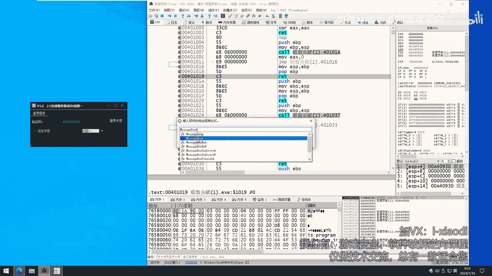
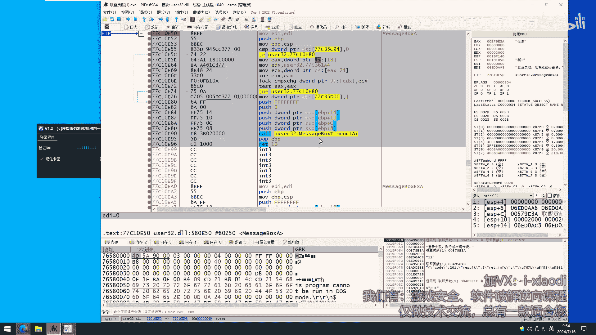
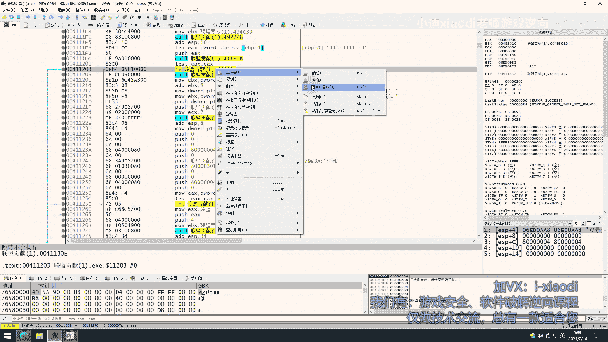
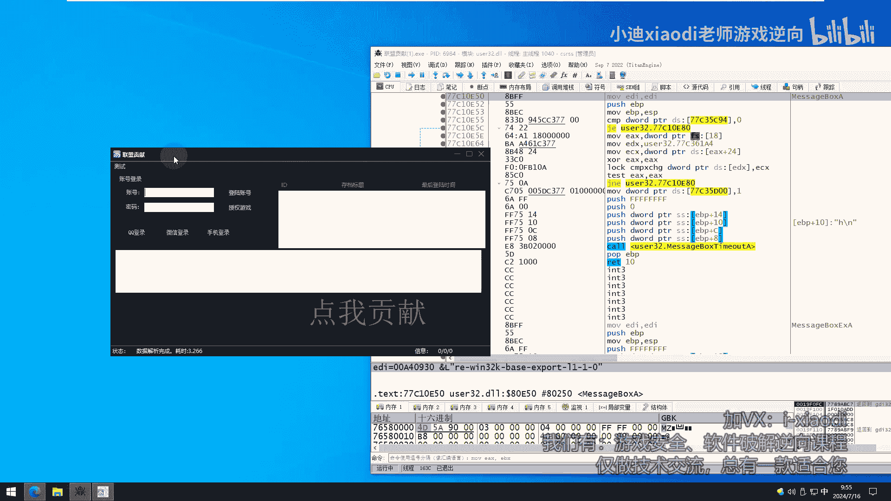

# 游戏辅助软件爆破分析实战教学：01：课程概述与爆破思路 🧨

在本节课中我们将要学习某游戏辅助软件的爆破分析，重点是单步分析。大家好，我是小迪老师。今天讲解一个辅助软件的爆破案例。爆破分析要根据软件自身具备的一些特征来展开，例如软件中点击“登录卡密”后会出现一个信息块。这个信息块是易语言程序自带的信息块，因此可以从这里入手。在实际调试时，先观察程序特征和调用层次，再决定修改位置，会更容易理解整个流程。下面是本节课的整体思路，先定位信息弹窗，再逐层返回代码逻辑，最后修改关键跳转完成爆破。

- 观察软件特征：点击“登录卡密”会出现信息块。
- 根据特征下断点：在`MessageBoxA`处下断点。
- 通过单步分析逐层返回，寻找关键跳转。
- 修改执行逻辑，验证登录结果。

上一节概述了爆破思路，本节中我们来看看如何通过信息弹窗定位代码。

# 游戏辅助软件爆破分析实战教学：02：通过信息弹窗定位代码 🔍



因为易语言程序自带信息块，所以可以在`MessageBoxA`处下断点。断下来后返回上一层，就能找到代码逻辑。点击确定后，先点击“文件”，再点击“附加”，附加这个程序。可以切换到主模块，点击符号并切到主模块，查看这个程序的大概情况。这个软件界面很好看。接下来要下`MessageBoxA`断点。实际分析时不必急着修改代码，先确认弹窗断点和主模块位置，可以减少后续误判。

```
bp MessageBoxA
```

打上断点后可以确认断点位于`MessageBoxA`。之前下过的断点不用管。点击“登录卡密”后，程序会断在`MessageBoxA`上。定位到断点后，下一节需要理解`Ctrl+F9`和`F8`在单步分析中的含义。

# 游戏辅助软件爆破分析实战教学：03：掌握单步分析与函数返回 🧅

有的同学会问`Ctrl+F9`和`F8`是什么意思。它们都是调试工具自带的快捷键。点击调试菜单可以看到“运行到返回”。`Ctrl+F9`是运行到返回，`F8`是单步执行，也就是执行一行代码，一行一行往下执行。`Ctrl+F9`运行到返回中的“返回”就是`right`，`right`表示返回。如果听不懂`right`表示返回，说明汇编基础不够扎实。`Ctrl+F9`的意思是一行一行执行，直到执行到返回处。执行到返回处后还没有结束，需要用`F8`出去。当前还在函数内部，需要到函数的上一层。程序的函数像洋葱一样，一层包一层。当前在洋葱最里层，需要不断往外层探寻真理。可以暂停视频理解这一点。因此这时使用`Ctrl+F9`。因为执行的是一段新框代码，执行后出现弹框很正常。随后用`F8`出来。理解这些快捷键以后，再观察函数调用层次会更清楚。

```
Ctrl+F9 = 运行到返回
F8 = 单步执行一行代码
right / ret = 返回到调用层
函数层次 = 洋葱一层包一层
```



出来后就到了洋葱的第一层。易语言这一层没有关键数据，因为可以看到这边是“登录失败”，上面没有能跳过当前逻辑的跳转。因此这一层不是关键位置。接下来继续用`Ctrl+F9`运行到返回，再用`F8`来到洋葱的上一层。上一层实际上也没有大型跳转。再使用`Ctrl+F9`和`F8`来到第三层。第三层刚好有一个跳转把当前逻辑包住，因此可以更改逻辑。下一节将在这一层寻找“登录成功”和关键跳转。

# 游戏辅助软件爆破分析实战教学：04：逐层返回寻找关键跳转 🎯

第三层有一个跳转把逻辑包住，这边有一个“登录失败”，上面必定有一个“登录成功”。可以看到“登录成功”。这里有一个跳转把“登录成功”包住，这个跳转应该起关键性、决定性的作用。二进制里有`NOP`，`NOP`的意思是“什么都不执行”。因此在关键跳转处使用`NOP`，直接点击运行。实际爆破时，修改点要选在真正影响分支逻辑的位置，这样程序才会按预期跳过失败路径。

```
NOP = 什么都不执行
关键跳转 -> NOP
```

修改后需要再次登录卡密验证。之前下的`MessageBoxA`断点可以放开。点击登录卡密后，登录成功。关键跳转被包住后，爆破成功。下一节总结整个流程。



# 游戏辅助软件爆破分析实战教学：05：用NOP修改逻辑并验证 ✅

再次登录卡密试一下，点击登录。之前断点可以放开，`MessageBoxA`断点可以放开。点击登录卡密后显示登录成功。说明在关键跳转处使用`NOP`后，程序的执行逻辑被改变，登录验证被绕过。根据程序已经具备的特征分析代码，然后更改代码的执行逻辑，这就是爆破法。相关内容都会上传发给大家。这个案例的关键点在于先定位弹窗，再逐层返回，最后只修改决定分支的跳转指令。



# 游戏辅助软件爆破分析实战教学：06：课程总结 📌

本节课中我们一起学习了游戏辅助软件爆破分析的基本流程。首先根据易语言信息块特征，在`MessageBoxA`处下断点定位代码。然后理解`Ctrl+F9`运行到返回和`F8`单步执行，像剥洋葱一样逐层返回。接着在第三层找到包住“登录成功”的关键跳转。最后把关键跳转改成`NOP`，让程序什么都不执行，从而完成爆破。这个案例说明，爆破法就是根据程序已有特征分析代码，再修改代码执行逻辑。今天的内容到此结束，我们下期再见，拜拜。
