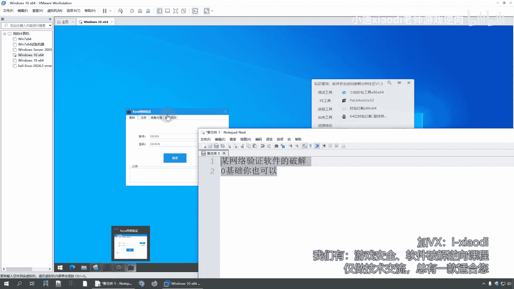
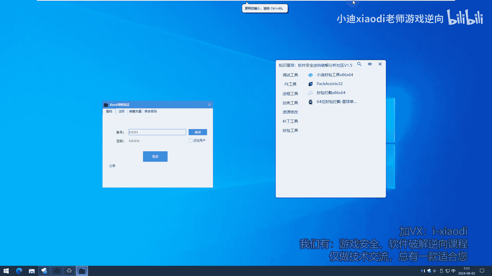
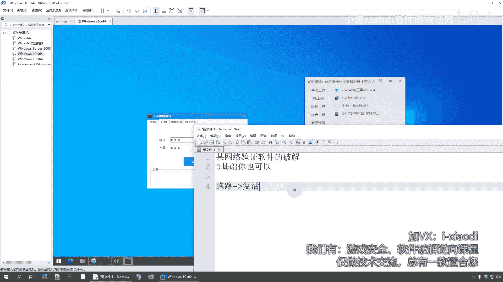
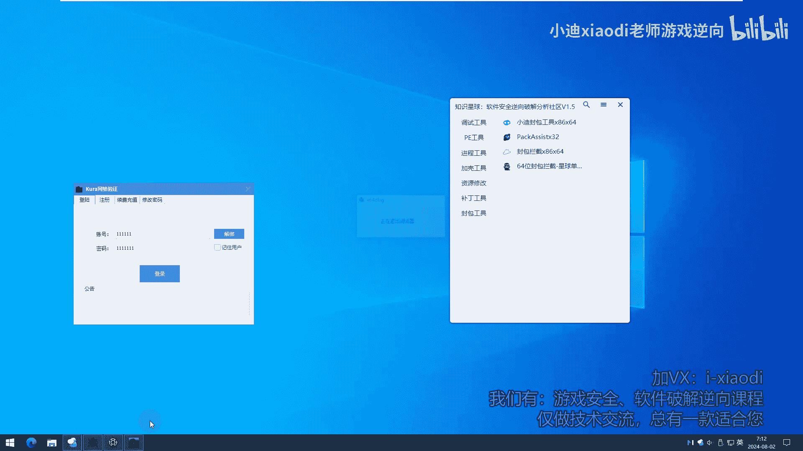
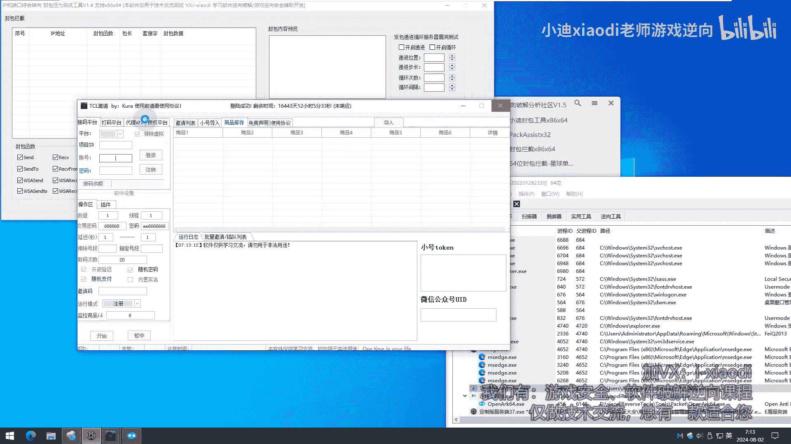
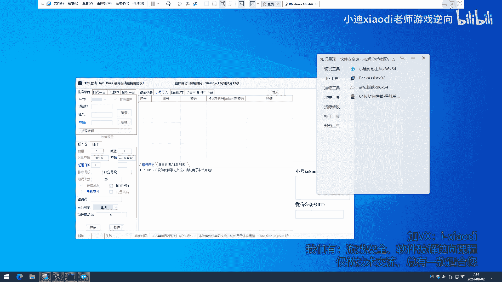

# 网络验证软件逆向破解入门：01：课程概述与学习目标 🧭


在本节课中我们将要学习某网络验证卡密软件的逆向分析思路，内容面向零基础学习者，零基础也可以跟着理解。课程由小丽老师讲解，先说明逆向破解能做什么，再通过一个网络验证软件跑路的场景，演示如何让它“复活”，并说明系统化学习的必要性。这里先给出整体流程公式：


```text
网络验证软件 = 客户端 + 验证服务器 + 授权/卡密
破解思路 = 观察进程 -> 注入工具 -> 转向本地/自建服务 -> 注册登录 -> 验证功能
```


上一节是概述，本节我们来看看为什么学习逆向以及这个案例的背景。下面先说明逆向的实际用途和案例前提。


## 网络验证软件逆向破解入门：02：案例背景与逆向用途 🎯




有不少朋友疑惑：讲逆向破解为什么有很多人听，逆向到底能干什么。这里用一个具体场景说明：假设你有一款网络验证软件，这个软件实际上已经跑路了，这个点非常重要。软件跑路后，可以通过一定方法给它“复活”，因为软件本身的功能仍然可以使用。要学会破解这种网络软件，需要跟着课程系统化学习；学习之后，就可以灵活运用各种各样的软件。以下是这个案例的核心前提：




- 软件类型是网络验证软件，带有卡密/授权逻辑。
- 软件已经跑路，但本地功能仍然可用。
- 目标是让软件“复活”，恢复可用状态。
- 学习方式需要系统化，而不是零散看内容。


上一节说明了案例背景，本节我们进入实际操作，先看工具准备和进程注入。下面按步骤说明如何打开工具包、找到进程并完成注入。


## 网络验证软件逆向破解入门：03：工具准备与进程注入 🛠️


首先第一步，打开工具包里面的风包工具，然后找到你的软件进程。可以看到，这个进程对应的软件加了VMP壳。有的朋友或同学可能有疑问：加了VMP这种壳的软件能不能破。结论是能破，不要紧，没有关系。这里先把加壳关系用公式表示：




```text
加壳软件 = 原始程序 + VMP保护层
```




接下来在进程上鼠标右键，点击注入，然后找到叉6版本，注入进去。出来之后不要慌，不要忙，直接启动转向，这样就可以完成。以下是注入操作的顺序：


1. 打开工具包中的风包工具。
2. 找到目标软件进程。
3. 确认进程带有VMP壳。
4. 在进程上鼠标右键，选择注入。
5. 选择叉6版本并注入。
6. 注入完成后直接启动转向。


上一节完成了注入和转向，本节我们来看服务器账号注册与登录。下面说明如何在没有账号密码的服务器环境中注册并登录软件。


## 网络验证软件逆向破解入门：04：注册账号与登录验证 🔑


现在服务器里边没有账号密码，可以注册一个账号。此时已经通过自己的服务器连上，因此可以直接登录这个软件。输入用户名“小迪”，密码“123456”，点击登录。可以看到，软件直接登录上来了。这里用代码描述登录参数：


```text
用户名 = 小迪
密码 = 123456
操作 = 点击登录
结果 = 软件登录成功
```


登录成功后，还需要观察软件显示的授权天数等信息。上一节完成了登录，本节我们看看软件运行状态和功能表现。下面说明卡顿处理、界面信息和功能观察。


## 网络验证软件逆向破解入门：05：运行状态与功能观察 ⏳


这个软件有多少天，需要打开后查看；打开之后会稍微有一点点卡，但不要紧，稍等一下即可。软件有一点点小卡顿，用完之后要把软件关掉，不然会非常卡顿。这个软件本身也是有点问题的，不然也不会出现需要这样处理的情况。卡一会儿就好了。界面中可以看到北京时间等信息。具体这个软件是干什么的，暂时不太清楚，应该是跟交易、支付相关的。界面里还有微信公众号之类的监控商品ID功能，也可以对接打码平台。这个软件还是可以用的。软件还授权了一些平台，然后可以导入，应该可以搞一些批量操作。以下是观察到的功能点：




- 软件打开后可能轻微卡顿，等待后可恢复。
- 使用完成后应关闭软件，避免持续卡顿。
- 界面显示北京时间等信息。
- 软件可能与交易、支付场景相关。
- 存在微信公众号监控商品ID等功能。
- 可以对接打码平台。
- 软件仍然可用，并授权了一些平台。
- 支持导入，可能用于批量操作。


上一节观察了软件功能，本节我们说明时间修改和学习建议。下面把剩余时间修改和学习路径单独说明。


## 网络验证软件逆向破解入门：06：时间修改与学习建议 🕒


本节内容讲到此处，剩余时间是可以随便更改的，可以用公式表示：


```text
剩余时间 = 可修改值
```


如果想学习，不要再去其他地方看一些乱七八糟、杂乱无章的内容，直接跟着这边零基础、系统化学习即可。以下是学习建议：


- 不要零散浏览杂乱内容。
- 按照零基础课程系统化学习。
- 先掌握工具操作，再理解网络验证和授权逻辑。
- 通过案例练习注入、转向、注册登录和功能验证。


上一节给出了时间修改和学习建议，本节我们做整体总结。下面回顾本课程的关键流程和注意事项。


## 网络验证软件逆向破解入门：07：课程总结 ✅


本节课中我们一起学习了某网络验证卡密软件的逆向分析思路：从逆向用途和跑路软件“复活”的背景开始，依次完成打开风包工具、找到带VMP壳的软件进程、右键注入叉6版本、启动转向、在自建服务器上注册账号、使用“小迪/123456”登录、观察软件卡顿和功能信息，并了解剩余时间可修改以及系统化学习的建议。核心流程可以概括为：


```text
打开工具 -> 找到进程 -> 确认VMP壳 -> 注入叉6 -> 启动转向 -> 注册账号 -> 登录验证 -> 观察功能 -> 修改剩余时间
```




本节内容到这里，下期再见。
