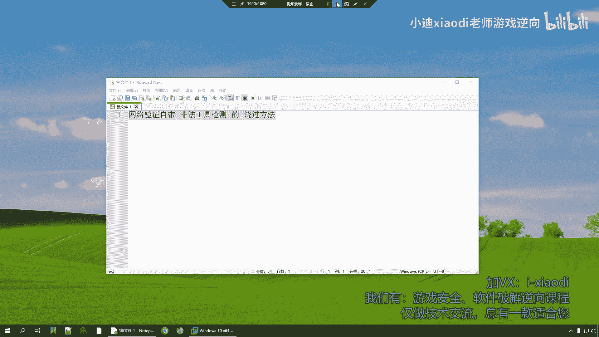

# 🧩 网络验证逆向分析入门：01：绕过非法工具检测并完成本地化转向


本教程将学习网络验证自带的非法工具检测如何绕过，并完成卡密软件逆向分析中的实战操作。内容面向游戏安全、软件安全、网络安全和CTF比赛必备基础，也适合小白学习软件破解、反汇编和逆向安全工程师方向。对应视频为BV1k4421U7SZ。原文是实战教学，下面会按步骤整理，尽量用大白话说明。


## 🧪 网络验证逆向分析入门：01.1：复现非法工具检测现象


上一节是概述，本节中我们来看看如何复现问题。首先打开目标程序，程序界面就是原文展示的样子。接着打开调试器并附加到程序，然后切换到主模块，这通常是常规操作。我们可以先查看程序有没有窗口，确实存在窗口，但先不管它，先随便点击一个按钮，例如点击登录。以下是复现步骤：


- 打开目标程序。
- 打开调试器并附加程序。
- 切换到主模块。
- 查看窗口，先不处理窗口。
- 随便点击一个按钮，例如点击“登录”。


点击登录后会提示“发现非法工具”。这个提示实际上不是壳导致的，一般是网络验证里自带的功能。以下是现象结论：


- 提示“发现非法工具”。
- 该提示通常来自网络验证自带检测。
- 不是壳导致。


这里可以用一个简单逻辑表示：


```text
if (检测到调试器附加) {
    提示“发现非法工具”;
}
```


## 🔍 网络验证逆向分析入门：01.2：定位检测来源与分支修改思路


上一节我们复现了附加调试器后弹出“发现非法工具”的现象，本节中我们来看看如何定位检测来源。可以去搜索当前模块的字符串，搜索“发现非法工具”。可以看到，它实际上是程序自带的内容。那怎么绕过？当然也可以直接把条件跳转`JE`改成无条件跳转`JMP`，这没有问题。但还有其他方法。需要考虑一种情况：假如代码被混淆，就找不到了，找不到就过不掉。关于易语言程序怎么混淆、怎么VM，上节课也讲过，并且有视频讲解。以下是定位与修改思路：


- 搜索当前模块字符串。
- 找到“发现非法工具”相关字符串。
- 可以直接把`JE`改成`JMP`。
- 如果代码被混淆，可能找不到对应位置。
- 易语言程序的混淆和VM处理可参考上节课视频。


对应核心概念可以写成：


```asm
JE  -> 条件跳转
JMP -> 无条件跳转
```


```text
检测分支：if (非法工具) { 提示; }
修改思路：JE 改为 JMP，跳过提示分支
```


## 🕵️ 网络验证逆向分析入门：01.3：隐藏调试器绕过附加检测


上一节我们介绍了字符串定位和改跳转的思路，本节中我们来看看更简单的绕过方式。先把程序关掉，然后重新观察程序行为。点击登录时提示“账户不存在”，也就是说没有附加调试器、没有产生附加动作时，程序没有问题，没有任何异常。但是附加调试器之后就有问题了，可以看到附加后点击登录会触发检测。说明问题实际出在附加动作上。以下是行为对比：


- 未附加调试器时，点击登录提示“账户不存在”，没有异常。
- 附加调试器后，点击登录会触发非法工具检测。
- 检测与调试器附加动作有关。


那这个问题怎么解决？操作很简单。点击“文件”，点击“附加”，这时点击登录肯定会被检测。过掉检测的方法很简单：点击“调试”，点击“高级”，找到“隐藏调试器”。这个小小的功能非常关键。以下是隐藏调试器步骤：


- 点击“文件”。
- 点击“附加”。
- 点击“调试”。
- 点击“高级”。
- 选择“隐藏调试器”。


隐藏后，左下角会显示调试器已隐藏。此时点击登录，会提示“账户不存在”。以下是绕过后的现象：


- 左下角显示调试器隐藏。
- 点击登录提示“账户不存在”。
- 非法工具检测被绕过。


这里可以用流程表示：


```text
附加调试器 -> 触发检测
隐藏调试器 -> 不触发“发现非法工具” -> 继续登录流程
```


## 🛠️ 网络验证逆向分析入门：01.4：IP端口转向完成网络验证本地化


上一节我们通过隐藏调试器绕过了附加检测，本节中我们来看看如何继续破解登录。账户不存在之后怎么破解？方法很简单，使用提供的IP端口转向封包综合工具1.4。现在已经更新到1.4版本。以下是工具使用步骤：


- 打开准备好的IP端口转向封包综合工具1.4。
- 找到“云兔好句”原文件。
- 鼠标右键点击。
- 注入到x86版本，因为目标程序是32位程序。
- 注入成功。
- 程序界面会出来。
- 点击“IP和端口转向网络验证本地化”。
- 点击“启动转向”。
- 开启成功。
- 等待测试，点击“确定”。
- 点击“登录”。


点击登录后，结果就出来了，登录被破解，流程就是这么简单。以下是破解流程核心概念：


```text
IP/端口转向 => 网络验证本地化 => 登录成功
```


```text
32位程序 -> 注入x86版本 -> 启动转向 -> 等待测试 -> 完成破解
```


## 📌 网络验证逆向分析入门：01.5：补充说明与总结


上一节我们完成了本地化转向和登录破解，本节中我们来做补充说明和总结。这个案例还有其他一些细节。如果大家想学习软件逆向破解，可以跟着课程继续学习。很多朋友会纳闷：为什么那么多同学和朋友听软件逆向破解课程，它到底有什么魔力，到底能干什么？答案就是能干这样一件事，也就是本教程演示的检测绕过与破解流程。以下是本教程要点回顾：


- 附加调试器会触发网络验证自带的非法工具检测。
- 检测提示通常不是壳导致，而是网络验证自带。
- 可以搜索字符串定位，也可以改`JE`为`JMP`。
- 代码混淆时定位会变难，易语言混淆和VM可参考上节课。
- 更简单的绕过方式是隐藏调试器。
- 使用IP端口转向封包综合工具1.4可完成网络验证本地化。
- 32位程序需要注入x86版本。
- 启动转向并等待测试后，点击登录即可完成破解。




本教程中我们一起学习了网络验证非法工具检测的复现、定位、隐藏调试器绕过，以及使用IP端口转向工具完成本地化转向和登录破解。以上就是今天的内容，下期再见。
