## 软件逆向破解实战教程：01：🧭 课程说明与案例引入

在本节课中我们将要学习一个国外软件的保存校验破解流程。本案例属于游戏安全、软件安全、网络安全与 CTF 比赛必备基础内容，课程为 2024 最新内容，视频编号为 BV1ib421Y7gm，面向小白讲解软件破解、反汇编和逆向安全工程师所需基础。我是小李老师，学习软件安全就找小李老师。今天来看一个软件破解案例。今后大家学完之后，也可以拿一些实验程序去尝试，过掉一些软件的校验、时间限制等内容。现在加入学习有最新优惠，可以看右下角联系，也可以通过视频评论区联系我。本节先说明课程目标和案例背景，下一节再进入程序分析和工具选择。

这个案例的目标很直接：打开软件后界面正常显示；软件未注册时，执行保存操作会被拦截，并弹出不允许保存文件的提示。具体触发操作是点击 C5 进行保存。这个提示就是关键特征，因为字符串往往会直接暴露校验逻辑所在的位置。下面先列出案例中的关键现象和破解目标，方便初学者建立整体认识。

- 软件来源：国外软件。
- 触发操作：未注册时点击 C5 进行保存。
- 现象：提示不允许保存文件。
- 关键提示字符串：`your license doesn't allow to save file`。
- 破解目标：去掉这个保存校验，让软件能够正常保存文件。
- 后续内容：先判断程序类型，再选择对应逆向工具。

以上就是案例背景和基本目标。上一节我们明确了要处理的是保存校验，本节中我们来看看这个软件用什么语言编写，以及应该选择什么工具。

## 软件逆向破解实战教程：02：🧰 判断程序类型与选择工具

上一节我们明确了要处理的是保存校验，本节中我们来看看这个软件用什么语言编写，以及应该选择什么工具。要破解一个软件，第一步不是直接改代码，而是先看它是什么类型的程序。不同类型的程序，分析方法不一样，工具也不一样。打开工具包，把这个软件拖进去分析，可以看到它是一个 .NET 程序。工具包在加入学习之后全部赠送，均为最新版本。课程视频里也讲过 .NET 程序怎么破解，.NET 程序可以使用 DNSPY 来破解。调试工具里带有 DNSPY，把程序拖入 DNSPY 即可。

这里需要说明一个初学者容易忽略的点：位数不匹配会导致调试失败。最初可以打开 64 位调试器，但这个案例中的程序是 32 位程序，所以后续需要打开 32 位版本重新操作。下面是程序类型判断和工具选择的核心结论，可以用代码形式表示。

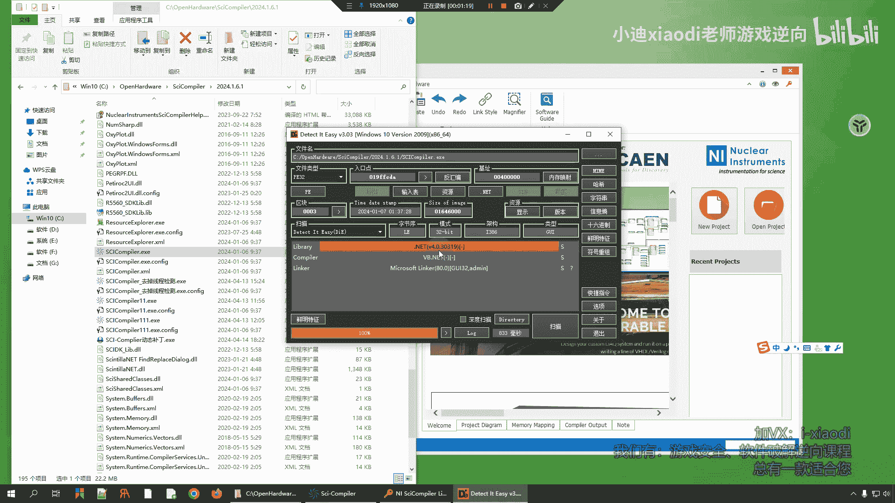

```text
程序类型：.NET
推荐工具：DNSPY
程序位数：32 位
调试器选择：32 位 DNSPY
```

上一节我们完成了工具选择，本节中我们来看看如何通过字符串定位关键函数。定位关键字符串是逆向分析里非常实用的一步，因为提示语通常离校验逻辑很近。

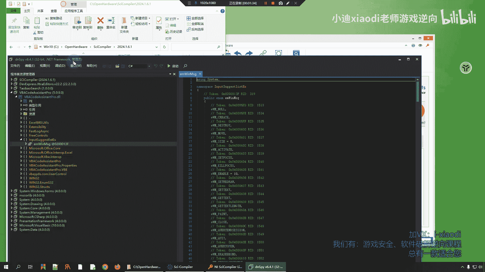

## 软件逆向破解实战教程：03：🔍 定位关键字符串与函数

上一节我们完成了工具选择，本节中我们来看看如何通过字符串定位关键函数。定位关键字符串是逆向分析里非常实用的一步，因为提示语通常离校验逻辑很近。在 DNSPY 中，先把之前的内容全部删掉，重新来一遍，把程序拖过来。拖入过程很简单。接下来使用搜索功能，搜索字符串 `allow to save file`，点击放大镜，在搜索框中输入要查找的内容。原文演示中出现了 `Hello`、`To save` 等搜索片段，核心目标仍然是找到保存文件相关的提示。搜索之后可以找到两个非常关键的函数。

搜索到关键函数后，需要看清它们分别对应什么操作。以下是定位结果和函数用途。

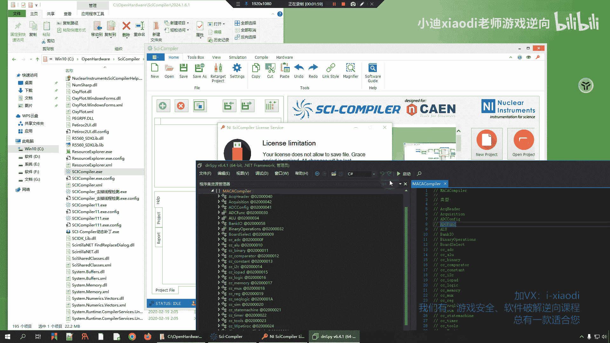

- 搜索关键字：`allow to save file`。
- 关键函数一：`saveItem_Click`，对应 Save。
- 关键函数二：`saveAsItem_Click`，对应 Save As。
- 查看方式：双击函数，进入代码逻辑。
- 分析重点：找到弹出“不允许保存文件”提示的分支。

为了更直观地表示定位过程，可以把核心操作整理成代码形式。

```text
搜索字符串：allow to save file
定位函数：saveItem_Click
定位函数：saveAsItem_Click
动作：双击进入函数，查看判断逻辑
```

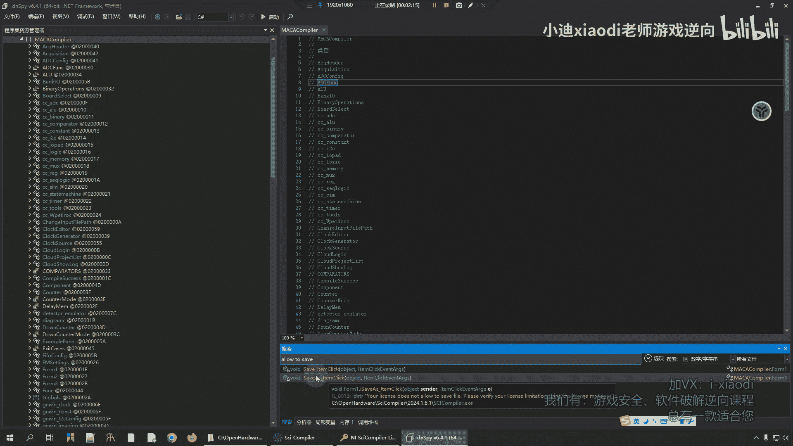

上一节我们找到了两个保存相关函数，本节中我们来看看函数内部的判断逻辑，并确定最简单的破解思路。

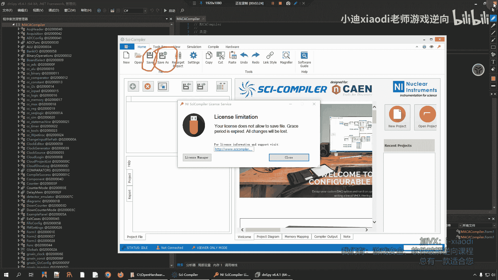

## 软件逆向破解实战教程：04：🧠 分析校验逻辑与制定破解思路

上一节我们找到了两个保存相关函数，本节中我们来看看函数内部的判断逻辑，并确定最简单的破解思路。双击函数后，可以看到它的判断逻辑。代码中会判断许可证状态，如果不允许保存，就弹出提示。原文提示字符串如下，中文含义也一并列出，方便对照。

> 原文提示：`your license doesn't allow to save file`
>
> 中文含义：你的许可证不允许保存文件。

这个提示就是校验失败后的结果。对初学者来说，可以先把它理解成一个开关：开关为真时允许保存，开关为假时弹出错误。下面是校验流程的简化公式，用大白话表示就是“先检查许可证，再决定走保存分支还是报错分支”。

```text
正常保存流程 = 许可证校验通过 → 执行保存
当前失败流程 = 许可证校验失败 → 弹出“不允许保存文件”
破解目标 = 让流程进入保存分支，或把校验结果改为通过
```

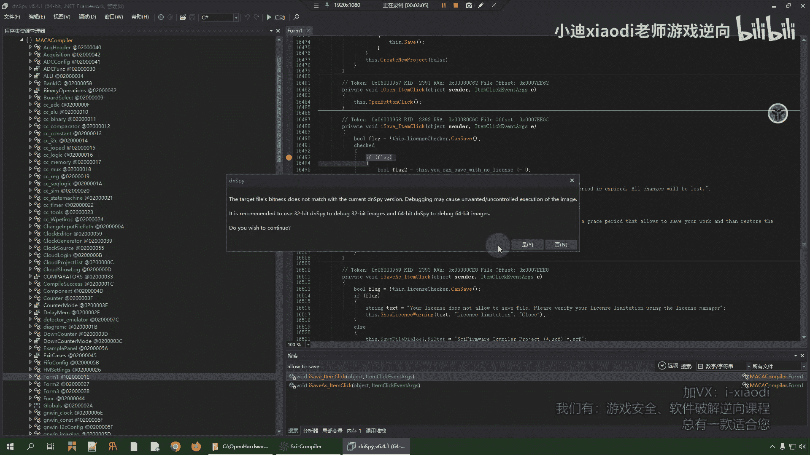

最初级的破解思路是直接改跳转。代码里有一个跳转，如果让它不进入报错分支，而是直接进入允许保存的代码逻辑，就可以绕过提示。也可以进一步在运行时观察 `flag` 的值，再把校验结果改掉。以下是两种思路的对比，先建立概念，再进入动态调试。

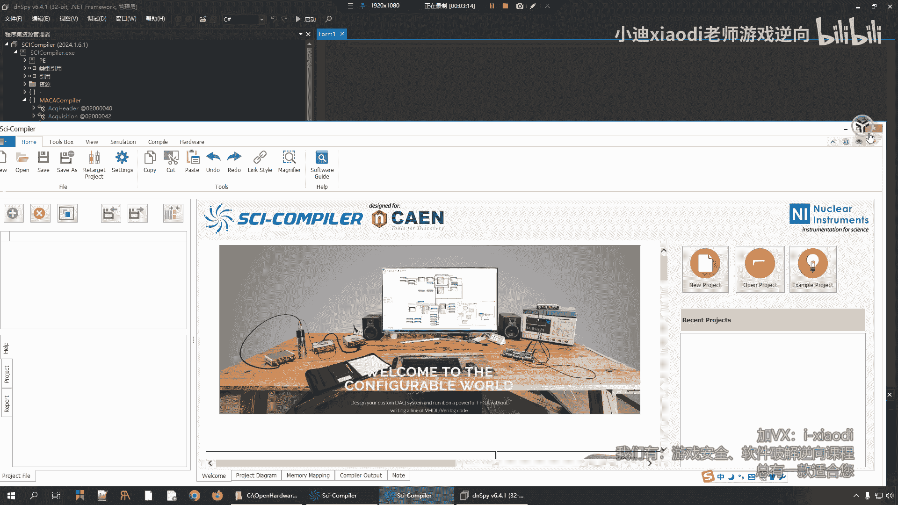

- 思路一：修改跳转，让程序不走报错分支。
- 思路二：修改校验结果，例如把 `flag = true` 改为 `flag = false`。
- 共同目标：让保存操作不再被许可证校验拦截。
- 学习顺序：先尝试简单跳转，再观察运行时变量。

上一节我们制定了破解思路，本节中我们通过断点和动态调试来验证思路。动态调试可以让我们看到程序运行到校验位置时的真实状态。

## 软件逆向破解实战教程：05：🛠️ 动态调试并修改校验结果

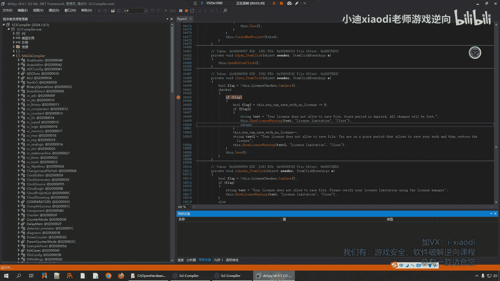

上一节我们制定了破解思路，本节中我们通过断点和动态调试来验证思路。动态调试可以让我们看到程序运行到校验位置时的真实状态。在函数中下断点，然后点击启动，点击确定，点击试，程序会运行起来。这个程序有好几个校验，稍等片刻还会自动弹出一个校验，这个自动弹出的校验不用管。大概等待 20 秒左右，第一个校验会出现，关闭即可。主要关注保存文件相关的校验：点击 C 触发保存操作，程序会中断在断点处。此时查看 `flag`，可以看到它的值为 `true`。把 `flag` 直接改成 `false`，然后执行程序，就可以正常保存文件。

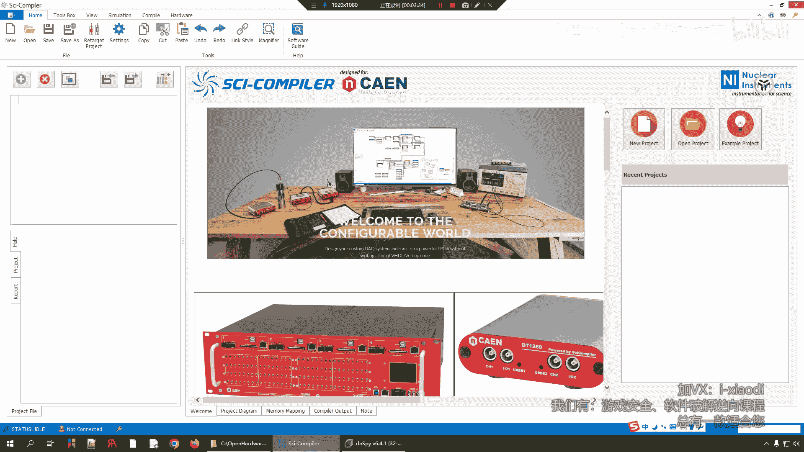

为了帮助初学者理解，这里把动态调试的关键步骤整理如下。断点的作用是在程序运行到指定代码行时暂停，方便查看变量和修改流程。

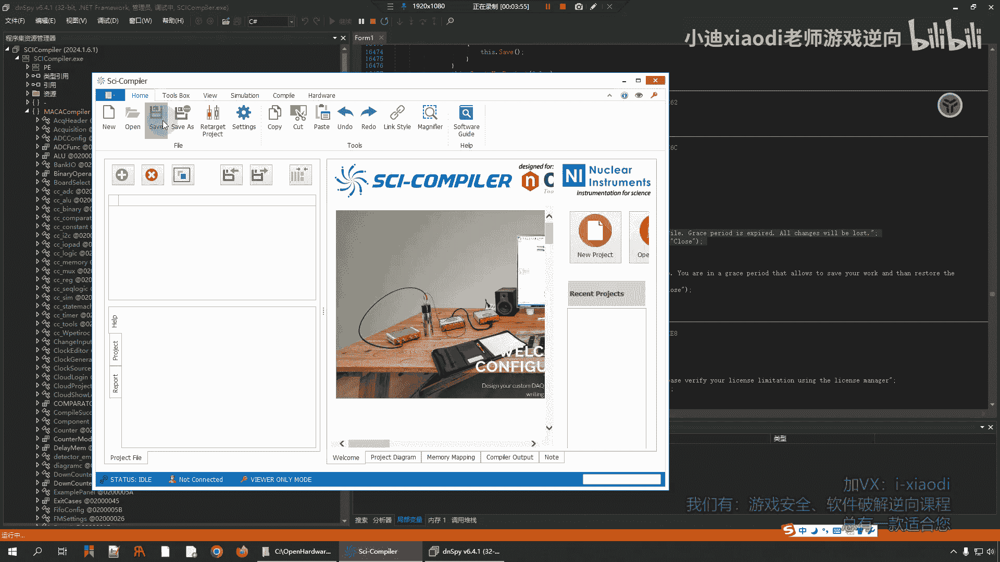

- 下断点：在保存校验函数中设置断点。
- 启动程序：点击启动，再点击确定，并完成原文提到的点击试确认操作。
- 等待校验：程序有多个校验，约 20 秒后出现第一个校验，关闭即可。
- 触发保存：点击 C，让程序进入保存校验。
- 观察变量：程序中断后查看 `flag`，当前值为 `true`。
- 修改结果：把 `flag` 改为 `false`。
- 验证效果：继续执行，软件可以正常保存文件。

整个操作可以用一个简化的代码片段表示。核心不是死记步骤，而是理解“校验结果控制分支”这个模型。

```text
if (flag == true) {
    // 当前校验失败，弹出不允许保存文件
} else {
    // 修改后进入允许保存分支
}

破解操作：flag = false
```

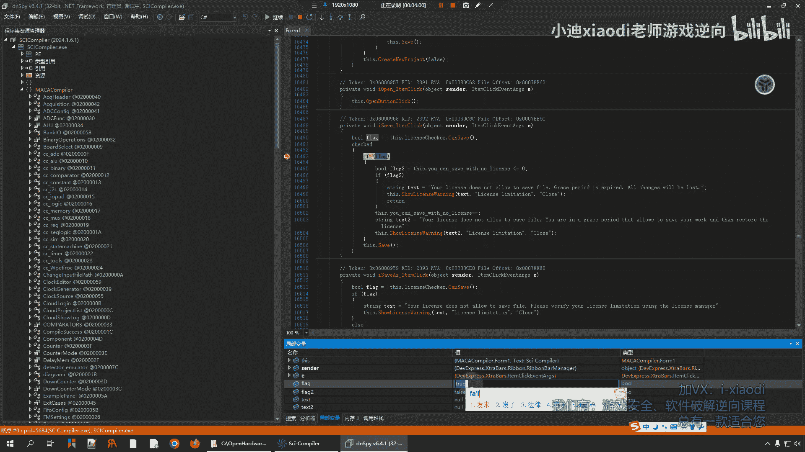

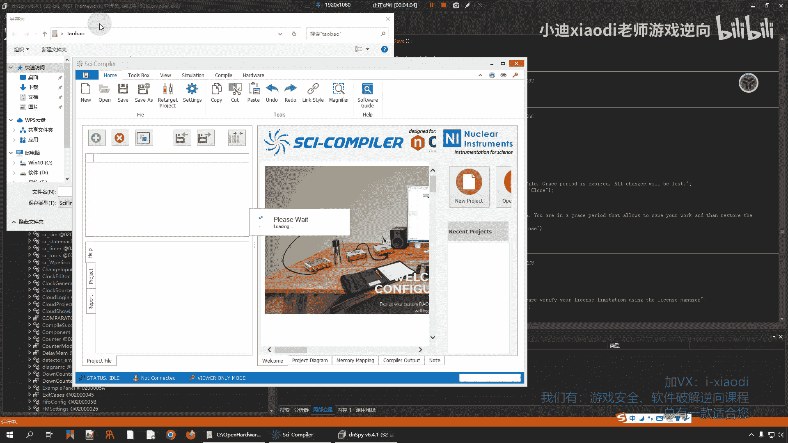

上一节我们完成了初步破解，本节中我们对整个流程进行总结，并说明后续学习方向。这个案例展示的是最基础的字符串定位、函数分析和运行时修改方法。

## 软件逆向破解实战教程：06：📌 总结与后续学习

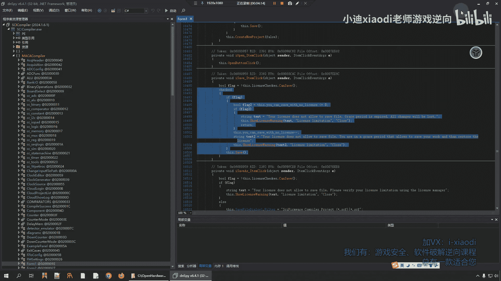

本节课中我们一起学习了软件保存校验的初步破解流程：先观察未注册保存时的提示，再判断程序是 .NET 程序，选择 DNSPY，通过字符串 `allow to save file` 定位 `saveItem_Click` 和 `saveAsItem_Click`，分析许可证判断逻辑，最后通过断点动态调试，把 `flag` 从 `true` 改成 `false`，从而让软件正常保存文件。这个方法比较直接，适合初学者理解逆向破解的基本思路。

当然，也存在更高级的破解方法。想学习更高级的破解方法，欢迎联系加入学习。加入后可永久学习、永久观看、永久服务、永久答疑。以上内容就是本次教程的完整整理，下期再见，拜拜。

