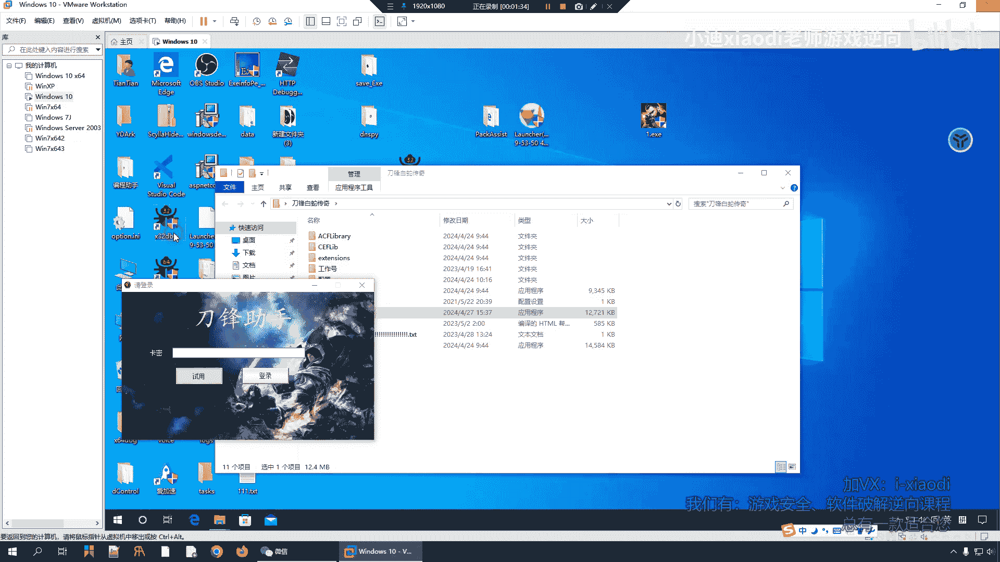
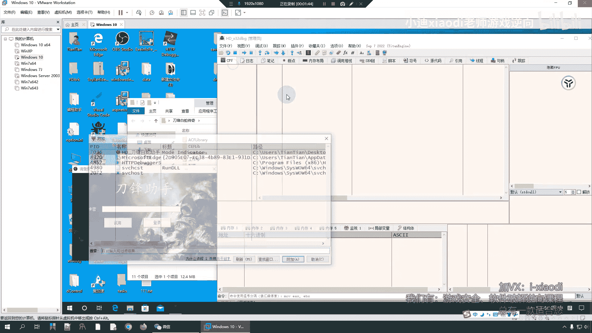
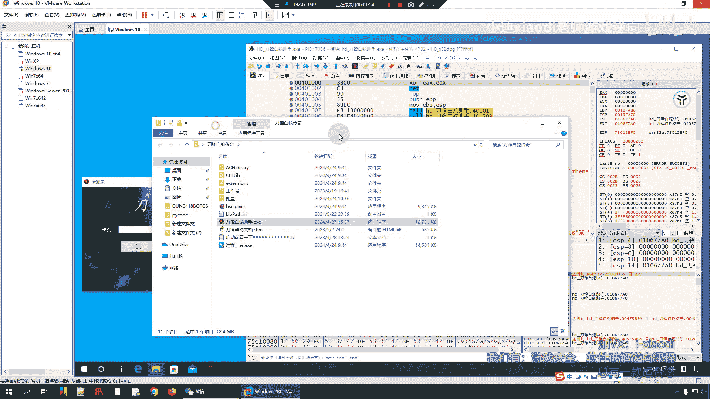
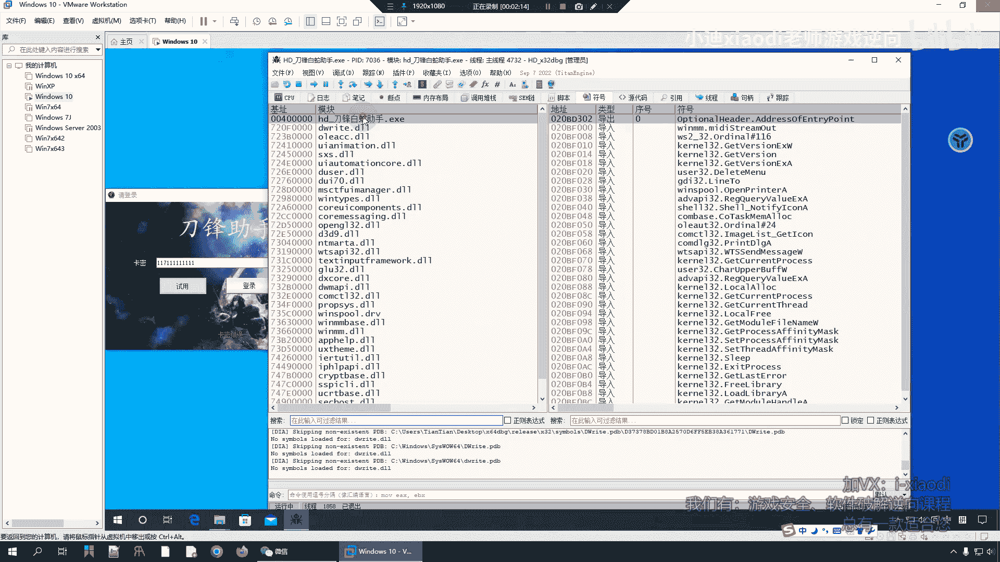
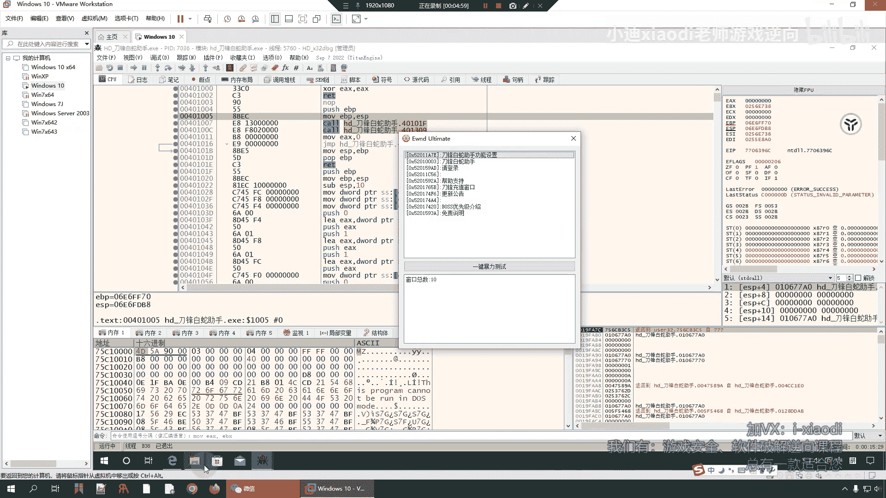
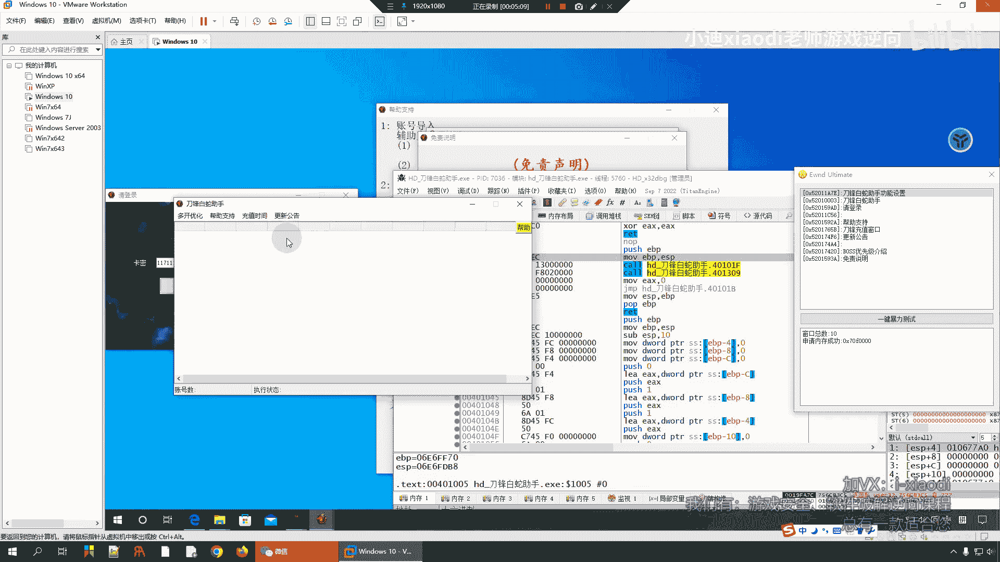
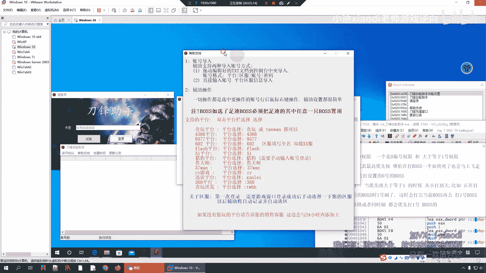
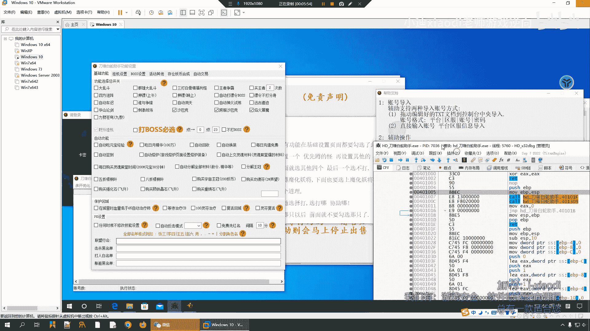
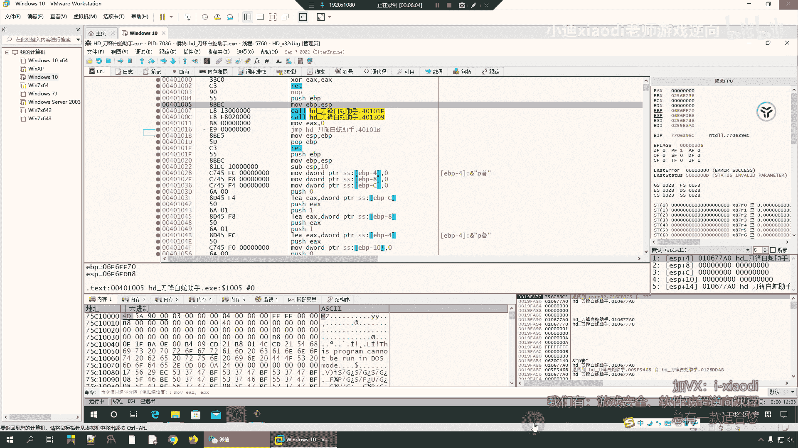

# 📚 软件安全逆向破解入门：第1章：卡密辅助软件分析与爆破 🛡️


## 🎯 概述

大家好，我是小李老师，专门讲授软件安全逆向破解相关的课程。本节课中，我们将要学习如何对一个带有卡密验证的辅助软件进行逆向分析与爆破。整个分析过程分为几个阶段：准备工具并加载目标程序，静态识别程序类型和加壳情况，动态附加进程并搜索关键字符串，解读字符串信息，最后利用EWND插件暴力开启功能窗口。这个案例非常适合初学者，因为目标程序没有任何保护，属于最基础的逆向场景。只要跟着完整操作一遍，你就会发现，软件安全逆向并没有想象中那么神秘。


## 💡 软件安全逆向破解能做什么

在动手分析之前，先来解决一个很多人心中的疑问：软件安全逆向破解到底能干什么？很多同学可能比较纳闷，为什么讲软件安全逆向破解，会有这么多人听？简单来说，这门技术就是通过分析一个程序的内部结构和运行逻辑，搞清楚它是怎么实现的，然后找到其中的薄弱环节，加以利用。举一个具体的例子，我们今天准备了一个辅助软件，这个辅助软件在使用之前，需要输入卡密。在网络上，这种带卡密验证的软件非常多，很多同学都想着自己去研究一下，看看人家的软件到底是怎么实现的，验证逻辑能不能绕过。

要完成这样的研究，需要两样东西，分别是相关的工具和相关的知识。这两样东西都可以通过加入社区来获取。工具方面，社区的工具包里面直接提供了现成的分析工具；知识方面，社区也提供了成套的课程。有了工具和知识，我们就可以手把手地分析这个软件了。接下来要做的事情非常明确，就是看看有没有什么简单的方法，能够直接使用这个软件的全部功能。


## 🧰 准备工具与加载目标程序

明确了目标之后，第一步就是准备工作，把目标程序加载到分析工具里面。怎么去分析这个软件？其实非常简单。社区工具包里面提供了一个现成的分析工具，我们直接把这个辅助软件的程序文件拖到工具窗口里面就可以了。如果说直接拖拽拖不过去，也不要紧，可以通过菜单去选择这个程序所在的路径，把程序打开。打开之后，工具会显示这个程序的一些基本信息，我们接下来就根据这些信息进行初步判断。


## 🔍 静态分析：程序类型与加壳情况

程序加载完成之后，就开始正式的静态分析了。所谓静态分析，就是在不运行程序的情况下，通过查看程序的静态特征来获取信息。首先看程序的类型。这里显示的是E language，也就是易语言。易语言是一个国产的中文编程工具，最大的特点就是使用中文进行编程。在之前的视频里面，我们其实讲到过易语言的概念，这里简单回顾一下，凡是易语言写的程序，在工具里面都会有明显的标识。这款程序的类型信息非常清晰，就是一个易语言程序。





然后看一下程序的区段信息。区段是理解程序结构的重要指标。这边很明显，区段信息显示这个程序没有加壳。加壳是什么概念？加壳相当于给程序穿了一层铠甲，目的是防止别人分析它的内部逻辑。一个程序如果加了壳，分析难度会大很多；反过来，没有加壳就意味着程序完全暴露在分析者面前，没有任何遮挡。我们可以把这款软件的情况用下面的代码总结出来：

```text
E语言(易语言) = 国产中文编程工具
加壳状态 = 未加壳
保护等级 = 无保护
目标难度 = 入门级
```

总结一下这款软件的特点，就是没有保护，它没有被保护起来。基于这一点，我们基本上可以断定，一个新手小白也完全可以处理掉这个程序。如果你加入了社区，跟着课程学习一两周，估计这种难度的软件就差不多可以搞定了。


## 🔎 动态分析：附加进程与字符串搜索





静态分析得出了无保护、新手可处理的结论，接下来就要进行动态分析了。我们把程序运行起来，看看它在运行过程中会暴露什么信息。先把程序运行起来。接下来怎么继续分析？社区里面同样提供了一款破解工具，在社区页面右下角可以找到。我们打开这个工具，点击文件菜单，点击附加选项。附加的意思是让调试器挂到正在运行的程序上，这样就能观察程序的一举一动。在弹出的进程列表里面，找到我们的目标程序，注意选择最上面那一个对应的进程。点击符号标签，双击这个符号条目，这样我们就定位到了这个程序的本体。为了方便后续操作，我们先把桌面图标隐藏起来。

回到程序界面，可以看到这个程序上面写着需要试用。我们不点击试用按钮，直接点击登录。点击之后，程序提示卡密错误。这说明程序必须输入正确的卡密，才能正常进入软件的功能界面。如果把它的验证流程抽象出来，可以用下面的代码来描述：

```text
卡密验证流程:
输入卡密 -> 程序发送请求 -> 服务器校验 -> 返回结果
结果 = 正确 -> 进入功能界面
结果 = 错误 -> 提示"卡密错误"
```

那么，我们可以怎么做？一般来说，我们回到破解工具，点击符号标签，切换到这个程序的模块。然后在当前模块上点击鼠标右键，选择搜索字符串，再选择搜索当前模块的字符串。为什么要搜索字符串？因为程序里面所有的提示文本都存放在字符串表中，把这些字符串搜索出来，就可以看到程序包含了哪些关键文本。当看到这些文本之后，基本上我们就可以断定很多东西了。


## 📋 关键字符串解读

字符串搜索结果出来了，里面有不少有用的信息。我们来一条一条地分析，看看这些文本到底透露了什么。

以下是一些典型的字符串以及它们对应的含义：

- "辅助正在运行"：这个提示说明你已经运行了一个辅助程序。也就是说，这台电脑同一时间只能运行一个辅助实例，防止多开。
- "BNB点TST"：这是一个网址字符串，这里面的"点"就是域名中的点号。我们把这个字符串复制下来，把前后的引号去掉，然后在浏览器里面打开它。打开之后可以看到一个数字4.05。这里的4.05就是版本号。也就是说，这个程序会把版本信息存放在服务器上，用来判断当前是不是最新版本。

到这里我们可以发现，这个程序的作者习惯用中文编程。因为前面提到过，这是一个用易语言开发的程序，作者在写代码的时候，变量名、文件名、提示文本全部使用中文或者拼音。这一点对逆向分析来说反而是个好事情，因为程序里所有文本都可以直接读懂，不需要猜测含义。再仔细看，还有一个"版本点TST"的字符串，它的含义是：在这个域名的服务器里面存放了一个版本号文件，记录着这个外挂程序的版本号。

继续往下看，还能看到其他一些信息。

以下是我们能够观察到的内容：

- 登录时间相关的字符串，记录用户登录的时间信息。
- 它支持的一些网络平台、网页平台的名称。
- 功能相关的说明文本，比如"请完整解压辅助"之类的提示。
- "卡号已被封停"：意思是如果你的卡号被封了，程序就会提示账号已被封停，无法继续使用。

综合这些信息来看，这个程序应该是通过发包的方式来获取服务器上的账号信息之类的数据。程序运行时，会向服务器发送请求，拿到账号状态、版本号、时间等信息。整体来说，软件的逆向破解是一个非常有意思、非常好玩的事情，每分析一个程序，就像拆开一个谜题一样。

当然，有一点必须说明白，我们并不能保证所有软件都能百分之百破解。社区的基础版是199元，高级版是249元，在加入社区学习之后，也不能保证任何软件都能搞定。比如说，你要去破解美国白宫的系统，那基本不太可能，这也不是说报名课程之后就直接去干白宫，这种想法根本不现实。对于网络上的普通软件，大概有百分之六十到百分之七十的概率，拿过来分析一下就能搞定。如果说某个软件的难度比较高，它是被保护起来的，搞不定的话，那就换一个目标就行了。这个思路和追对象是一样的，这个不行就换一个，没有必要一直当舔狗。舔狗必死，舔狗不得好死，执着于一个搞不定的目标没有任何意义。


## 💥 暴力破解：EWND插件开启功能窗口

到目前为止，在字符串搜索结果里面，我们还没有找到特别关键的验证逻辑信息，至少在小白的阶段，看不出太多关键的内容。那么，我们能不能暴力破解？答案是可以的。暴力破解的思路很简单，既然登录验证难以绕过，那就干脆不登录，直接想办法把程序的功能窗口全部打开。社区提供的破解工具里面，正好有一个功能可以做到这一点。

下面是通过EWND插件暴力开启功能窗口的具体步骤：





1. 打开社区提供的破解工具，确保目标程序正在运行。
2. 点击插件菜单，找到EWND插件。
3. 点击EWND插件中的Open Window选项。
4. 插件会自动枚举这个程序所有的功能窗口。
5. 我们完全不需要登录外挂程序，直接选择暴力测试，点击开启按钮。



执行完这些操作之后，我们直接就进入了辅助软件的功能界面，界面里面所有的功能都可以直接使用了，基本上不需要任何额外的操作。看一下这些功能：技术功能、沙巴克、确定取消、自动冬天、跨服沙巴克、焰火头模等等，内容非常丰富。整个过程用代码来描述就是：

```text
EWND插件 -> Open Window -> 枚举全部功能窗口 -> 暴力开启 -> 绕过登录验证
```

到这里，这个辅助软件的卡密验证就被完全绕过了，程序的所有功能都暴露在我们面前。


## 🎓 学习路线与总结



演示结束了，最后来说一下学习路线，并且对整节课做一个总结。想要学习软件安全逆向相关技术的同学，一定要抓紧时间了。这个月社区依然有优惠活动，基础版199元，高级版249元，详情可以联系右下角了解。基础版和高级版的差别在哪里？差别在于高级版多了一门C语言Windows程序开发课程。我们的毕业设计就是这样一个辅助程序的开发，从头到尾把整个程序写出来。基础版199元，高级版249元，两者只差了50元，绝对是物美价廉的选择。



本节课中，我们一起学习了如何对一个卡密辅助软件进行完整的逆向分析。首先，我们了解了软件安全逆向破解的用途。然后，我们加载了目标程序，识别出这是一个易语言程序，并且没有加壳。接着，我们附加到运行中的进程，搜索了关键字符串，解读了版本号、平台信息、封号提示等内容。最后，我们使用EWND插件暴力开启了功能窗口，直接绕过了卡密验证。这一整套流程就是游戏安全、软件安全、网络安全和CTF比赛中非常常见的基础操作。我们用短短5分钟的时间，就把这个完整的分析过程讲解完了。这个视频既是给大家做一个简单的演示，也算是一个小小的推广，同时也带给大家一些不错的小知识点。如果有什么疑问，或者想要学习相关的知识，可以联系右下角。我们下期再见。
