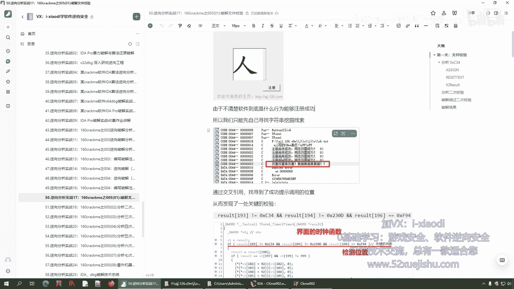
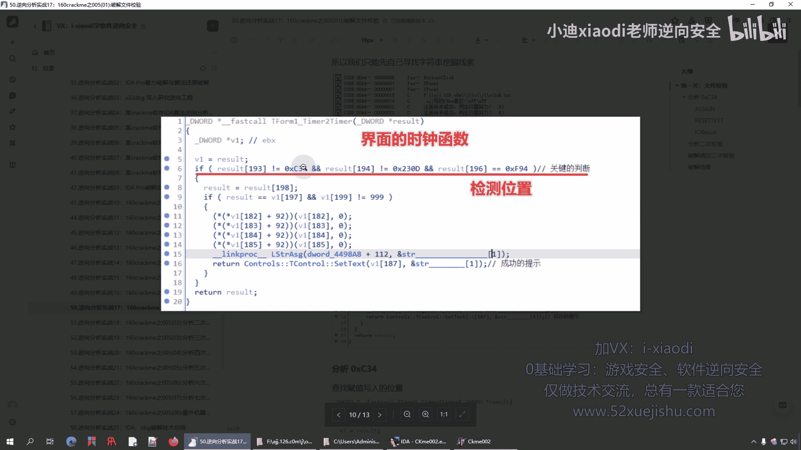
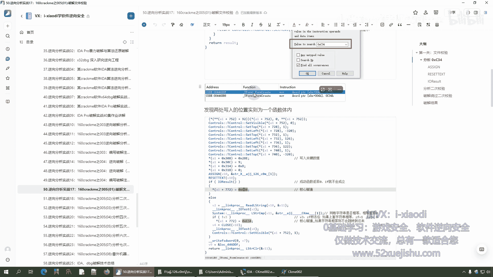
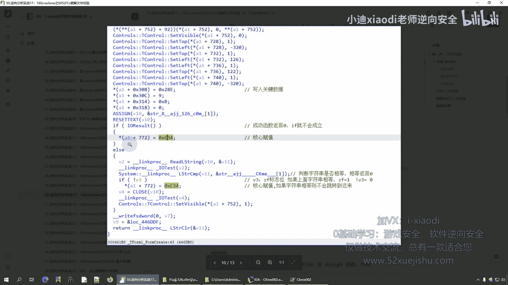
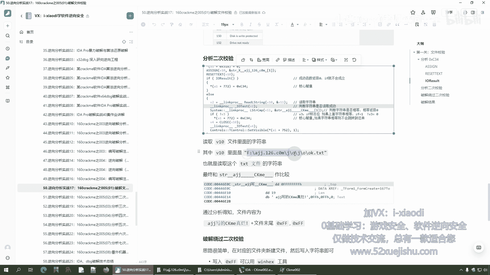
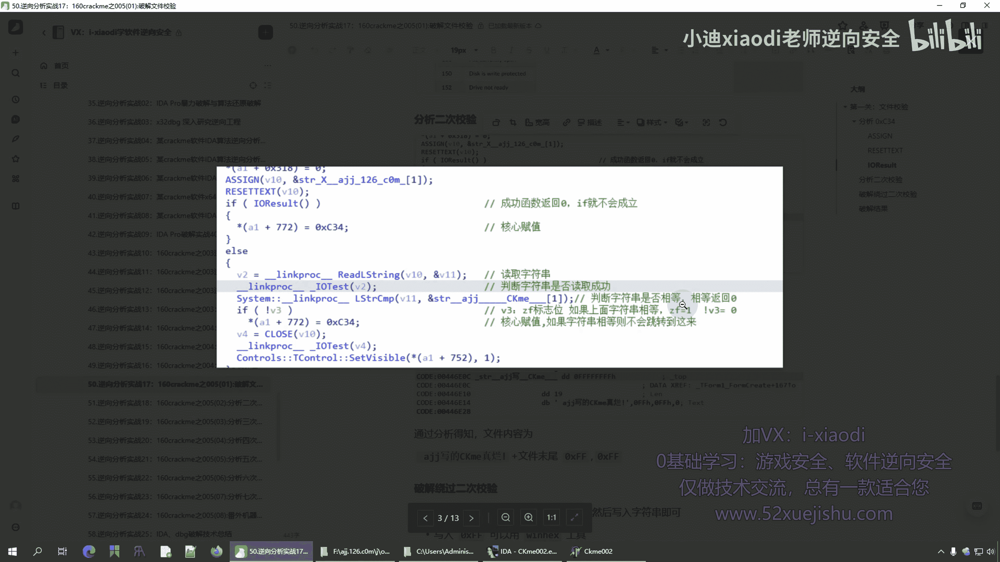
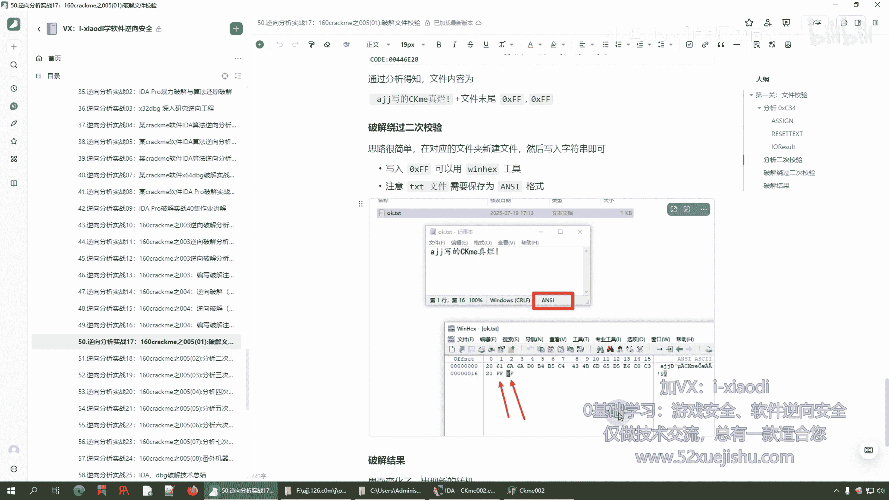

# 汇编逆向分析实战：005（01）：利用 IDA Pro 破解文件校验 🔍

## 📚 课程概述

本节课学习如何使用 IDA Pro 分析一个简单的文件校验程序，并通过定位字符串、查看交叉引用、分析条件判断，找到程序注册成功的关键逻辑。

本案例属于 160 Crackme 系列的第 005 题第 1 集，主题是破解文件校验。通过本节内容，可以掌握文件读取、字符串比较、条件分支分析等基础逆向知识，这些内容也是游戏安全、软件安全、网络安全和 CTF 比赛中的基础技能。

在观看分析过程前，建议先自行尝试破解程序。破解成功后的结果是界面中会多出一个编辑框。完成自己的分析后，再对照本节教程检查思路，看看是否遗漏了某个关键点，也可以比较自己的方法与教程中的方法有什么不同。

如果暂时无法破解，也可以直接按照本节教程补充相关知识点。接下来，我们先观察程序的运行效果。


## 🖥️ 一、观察程序运行界面

上一部分介绍了本节课的学习目标，下面先从程序本身入手，了解它在正常运行时的表现。

这个程序启动后，界面中包含以下几个主要部分：

- 一个编辑框；
- 右下角的一个按钮；
- 中间的一个图片框。

图片框会循环播放以下几张图片：

```text
人之初
性本善
性相近
习相远
```

图片移动的方向并不固定，有时向右移动，有时向左移动，有时向上移动，有时向下移动。因此，图片框不仅会循环显示图片，还会不断改变运动方向。

当我们点击图片时，程序会弹出提示：

> 注册尚未成功，同志仍需努力。

这说明当前输入或当前运行状态还没有满足程序的注册条件。要让注册成功，需要进一步分析程序内部的校验逻辑。


## 🧭 二、通过字符串搜索寻找线索

已经确认程序存在“注册成功”和“注册失败”的提示，下一步就可以从字符串入手寻找关键代码。

逆向分析时，字符串通常是非常重要的线索。程序界面上显示的提示文字，往往会直接存储在程序的数据区中。通过搜索这些字符串，可以快速定位负责显示提示的代码位置。

本例中，可以使用 IDA Pro 搜索以下提示文字：

```text
厉害厉害真厉害
佩服佩服真佩服
```

找到字符串后，再通过交叉引用查看哪些代码使用了它们。这样就可以定位到“注册成功”提示被调用的位置。

成功提示所在的代码大致位于界面时钟函数中。也就是说，程序会在定时器或时钟事件触发时，检查当前状态是否满足注册条件。

在这个函数中，可以发现，成功提示要显示出来，必须同时通过多项校验。当前代码中大约有 5 个关键条件，可以将它们概括为：

```text
条件 1
条件 2
条件 3
条件 4
条件 5
```

只有这些条件满足后，程序才会执行注册成功的提示逻辑。因此，接下来需要逐个分析这些条件。


## 🧩 三、分析变量 C34 的赋值位置

上一节已经定位到注册成功提示所在的函数，本节先分析其中一个关键变量 `C34`。

首先，可以在 IDA Pro 中查找常量 `C34`，观察哪些代码对它进行了写入。通过搜索可以发现，一共有两行代码会对 `C34` 进行赋值。

这两处写入虽然位于不同位置，但实际上都在同一个函数体内，也就是窗口创建函数 `TFormCreate` 中。

可以将相关逻辑简化为以下形式：

```c
if (条件 A) {
    C34 = 某个值;
}

if (条件 B) {
    C34 = 另一个值;
}
```

这说明，`C34` 是否能够被正确赋值，取决于上方条件或下方条件是否成立。

下方的代码较多，其中还包含一个比较异常的分支。该分支中可以看到类似 `B` 的判断，后续还需要重点分析。为了先掌握整体逻辑，我们先分析上方条件中涉及的文件操作函数。


## 📄 四、分析文件路径绑定与文件打开过程

在上方代码中，第一个关键操作是 `Assign`。这个函数的作用比较简单，就是把右侧的文件路径绑定到左侧的文件变量上。

可以用下面的伪代码表示：

```pascal
Assign(FileVariable, FilePath);
```



其中：

- `FileVariable` 表示程序内部使用的文件变量；
- `FilePath` 表示要操作的文件路径。



也就是说，程序会把某个文件路径绑定到指定的文件变量上。完成绑定之后，程序继续调用 `Reset` 函数打开这个文件。

其逻辑可以表示为：



```pascal
Assign(FileVariable, FilePath);
Reset(FileVariable);
```

`Reset` 通常用于打开已经存在的文件，并准备从文件中读取内容。在本例中，程序会以文本读取模式打开前面绑定好的文件，然后从文件中读取字符串。

文件是否成功打开，通常会通过 `IOResult` 进行判断。它的基本规则如下：

```pascal
IOResult = 0    // 操作成功
IOResult != 0   // 操作失败
```

如果文件打开成功，返回值就是 `0`。此时，类似下面的判断：

```pascal
if IOResult <> 0 then
begin
    // 文件打开失败时执行
end;
```

就不会进入分支，因为 `IOResult` 等于 `0`，条件不成立。

因此，文件打开成功后，失败分支中的赋值操作不会执行。分析重点就应该放在文件成功打开之后的代码。


## 🔤 五、分析字符串读取与比较逻辑

文件成功打开后，程序会读取文件中的字符串。相关操作可以概括为以下流程：

```pascal
ReadString(FileVariable, Buffer);
```

这里的 `ReadString` 用于读取文件中的字符串，并将读取结果保存到变量 `Buffer` 中。

程序读取字符串后，还会判断读取操作是否成功。读取完成后，程序继续进行字符串比较，将文件中的内容与程序内置的目标字符串进行比较。

伪代码如下：

```c
read_string(file, buffer);

if (compare(buffer, target_string) == 0) {
    // 字符串相同，校验通过
}
```

字符串比较函数返回 `0`，通常表示两个字符串完全相同。因此，本例中的核心校验条件可以写成：

\[
\text{compare}(\text{文件内容}, \text{目标字符串}) = 0
\]

只要文件中读取出来的字符串与程序要求的字符串完全一致，就可以通过这一项校验。

结合前面的文件操作，可以将完整逻辑整理为：

```pascal
Assign(FileVariable, FilePath);
Reset(FileVariable);

if IOResult = 0 then
begin
    ReadString(FileVariable, Buffer);

    if Compare(Buffer, TargetString) = 0 then
    begin
        // 当前文件校验通过
    end;
end;
```



由此可以看出，破解方法已经比较明确：需要创建程序要求的文件，并在文件中写入指定字符串。


## 🛠️ 六、创建校验文件并写入目标内容

上一节已经确定了程序会读取某个文件，并将其中的字符串与目标内容进行比较。现在只需要按照程序要求创建文件，就可以满足这部分校验。

具体步骤如下：

1. 根据程序中的路径确定文件位置。

2. 按照该路径创建对应的文件。

3. 将程序要求的字符串写入文件。

4. 保存文件后重新运行程序。

核心条件可以总结为：

```text
文件路径正确
AND
文件能够成功打开
AND
文件内容与目标字符串完全一致
```

也可以用公式表示：

\[
\text{校验通过}
=
(\text{文件存在})
\land
(\text{文件可读取})
\land
(\text{文件内容} = \text{目标字符串})
\]

需要注意，目标字符串最后的 4 个 `F` 不能直接通过普通文本输入方式写入。这里的内容需要借助外部编辑工具进行修改，例如使用十六进制编辑工具打开对应的文件。

操作流程如下：

1. 使用十六进制编辑工具打开刚刚创建的文件。

2. 将文件内容修改为程序要求的字符串。

3. 在文件末尾追加两组 `FF`。

4. 保存修改后的文件。



可以将文件末尾处理形式表示为：

```text
目标字符串 + FF FF
```



这里的 `FF` 是十六进制编辑器中显示的字节内容。直接在普通文本编辑器中输入字符 `F`，并不等同于写入十六进制字节 `FF`，因此必须使用外部十六进制编辑工具完成最后的修改。


## ✅ 七、运行程序验证破解结果

文件处理完成后，再次运行程序进行验证。

如果文件路径、文件内容和文件末尾的数据都符合程序要求，程序界面会发生变化，原本的界面中会多出一个编辑框。

验证结果可以概括为：

```text
文件校验成功
    ↓
校验条件满足
    ↓
程序执行成功分支
    ↓
界面新增编辑框
```

运行后，如果看到界面中出现新的编辑框，就说明本次文件校验已经破解成功，程序成功进入了新的状态。


## 📝 本节总结

本节课中，我们一起分析了一个基于文件内容的注册校验程序。

首先，我们观察了程序的界面和运行效果，确认程序包含编辑框、按钮和循环移动的图片。随后，通过搜索“厉害厉害真厉害”和“佩服佩服真佩服”等字符串，利用交叉引用定位到了注册成功提示所在的代码位置。

接着，我们分析了程序中的多个校验条件，并重点研究了变量 `C34` 的赋值逻辑。通过分析 `Assign`、`Reset`、`IOResult`、`ReadString` 和字符串比较操作，最终确定程序会读取指定路径下的文件，并将文件内容与目标字符串进行比较。

本次破解的核心逻辑可以总结为：



```pascal
Assign(FileVariable, FilePath);
Reset(FileVariable);

if IOResult = 0 then
begin
    ReadString(FileVariable, Buffer);

    if Compare(Buffer, TargetString) = 0 then
    begin
        // 注册成功
    end;
end;
```

最后，我们按照程序要求创建文件，写入目标字符串，并使用十六进制编辑工具在文件末尾追加两组 `FF`。重新运行程序后，界面中出现了新的编辑框，说明文件校验已经成功破解。

本节内容主要围绕字符串搜索、交叉引用、文件操作和条件分支展开，是逆向分析入门中比较基础但非常实用的一类案例。下一集将继续分析后续内容。

