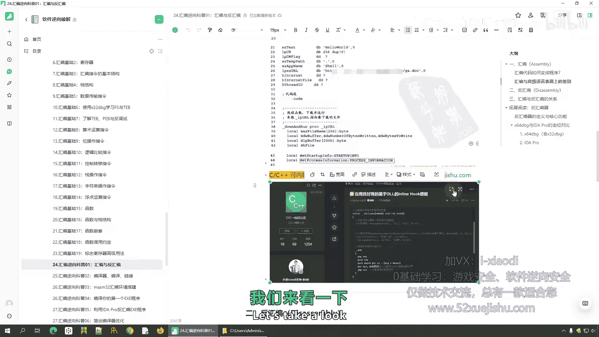
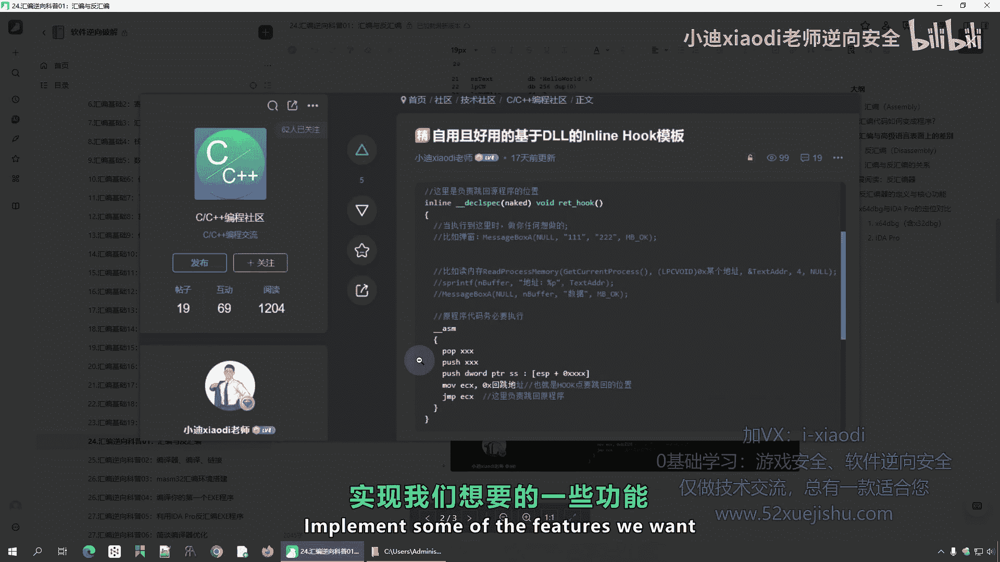
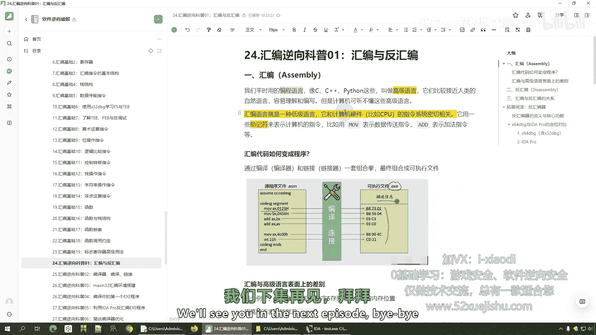

# 汇编逆向科普：01：深入浅出介绍汇编与反汇编 🧭

## 本节概述 📌

在本节课中我们将要学习汇编语言与反汇编的基础内容。这节课的内容非常重要，大家一定要看完。我们会先建立整体框架，再逐步深入，刚开始不需要记住所有细节，先理解每个概念在逆向分析中的位置即可。

本节会先说明什么是汇编语言、什么是编程语言、高级语言和低级语言如何区分，再介绍汇编语言的应用场景和汇编代码如何变成程序；随后进入反汇编部分，说明机器码、反汇编工具、反汇编的难点与局限、汇编与反汇编的关系，以及常见工具和拓展阅读。下面就开始进入正题。

## 汇编逆向科普：01.1：汇编语言与编程语言 🧩

上一节我们做了整体概述，本节中我们来看看汇编语言到底是什么。汇编是一种编程语言。所谓编程语言，就是能够用来编写程序的语言。语言本身则是一种能够叙述和表达意思，同时能够传达某种指令的形式，比如中文和英文。放到计算机里，编程语言分为高级语言和低级语言。高低如何区分，是本节要讲清楚的问题。

高级语言和低级语言的区分方式可以用公式概括如下。

\[
\text{高级语言} \approx \text{接近人类自然语言、容易理解和编写}
\]

\[
\text{低级语言} \approx \text{接近计算机硬件、机器更容易理解、人类更难理解}
\]

换句话说，高级语言比较接近人类的自然语言，容易理解和编写，具备这种特征的语言就是高级语言，比如C语言、C++、Python。低级语言则更接近计算机硬件，汇编语言就是这种低级语言。计算机硬件更容易理解汇编语言，但人类不太容易理解。反过来说，如果汇编也像高级语言一样容易理解，前面学习时就不会感到那么枯燥。

举个例子：如果想让计算机把一个数字放到一个位置，高级语言可能写成下面这样。

```c
A = 5;
```

这种写法就跟数学课本里的A等于5差不多，非常简单。用汇编语言则要写类似mov的指令。mov是移动的意思，把5移动到左边，再用逗号分隔开。代码如下。

```asm
mov 目标位置, 5
```

这种写法看起来较为复杂，实际上汇编会更复杂，这里只是简单示意。

关于汇编语言的定义，前面基本讲过：汇编语言使用助记符替代机器指令。它还高度依赖CPU架构，版本不一样，可能存在一些区别。可以用下面这个关系来理解。

\[
\text{汇编语言} \approx \text{助记符} + \text{特定CPU架构/指令集}
\]

## 汇编逆向科普：01.2：汇编语言的应用场景 🛠️

上一节我们介绍了汇编语言的定义和它依赖CPU架构的特点，本节中我们来看看汇编语言通常用在哪些场景。理解应用场景有助于明白为什么今天仍要学习汇编，也有助于理解逆向分析为什么离不开汇编。以下是汇编语言的主要应用场景。



- 早期直接编写程序。早期C语言还没有发明出来，只能用汇编去写；或者说C语言已经发明出来，但某个公司的项目对性能要求比较高，也会采用汇编语言。原因是汇编语言更接近计算机硬件，效率要高一些。
- 现代用汇编编写程序。某些逆向书籍，比如《Windows PE权威指南》，这是一本关于逆向的书，里面很多案例都是用汇编代码编写的。
- 高级语言中的内联汇编。高级语言比如C、C++可以内联汇编，去操作数据并实现相应功能。
- 论坛中的额外代码示例。这个示例展示的是在C++里面配合汇编进行编写，实现想要的一些功能。



这些场景可以用一个简单关系来概括。

\[
\text{汇编应用} \approx \text{早期直接编写} + \text{性能敏感项目} + \text{现代逆向书籍案例} + \text{高级语言内联汇编}
\]

## 汇编逆向科普：01.3：汇编代码如何变成程序 ⚙️

上一节我们介绍了汇编语言的应用场景，本节中我们来看看汇编代码如何被编成程序。这里有一个问题：现在有一个代码文件，代码文件怎么才能变成一个可执行程序。示例中可以看到，这就是一个代码文件。这个代码文件运行后会弹出一个信息框，信息框的内容是“我的哔哩哔哩”和“我的微信”，会弹出这样一个提示。最终生成的可执行程序就是这样的效果。

很多同学可能会有疑问：它是怎么从代码文件变成这个程序的。实际上是通过编译和链接这套组合流程，最终组合成可执行文件。编译过程由编译器负责，链接过程由链接器负责。关于这部分内容，后面会带大家编写自己的程序。现在简单理解一下，它是通过编译和链接最终形成可执行文件就可以了。后面会对编译链接做非常详细的讲解，大家可以先预习。

核心流程可以用下面的代码描述。

```text
源代码文件 --编译（编译器）--> 目标文件 --链接（链接器）--> 可执行文件
```

## 汇编逆向科普：01.4：反汇编与机器码 🔍

上一节我们介绍了汇编代码如何变成程序，本节中我们来看看第二部分：反汇编。首先要知道一点：计算机运行的程序无论是否正在运行，最终都以机器码的形式存在于计算机中。机器码就是一串0101的二进制代码。这种二进制代码人类不认识，因此要借助反汇编工具。反汇编工具可以通过反汇编器，将机器码或者说将0101还原成汇编代码。

这个过程可以用公式表示。

\[
\text{机器码（0101二进制）} \xrightarrow{\text{反汇编器}} \text{汇编代码}
\]

以下是反汇编工具的体验步骤。

- 使用IDA Pro（口述中也称IDpro、Ipro）体验还原效果。把程序拖入工具，直接点击O，然后对照自己的源代码，查看它还原得像不像。可以看到，还原效果非常不错。
- 使用x32dbg或x64dbg（口述称叉32DBG、叉64DBG）体验还原效果。点击文件，点击附加，切换到程序的主模块，查看还原效果，再对照源代码。可以看到，还原效果也非常不错。

刚才讲解的两个工具，一个是IDA Pro，一个是x64dbg，它们就属于反汇编工具。现在也就知道了，反汇编实际上是逆向的一个过程，就是反向还原的过程，把机器码还原成汇编代码。这里的重点先放在观察还原效果上，不需要一开始就完全读懂每一行汇编。

## 汇编逆向科普：01.5：反汇编的难点与局限 ⚠️

上一节我们体验了反汇编工具，本节中我们来看看反汇编的难点与局限。反汇编具备一定的难点和局限。程序生成过程有一个编译和链接的过程，编译由编译器实现。编译器有时会对代码进行优化，优化之后会破坏程序原来的逻辑，增加反汇编后的理解难度。因此要记住一点：反汇编结果并不等于原先程序的代码，它只具备一定的参考性。这个结论可以用公式表示。

\[
\text{反汇编结果} \neq \text{原始源代码}
\]

\[
\text{反汇编结果} = \text{可参考的近似还原}
\]

以下是两个需要记住的难点与局限。

- 编译器优化会破坏原来的逻辑，增加理解难度，所以反汇编结果只具备参考性。
- 平台依赖。反汇编需要针对特定架构，不同CPU的代码不太一样。还是刚才这个程序，还是刚才这个工具，把程序拖过来。默认一般选择英特尔，向上翻到指定位置，点击O并点击yes后，会发现代码跟刚才完全不一样，很多东西识别不出来。原因是CPU的指令集不一样，所以识别会出错。

平台依赖也可以用公式概括。

\[
\text{反汇编结果依赖} = \text{CPU架构} + \text{指令集}
\]

## 汇编逆向科普：01.6：汇编与反汇编的关系 🔄

上一节我们介绍了反汇编的难点与局限，本节中我们来看看汇编与反汇编的关系。汇编与反汇编肯定是互补的、相辅相成的关系。反汇编是逆向分析的核心步骤，用于漏洞挖掘、恶意软件分析等多种场景。比如做软件逆向时，软件发布时像QQ、微信发布给我们时，肯定只有可执行的软件版本，没有源代码。微信逆向并不是把微信源代码发给你让你逆向，而是针对微信的反汇编进行逆向分析，也就是这个意思。

通过反汇编可以得到汇编代码，从而分析程序具体的执行逻辑。以下是典型的分析目标。

- 防止微信撤回。
- 抓取用户微信ID。
- 分析程序怎么处理用户输入。
- 分析程序怎么和服务器通信。
- 分析有没有加密算法，以及是怎么加密的。

利用反汇编技术，可以了解软件内部的工作原理，找到一些软件漏洞，或者实现破解、修改软件功能等操作。因此汇编语言知识非常重要，理解了汇编语言才能更好地看懂反汇编，从而进行更好的逆向分析。这个关系可以用公式表示。

\[
\text{逆向分析能力} \approx \text{汇编语言理解} + \text{反汇编结果分析}
\]

## 汇编逆向科普：01.7：反汇编相关工具与拓展阅读 🧰

上一节我们介绍了汇编与反汇编的关系，本节中我们来看看相关工具和拓展阅读。相关工具只需了解两款，一个是x64dbg，另一个是IDA Pro。有同学会问：反汇编器看到了，IDA调试器看到了，x64dbg也看到了，那反编译器是什么。这里需要区分：反汇编器是把机器码也就是0101还原成汇编代码的工具；反编译器是把机器码还原成高级语言的工具。

两者的区别可以用公式表示。

\[
\text{机器码} \xrightarrow{\text{反汇编器}} \text{汇编代码}
\]

\[
\text{机器码} \xrightarrow{\text{反编译器}} \text{高级语言代码}
\]

反编译器就是将机器码还原成高级语言的一种工具。比如还是这个程序，还是这个工具自带的功能，把程序拖过来并点击后，此时看到的是汇编代码。按一下F5键，这个工具自带该功能，就可以把刚才的汇编代码直接还原成C语言代码，这里看到的就是C语言代码。这个功能简单了解即可。

以下是课后拓展阅读建议。

- 课后阅读反汇编器相关的知识，进一步理解反汇编工具的工作原理和使用方式。

## 本节总结 🧾

本节课中我们一起学习了汇编语言与反汇编的基础内容。我们理解了汇编是一种低级编程语言，编程语言分为高级语言和低级语言，高级语言接近自然语言、容易理解和编写，低级语言更接近硬件；也了解了汇编语言依赖CPU架构，常见应用场景包括早期直接编写、性能敏感项目、现代逆向书籍案例和高级语言内联汇编。



我们还学习了汇编代码如何通过编译和链接变成可执行文件，以及反汇编如何把机器码还原成汇编代码。反汇编存在编译器优化和平台依赖等难点与局限，反汇编结果只具备参考性，并不等于原始源代码。汇编与反汇编是互补关系，理解汇编语言才能更好地看懂反汇编，从而更好地进行逆向分析。本节课到这里结束，下节课再见。

