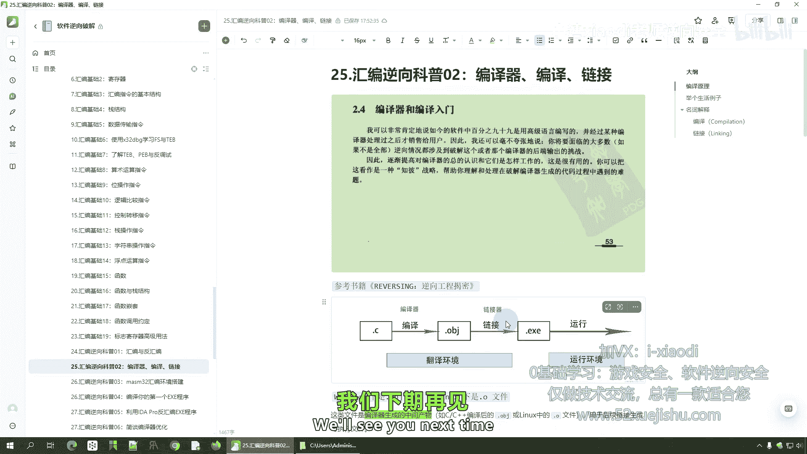

# 🧭 汇编逆向科普：02：编译器、编译与链接

在本节课中我们将要学习编译器、编译和链接，同时理解软件逆向安全、逆向破解和游戏逆向为什么需要这些基础。本节内容比较重要，如果希望有比较长远的发展，今天的内容务必知道。我们可以先记住一个总体认识：如今的软件中，99%是用高级语言编辑，并经过某种编译器处理之后才销售给用户。上一节已经讲过，高级语言就是接近人类表达方式的编程语言，例如C语言、C++、Python。高级语言经过编译器编译、链接器链接，这套组合流程可以生成EXE可执行程序；程序可以执行，也可以销售给用户。QQ、微信这类产品是免费的，腾讯公司也是把源代码文件编译链接之后，把程序发给用户，不可能把源代码发给你让你自己跑、自己运行。因此，了解编译原理有助于我们更好地分析程序。书中说，逐步提高对编译器的总体认识以及理解它们怎样工作，是很有用的；可以把这看作知彼战略，知己知彼，百战不殆，帮助你理解和处理在破解编译器生成的代码过程中遇到的难题。

## 🍳 汇编逆向科普：02：用做饭理解编译原理

上一节我们建立了高级语言和程序的基本认识，本节来看看编译原理。这里用做饭的比喻解释编译器原理，保证完全没有技术背景也能听懂。大家都做过饭，最起码西红柿炒鸡蛋应该做过。

第一个问题是编译器做什么。编译器像翻译官，把人类能看懂的代码，例如C、C++这类高级语言，翻译成电脑能懂的机器语言，编译器就在做这样的工作。整个编译过程像做菜流程，分为六个步骤。下面先给出流程公式，再逐个说明。

\[
源代码 \xrightarrow{编译器} 目标文件(.obj/.o) \xrightarrow{链接器} 可执行程序(.exe)
\]

编译过程可以拆成六个步骤，下面是这六个步骤的简要说明。

1. 第一步是切菜，也就是词法分析。词法分析会把代码切成单词。例如写代码 `print "你好"`，作用是打印“你好”、输出“你好”。`print "你好"`可以切成`print`、左括号、用引号括起来代表文本或字符串的部分、右括号四个零件，有时会把它们切分开。

2. 第二步是零件有了之后检查这些零件摆放是否正确，这个步骤叫摆盘检查或语法分析。例如`print`后面必须跟括号；如果括号写在前边，就本末倒置，顺序不对，整个编译过程会报错。

3. 第三步是语义分析，它会检查是否用错材料。例如把文字“你好”当成`1+2=3`里的数字去计算，用法就错了；像做菜时检查是否把糖当成盐放了。

4. 第四步是做预制菜，也就是中间代码。它会把代码转成一种标准格式，类似把食材做成半成品，方便后面加工。

5. 第五步是优化食材。它会对代码进行整体优化，去掉多余步骤。例如`X = 0 + 5`会直接改成`X = 5`，因为`0 + 5`这个运算没有意义，会被优化掉；像把菜里多余的调料去掉一样。

6. 第六步是装盘上菜，终于生成机器码，转换成电脑能直接运行的0101代码，像把菜装盘端上桌。在这一步会生成一个OBG文件；这个OBG文件在Windows下是OBG，在Linux下是`.o`文件。看图示，我们有C语言代码，通过编译器编译，就会生成一个点OBG文件。这个点OBG文件是编译器生成的中间产物，里面包含机器码；它还包含其他内容，可以自行了解。这个文件结构也遵循特定格式，简单了解即可，例如Windows是COFF格式，Linux是ELF格式。

## 🔍 汇编逆向科普：02：逆向、反汇编与反编译

上一节我们用做菜流程理解了编译六步，本节来看看做菜和逆向的关系。逆向像拆解成品菜谱。这里涉及两个名词：反汇编和反编译。下面用公式说明两者的基本路径，并解释为什么它们不是完美还原。

反汇编是把机器码转换成汇编语言，类似看出这道菜用了炒的步骤。看图示，现在有一个可执行程序，通过反汇编操作就可以还原到汇编代码，这就是反汇编步骤。

\[
机器码 \xrightarrow{反汇编} 汇编代码
\]

反编译则是：有一个可执行程序，通过一系列操作先把它转换成汇编代码，再通过汇编代码转换成以前的源代码。上一节说过，如果把可执行程序还原成汇编代码，它实际上跟以前的程序不是完全一样，会有很多细节丢失；在这一步基础上进一步还原成以前的源代码，细节会丢失得更多。因此反汇编和反编译技术并不是完美的，在这个过程中可能需要做更多修修补补的工作，大家要做好心理准备。

\[
可执行程序 \xrightarrow{反汇编} 汇编代码 \xrightarrow{进一步还原} 源代码（细节会丢失）
\]

举一个生活例子：你写了一份蛋炒饭菜谱，相当于源代码；编译器帮你翻译成厨房机器能执行的指令，这就是机器码。现在一个逆向工程师拿到机器码，但没有你的菜谱，他想试图反推出你的蛋炒饭菜谱，能不能行？当然能行，但口味肯定跟之前不是完全一样。如果想实现完美的逆向工程，可能需要做更多工作。

## 📚 汇编逆向科普：02：编译与链接名词解释

前面我们理解了编译流程和逆向还原的局限，本节最后解释两个名词：编译和链接。同时大家要记住它们的英文单词，这部分可以课后自行了解。只要能够读懂编译是怎么一回事就行。链接会在下一节课讲解。

> 编译：把高级语言源代码翻译成机器码或目标文件的过程。  
> 链接：把目标文件等组合成可执行程序的过程。

本节课中我们一起学习了编译器、编译和链接的基本概念，理解了软件中绝大多数程序由高级语言经过编译器处理后销售给用户，掌握了用做饭比喻理解的编译六步骤：词法分析、语法分析、语义分析、中间代码、优化、生成机器码，也区分了反汇编与反编译，并知道逆向还原不是完美还原。今天的内容就是这些，下期再见。

