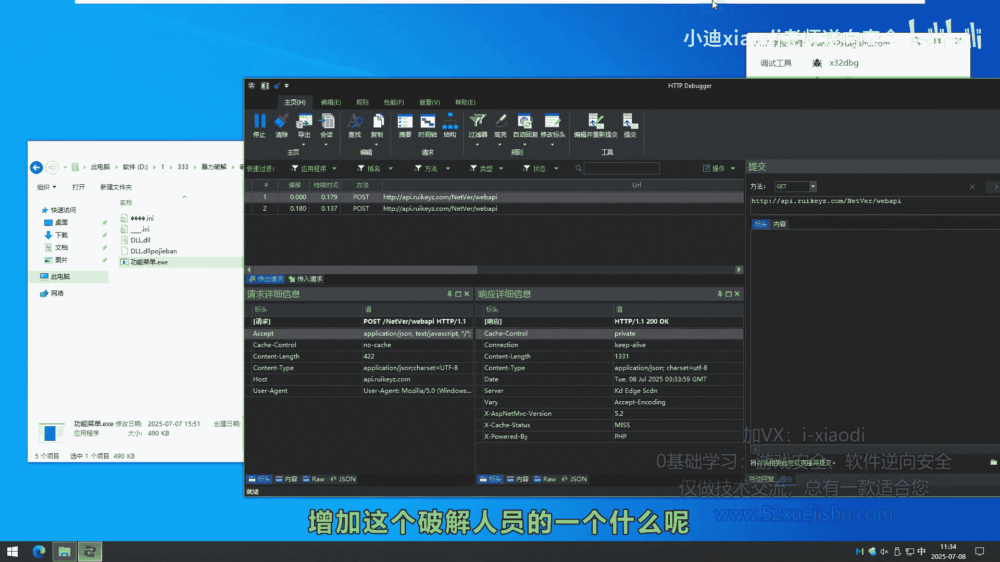
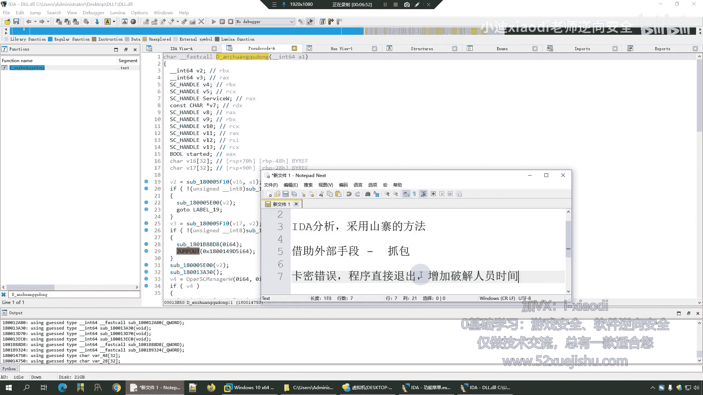
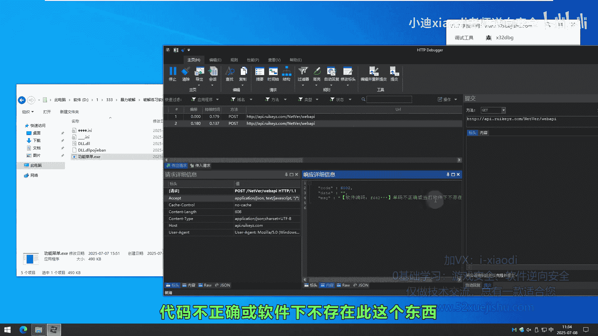
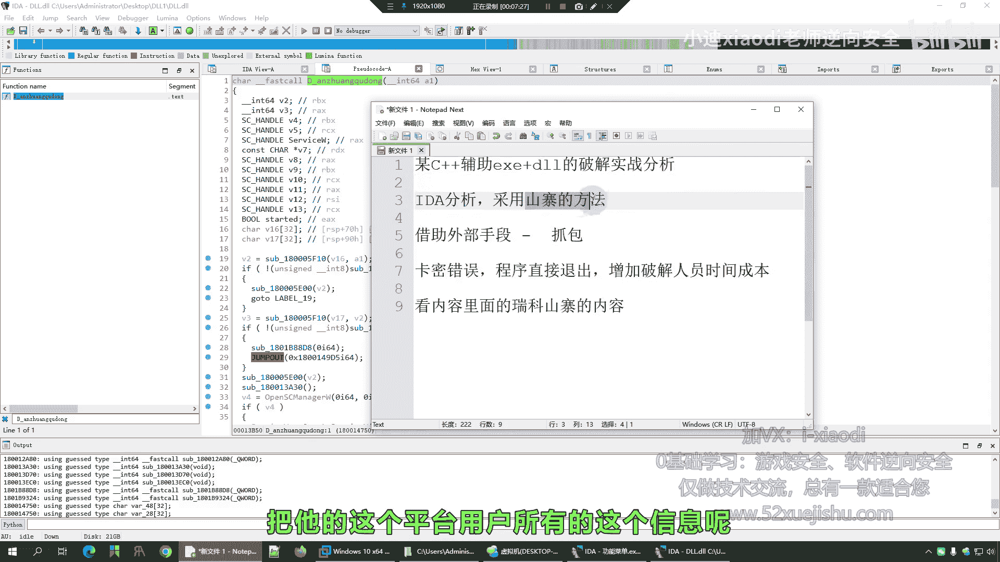
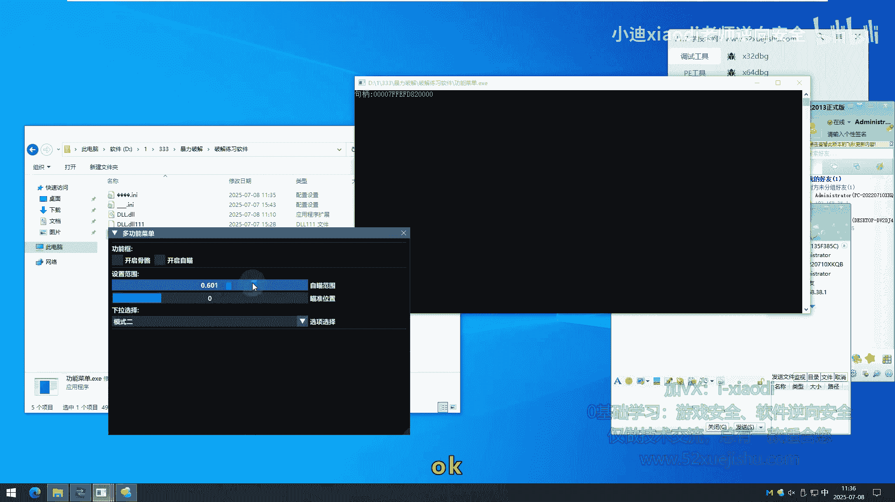
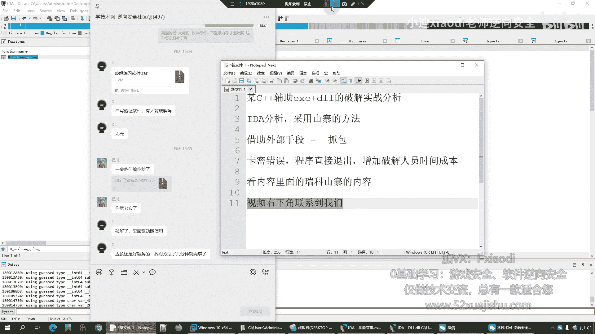

# 📚 游戏安全逆向分析教程：00：课程概述

在本节课中我们将要学习一个外挂辅助程序破解后的运行效果、程序文件构成、IDA 逆向分析 EXE 与 DLL、驱动安装核心逻辑、网络验证抓包、瑞科山寨以及卡密长度判断。本教程整理自视频编号 BV14deiznEom-，面向游戏安全、软件安全、网络安全和 CTF 比赛基础方向，用大白话带初学者了解外挂背后的真相。

对初学者来说，先看破解后的现象，再看程序文件结构，会更容易建立整体认识。下面先进入第一节，看看程序破解后的效果和目录中的关键文件。


# 🎮 游戏安全逆向分析教程：01：破解效果与程序文件构成

在概述之后，本节先来看破解后的效果和程序文件夹中的文件构成。运行程序后可以看到验证成功，程序被破开，界面中有模式一、模式二、模式三、模式四，并且可以开启骨骼、开启增描，这个辅助程序已经被破开。接下来简单讲一讲它是怎么被分析的。


程序目录中需要重点观察的文件构成如下：

- 配置文件：包含程序加载过程或运行过程中的重要配置，例如提示-1、提示-2的提示风格和大小；这个配置文件对破解分析无关痛痒。

- DLL 文件：这是一个应用程序扩展文件，后缀是 DLL。

- EXE 文件：这是应用程序，后缀是 EXE，也就是可执行文件。

- 动态加载关系：DLL 是动态链接库，会被应用程序动态加载，从而产生扩展功能；一般来说核心功能写在 DLL 中，EXE 一般只起加载作用，这只是初步推测。

通过以上文件构成可以建立一个基本判断：EXE 更像入口，DLL 更像核心功能工具箱。核心概念可以用下面的代码表示：

```text
EXE = 可执行文件（Executable）
DLL = 动态链接库（Dynamic Link Library）
EXE -> 动态加载 DLL -> DLL 提供扩展功能
```

完成文件构成认识后，下一节进入 IDA，看看 EXE 是如何加载 DLL 的。


# 🧩 游戏安全逆向分析教程：02：IDA分析EXE加载DLL

上一节我们介绍了程序文件构成和 EXE/DLL 的基本关系，本节中我们来看看 IDA 如何分析 EXE 加载 DLL 的过程。因为 EXE 是加载 DLL 的程序，所以先从这个程序入手分析。打开 IDA，把程序拖进去，点击 OK。

IDA 加载 EXE 时出现的关键信息如下：

- 点击 OK 后会弹出提示，提示 PDB 文件缺失。

- 一般来说，程序开发时会生成 PDB 文件，PDB 文件包含程序的调试信息，IDA 会默认加载；如果没有 PDB 文件，就会提示缺失。

- 提示内容会显示作者电脑上的文件或项目路径，可以看到路径中有“C嘎嘎功能菜单”“x64 Release 功能菜单”等信息，也体现出辅助外挂作者的命名素养有待提升。

等待程序加载后可以发现，这个程序非常简单，入口处和主函数处直接进行加载。按 F5 查看代码，可以看到大概逻辑：EXE 执行后直接加载 DLL，加载完成后判断句柄是否加载成功；如果加载成功，就输出句柄。运行程序时看到加载打印的内容，就是对应的句柄。随后程序会获取 DLL 中“安装驱动”和“卸载驱动”两个函数的地址，这两个函数应该是核心内容。安装驱动不成功，辅助应该没有效果，所以安装驱动是核心切入点。

核心逻辑可以用下面的代码概括：

```c
LoadLibrary(dll);
if (句柄加载成功) {
    输出句柄;
}
安装驱动地址 = GetProcAddress(..., "安装驱动");
卸载驱动地址 = GetProcAddress(..., "卸载驱动");
```

上一节定位到 EXE 加载 DLL 和核心函数入口，本节中我们来看看 DLL 内部的安装驱动代码。


# 🛠️ 游戏安全逆向分析教程：03：DLL安装驱动与登录界面线索

上一节我们定位了 EXE 加载 DLL 以及安装驱动、卸载驱动函数地址，本节中我们来看看 DLL 里的安装驱动代码和登录界面线索。把 DLL 直接拖到 IDA 中，点击 OK。

DLL 分析中出现的现象如下：

- 拖入 DLL 后也会弹出 PDB 缺失提示，说明这个外挂辅助作者的项目放在“2025年6月30号垃圾项目/驱动项目dll”文件夹路径中。

- DLL 中函数有很多，列表中都是函数；核心是函数名字，所以去搜索函数名。函数有 1 万多个，搜索“安装驱动”后可以看到核心安装驱动的位置，按 F5 查看。

- 安装驱动代码主要是驱动安装、创建服务，然后驱动安装成功。

- 如果驱动安装不成功，会有提示，通过函数去校验；如果程序有二次校验并提示“验证失败”或“启动服务失败”，就把这个位置去掉即可。

- 安装驱动并不是直接开启辅助的位置，程序还有菜单和登录界面，登录界面位置不得而知，所以需要借助外部手段，例如抓包。


安装驱动的核心流程可以用下面的代码表示：


```text
安装驱动 -> 创建服务 -> 启动服务 -> 驱动安装成功
失败提示：验证失败 / 启动服务失败 -> 定位校验点 -> 去掉校验位置
```

由于它是外网程序，最好抓包分析。上一节说到登录界面位置不得而知，需要借助外部手段，本节中我们来看看抓包、瑞科验证和山寨判断。


# 🌐 游戏安全逆向分析教程：04：抓包、瑞科山寨与卡密长度判断



上一节我们说到登录界面位置不得而知，需要外部手段，本节中我们来看看抓包、瑞科验证和山寨判断。先抓一小段包，查看是不是 HTTP 协议，然后运行程序。



抓包和验证过程中可观察到的现象如下：

- 程序界面出现后，点击提交，程序退出；有时验证失败时程序会自动退出，卡密失败或卡密错误时程序也会直接退出，这是常见增加破解者时间成本的方式。

- 网络认证是瑞科，瑞科可以直接山寨；所有相关信息在内容中都有提示，例如“代码不正确或软件下不存在此东西”。



- 只需要查看内容中的瑞科山寨方法，山寨时把平台用户的所有信息全部替换成自己的即可。

- 没有替换的是原版，替换后的版本点击确认没有问题，再把结果填到判断位置，就能判断辅助到底是山寨过、破解过还是原版。



- 破解过的卡密长度比较长，原版卡密没有超过 20 个字符，所以能够体现与原始版本不一致。

卡密长度判断可以用下面的代码表示：


```text
原版卡密长度 <= 20
破解版卡密长度 > 20
```

点击提交后驱动安装成功，点击确定显示提示-1，这是第一个提示，验证成功；随后出现模式一、模式二、模式三、模式四，效果如此。到这里完成了验证与效果确认，本节中我们来看看学习延伸和课程总结。


# 🧾 游戏安全逆向分析教程：05：课程总结与学习延伸

上一节我们完成了抓包、瑞科山寨、卡密长度判断和驱动安装验证，本节中我们来看看学习延伸和总结。关于山寨的具体操作、其他信息以及 IDA 工具的详细用法，可以加入学习，并通过视频右下角联系。



本教程涉及的可继续学习内容如下：

- 山寨的具体操作、其他相关信息以及 IDA 工具的详细用法，可以通过视频右下角联系学习。

- 演示程序是群里自己开发、自己写的，本次录制案例用于说明如何分析外挂辅助程序。

- 今天内容到此，下节再见；想学习相关内容可以在视频右下角联系，下期再见。



本节课中我们一起学习了外挂辅助破解后的效果、程序文件构成、EXE 加载 DLL、IDA 定位安装驱动、DLL 安装驱动与校验、外网抓包、瑞科山寨、卡密长度判断以及最终验证效果。整体思路是先看现象，再看文件结构，然后从 EXE 入口定位 DLL，从 DLL 中定位核心函数，最后结合抓包和山寨判断验证方式。

