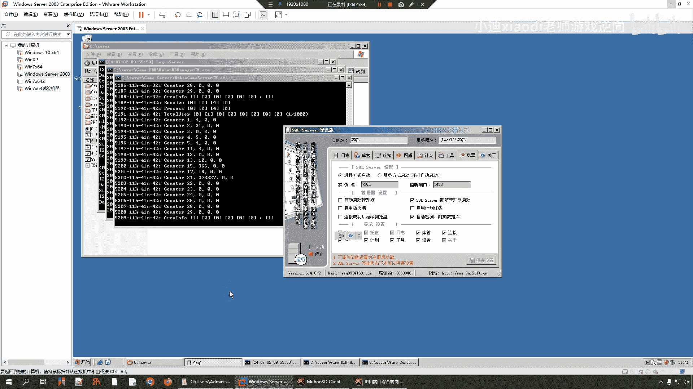
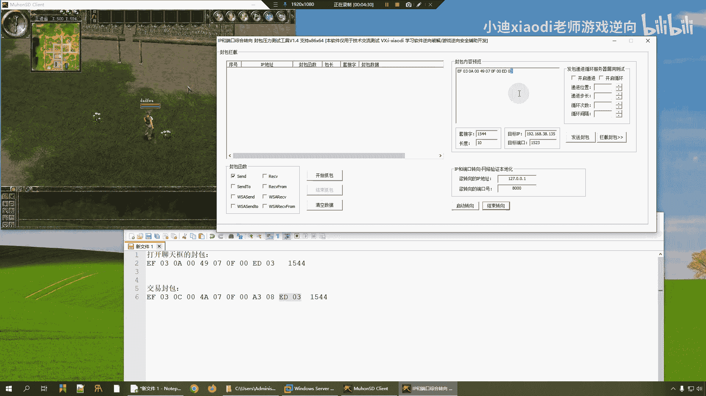

# 游戏封包与网络验证本地化测试教程：00：📌 课程概述

大家好，我是小迪老师。在本节课中我们将要学习IP端口转向封包综合工具1.4的更新内容和使用方法。本次更新内容不是很多，主要是先带大家熟悉这个工具怎么使用。这个工具面向游戏封包、网络验证本地化测试、游戏协议测试以及X64/X86封包工具讲解，支持全系统且无需代理，是游戏安全、软件安全、网络安全和CTF比赛的基础内容。

为了便于理解，可以把一条封包记录理解成下面这个公式。公式不是额外功能，只是帮助初学者把套接字、目标地址、长度和内容之间的关系看清楚。

```text
封包记录 = 套接字标识 + 目标IP + 目标端口 + 数据长度 + 数据内容
发送条件 = 对应套接字 + 正确长度 + 目标IP:端口 + 数据内容
```

下面我们从打开软件和注入进程开始，一步一步熟悉工具的基本流程。

# 游戏封包与网络验证本地化测试教程：01：🎮 工具打开与进程注入

上一节概述了课程目标和封包的基本概念，本节我们来看看如何打开软件、找到游戏进程并完成注入。首先打开这个软件，然后找到游戏的进程。游戏进程在列表中有显示，把列表往上拖一拖，方便查看。

接下来用鼠标右键点击注入，在注入选项里选择对应位数。下面是32位程序和64位程序的选择规则，初学者可以先用这段伪代码记住。

```text
32位程序或32位游戏 -> 选择 x86
64位程序（例如微信） -> 选择 x64
```

这个游戏是32位游戏，所以选择x86，点击打开。注入成功以后，就可以去拦截封包了。完成注入后，我们来看看本次更新内容和抓包前的准备。

# 游戏封包与网络验证本地化测试教程：02：🔄 更新内容与抓包发包准备



上一节完成了软件打开和进程注入，本节我们来看看1.4版本的更新内容以及如何准备抓包发包。本次更新内容不多，新增了一个封包内容预览，界面上会显示套接字的长度、目标IP端口，并且可以根据对应的套接字和目标IP去发送数据包。可以用下面的公式描述这个发送关系。

```text
可发送数据包 = f(套接字, 目标IP, 目标端口, 数据长度, 封包内容)
```

我们来试一下，只拦截发包就可以。先找一个人去沟通，点击开始抓包，然后回到游戏找这个人谈话。弹出对话框以后，点击结束抓包。下面是本次聊天对话框抓包的操作顺序，按顺序操作即可。

- 找到目标人物并准备沟通。
- 点击开始抓包。
- 回到游戏与目标人物谈话。
- 弹出对话框后点击结束抓包。

这个对话框实际上就是发送了一个封包，往服务器发送了一个封包。服务器在哪里？服务器已经架设好了，这就是我们的一个服务器。穿越火线、地下城等游戏也都有类似的服务器。理解这个关系以后，就可以做进一步测试。

# 游戏封包与网络验证本地化测试教程：03：🧪 四条封包与聊天框打开测试

上一节抓到了聊天对话框封包，本节我们对拦截到的数据包做发送测试。刚才通过聊天拦截了4条数据包，这4条数据包中有一条是打开对话框的。我们先试第一条，点击封包记录，界面会显示套接字、IP端口等信息。

下面是四条封包的测试顺序，主要观察哪一条能够打开对话框。

- 点击封包记录，查看套接字、IP端口显示。
- 点击发送封包，测试第一条，没有反应。
- 测试第二条，也没有反应。
- 继续测试下一条，点击发送封包，打开对话框。

这个时候就打开了对话框，效果非常神奇。正常情况下，如果人物离目标没有特别近，是点不到目标的。比如现在要点一下，必须走到目标跟前，必须走过去，走到跟前才能开启这个对话。假如目标是一个商店，它看起来就是一个商店，界面上有交易选项。既然有交易选项，我们再去拦截交易封包。

# 游戏封包与网络验证本地化测试教程：04：🛒 交易封包与远程商店测试

上一节打开了聊天对话框，本节我们拦截交易封包并测试远距离交易。此时已经知道打开交易框的封包，也涉及打开聊天框的封包。套接字1544可以简单记录一下，套接字本身暂时不用深究。下面是交易封包的抓取步骤。

- 点击开始抓包。
- 回到游戏点击交易。
- 拦截到交易封包后结束抓包。
- 记录该交易封包，套接字也是1544。

这个应该就是交易封包。如果进行交易，就会发送这样一个交易封包。记录套接字1544以后，关掉界面，走远一点，测试能不能直接交易。离得特别远的时候直接进行交易，这种就是远程商店之类的效果。现在可以清空数据，然后把封包内容直接在这里发送，可以看到可以成功。如果要打开聊天框，也可以在这个基础之上打开聊天框，但长度字段要改。下一节我们具体看长度和字节修改。

# 游戏封包与网络验证本地化测试教程：05：📏 封包长度与字节修改

上一节完成了交易封包和远距离交易测试，本节我们来看看封包长度字段和字节修改。打开聊天框时，可以在现有封包基础上操作，但长度要改。长度是多少？数一下是10个长度。下面的公式记录了本例中的长度关系。

```text
聊天框封包长度 = 10
另一条记录长度 = 12
12 - 2 = 10
```

用这个长度去发送，聊天框就出来了。长度不要乱，长度一定不要乱。另一个记录是12个长度，这个刚好少两个，所以是10个长度。封包工具可以根据套接字和长度自定义设置信息，界面这边也可以改。例如当前字节是03，改成01试一下。

```text
原字节：03
修改为：01
结果：游戏已经断开，掉线
```



注意长度字段不要随意改动，长度错误可能导致发送失败或游戏连接异常。

到这里，工具的基本演示就完成了。这个工具就是IP端口转向封包综合工具1.4，下面做课程总结。

# 游戏封包与网络验证本地化测试教程：06：✅ 课程总结

上一节完成了长度和字节修改演示，本节我们对整个课程做总结。本节课中我们一起学习了IP端口转向封包综合工具1.4的基本使用，包括打开软件、注入32位或64位进程、拦截发包、查看封包内容预览、查看套接字长度和目标IP端口、根据套接字发送数据包、聊天框打开测试、交易封包测试、远距离商店测试、封包长度修改以及字节修改导致游戏掉线。

这个封包工具可以根据套接字和长度自定义设置信息，界面中的内容也可以修改。今天的内容演示到这里，这就是工具的基本用法。大家喜欢可以加入学习游戏安全，我们这边有游戏安全、辅助开发、软件逆向破解、网络验证、注册机、EG一码等程序。今天内容到这里，下期再见。

