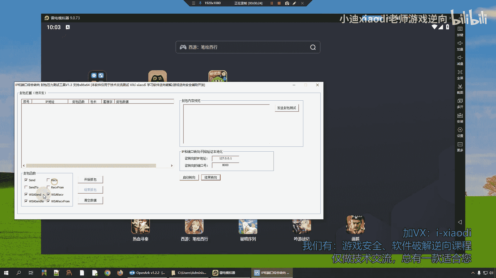
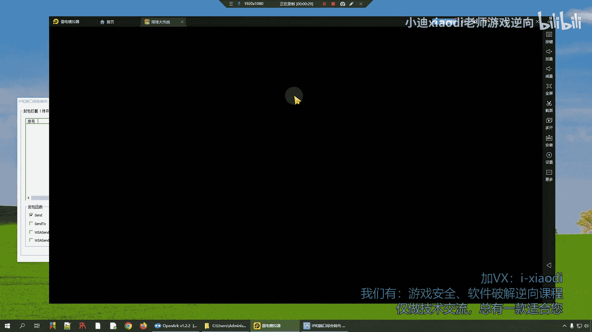
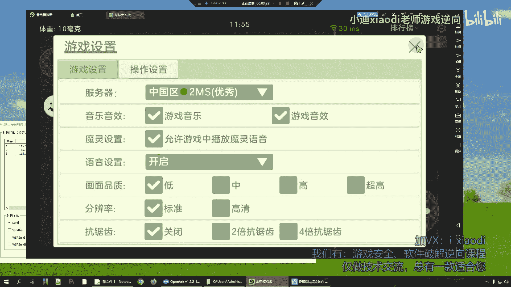
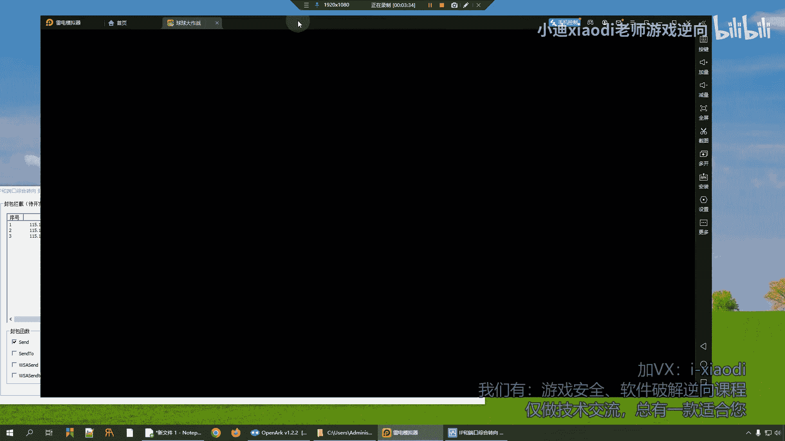

# 游戏封包与网络协议测试基础教程：00：课程总览 🎯

在本节课中，我们将一起学习游戏封包、网络验证本地化测试、游戏协议测试，以及IP和端口综合转向封包压力测试工具1.3公测版的基础用法。本教程根据小迪老师的视频讲解整理，对应视频编号为BV1sy411q7VB-。课程内容属于游戏安全、软件安全、网络安全与CTF比赛的基础内容，重点放在工具理解、抓包重放、协议观察和简单字段修改上。

上一段介绍了课程来源和整体范围，本节先说明本课程要解决的问题。这个工具支持全系统运行，并且无需代理，主要能力是对IP和端口做综合转向，对被测试的网络验证和辅助软件进行本地化操作，也可以抓取游戏数据包并做协议测试。封包本身很有意思，如果把一个游戏的封包分析清楚，就可以进一步编写封包脚本。以下先列出本课程覆盖的核心学习目标，方便初学者建立整体印象。

- 理解封包、抓包、重放和协议测试的基本概念。

- 了解IP和端口综合转向封包压力测试工具1.3公测版的定位。

- 通过游戏界面跳转案例观察“一个封包触发一个状态”的现象。

- 学习抓取团队模式、双冠模式、极速团战等操作对应的数据包。

- 观察修改封包长度和字段后，目标界面是否仍然进入。

- 了解后续自定义发送长度能力和学习获取方式。

> 本教程仅用于授权环境下的协议分析、软件测试和CTF学习。请遵守游戏规则、软件许可和法律法规，不要将相关技术用于破坏公平性或未授权测试。



以上是课程总览和合规说明。下一节中，我们来看看这个工具的具体定位，以及它为什么适合做本地化封包测试。

## 游戏封包与网络协议测试基础教程：01：工具定位与测试目标 🧰

上一节我们介绍了课程范围和合规要求，本节来看看工具定位。本次测试的对象是IP和端口综合转向封包压力测试工具1.3公测版。它的特点是可以对IP和端口做综合转向，支持全系统使用，并且不需要代理。它不仅能对网络验证、辅助软件做本地化操作，还能抓取游戏数据包，并对游戏协议进行测试。对于初学者来说，可以先把它理解成一个“记录数据包、再发送数据包、观察目标反应”的测试工具。



为了更直白地理解工具目标，可以用下面的公式描述。公式左边是测试目标，右边是两类常见用途：本地化测试和抓包重放测试。这里的“重放”就是把抓到的封包再发送一次，观察目标程序是否出现相同反应。

```text
测试目标 = 本地化测试(网络验证/辅助软件) + 抓包重放(游戏协议)
```

上一段用公式说明了工具用途，本节再补充一个核心认识：封包可以理解为程序之间按照协议发送的一段数据。抓包就是把这段数据记录下来，发送封包就是把记录下来的数据再发给目标。以下列出本工具在当前阶段的关键特点，便于后续操作时对照。

- 工具版本为1.3公测版。

- 支持IP和端口综合转向。

- 支持全系统运行。

- 使用时无需代理。

- 可以对网络验证和辅助软件做本地化操作。

- 可以抓取游戏数据包并做协议测试。

- 当前阶段以“点什么发什么”为主，后续会加入自定义发送长度。

以上是工具定位和关键特点。下一节中，我们进入游戏，看看一个界面跳转背后是如何对应到一个封包的。

## 游戏封包与网络协议测试基础教程：02：进入游戏与理解界面跳转的封包触发 🎮

上一节我们介绍了工具定位和封包的基本概念，本节进入实际操作。首先进入游戏，然后在游戏界面中观察模式入口。原文案例中，点击双冠模式后，里面有一个团队模式；点击团队模式会来到对应界面。这个界面并不是凭空出现的，它实际上是客户端发送了一个数据包后得到的结果。对初学者来说，可以先用下面的公式理解：界面状态由发送的封包决定。

```text
团队模式界面 = Send(团队模式请求封包)
```

上一段用公式说明了界面跳转与封包的关系，本节开始做抓包和重放实验。操作时先停留在当前界面，只选择一个目标，原文称“选择一个s”，然后点击开始抓包，再点击团队模式。此时进入团队模式的数据包就被抓到了，需要把这个封包记录下来。以下是本轮抓取和验证团队模式封包的操作步骤，按顺序执行即可观察现象。

- 进入游戏并停留在可以点击模式入口的界面。

- 在抓包工具中只选择一个目标，原文称选择一个s。

- 点击开始抓包。

- 点击团队模式。

- 拿到进入团队模式的数据包，并记录该封包。

- 在工具中直接点击发送封包测试。

- 观察游戏是否直接进入团队模式界面。

完成上述步骤后，可以看到游戏直接来到团队模式界面。它跳过了先点击双冠模式、再点击团队模式的步骤。也就是说，只要重放这个团队模式封包，就能触发相同的界面跳转。为了更清楚地表达，可以用下面的伪代码描述整个流程。

```text
开始抓包()
点击(团队模式)
包_团队 = 结束抓包()
发送封包(包_团队)
结果：直接进入团队模式界面
```

上一段展示了团队模式封包的重放效果，本节还需要强调一次验证思路：先抓包，再记录，再发送，最后观察界面是否一致。再次测试时，结果仍然一致，说明这个封包与团队模式界面之间存在明显的触发关系。以上是团队模式封包的抓取和重放过程。下一节中，我们继续抓取双冠模式封包，并和团队模式封包做对比。

## 游戏封包与网络协议测试基础教程：03：双冠模式封包抓取与对比 🏆

上一节我们验证了团队模式封包可以直接触发团队模式界面，本节来看看双冠模式。原文案例中，双冠模式也可以直接进入。操作时先返回，再点击开始抓包，然后点击双冠模式，最后结束抓包。此时抓到的封包很可能就是进入双冠模式的数据包。先怀疑它是不是双冠模式封包，再发送测试，结果确实进入了双冠模式，因此可以记录为“进入双冠模式数据包”。

上一段描述了双冠模式封包的抓取和验证过程，本节用公式总结这个关系。抓包时点击双冠模式得到候选封包，发送候选封包后进入双冠模式界面，就说明候选封包有效。

```text
包_双冠 = 抓包(点击双冠模式)
发送封包(包_双冠) -> 双冠模式界面
```

上一段用公式表达了双冠模式封包的触发关系，本节再说明对比结果。把进入双冠模式的数据包和进入团队模式的数据包放在一起对比，可以发现两者差别比较大，直接互相参考的价值有限。以下是双冠模式测试中的关键记录点，方便后续整理协议样本。

- 返回游戏主界面或模式选择界面。

- 点击开始抓包。

- 点击双冠模式。

- 结束抓包并保存候选封包。

- 发送候选封包做验证。

- 验证成功后记录为进入双冠模式的数据包。

- 与团队模式数据包对比，发现差异较大，参考价值有限。

以上是双冠模式封包的抓取、验证和对比。下一节中，我们继续测试自由模式、极速团战和QQ主题界面，观察不同入口的封包表现。

## 游戏封包与网络协议测试基础教程：04：自由模式、极速团战与QQ主题界面测试 🧪

上一节我们完成了双冠模式封包的抓取和对比，本节继续测试其他入口。先看清空数据、开始抓包、点击自由模式的流程。自由模式会来到一个界面，但这个模式似乎还没有开放；点击立即参与后才真正进入。测试中还遇到取消匹配不熟悉、游戏退出方式不熟悉的问题，因此只能重新来一遍。原文还提到，有些模式会直接进入，直接进入后不方便继续观察，所以测试时希望找到“不直接进入”的状态，以便分析中间过程。这里先说明，实际操作前最好熟悉游戏的退出、取消匹配和返回方式，避免测试流程被卡住。

上一段说明了自由模式测试中的操作现象，本节继续看极速团战和QQ主题界面。测试极速团战时，先点击自由模式，再点击开始抓包，然后点击极速团战。此时数据包数量有点多，需要重新来一遍。查看抓包结果时，先发送第一个数据包，发现第一个数据包有效，其他数据包一般不是关键包；再测试其他数据包没有效果。因此可以得到一个经验：通常第一个数据包是根本性的数据包。QQ主题界面则看起来不发包，至少从现象上感觉它不发送关键封包。以下列出本轮多入口测试的观察要点，便于初学者理解不同界面的差异。

- 自由模式测试前先清空数据，再开始抓包。

- 自由模式界面似乎未开放，点击立即参与后才真正进入。

- 测试中遇到取消匹配不熟悉、游戏退出方式不熟悉的情况，需要重新开始。

- 极速团战测试时先点击自由模式，再开始抓包，再点击极速团战。

- 极速团战抓到的数据包数量较多，需要重新抓取并筛选。



- 发送第一个数据包后有效，其他数据包测试后一般没有效果。

- QQ主题界面看起来不发包，可以作为非关键入口参考。



上一段用列表整理了多入口测试现象，本节用公式总结“第一个有效封包”的经验。需要说明，这个经验只适用于当前案例，不能直接套用到所有游戏协议。

```text
有效封包 = First(抓包结果)
```

上一段给出了筛选第一个封包的简单公式，本节再补充解释。极速团战案例中，第一个数据包发送后可以连上目标界面，其他数据包发送后没有明显效果，因此第一个数据包更可能是根本性数据包。以上是自由模式、极速团战和QQ主题界面的测试记录。下一节中，我们来看看修改封包长度和字段后，目标界面的反应会发生什么变化。

## 游戏封包与网络协议测试基础教程：05：修改封包长度与字段观察校验强度 🔧

上一节我们测试了多个入口的封包表现，本节进入字段修改实验。当前工具还只支持“点什么发什么”，后续会改成可以自定义发送长度。原文提到，在工具中可以直接修改长度，把长度作为自定义参数来调整。为了观察协议校验强度，可以抓取团队或团战模式的数据包，然后尝试修改数据包中的字段。案例中把字段31改成30，再发送，结果仍然进入目标模式；把字段改成00，再发送，结果也仍然进入。这说明当前案例对字段的校验并不特别严格，影响比较薄弱。

上一段说明了字段修改实验的现象，本节用代码形式总结实验过程。以下表达式表示发送长度可以自定义，字段31改成30或00后仍然进入目标模式。

```text
发送长度 = 自定义长度
字段31 -> 30 => 仍进入团队/团战模式
字段31 -> 00 => 仍进入团队/团战模式
```

上一段用代码形式记录了字段修改结果，本节再列出实验步骤，方便复现。需要再次强调，字段修改测试应在授权环境中进行，并且要理解“当前案例校验薄弱”不等于所有协议都校验薄弱。以下是本轮字段修改实验的关键步骤和结论。

- 抓取团队或团战模式的数据包。

- 在工具中找到可修改的字段或长度位置。

- 尝试把字段31改成30，然后发送封包。

- 观察目标模式是否仍然进入，案例中结果仍然进入。

- 尝试把字段改成00，然后发送封包。

- 观察目标模式是否仍然进入，案例中结果仍然进入。

- 结论是当前案例的校验并不特别严格，影响比较薄弱。

以上是修改封包长度和字段的观察过程。下一节中，我们来看看工具的后续能力，以及原文提到的学习获取方式。

## 游戏封包与网络协议测试基础教程：06：工具后续能力与学习路径 🚀

上一节我们通过字段修改观察了协议校验强度，本节看看工具的后续计划和学习路径。原文展示了最新的封包工具，并说明这类工具有助于编写封包游戏辅助或游戏外挂。这里应理解为：理解封包结构和重放机制，有助于学习封包脚本和协议测试原理；实际使用必须遵守规则和法律。工具后续会增加自定义发送长度，使测试者可以更方便地调整封包长度和字段。以下列出后续能力和学习相关事项，方便读者明确下一步方向。

- 后续会把“点什么发什么”扩展为可自定义发送长度。

- 可以在工具中直接修改长度，作为自定义参数使用。

- 工具依旧上传到知识星球，并放在置顶公告中。

- 如果想学习相关内容，可以点击右下角联系发布者。

- 本期讲解结束后，下期再见。

> 工具获取方式：知识星球置顶公告。学习咨询方式：点击右下角联系发布者。相关技术请仅用于授权测试与安全学习。

以上是工具后续能力和学习获取方式。下一节中，我们对整节课程做一次总结，把抓包、重放、字段修改和协议观察的流程串起来。

## 游戏封包与网络协议测试基础教程：07：课程总结 📝

本节课中我们一起学习了IP和端口综合转向封包压力测试工具1.3公测版的基础用法，也通过游戏案例观察了封包与界面状态之间的对应关系。我们了解到工具支持全系统、无需代理，可以对网络验证和辅助软件做本地化操作，也可以抓取游戏数据包做协议测试。以下列出本节课的核心收获，帮助初学者复习整体流程。

- 封包是程序之间按协议发送的数据，抓包是记录数据，重放是再次发送数据。

- 团队模式封包可以直接触发团队模式界面，跳过前面的点击步骤。

- 双冠模式封包可以单独抓取和验证，但与团队模式封包差异较大。

- 自由模式、极速团战和QQ主题界面的封包表现不同，需要逐个测试。

- 极速团战案例中，第一个数据包更可能是根本性数据包。

- 修改字段31为30或00后仍然进入目标模式，说明当前案例校验较薄弱。

- 后续工具会支持自定义发送长度，便于进一步做协议测试。

以上是本节课的总结。通过本课程，我们建立了“抓包、记录、重放、观察、修改、再观察”的基本测试思路。需要再次提醒，相关技术应仅在授权环境中用于协议分析、软件测试和CTF学习。本期讲解到此，下期再见。

