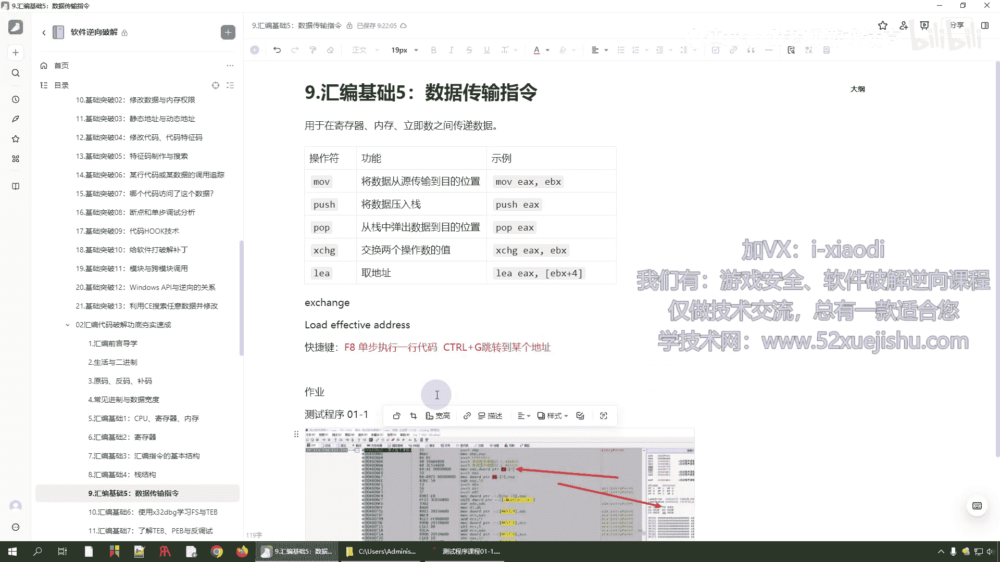

# 📦 汇编语言基础：09：数据传输指令

## 🧭 汇编语言基础：09：本节概述

在本节课中我们将要学习游戏逆向、逆向破解中常用的汇编语言数据传输指令。本讲是第九讲，主题是汇编技术中的数据传输指令，内容面向游戏安全、软件安全、网络安全、CTF 比赛，以及希望学习软件破解、反汇编和逆向安全的基础学习者。配套视频编号为 `BV1PeCtYiE94`。本讲由小迪老师讲解，重点是把几条常见的数据传输指令讲清楚，再用实验程序观察它们在调试分析中的实际表现。

前面我们已经接触过一些汇编基础，本节开始进入数据传输指令的具体学习。数据传输指令顾名思义，就是用来传输数据的指令，用于在寄存器、内存、立即数之间传递数据。这个说法听起来简单，但它是后面理解栈、函数调用、内存访问和调试分析的基础。下面我们先认识五条常见指令，再进入实验程序逐条观察。

## 🧱 汇编语言基础：09：数据传输指令是什么

上一节我们说明了本讲的目标，本节来看看数据传输指令的基本含义。数据传输指令负责把数据从一个位置搬到另一个位置，这个位置可以是寄存器，也可以是内存，还可以是立即数。学习这些指令时，重点不是死记硬背，而是理解“数据从哪里来、到哪里去、执行后哪个位置发生变化”。

常见的数据传输指令有五条，先建立一个整体印象，下面是本讲要学习的指令列表：

- `MOV`：把右边的数据给到左边。
- `PUSH`：把数据压入栈中。
- `POP`：从栈中把数据弹出到目的寄存器。
- `XCHG`：交换两个操作数的值。
- `LEA`：取地址，也就是加载有效地址。

上面这五条指令就是本讲的主线。它们看起来不多，但在调试和逆向分析中出现频率很高。接下来我们逐条展开，先看最基础的 `MOV` 指令，再看与栈有关的 `PUSH`、`POP`，然后看交换指令 `XCHG`，最后看取地址指令 `LEA`。

### ✍️ 汇编语言基础：09：MOV 指令

上一节列出了五条常见指令，本节先看 `MOV`。`MOV` 的作用就是把数据从右边给到左边，可以写成下面这个形式：

```asm
MOV 目的操作数, 源操作数
```

它的核心含义可以用公式表示：

```text
目的操作数 = 源操作数
```

例如执行 `MOV EAX, 3`，就是把立即数 `3` 给到寄存器 `EAX`。执行之前 `EAX` 可能是别的值，执行之后 `EAX` 就变成 `3`。这个指令非常基础，但后面大量代码都会围绕它展开，所以需要先把它看熟。

### 📥 汇编语言基础：09：PUSH 与 POP 指令

看完 `MOV` 之后，本节来看与栈有关的 `PUSH` 和 `POP`。`PUSH` 的作用是把数据压入栈中，`POP` 的作用是从栈中把数据弹到目的寄存器。栈在调试中非常重要，函数调用、参数传递、局部变量等内容都会和栈发生关系，所以这两条指令需要重点观察。

`PUSH` 可以写成下面这个形式：

```asm
PUSH 源操作数
```

在 32 位环境下，可以把它理解成类似下面的过程：

```text
[ESP] = 源操作数
ESP = ESP - 4
```


`POP` 可以写成下面这个形式：

```asm
POP 目的操作数
```


在 32 位环境下，可以把它理解成类似下面的过程：

```text
目的操作数 = [ESP]
ESP = ESP + 4
```

上面是压栈和弹栈的基本概念。实际调试时，栈窗口中的数值变化会直接反映这些操作的结果，后面实验部分会结合 `x32dbg` 一步一步观察。

### 🔁 汇编语言基础：09：XCHG（exchange）指令

上一节看了栈操作，本节来看交换指令。`XCHG` 的英文单词是 `exchange`，意思就是交换。它的作用是交换两个操作数的值，可以写成下面这个形式：

```asm
XCHG 操作数A, 操作数B
```

例如交换前 `EAX = 1`、`EBX = 2`，执行 `XCHG EAX, EBX` 之后，`EAX` 变成 `2`，`EBX` 变成 `1`。这个指令的特点是两个位置的值互相调换，理解时可以直接把它记成“你拿我的、我拿你的”。

### 📍 汇编语言基础：09：LEA 指令

看完交换指令，本节来看取地址指令 `LEA`。`LEA` 的英文是 `load effective address`，翻译过来就是加载有效地址。它和普通取值指令不同，`LEA` 取的是地址表达式计算出来的地址，而不是地址里面存放的数据。

`LEA` 可以写成下面这个形式：

```asm
LEA 目的寄存器, [地址表达式]
```

例如：

```asm
LEA EAX, [EBX + 4]
```

这条指令的含义是把 `EBX + 4` 这个地址给到 `EAX`。方括号里面放的是内存地址表达式，所以 `LEA` 会把计算出来的地址直接给到目的寄存器。理解这一点后，后面看到 `LEA EAX, [00403000]` 时，就知道它是在把地址 `00403000` 给到 `EAX`。

## 🧪 汇编语言基础：09：在 x32dbg 中观察指令执行

上一节我们逐条认识了五条指令，本节进入实验程序观察它们真正执行时的变化。首先打开工具包，在工具包中找到 `x32dbg` 并运行起来。运行之后，把实验程序 `text.exe` 拖进来，拖进来之后就可以开始观察指令执行情况。

实验过程可以按照下面的步骤进行，下面是本讲需要跟着操作的重点步骤列表：

1. 执行 `MOV EAX, 3`，观察 `EAX` 变成 `3`。
2. 执行 `MOV EBX, EAX`，观察 `EBX` 也变成 `3`。
3. 执行 `PUSH EBX`，观察栈中对应位置变成 `3`，原文提到的 `70` 位置会变成 `3`。
4. 执行 `POP ECX`，观察 `ECX` 从原来的 `00401001` 变成 `3`。
5. 执行 `MOV EAX, 1`，观察 `EAX` 从 `3` 变成 `1`。
6. 执行 `XCHG ECX, EAX`，观察 `ECX` 和 `EAX` 的值互换，交换后 `EAX` 变成 `3`，`ECX` 变成 `1`。
7. 执行 `LEA EAX, [00403000]`，观察 `EAX` 变成地址 `00403000`。

上面这些步骤就是本讲实验的主线。每一步都可以按一次执行，观察寄存器窗口和栈窗口的变化。这里的寄存器名以 `EAX`、`EBX`、`ECX` 为例，原文口述中出现的 `ES`、`EBS`、`ECS` 对应到实际寄存器就是这几个常见寄存器。实验时不要只看结果，还要注意执行前后数值的变化，这样才能把指令含义和调试现象对应起来。

## 🔎 汇编语言基础：09：查看内存地址与编码问题

上一节我们执行到了 `LEA EAX, [00403000]`，本节来看看如何查看这个内存地址里的数据。很多初学者会问，拿到了一个内存地址之后，怎样查看这个地址里面存放的内容。原文中提到的 `40300` 是地址的口述简化写法，这里按 `00403000` 来观察即可。

查看内存地址可以按照下面的步骤操作，下面是查看地址和解决中文显示问题的步骤列表：

1. 先复制这个内存地址。
2. 在调试器中按快捷键 `Ctrl + G`，跳转到某个地址。
3. 把复制的地址粘贴到跳转框中，点击确定。
4. 如果地址内容显示不出来，原因通常是编码问题。
5. 在代码页中找到 `GBK`，中文内容一般使用 `GBK`，选择后点击确定，标题就能正常显示。
6. 也可以在内存窗口上点击鼠标右键，在内存窗口中选择“内存一”进行查看。

上面这些操作并不复杂，但编码问题在调试中很常见。看到中文显示异常时，不要先怀疑程序本身，可以先检查代码页设置。把地址跳转、内存查看和编码设置结合起来，后面分析字符串和内存数据会方便很多。

## ⏭️ 汇编语言基础：09：单步执行与课后练习

上一节我们查看了内存地址，本节来看单步执行和课后作业。整个实验过程中，我们是一行代码一行代码执行的，使用到的快捷键是 `F8`。按一次 `F8` 就会执行一行代码，再按一次就继续执行下一行。这个操作需要反复练习，因为单步执行是调试分析中最常用的基本动作之一。

课后作业如下，下面是本讲布置的练习内容列表：


- 打开实验程序，把程序拖入调试器。
- 从 `004606D1` 一直看到 `00460730` 附近，并继续向下拉动观察。
- 对整个区域一行代码一行代码地看。
- 遇到不懂的地方做标记，后续会逐个讲解。
- 例如 `FS` 寄存器是下节课重点讲解的内容，之前提到过它。
- `FS` 寄存器与 `TEB` 有关，`TEB` 又与 `PEB` 有关，`PEB` 又与反调试有关。
- 通过汇编可以一步一步接触反调试这类更高深的技术，后面会继续讲。


上面这些练习是为了把本讲的指令和真实调试场景连接起来。原文口述中的 `TB`、`PB` 分别对应 `TEB`、`PEB`，这里按常见术语整理。学习汇编不要只看单条指令，还要把它放回程序上下文中观察。随着课程推进，会慢慢接触到反调试等内容，也会逐渐体会到计算机世界的有趣之处。



## 🧾 汇编语言基础：09：本节总结

本节课中我们一起学习了汇编语言中的数据传输指令，包括 `MOV`、`PUSH`、`POP`、`XCHG` 和 `LEA` 五条常见指令。我们理解了 `MOV` 是把右边给左边，`PUSH` 是压栈，`POP` 是弹栈，`XCHG` 是交换两个操作数，`LEA` 是加载有效地址。随后我们使用 `x32dbg` 和实验程序逐条观察了这些指令执行后的寄存器变化和栈变化，还学习了用 `Ctrl + G` 跳转内存地址、通过代码页 `GBK` 解决中文显示问题，以及按 `F8` 单步执行代码。最后布置了从 `004606D1` 看到 `00460730` 附近的课后练习，并引出下节课要重点讲解的 `FS` 寄存器、`TEB`、`PEB` 和反调试相关内容。把这些基础打牢，后面分析更复杂的逆向与安全问题会顺畅很多。

