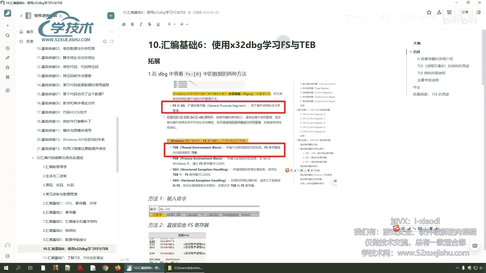
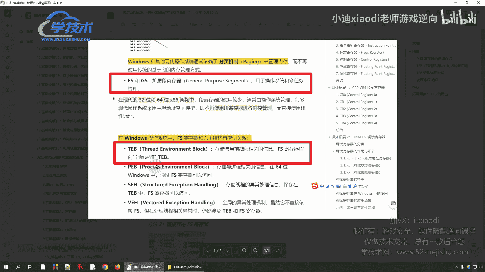
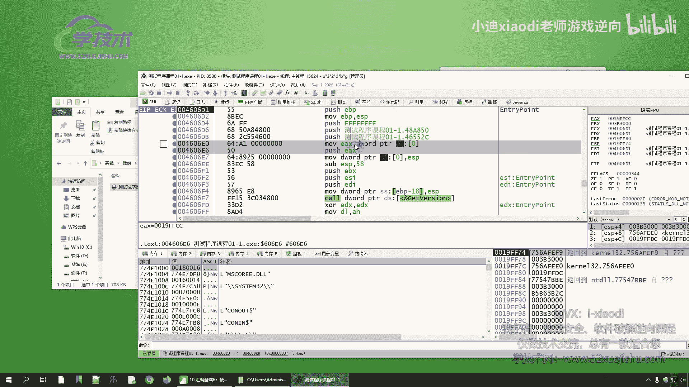
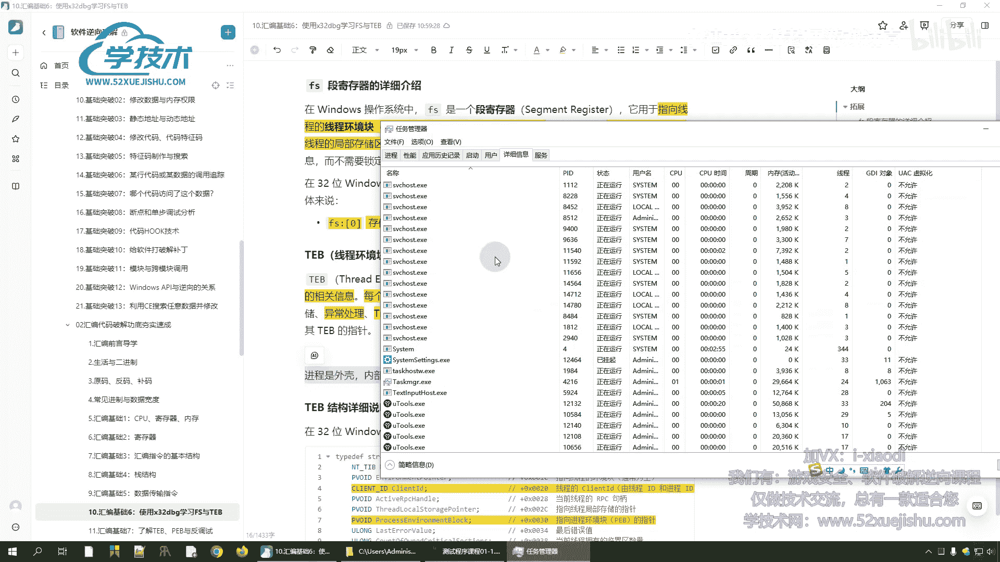
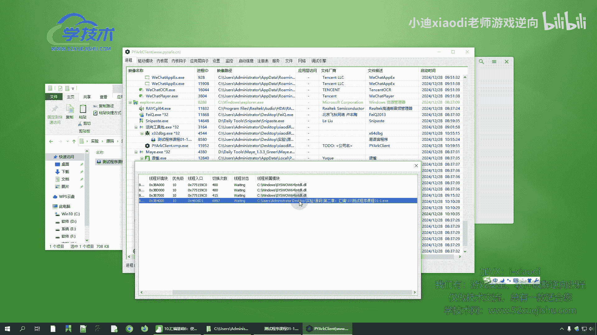
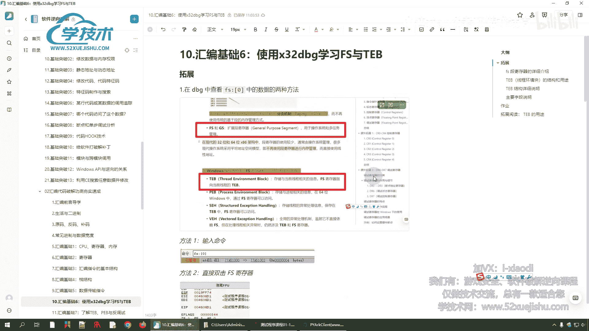

# 🧩 游戏逆向与逆向破解常用汇编指令：第6讲：使用x32dbg学习FS与TEB

在本节课中我们将要学习FS寄存器与TEB之间的关系，并使用x32dbg查看FS:0以及TEB中的关键字段。本讲是第十讲，由小李老师讲解。内容会从FS寄存器回顾开始，逐步讲到TEB是什么、TEB的重要性、TEB的重点结构，最后给出作业与拓展阅读建议。整个过程用大白话说明，目标是让初学者也能看懂这些概念在调试器里的具体表现。

## 🔍 第1节：FS寄存器回顾与查看FS:0

上一节我们接触过FS寄存器，本节先回顾它的基本背景，再进入用x32dbg查看FS:0的操作。之前讲到FS是一个扩展段寄存器，当时也说过段寄存器很多都没有什么用处。因为在现在的32位和64位x86架构中，不再使用段寄存器进行内存管理。但是在Windows操作系统中，FS寄存器与以下结构有着密切联系，例如TEB、PEB、SEH、VEH等等。今天要了解的是TEB，而这个FS寄存器在上节课的作业程序中是有体现的。把程序拖到x32dbg中以后，可以看到`FS:0`，单步执行到这条指令，然后观察执行完之后的情况，会发现ES仍然显示为19FFCC。它到底是不是19FFCC，怎样去查看FS寄存器里面的数据，这是首先要解决的问题。

为了解决“怎样查看FS寄存器数据”这个问题，有两个方法。以下是两种查看FS寄存器相关数据的方式。



- 第一种方法是输入命令：在命令位置输入`FS:0`，把0用括号括起来也可以，然后回车。回车之后，调试器会把FS寄存器的值显示出来，也就是19FFCC。





- 第二种方法是直接双击FS寄存器：在寄存器窗口找到FS并双击，调试器会直接来到对应位置，整个这一块就是FS寄存器相关的数据。

接下来还要弄清楚“0的位置”怎样看。可以在最左边双击一下，它就会显示为偏移的形式。这个位置没有写，就是加0；如果这里写加4，那里写加8，就依次往后排列。因此`FS:0`的值就是19FFCC。这一步看起来只是查看一个数值，但它是后面理解FS与TEB关系的基础。

## 🧠 第2节：FS与TEB是什么关系

上一节我们查看了`FS:0`的值，本节详细说明FS在Windows操作系统中的作用。FS是一个段寄存器，它用于指向线程环境块，英文是environment block，简写为TEB。因此FS寄存器是直接针对TEB的，尤其是`FS:0`。`FS:0`存储的是当前线程的TEB基地址，通常被用来获取该线程的相关信息。所以现在就知道`FS:0`非常重要，它的重要性体现在它指向的是TEB的基地址。

核心关系可以用下面这个公式来描述：

```text
TEB基址 = FS:[0]
FS:[0] -> TEB
```

那么什么是TEB？TEB是线程环境块，是为每个线程分配的一个数据结构，用来存储线程的相关信息。每个线程都有一个独立的TEB，它被用来存储多种信息。总的来说，TEB就是用来描述线程的信息的。理解到这一步，就能明白FS并不是一个“没用的段寄存器”，它在Windows线程层面承担了定位TEB的作用。

## 🧵 第3节：从进程与线程理解TEB的重要性

上一节说明了FS:0指向TEB基地址，本节从进程与线程的关系理解TEB为什么重要。TEB的重要性可以这样去理解：进程是外壳，内部是由线程来构成的。在操作系统中，有很多的进程，可以在任务管理器里点击“详细信息”，会看到很多进程。每个进程实际上都是由线程来构成的。我们可以在工具包中打开进程相关的工具，点一下这个工具运行起来之后，随便找一个程序，然后鼠标右键查看进程的线程，会发现一个进程原来是由很多个线程来构成的，其中有的是系统的线程，有的是程序的线程。

再来看一个比较常见的微信，鼠标右键查看进程的线程，会发现一个简简单单的进程，实际上是由很多个线程来构成的。我们会发现线程中有微信的程序模块，同时还有一些系统的模块，同时还有一些搜狗输入法拼音的模块。因此了解线程是非常重要的。进程是外壳，内部是由线程来构成的。线程都这么重要了，所以TEB也是非常重要的。



可以用下面的关系帮助记忆：

```text
进程 = 外壳
线程 = 进程内部的执行单元
TEB = 描述每个线程信息的数据结构
```

## 📌 第4节：TEB的重点结构：ID与PEB指针

上一节我们从进程和线程的角度理解了TEB的重要性，本节来看TEB结构中需要重点掌握的位置。TEB的结构比较大，但这里只挑重点去看。在`0x20`这个偏移的位置，存放了线程ID和进程ID，这就相当于线程和进程的身份证号，这个东西是它的唯一标识符，是非常重要的。还有一个是加`0x30`的位置，它指向进程环境块的指针。这个进程环境块存储了与当前进程相关的信息，例如进程的启动参数、模块信息、进程内存布局等等，所以这个位置也是非常重要的。

重点结构可以用下面的代码形式描述：

```text
TEB + 0x20 -> 存放进程ID和线程ID
TEB + 0x30 -> 指向PEB的指针
PEB -> 当前进程相关信息：启动参数、模块信息、内存布局等
```



先来看一下`0x20`位置是怎样存储的。它是先存储一个进程的ID，再去存储一个线程的ID。回到工具中查看，`0x20`位置的值是2184，2184的十进制就是8580，也就是说进程ID是8580。回到工具可以查看，这个进程的ID的确是8580。也可以在这个工具里面去查看进程ID，的确是8580。再来看线程ID，线程ID是15624，那么看一下3D08是不是15624，它果然是15624。这里也有体现主线程为15624。然后再看`0x30`这里的进程环境块指针，`0x30`是3B3000。通过这些字段，TEB就不再是一个抽象结构，而是能在调试器里直接观察到的数据。

## 📝 第5节：作业与拓展阅读

上一节我们观察了TEB中`0x20`和`0x30`两个重点位置，本节布置练习和拓展阅读。此时可以做一下作业，一共有三道题。以下是三道作业题。

- 写一段汇编代码获取进程的ID。

- 写一段汇编代码获取线程的ID。

- 写一段汇编代码获取PEB的基地址。

其他内容可以抽时间做一个拓展阅读，去阅读一下没有讲到的地方。大家都可以看一下笔记，简单地自己了解。课程只讲重点，把重点掌握之后，就可以去解决生活中大多数的技术难题。

## ✅ 总结



本节课中我们一起学习了FS寄存器与TEB的基础关系，包括用x32dbg查看`FS:0`的两种方法、`FS:0`指向TEB基地址、TEB与线程的关系、TEB中`0x20`位置存放进程ID和线程ID、`0x30`位置指向PEB，以及通过工具观察进程ID、线程ID和PEB指针的值。最后还给出了三道作业和拓展阅读建议。回去之后好好理解吸收这些内容，下期再见。

