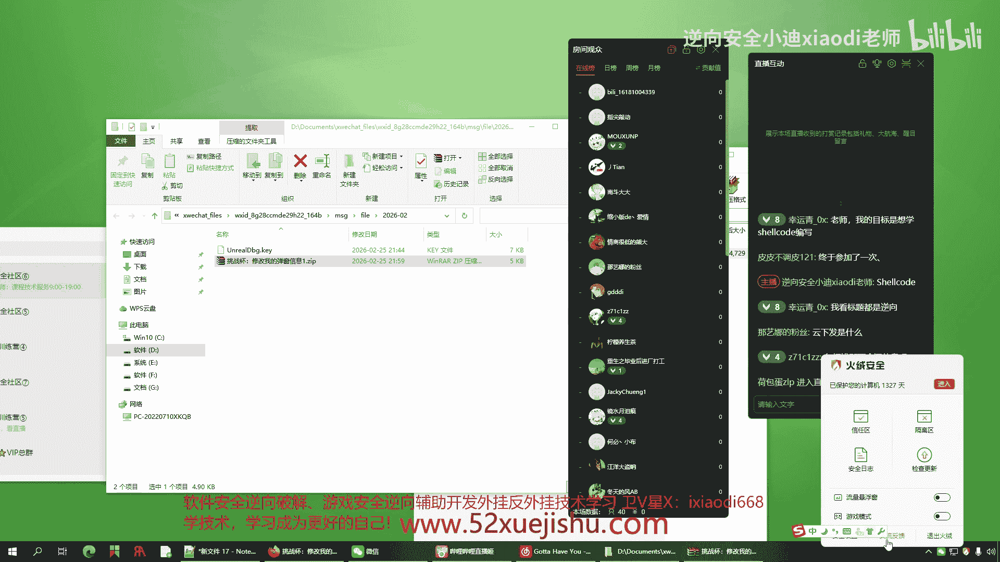
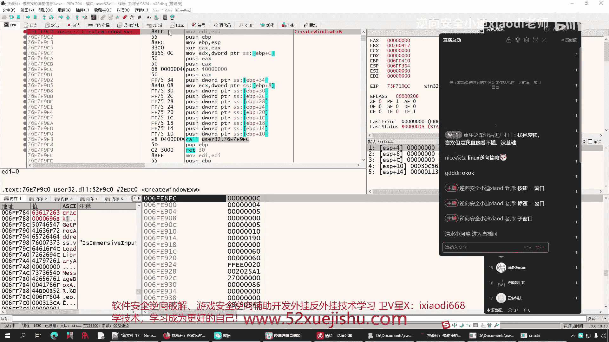
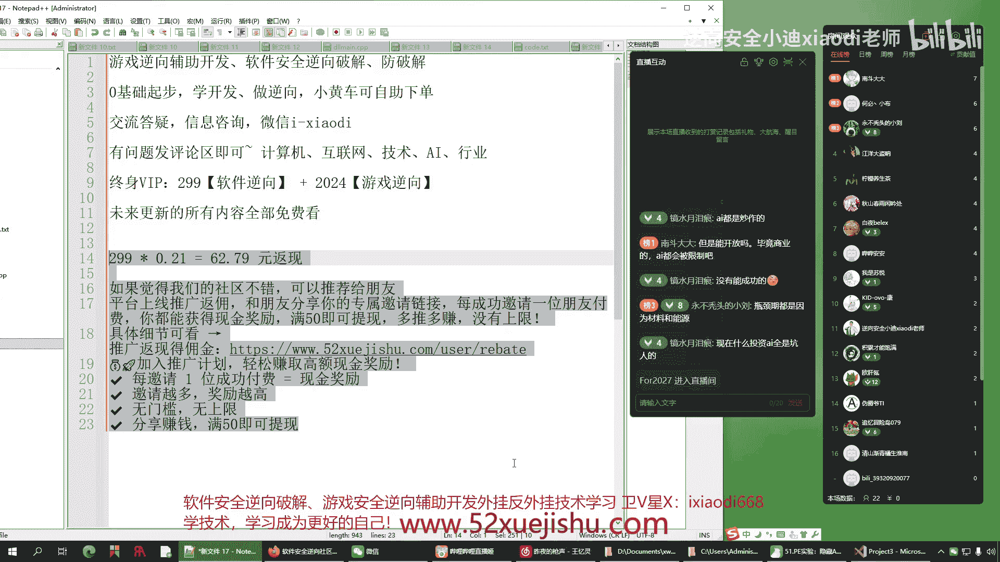

## 🧭 软件逆向实战：01：课程概述与环境说明

在本节课中我们将要学习软件逆向中字符串加密、隐藏API调用和Shellcode技术实战。课程内容来自直播回放整理，主题包括软件逆向、网络验证、软件安全、网络安全和CTF比赛基础。开始前先说明：本教程只用于授权环境和学习研究，不应在未授权目标上使用。直播开始时播放轻音乐，讲解群消息免打扰设置：当前号开启免打扰，另一个号未开启；群内艾特能直接看到消息。直播消息很多，需要逐步梳理。

程序启动后提示风险，这个提示不必紧张。演示环境中处理提示风险的一种方法是退出杀毒软件，退出后看不到报毒提示。有人问自己写的软件报毒怎么办，原文给出的思路是退出杀软，或者卸载杀软，报毒提示就会消失。这个做法只适用于隔离的授权实验环境，真实环境应做正规签名、白名单和合规检测。

本节先梳理逆向思路。有人提出在`MessageBoxA`下断点并修改栈，娜英粉丝和凭空等同学在讨论。按照这个思路使用DBG：把程序拖进去，点击文件，点击附加，先运行程序。这个拖入和附加操作需要检查是否正确。随后处理字符串：点击符号，切换到程序模块，搜索当前模块字符串，或者搜索所有用户模块字符串。程序没有壳，模块非常干净，附加已经执行。

完成附加后，搜索字符串，发现小迪没有出现，8273还在。信息框相关函数下断点稍后观察。直播有回放，今天尽量安排回放。接着按思路给`MessageBoxA`下断点，使用快捷键输入函数名；同时给`MessageBoxW`也打上断点，然后重启程序。实际运行时没有断下来。有人提出用`CreateWindow`窗口绘制相关断点，于是给`CreateWindowExA`和`CreateWindowExW`也下断点，再重启程序。断在Create窗口后，需要继续操作；原文指出话不能说一半，需要完整分析。

在断下后可以查找但改不了。查调用堆栈时，可以用CE在内存中搜索特征码，例如在内存布局中搜索匹配特征，搜索小迪字符串，注意大小写：X为大写，后面为小写。实际搜索没有找到。于是先回溯看参数，使用`Ctrl+F9`和`F8`寻找关键内容，反复运行到系统领空`combase`，仍然没有明确终点。查看调用堆栈可以看到多层嵌套，上层是系统领空调用，从某处开始出现用户模块调用。双击用户模块调用位置，可能是关键点，但不能说一定，只能说可能。在该位置下断点，上面没有额外跳转，重启程序后确实断下。按`F8`单步执行，可以看到`MessageBoxA`被隐藏起来，随后悄悄调用。通过调用堆栈能猜出大概逻辑：先`push MessageBoxA`，再`push 76E5000`，调用后得到`EAX`，这个`EAX`是动态获取的`MessageBoxA`地址，所以之前直接下断点断不下来。动态获取地址后继续调用，小迪字符串出现，将小迪压入，再压入`ss`。右键使用二进制编辑，把`C2ACKE`改为`Crack`，按`F8`运行成功。这个思路可行，关键看能否在调用堆栈中碰上关键点。

需要说明，真正考察点不是`CreateWindow`本身。所有弹窗本质上也是窗口，按钮不是普通按钮，按钮在底层也是窗口；标签也是窗口，只是称为子窗口。只要是Windows原生API界面，都可以用Create窗口断点；D3D绘制的界面不行，MGUI界面也要找对应特征。原文还提到打开语雀资料，但重要资料不展示。通过这个案例要理解隐藏API调用的原理。

## 🔍 软件逆向实战：02：字符串搜索与断点定位

上一节介绍了通过Create窗口和调用堆栈定位隐藏调用。本节我们来看看字符串搜索、断点位置和内存特征定位的具体过程。直播中先尝试直接搜索字符串，结果是搜不到小迪，说明字符串可能被加密或被隐藏。8273仍然存在，说明并非所有字符串都消失。信息框函数下断点也没有立即断下，需要结合重启程序、附加进程和调用堆栈一起分析。

以下是本节涉及的操作要点，按原文顺序整理，便于初学者照着理解思路。



- 使用DBG附加程序：先运行目标程序，点击文件，点击附加，选择目标进程。
- 点击符号切换到目标模块，搜索当前模块字符串，也可以搜索所有用户模块字符串。
- 搜索小迪失败后，不要只盯着字符串窗口，要查看信息框函数断点、调用堆栈和内存布局。
- 对`MessageBoxA`和`MessageBoxW`下断点后重启程序，发现断不下来，说明调用路径被处理过。
- 尝试`CreateWindowExA`和`CreateWindowExW`断点，重启后能断在Create窗口路径。
- 在调用堆栈中查看嵌套调用：上层是系统领空，下层开始出现用户模块调用，用户模块位置可能是关键点。
- 在用户模块跳转处下断，重启后断下，按`F8`单步观察`push`和动态获取函数地址的过程。
- 使用CE在内存布局中搜索特征码，搜索小迪字符串时注意大小写；搜索不到说明字符串可能被加密。
- 使用`Ctrl+F9`和`F8`回溯参数，反复运行到系统领空`combase`，观察调用堆栈变化。
- 找到动态获取`MessageBoxA`地址的代码后，可以在字符串压栈处右键二进制编辑，把测试字符串改为`Crack`并运行验证。

原文强调，按钮、标签、弹窗在Windows底层都属于窗口体系，所以Create窗口断点对原生Windows界面有效。对于D3D绘制或MGUI界面，需要寻找对应框架特征，不能直接套用Create窗口断点。这个案例中Create窗口断点只是碰上了，真正要学习的是隐藏API调用。


## 🧬 软件逆向实战：03：隐藏API调用与调用堆栈分析

上一节我们通过字符串和断点找到了一个可用路径。本节我们来看看隐藏API调用的核心逻辑。原文把这种技术称为隐藏的API调用，它通常依赖PEB解析导出表，动态获取API函数地址，而不是在导入表中直接写明函数。隐藏调用会把原本的函数入口流程改掉，让调试器在函数头部下断点时断不下来。原文还用“悄悄进村，打枪不要”形容这个过程，意思是调用被藏起来，不主动暴露函数名和字符串。

以下是隐藏API调用的核心概念，用公式和伪代码表示。

```text
模块基址 = PEB->Ldr->InMemoryOrderModuleList 中目标模块
函数地址 = 解析导出表(模块基址, 函数名)
调用结果 = 调用函数地址(参数...)
```

原文演示的动态获取`MessageBoxA`地址过程可以概括为：先获取模块基址，再解析导出表，找到函数名对应的地址，把地址保存到寄存器，最后通过寄存器调用。因为地址是动态获取的，所以直接在`MessageBoxA`函数头下断点可能无效。原文还提到`MessageBoxA`最终会调用`MessageBoxW`，这是微软设计的底层逻辑，因此可以在更底层的W函数内部下断点。

以下是原文中分析隐藏调用时涉及的断点位置和现象，按操作顺序列出。

- 在`MessageBoxA`和`MessageBoxW`函数头下断，重启后没有断下。
- 在`CreateWindowExA`和`CreateWindowExW`下断，可以断在窗口创建路径。
- 查看调用堆栈，找到从系统领空进入用户模块的边界，在用户模块跳转处下断。
- 重启后断下，按`F8`单步，观察`push MessageBoxA`、`push 76E5000`、调用后得到`EAX`的过程。
- 继续单步，能看到小迪字符串被压栈，说明程序自己实现了字符串压栈和函数调用。
- 在字符串压栈位置右键二进制编辑，把测试字符串改为`Crack`，运行后验证修改成功。
- 如果函数头断不下，可以尝试函数中间、函数尾部或底层`MessageBoxW`内部下断。
- 原文指出，函数头容易被处理掉，中间断点也可能被处理，需要继续找更深层实现。

原文还演示了通过PEB硬件断点定位关键代码。PEB在`FS:[0x30]`位置，可以在调试器中双击`FS`，找到`FS:[0x30]`，右键设置硬件访问四字节断点，然后不断运行，直到从系统领空进入程序领空。进入程序领空后就是关键点，此时可以删除硬件断点，重启程序，再单步观察PEB解析和导出表遍历过程。这个方法能较快看到关键数据。

## 🧩 软件逆向实战：04：Shellcode与导出表原理

上一节介绍了隐藏API调用依赖PEB和导出表。本节我们来看看Shellcode与导出表的关系。原文先解释Shellcode：Shellcode是一段精心编写的机器码，通常用于软件漏洞利用，让程序执行攻击者指定的操作。它最常见的功能是启动一个命令行，然后上线。Shellcode是无地址无关代码，本质是一串原始二进制指令，可以直接被CPU执行，不依赖操作系统的标准加载流程，也不调用Windows API函数。它也可以理解为一种特殊格式的动态链接库，需要按照接口格式对接；要学会逆向Shellcode，最好先学会自己写Shellcode，知道接口怎么对接、结构是什么样，才能分析。原文还提到，有人只写过一句话木马，而Shellcode需要按接口和结构对接，不能乱写乱分析。

以下是Shellcode的核心特点，按原文含义整理。

- Shellcode是精心编写的机器码，不是普通高级语言代码。
- Shellcode通常用于漏洞利用，让程序执行指定操作。
- 常见功能是启动命令行并上线。
- Shellcode是无地址无关代码。
- 本质是原始二进制指令，可以直接被CPU执行。
- 不依赖操作系统标准加载流程。
- 不调用任何Windows API函数。
- 属于一种特殊格式的动态链接库，需要对接接口。
- 需要先会写Shellcode，理解接口和结构，才能逆向分析。
- 字符串可以加密，常见简单加密是异或加密。

导出表的作用是告诉外部模块导出了哪些函数以及函数地址。原文提到导出表中有三个重要数组：`AddressOfFunctions`、`AddressOfNames`、`AddressOfNameOrdinals`，分别对应函数地址、函数名字符串RVA、序号。前面课程还讲过按序号导出解析、序号空洞解析、转发中转导出等内容，这里不重复展开。Shellcode没有导入表、IAT和重定位，因此需要解析导出表，动态获取API函数地址。核心关系可以写成：

```text
API地址 = 导出表.AddressOfFunctions[序号]
函数名 = 导出表.AddressOfNames[序号]
序号 = 导出表.AddressOfNameOrdinals[索引]
```

原文展示了一段汇编代码：通过PEB获取模块地址，再从模块地址遍历导出表，找到目标函数并动态调用。代码中字符串没有加密，因此容易被搜索到。另一个版本对字符串做异或加密，例如将`hide`、`小迪`、`success`、`MessageBox`等字符串与`0x55`异或，解密时再与`0x55`异或还原。公式如下：

```text
密文 = 明文 XOR 0x55
明文 = 密文 XOR 0x55
```

字符串加密后，搜索字符串时什么都搜不到。原文指出，这种简单加密的密钥通常只有几个字节或一个字节，算法需要多练习。除了字符串加密，还要注意`strcmp`等C库函数调用特征。`strcmp`比较敏感，分析者看到`strcmp`就可能定位字符串比较位置，从而找到关键点。为了规避这个特征，可以自己实现一个字符串比较函数，不用标准`strcmp`。还可以用`LEA`等等价汇编指令替换明显指令，或者插入花指令进行混淆，让杀毒软件和逆向人员不容易抓到特征。

## 🛡️ 软件逆向实战：05：隐藏函数调用与断点选择

上一节介绍了Shellcode解析导出表和字符串加密。本节我们来看看如何隐藏函数调用，以及为什么有些断点断不下来。原文演示了一个处理过的程序：直接调用`MessageBox`时仍然可能断下，第一次下断可能断不上，重启程序后又能断上；要让断点彻底断不上，需要额外处理。处理方法不是直接调用原函数，而是自己创建一个类似`MessageBoxA`的函数，通过篡改和模拟执行来隐藏调用。

以下是原文演示的隐藏调用处理思路，按步骤说明。

- 原本`MessageBoxA`从函数头开始执行，程序把执行地址改到函数内部某个位置，例如加5跳过开头5个字节。
- 跳过开头后，原本开头的几行代码仍然重要，需要模拟执行。
- 模拟执行会改变栈和寄存器状态，因此要保存原来的`EBP`和返回地址。
- 模拟执行完开头字节后，再跳回原函数继续执行，实现类似“狸猫换太子”的效果。
- 这样调试器在函数头下断点时断不下来，因为函数头代码没有按原流程执行。
- 只有真正执行被篡改后的代码位置，断点才会命中。
- 原文在函数中间下断点可以断下，在函数头下断点断不下。
- 真正核心代码在自定义执行位置，原文通过单步和调用堆栈观察这个过程。

原文指出，不能只在函数头下断点，可以尝试函数尾部下断，但函数尾部也不一定可行。实际可行的位置是底层实现函数，例如`MessageBoxA`最终调用`MessageBoxW`，可以在W函数内部下断点。原文还提到“文本存哪里了，文本存站上了”，说明字符串可能保存在栈这种临时空间，补丁不了，因为栈是临时的。文本加密常见做法也是异或加密。

以下是断点选择的经验，按原文含义整理。

- 函数头下断是常规做法，但遇到隐藏调用时会失效。
- 函数尾部下断不一定有效，需要实际测试。
- 函数中间下断有时有效，但中间也可能被处理。
- 更底层的`MessageBoxW`内部下断通常更可靠。
- 在PEB的`FS:[0x30]`设置硬件访问断点，运行到程序领空后单步，可以定位解析导出表的关键代码。
- 面对加密字符串，直接搜索字符串无效，需要从API调用、PEB、导出表和调用堆栈入手。
- 插件自动下断只能适应一般情况，高级隐藏调用需要手动分析底层函数。

## 🧰 软件逆向实战：06：工具选择与动态分析

上一节介绍了隐藏调用和断点选择。本节我们来看看工具选择。原文强调，IDA功能很强，拖入程序后按F5就能看到伪代码，很多内容直接出来，这样不利于学习原理。因此课程要求使用x32dbg进行动态分析，通过单步、调用堆栈、内存布局和硬件断点理解程序行为。原文说“为了改而改没有意思，主要是懂原理”。如果直接用IDA看伪代码，虽然快，但学习效果不好。

以下是原文对工具和难度的说明，按含义整理。

- IDA拖入程序后F5可以直接生成伪代码，分析非常强大。
- 课程要求使用x32dbg动态分析，理解底层执行过程。
- 提供的练习程序特意做成无壳版本，降低难度，方便练手。
- 如果有壳，初学者容易卡住；无壳版本用于锻炼动态分析能力。
- 插件自动下断只能处理一般情况，不能覆盖高级隐藏调用。
- 原文提到以前写过过检测文章，例如游戏CRC检测，但过检测需要自己研究。
- 传奇辅助、方框透视等游戏辅助开发内容课程可以满足，辅助涂色版本价格299。
- 课程没有专门讲ACE反作弊，也没有专门讲天龙教程；ACE检测可以自己研究。
- 微信互客没有讲过，以后有机会再讲。

## 💬 软件逆向实战：07：课堂互动与学习建议

上一节介绍了工具选择和动态分析。本节我们来看看直播中的课堂互动和课程说明。原文包含较多直播互动、课程销售和AI讨论，这里按含义整理，便于理解课程背景。直播过程中有观众提问、加群、推广和返现说明，这些内容与逆向学习环境有关。原文还提到电脑卡、课程价格、返佣比例、AI未来判断等内容，下面逐项说明。

以下是课堂互动和课程说明的要点，按原文含义整理。

- 直播开始有轻音乐，群消息免打扰设置影响消息查看，群内艾特能看到消息。
- 有人问邪恶软件从不报毒怎么办，原文用玩笑方式称赞。
- 有人问官网修改标题工具，原文提到附加进程和运行程序的操作。
- 有人要学Shellcode，原文说本课偏向Shellcode，后期会出Shellcode专题。
- 幸运青等同学离开直播间，原文感叹错过学习机会。
- 直播有回放，今天尽量安排回放。
- 课程有199和299等版本：199比B站免费课多内部视频和实验程序，主要起引流作用；高级版内容更完整，核心内容绑定播放器，别处看不到。
- 高级版需要单独下单或扫码加入；微信是“爱小迪668”。
- 平台有21%返佣，299乘以0.21等于62.79；推荐会员加入可返现62.79。
- 群内有问必答，群友也会帮助回答；原文强调群内氛围和推广。
- 原文提到“明天加微信”没有必要等，可以直接加微信。
- 原文说“南斗大大不用花钱，后边会讲微信互客”，以后有机会再讲。
- 原文提到“有蛋糕大家一块分”，推荐返现可以参与；也说当前GMV为0，直播半天没人购买，原文用玩笑说老师没有钱换电脑。
- 原文提到电脑运行直播很卡，运行2026类工具跑不起来，内存条和硬盘涨价买不起，电脑属于“老头乐”级别；这些都是直播环境说明。
- 原文提到课程质量清晰，价位在国内国外都比较有竞争力，前面导出表等内容已经更新完成，质量上层。
- 原文提到变现机会：有群和机会就可以变现，群友可以多交流。
- 原文讨论AI：三年后逆向可能基本自动化，无壳程序可能被AI自动分析，加壳程序未必；MCP和AI目前缺少足够样本，逆向需要逻辑上下文和数据关联，调试器、VT调试、反调试有门槛；商业AI受法律限制；当前AI还比较鸡肋，所以暂时不用MCP。
- 原文认为AI比人智能、反应快，但逆向缺少足够数据投喂；写小说、喂鲁迅文章、李清照诗词、李白诗、朱自清散文很容易学，逆向汇编不能只靠一行行读，还要理解复杂逻辑和上下文数据关联，并在关联中找重点。
- 原文提到现在AI还没有那么智能，三年后VM可能都能分析；互联网有10年周期，未来几年是变革之年，建议多接触新技术。
- 原文提到商业AI容易被限制，开放程度受限，未来如何发展需要观察。
- 原文提到“谁不想省事躺着挣钱”，但当前AI还不行，所以暂时不用AI替代人工分析。
- 原文提到有人问“有没有能成功的”，原文认为目前没有成功方案；还提到“SP识别日”和文章致谢，表示如果文章发布可以致谢。
- 原文提到多拉进群、多交流，C语言基础应该会；群内可以继续交流问题。
- 原文最后邀请“上个实战，随便搞一搞，学习学习”。

## ✅ 软件逆向实战：08：课程总结



本节课中我们一起学习了软件逆向中字符串加密、隐藏API调用和Shellcode技术实战。开头说明了授权环境和杀软提示风险的处理背景，然后从字符串搜索和断点定位入手，观察到直接搜索小迪失败、`MessageBoxA`函数头断点失效，接着通过Create窗口断点、调用堆栈、内存特征和用户模块跳转找到隐藏调用路径。随后分析了PEB、导出表和动态获取API地址的原理，解释了Shellcode是无地址无关机器码、不依赖标准加载流程、需要解析导出表获取函数地址。字符串加密部分学习了异或加密公式`明文 = 密文 XOR 0x55`，以及规避`strcmp`特征和指令混淆的思路。隐藏函数调用部分理解了函数头篡改、模拟执行、保存栈和返回地址、在底层`MessageBoxW`内部下断的方法。工具部分强调使用x32dbg动态分析而不是只依赖IDA伪代码。最后整理了课堂互动、课程版本、返佣、AI讨论和学习建议。课后可以按原文思路做一次无壳程序实战，重点观察调用堆栈、PEB硬件断点和导出表解析过程，理解原理后再进行修改和验证。

