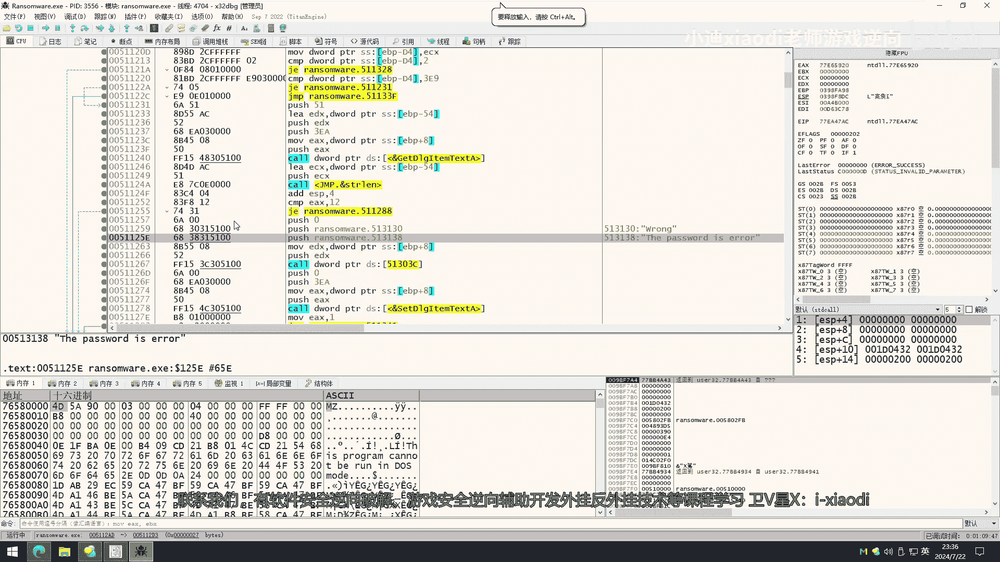
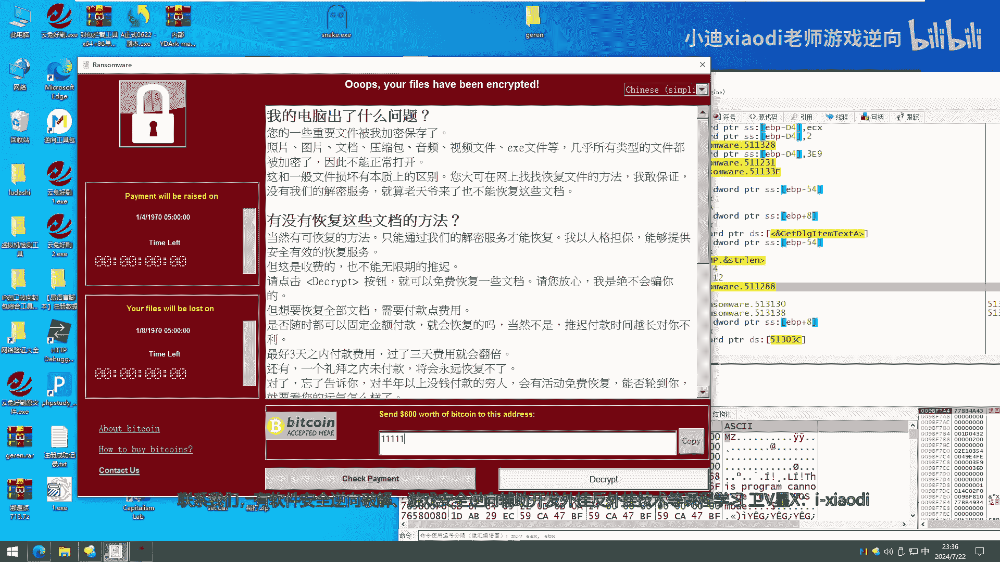
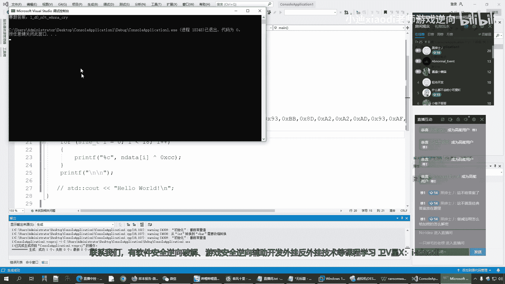
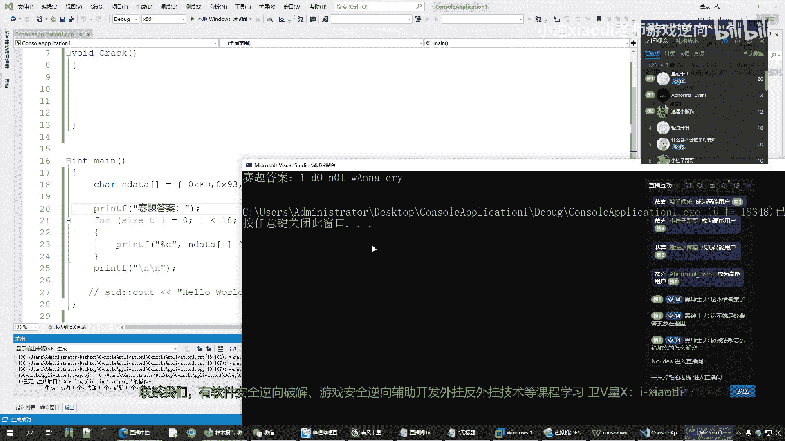
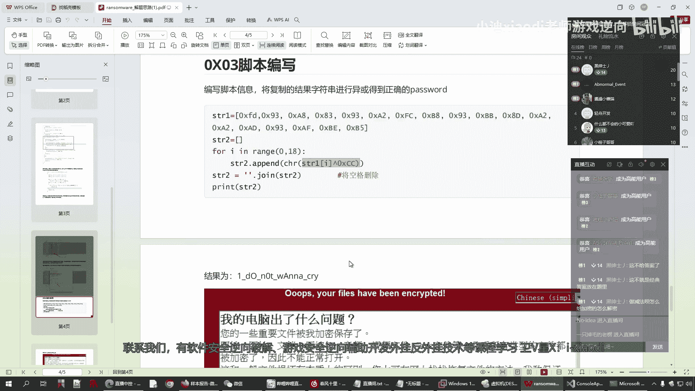
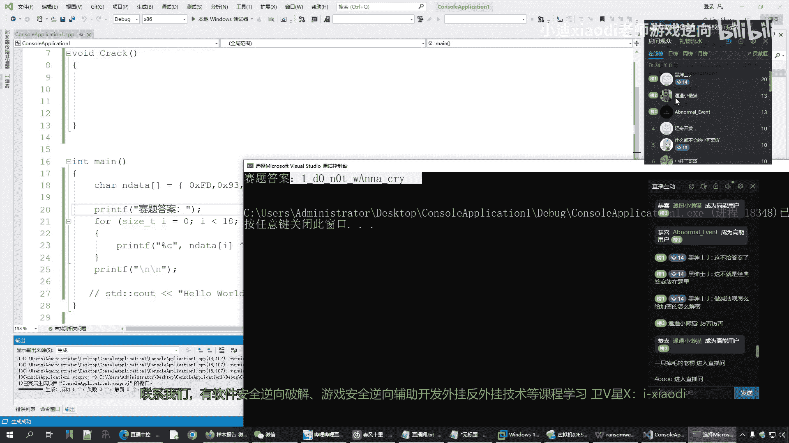
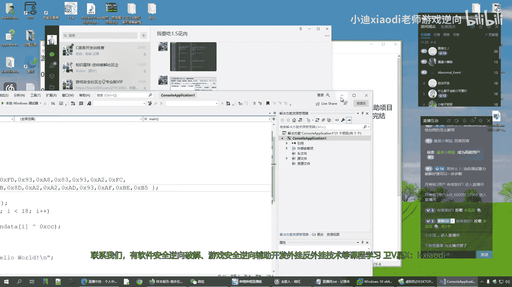

# CTF逆向工程实战：第1章：直播间惊险勒索软件逆向flag

## 🎯 本节概述

在本节课中，我们将要学习一个来自B站视频BV1Wi421a7CL-的CTF逆向题目。这个题目被描述为“直播间惊险勒索软件逆向flag”，由社区成员提供。题目本身看起来是一个简单的程序，要求输入密码，但背后隐藏着长度校验和逐字节异或的逻辑。我们会使用OD（OllyDbg）动态调试工具，一步一步分析这个程序的汇编代码，最终写出解密脚本，得到正确的flag。





通过这个案例，我们既能巩固动态调试的基本功，也能理解CTF中常见的“长度校验+异或加密”套路。不管你是想入门软件安全、游戏安全，还是准备CTF比赛，这道题都是一份非常合适的练习材料。接下来，我们就从零开始，把这道题彻底拆解。

## 🔍 初步尝试与现象观察

我们先运行这个程序，看看它长什么样。程序界面非常简陋，只有一个输入框和一个按钮。点击按钮，输入任意内容，程序弹出一个提示框，上面写着“password is error”，除此之外没有任何其他信息。好像这个程序就只做了这么一件事：提示密码错误。当然，这也太假了，作为一个CTF赛题，它绝对不可能这么简单。如果我们直接搜索字符串，比如用PEiD或者IDA打开，能看到一些线索，比如“Flaag”、“rong”、“congratulations”等，但真正关键的逻辑还是得靠动态调试来还原。

从直觉上看，这个程序甚至不需要分析，直接爆破（修改跳转指令）就能通过。但这里我们选择更硬核的方式：用OD动态调试，看它到底在背后做了什么。毕竟爆破只能解决这一个程序，而分析逻辑能让你理解一类程序。而且，这道题表面上看没有“注册码”，其实它是有校验的，只是校验方式比较隐晦。

## 🛠️ 动态调试：定位长度校验

我们打开OD，载入这个程序。先随便输入一个字符串，比如“111”，然后下断点，让程序断下来。通过单步跟踪，我们发现程序调用了`strlen`函数来计算我们输入的长度。接着，它把这个长度与`0x12`（也就是十进制的18）进行比较。如果长度不等于18，程序就会跳到错误提示的分支，显示“password is error”。

这就是第一个关键点：程序首先检查输入的长度必须是18位。我们在OD里可以看到一个`cmp`指令，比如`cmp eax, 0x12`，紧接着是条件跳转。如果我们直接把长度改成18，那么这一步校验就能通过。但不要高兴太早，因为后面还有更多的校验。

这里我们可以总结一下目前为止发现的信息：

- 程序使用`strlen`获取输入长度。
- 长度必须等于`0x12`（18），否则直接失败。
- 修改长度可以让第一层校验通过，但后面还有别的动作。

所以，我们动手改一下。在OD中，我们可以修改`strlen`返回的结果，或者直接修改比较指令的跳转条件，让它跳过长度不相等时的错误分支。这样程序就能往下走了。

## 🔄 逐字节异或：把输入和0xCC进行运算

长度校验通过之后，程序继续执行。我们单步跟进去，发现它开始对我们的输入字符串做操作。注意看，程序先取输入的第一个字节，然后与`0xCC`进行异或（XOR）运算。比如我们输入的字符是“1”，ASCII码是`0x31`，`0x31 XOR 0xCC = 0xFD`。程序得到这个结果后，会把它放到某个地址中，准备后续使用。

这个异或操作并不是只做一次，而是循环处理每一个字节。也就是说，程序会依次取出输入的每个字符，和`0xCC`异或，然后把结果存放起来。这里我们看到了一个典型的加密/解密操作：`result[i] = input[i] ^ 0xCC`。要注意，异或操作是可逆的，如果输入是密文，那么和`0xCC`再异或一次就能还原出原文。

我们通过OD观察内存，可以看到每一次异或的结果。例如，如果我们输入18个“1”，那么每一个字节异或后的结果都是`0xFD`。内存里就会填满`FD`。这说明程序确实在逐字节地处理我们的输入。

下面是这个步骤的核心逻辑，可以用一段伪代码表示：

```python
for i in range(18):
    result[i] = input[i] ^ 0xCC
```

这个过程在汇编中表现为一个循环。程序会先取一个字节，异或，存储，然后判断是否已经处理完18个字节。如果没有，就继续循环。这个套路在CTF中非常常见，本质上是把输入进行简单的变换，然后再与目标数据进行比较。

## 📍 关键比较：与内存地址0x514000处的数据逐一比对

现在，我们已经知道程序会把输入与`0xCC`异或。但异或之后呢？异或的结果会拿去和什么比较？继续向下跟踪，我们发现了一个非常重要的地址：`0x514000`。程序会从`0x514000`这个内存地址开始，取出一个个字节，然后将这些字节与我们异或后的结果进行比较。

具体来说，程序从零开始计数，每次取出`0x514000`处的一个字节，比如第一个字节是`0x93`，第二个字节是`0xA8`，第三个字节是`0x83`……然后，它把这些字节与我们输入异或后的结果逐一对比。只有当两者完全相等时，校验才会通过。

我们来梳理一下这个逻辑：

- 程序首先要求我们的输入长度必须是18。
- 然后，它把输入的每个字节与`0xCC`异或。
- 接着，它把异或后的结果与内存地址`0x514000`处的18个字节逐一比较。

那么，如果我们想让校验通过，就需要满足：

```text
input[i] ^ 0xCC = data[0x514000 + i]
```

因此，输入的正确值应该是：

```text
input[i] = data[0x514000 + i] ^ 0xCC
```

这个`data[0x514000 + i]`就是藏在程序里的密文。在OD中，我们可以直接把这个内存区域的数据复制出来。这些数据看起来是一堆十六进制字节，比如`93 A8 83 B5 ...`。我们把这些二进制数据提取出来，然后用脚本和`0xCC`异或，就能得到正确的输入。

顺带一提，我们在这个程序里还看到了一个用Python写的脚本，里面也是用`open`读取数据，然后和`0xCC`做异或。这印证了我们从汇编里分析出来的逻辑是完全正确的。

## 🧩 编写解密脚本，获取flag

既然我们已经知道了加密算法，那么解密就很简单了。我们可以用Python或者C语言写一个脚本，把从`0x514000`处提取出来的数据与`0xCC`逐字节异或，得到的就是正确输入，也就是flag。

下面是Python脚本的示例：

```python
data = [
    0x93, 0xA8, 0x83, 0xB5, 0xFD, 0x93, 0xA8, 0x83,
    0xB5, 0xFD, 0x93, 0xA8, 0x83, 0xB5, 0xFD, 0x93,
    0xA8, 0x83
]  # 这里填写从内存0x514000处提取的18个字节

flag = ''.join(chr(byte ^ 0xCC) for byte in data)
print("赛题答案:", flag)
```

在这里，我们用一个列表保存从内存中提取的密文。列表里每个元素是一个字节，比如`0x93`、`0xA8`、`0x83`等等。然后，我们使用`byte ^ 0xCC`对每个字节进行异或解密，把结果转换成字符，最后拼接成字符串。运行这个脚本，就能得到正确的flag了。

当然，用C语言写也是一样，核心逻辑就是异或。比如：





```c
unsigned char data[] = {0x93, 0xA8, 0x83, 0xB5, ...};
for (int i = 0; i < 18; i++) {
    printf("%c", data[i] ^ 0xCC);
}
```



总之，这个题目实际上就是一个“长度校验+异或解密”的流程，并不复杂。我们通过动态调试，一步一步找到了校验的长度、异或的密钥、密文的存放地址，最后用脚本还原出了正确答案。整个过程也验证了：只要跟着逻辑走，任何加密都能被解开。



## 💡 总结与扩展

本节课中，我们一起学习了如何用动态调试的方式解决一道CTF逆向题目。我们首先运行程序，发现它只会提示“password is error”。然后，我们用OD下断点，找到了程序对输入长度的校验：长度必须是18。接着，我们分析了它的核心计算：把输入的每个字节与`0xCC`异或，再与内存地址`0x514000`处的数据逐一比较。最后，我们根据这个逻辑编写了解密脚本，成功还原出了flag。

这道题虽然难度不高，但它非常典型。它告诉我们，很多程序所谓的“注册码”其实并不是直接存储的，而是经过异或等简单变换后隐藏在内存或文件中。动态调试能让我们一步步看清程序在干什么，然后利用这些信息反推出正确的输入。这种方法不仅适用于CTF比赛，也适用于网络验证、数据包解密等场景。动态调试的基本功是每个逆向工程师都必须掌握的。当你面对一个程序时，不要急着爆破，先看看它到底在做什么，这样你才能真正理解它，进而破解它。

另外，如果你使用IDA这类静态分析工具，可能会更快地看到异或逻辑，但动态调试能让你更直观地观察数据的变化。两种方法各有优势，但基础都是一样的：理解汇编、理解程序行为。希望大家通过这个案例，能够举一反三，今后遇到类似的“假注册码”程序时，能够轻松搞定。



好了，本节的内容就到这里。我们下一节课再见。
