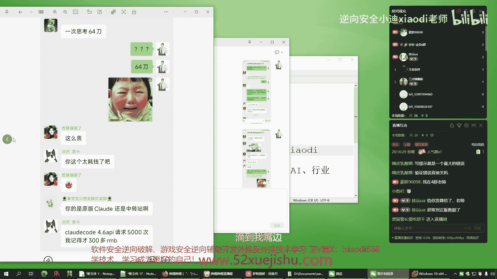

# 🧭 软件逆向破解技术：01：课程概述与样本现象

在本节课中我们将要学习软件逆向破解中的自删除外挂对抗方法。课程会围绕游戏安全、软件安全、网络安全以及CTF比赛必备基础展开，目标是讲清楚如何发现样本的进程隐藏、文件自删除、释放母体，以及如何用调试器和拦截工具切入分析。原文样本在更新到最新版本后出现可疑行为，这类样本刚更新时往往会把关键动作藏起来，因此需要先观察它到底做了什么，再决定从哪里下手。

这里先把核心概念用公式说清楚。自删除可以理解为：`自删除 = 程序运行后删除自身文件 => 原路径文件属性不可见`。母体文件可以理解为：`母体 = 被释放到磁盘的真实程序文件`。这两个概念会贯穿后面的操作，先记住它们，后面分析时不容易乱。

上一段已经交代了课程目标，本节中我们先把样本现象看清楚。样本更新后做了一个进程隐藏，程序本身比较可疑，因为在任务管理器或常规位置看不到它的进程信息。它有可能注入到系统进程里面，也可能把自己释放到某个路径后再删除。继续观察可以看到，它释放到了某个位置，通过定位进程文件可以找到目标进程文件，但此刻这个文件应该已经不存在了。查看进程文件属性时找不到这个东西，这就是自删除的表现。样本以管理员权限运行后执行自删除，因此后续操作要考虑管理员权限环境。

# 🕵️ 软件逆向破解技术：02：发现进程隐藏与自删除

上一节介绍了样本更新后的可疑现象，本节中我们来看看如何确认进程隐藏和自删除。先不要急着直接附加调试器，因为样本会隐藏进程，直接附加可能找不到目标，也可能触发它的保护。可以先从文件释放路径、进程文件定位、文件属性查看这几个角度入手，确认它是不是运行后就把自身删除了。

以下是观察样本自删除的基础步骤，按顺序做可以少走弯路。

1. 观察样本更新后是否出现进程隐藏，常规位置看不到进程时，要考虑注入系统进程的可能。


2. 定位样本释放文件的路径，找到它写入磁盘的位置。

3. 通过进程文件定位目标文件，查看该路径下的文件是否仍然存在。

4. 查看进程文件属性，如果找不到文件，说明样本可能在管理员权限运行后执行了自删除。

5. 记录管理员权限运行这一条件，后续拦截和调试都要在相同权限环境下复现。

完成这些观察后，就能确认样本存在自删除行为。原文中提到先直接附加调试，并判断它可能是32位程序，也可能为64位程序，样本以管理员身份运行。实际操作中直接附加会闪退，因此不能硬附加，需要改用调试器启动样本，在调试器运行过程中处理文件自删除问题。


# 🛡️ 软件逆向破解技术：03：用火绒自定义防护拦截释放文件

上一节确认了样本会自删除，本节中我们来看看如何用火绒自定义防护拦住它的文件释放动作。思路很直白：样本要写文件、改文件、删文件时，先让火绒询问是否允许，这样就能在关键时间点把释放出来的真实文件提取出来。原文使用火绒的自定义防护，打开后立即开启，再进入设置添加自定义规则。发起程序选择样本程序MADC，保护对象设置到Windows目录下，并把删除或修改等操作勾选上，保存后运行样本，火绒就会询问是否处理。

核心规则可以用下面的伪代码描述，重点是发起程序、保护对象和操作类型三者匹配。

```text
拦截规则 = 发起程序(MADC) + 保护对象(C:\Windows 相关路径) + 操作类型(创建/修改/删除/读取)
如果 规则匹配 则 弹出询问
```

以下是配置火绒自定义防护并提取释放文件的操作列表，每一步都要看清路径和勾选项。

1. 打开火绒的自定义防护功能，选择立即开启。

2. 进入设置，添加自定义规则，添加发起程序，找到并选择样本程序MADC。

3. 添加保护对象，路径设置到Windows目录下，勾选删除或修改等需要拦截的操作。

4. 保存规则后运行样本，火绒会询问是否处理，此时先观察样本写入动作。

5. 样本写入EXUI界面库时，可以先允许，继续观察后续释放行为。

6. 查看目标路径`C:\Windows`下是否出现文件，如果没有，说明样本还没有完成释放。

7. 重新调整规则，把文件创建也勾选上，再运行样本。

8. 样本先创建名为MA的文件夹时，允许创建操作，观察文件是否开始出现。

9. 如果样本很快退出，说明拦截项还不完整，需要把修改、删除、读取等操作也勾选上。

10. 目录选择要准确，选择MADC对应目录，把读取、创建、删除等操作都纳入规则。

11. 保存后再次运行样本，允许创建动作，等待数据写入。

12. 数据写过来后，尽快新建文件夹，把释放出来的文件提取出来。

13. 对比提取文件的大小，原文中一个文件是2000多，另一个是3000多，大小不同说明提取到的是真实释放文件。

完成这些步骤后，样本释放的真实文件就被提取出来了。这里的关键是动作要快，因为样本写入数据后可能马上删除文件；规则不完整时会出现拦截不上、样本换文件夹、自动放行等情况，需要检查规则路径和勾选项。

# 📦 软件逆向破解技术：04：提取母体文件并做好备份

上一节提取到了真实释放文件，本节中我们来看看如何保存母体文件。提取出来的文件先不要直接拿去分析，最保险的方法是把它放进压缩包备份。这样即使后续运行或分析时文件出问题，还可以从压缩包重新解压，不会丢掉样本。

以下是母体文件备份的要点，操作简单但很重要。

1. 将提取出来的真实文件放入独立文件夹，避免和原样本目录混在一起。


2. 对文件做压缩包备份，保留原始文件大小和路径信息。


3. 后续如果样本被删除或损坏，直接从压缩包恢复，不要依赖原路径文件。

4. 记录提取文件的大小差异，2000多和3000多的文件不是同一个文件，分析时要以真实释放文件为准。

备份完成后，母体文件就可以用于后续运行和拦截测试。原文中提到这个提取出来的文件先不管它，重点是用它来复现母体的自删除行为。

# 🧱 软件逆向破解技术：05：拦截母体自删除

上一节完成了母体文件备份，本节中我们来看看如何拦截母体自身的自删除。运行提取出来的程序可以确认它确实有自删除行为。既然它会删除自己，就用火绒继续拦截：在自定义防护中再添加一个规则，发起程序选择新建文件夹里的母体程序，保护对象也选择这个母体文件，把删除操作勾选上。这样母体要删除文件时就会被拦截。

核心判断可以用公式表示：`拦截成功 = 发起程序匹配 ∧ 保护对象匹配 ∧ 操作类型匹配`。

以下是拦截母体自删除的操作列表，按顺序执行即可复现。

1. 运行提取出来的母体程序，确认它存在自删除行为。

2. 打开火绒自定义防护，再添加一个自定义规则。

3. 添加发起程序，选择新建文件夹里的母体程序。

4. 添加保护对象，同样选择这个母体文件，并勾选删除操作。

5. 保存规则后运行母体，管理员身份运行可以，不使用管理员身份运行也可以，重点是观察删除动作。

6. 当母体尝试删除文件时，火绒弹出询问，选择阻止。

7. 如果再次弹出删除询问，继续选择阻止。

8. 确认母体自删除被拦住后，就可以拖入调试器分析程序的真实信息。

完成这些操作后，母体文件的自删除也被干掉了。原文在这里提到可以开始分析程序真实信息，把真实程序拖过来查看，`YPS0`说明它可能带有网络验证一键夹，也可能带有虚拟防护。这里的判断只是线索，后面还要结合调试和静态信息继续确认。

# 🔍 软件逆向破解技术：06：静态信息、反调试与登录逻辑定位

上一节拦住了母体自删除，本节中我们来看看如何分析程序的真实信息、反调试和登录逻辑。把真实程序拖入分析工具后，可以看到它的一些基本信息。原文中调试器还在下载，速度比较慢，因此可以先做静态观察。建议配置反调试插件，选择一个基础的basic反调试配置，减少样本对调试行为的干扰。程序使用的是ESUI界面，很多窗口是自绘的，所以常规窗口信息可能看不到，这不代表程序简单，反而说明界面层做了封装。

以下是静态观察和调试定位的要点列表，先看信息再下断点。

1. 查看程序的基本窗口和界面信息，确认它是ESUI界面，很多内容为自绘。

2. 尝试查看登录逻辑，如果看不到明显实现，说明代码可能被混淆。

3. 观察是否存在奇怪的区段，这类区段可能是加密代码，登录完成后才进行解密。

4. 看到“登录失败卡密错误”等提示时，可以判断程序存在混淆，不能只看表面字符串。

5. 注意作者写了自己的钩子，正常API入口常见`mov edi, edi`一类形式，但作者在这里做了处理，不要被表面API骗过。

6. 这类钩子可能会检测断点，因此不要在容易被检测的位置下断，改为在底层函数下断点。

7. 在底层函数处下断点，点击登录，让程序断在底层调用位置。

8. 通过返回回溯继续跟踪，使用F8单步，结合Ctrl+F9和F8继续运行与单步。

9. 跟踪到某个位置后，可以看到作者使用了Hook壳技术，错误信息也是自己实现的简单错误提示。

10. 继续按F9、F8，再按M8继续跟踪，到达混淆区域后，分析余地就很小了。

11. 混淆区域可能是软件自己写的VM虚拟机，没有逆向经验时直接写解密脚本会很困难。

12. 原文提到可以用某个工具解决这类问题，但该工具需要花钱，是否使用要看实际需求。


调试快捷键可以整理成下面的代码形式，方便记忆。

```text
F8        = 单步执行
Ctrl+F9   = 运行到返回/继续执行
F9        = 继续运行
M8        = 原文中的继续跟踪操作
```

这里还要补充一点，AI可以辅助逆向。比如用AI帮助整理报错文本、API调用线索和混淆特征，可以减少查资料的时间；但AI不能替代动态调试，关键断点和拦截规则仍然要在调试器里验证。原文的标题提到AI助力逆向，实际分析时可以把AI当作辅助整理工具，不要把它当成自动破解工具。

# ✅ 软件逆向破解技术：07：课程总结



本节课中我们一起学习了软件逆向破解中对抗自删除外挂的完整流程。我们先是观察样本更新后的进程隐藏和自删除现象，然后通过定位进程文件、查看文件属性确认自删除行为；接着用火绒自定义防护拦截文件释放，把真实释放文件提取出来并做压缩包备份；随后用同样的拦截思路阻止母体自删除，再拖入分析工具查看真实信息、配置基础反调试、定位登录逻辑和底层函数断点；最后认识到样本可能使用Hook壳技术和自写VM虚拟机混淆，AI可以辅助整理线索，但动态调试和拦截验证仍然不可少。整套流程适合作为游戏安全、软件安全、网络安全和CTF比赛的基础练习，关键点是先观察行为，再拦截关键动作，最后切入真实母体进行分析。

