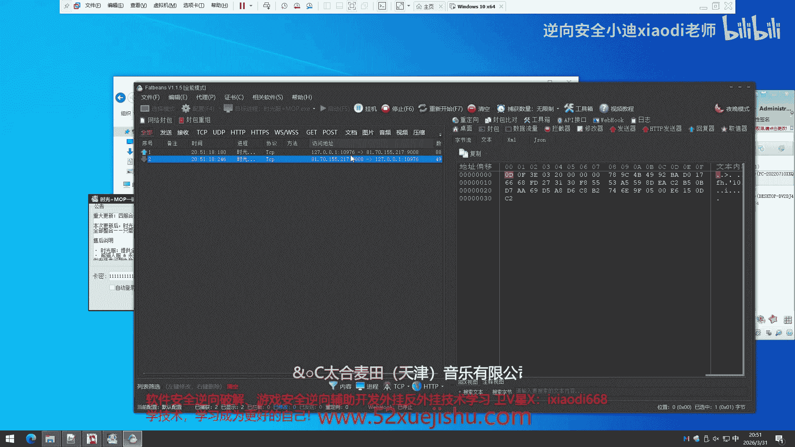
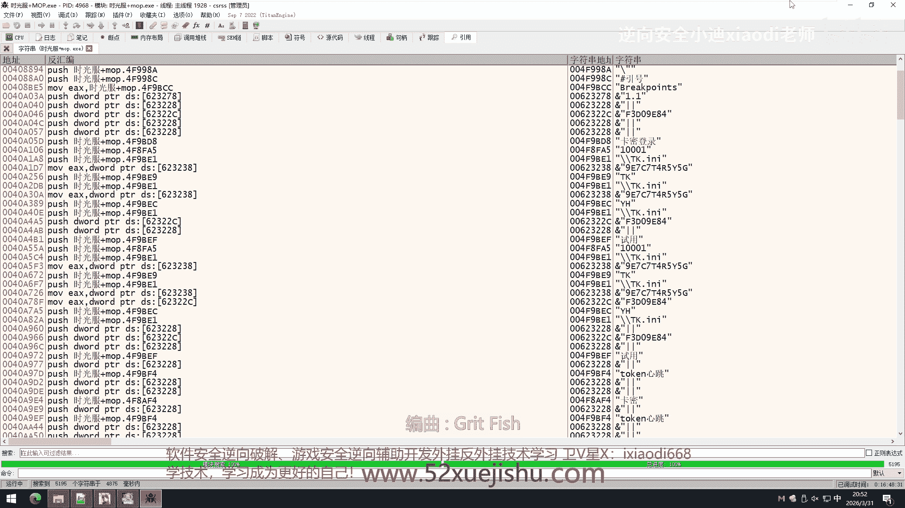
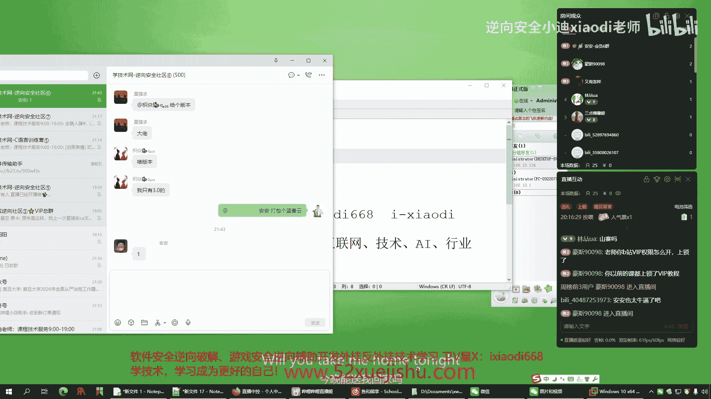

# 软件逆向破解技术：第1节：卫士盾网络验证破解实战

在本节课中，我们将演示如何对一个使用“卫士盾”网络验证的程序进行逆向分析与破解。整个分析过程会涉及查看程序特征、识别验证类型、定位关键代码以及最终实现破解。我们不会依赖复杂的工具，而是通过直观的观察和逻辑推理来一步步完成目标。整个过程以实战为主，适合零基础的学习者跟随操作，同时也适合有一定逆向经验的人查漏补缺。

首先，我们打开目标程序“时光服”，观察它的外观和基本特征。经常做逆向的人会发现，这类程序其实都大同小异，它们往往会在界面上添加一些装饰性的图标。例如，这个程序就带了1个UAC权限的图标，看起来很像另一个常见的网络验证程序“异盾”。通过初步的界面观察，我们可以快速判断出程序的大致类型，这种识别能力在逆向中非常重要，因为它能帮助我们省去很多不必要的摸索时间。随后，我们关闭了界面，转而查看它的网络通信行为。通过抓包或者调试，可以发现它使用了标准的TCP通信协议。到这里，我们已经对程序有了一个初步的印象，接下来需要深入内部寻找它的验证逻辑。

接下来，我们先来分析程序在启动验证时给出的提示信息。在运行过程中，程序弹出了一个错误提示，内容为“软件编码不能为空”，后面还跟着一个“验证类初始化”的操作，以及一个错误码 `10011004`。这个错误码很关键，因为不同的验证系统往往会有自己专属的错误码范围，通过这个号码，我们就能初步联想到对应的验证产品。下面是分析中遇到的关键错误信息：

- 错误提示：`软件编码不能为空`
- 初始化操作：`验证类初始化()`
- 错误码：`10011004`

看到这个错误码和提示，我们进一步观察程序的通信数据包。在数据包的发送频率和格式中，我们注意到有一个“token心跳”行为。所谓token心跳，指的是程序定期向服务器发送一个包含token的验证包，以维持登录状态或确认授权有效性。如果能识别出这个心跳对应的具体验证系统，后续的破解就会变得容易很多，因为我们可以针对该系统的特点寻找突破口。

在确认了验证类型之后，我们继续检查程序是否还有其他通信入口。经过全方位的排查，我们发现除了刚才那个用于验证的TCP通信之外，程序并没有其他网络连接。也就是说，它唯一的网络验证通道就是卫士盾。接着，我们在程序字符串中找到了一个域名：`DYWT.com`，复制下来后进一步确认这是一个易语言编写的程序。同时，我们注意到验证过程中有一个关键点：“验证编码不能为空”。这进一步验证了我们需要识别出这是一个什么类型的验证系统。实际上，对于易语言程序，很多网络验证的框架都是类似的，但细节不同，我们必须找到它的具体类型，才能进行精确的破解。

现在，我们遇到了一个棘手的问题：程序没有提供“软件名”这样的明文标识，那么从哪里切入呢？唯一能下手的就是“软件编码”字段。通过跟踪代码中对“软件编码”的读取和校验过程，我们可以找到它存放的位置，或者是否有可能直接绕过这个检查。思考一下：既然程序没有软件名，那么它的身份标识完全依赖于软件编码，我们只需要从软件编码上做文章即可。这就是破解的突破口。

为了进一步确认验证系统的类型，我们在群聊中转发了一些程序的信息，并进行了讨论。经过多方确认，这个验证系统就是“威士顿”。虽然我们之前没有见过这个产品，但通过错误码 `10011004` 和 token心跳特征，我们基本可以确定它的身份。既然知道了它的具体品种，我们就可以查找相关的资料或者工具。如果验证系统中没有设置软件名，那么攻击的重点自然就是软件编码的校验逻辑。

到这里，我们暂停一下。也许有初学者会问：这个过程难吗？实际上，逆向分析并不需要从零开始掌握所有底层原理，这门技术更适合边做边学。逆向学习中，防御是偏防守，而我们这里做的是偏攻击的破解，它更考验你的逻辑推理和耐心。很多同学都是从零基础开始学习的，所以完全不用担心学不会。

接下来就是实际操作了。我们使用了对应的工具包，在论坛中下载了版本为2.0的工具包，里面已经包含了处理这种验证所需的组件。运行破解步骤后，我们成功通过了验证。程序到期时间显示为 `2021-4-29`，也就是说，我们没有修改软件编码，而是通过其他方式让程序认为授权有效。由此可见，工具的辅助加上正确的分析思路，就能达到破解的效果。注意，工具包2.0已经提供了解决方案，你只需要下载并按照教程操作即可。

最终，我们成功模拟了“山寨”的服务器响应，骗过了程序的校验逻辑。这就是知识的价值。亲眼看到破解成功，你是不是也心动了呢？如果你也想掌握这门技术，欢迎加入学习。我们准备了丰富的实战课程和工具包，帮助你快速上手。别再犹豫了，现在就可以报名，马上进群开始学习。
