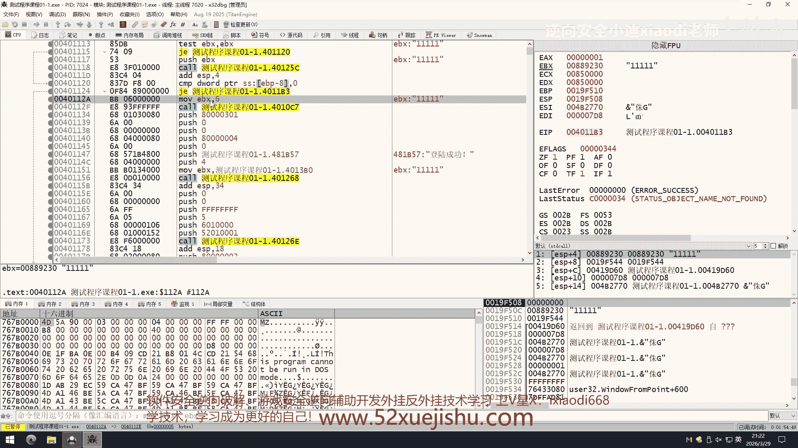
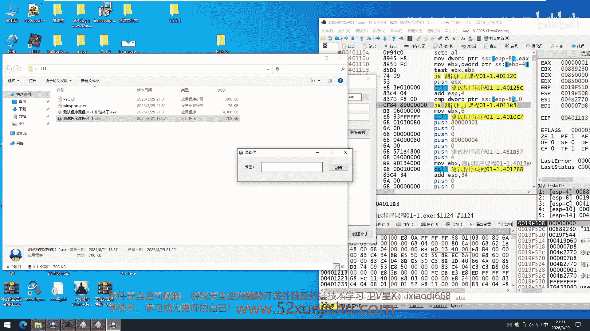

## 🧩 软件逆向破解技术：01：异常中断补丁与大白补丁工具实战


在本节课中我们将要学习异常中断补丁的基本打法，重点看如何通过修改`EIP`让程序从失败流程跳到成功流程，以及如何使用大白补丁工具完成测试。课程会从一个登录成功与登录失败的案例开始，逐步说明中断地址、首字节判断、虚拟地址、EIP偏移计算和实际补丁验证。对初学者来说，可以把`EIP`理解成程序下一步要执行哪条指令的门牌号，改`EIP`就是改程序接下来要走的路。理解了这一点，后面的补丁配置就更容易看明白。


### 🔍 软件逆向破解技术：01-1：案例观察与跳转目标




我们先把程序附加到调试环境里，观察登录成功与登录失败两个分支如何跳转。原文案例中有一个登录成功的位置，也有一个登录失败的位置，目标是让程序跳到我们希望执行的登录成功位置。需要查看程序原本如何跳转，并确认错误分支下会执行到哪个地址。原文说明，错误情况下程序会执行到`4011B3`；如果把`EIP`直接改到`4012A`，就相当于让程序跳到目标位置，从而完成破解。这个案例本身不是特别理想，因为成功与失败分支的判断关系需要结合具体程序确认；如果把成功和失败的条件写反，也可以达到跳转目的。核心思路可以写成下面的公式：


```text
EIP = 4012A
```


从公式可以看出，异常中断补丁的关键不是改普通数据，而是改程序下一步执行的位置。上一段我们观察了跳转目标，接下来需要准备补丁工具，并把待测试程序放到独立目录中，方便后续操作。


### 🧰 软件逆向破解技术：01-2：准备大白补丁与选择寻址方式


上一节我们介绍了登录成功与登录失败案例中的跳转目标，本节中我们来看看如何使用大白补丁工具做准备。需要新建一个文件夹，把待测试程序复制到该文件夹中，后续就用这个副本做异常中断补丁测试。异常中断补丁是本节必须掌握的知识点，配置时需要认真核对地址和首字节。下面是大白补丁的准备步骤，这些步骤主要用于把程序放到独立目录，并让补丁工具能够定位目标模块。


- 新建一个文件夹，把程序复制过来，待会儿用这个副本做测试。
- 使用大白补丁工具添加补丁，本案例中补丁不需要解码。
- 如果程序有壳，需要自行解码；视频课程中有相关讲解，本教程不展开。
- 寻址方式有特征码寻址和虚拟地址，本案例选择虚拟地址。
- 模块基址可以直接复制，把工具中显示的基址拿到补丁配置中使用。


选择虚拟地址后，补丁工具会围绕模块基址和中断地址定位目标位置。模块基址可以理解为程序在内存中的起始地址，复制它是为了让补丁工具准确找到目标模块。准备好这些信息后，就可以填写中断地址和首字节判断条件。


### 🧠 软件逆向破解技术：01-3：中断地址、首字节判断与补丁类型


上一节我们介绍了大白补丁的准备和虚拟地址选择，本节中我们来看看中断地址、首字节判断与补丁类型。案例中需要中断的地址是`4011B3`，首字节是`BB`，配置时把`BB`填入首字节位置。首字节在这里不是随便填写的，它实际上作为一种判断条件使用。下面是首字节判断的主要用途，这些判断可以帮助补丁工具确定精确的触发时机。


- 判断程序是否已经解码。
- 判断目标位置是否已经存在中断。
- 判断目标位置是否已经存在`F2`断点。
- 判断目标位置是否存在其他异常代码。
- 通过上述判断确定一个精确的触发时机。


核心配置可以写成下面的代码描述：


```text
中断地址 = 4011B3
首字节 = BB
补丁类型 = 修改EIP
```


补丁类型需要选择“修改EIP”，这是异常中断补丁的关键功能。大白工具中的说明指出，当相关选项填写为零时，补丁模块会自动获取中断地址对应汇编指令的长度，并增加跳过该指令的效果；当偏移值非零时，使用目标地址减去当前地址。工具说明可以整理为下面的引用：


> 填写为零时，补丁模块自动获取中断地址对应汇编指令的长度，并增加跳过该指令的效果；偏移值非零时，使用目标地址减去当前地址。


原文还提到，自动获取的指令长度可能以`55`这样的值来说明跳过效果，具体长度应以工具显示为准。理解这个规则后，就可以继续计算EIP偏移，并让程序跳到希望执行的位置。


### 🧮 软件逆向破解技术：01-4：EIP偏移计算与修改EIP


上一节我们介绍了中断地址、首字节判断和修改EIP的补丁类型，本节中我们来看看EIP偏移如何计算。实际尝试时，大白工具在这个场景下可能不方便直接做减法，因此换到地址`401124`做测试；原文中也出现过`40124`的写法，实际应以工具中显示的完整地址为准。这里把`401124`当作假想的中断点，当前程序不一定正好执行到这里，补丁触发时才把这里视为当前EIP。下面是偏移计算与跳转目标的要点，这些要点用于确定从当前EIP向前跳多少字节。


- 在补丁配置中填写EIP偏移，例如填写`6`。
- 原文用`123456`表示跳过6个字节，并加`6`进行计算。
- 打开计算器对地址加`6`，可能到达`2A`位置。
- 偏移填`6`表示从当前位置加`6`直接跳过来，相当于更改EIP。
- 偏移不填写也可以，具体效果需要结合工具规则确认。
- 想跳到其他位置时，可以加`2D`或加`3A`等偏移。


EIP偏移的核心关系可以写成下面的公式：


```text
目标EIP = 当前EIP + 偏移
```


也就是说，偏移就是相对当前EIP的字节数。原文中强调，`EIP`是当前执行位置的指针；异常中断补丁可以修改EIP，直接决定程序接下来执行哪一行代码。下面是对EIP概念的必要澄清，避免把寄存器修改和内存内容修改混在一起。


- `EIP`是指令指针寄存器，永远指向当前代码要执行的位置。
- 有同学提到修改`ERP`或`ERPERP`中某个地址的内容，并把它理解成卡密时间，这里需要区分概念。
- `ERP`或`ERPERP`不是这里要讨论的内容寄存器，`EIP`也不是内存内容。
- 如果修改了某个寄存器，需要说清楚具体是哪一个寄存器。
- 操作时不要忘记把EIP偏移填写到补丁工具中。


把这些概念分清以后，补丁配置就不会把“地址内容”和“指令指针”混在一起。接下来进入实际补丁操作，并通过排错确认首字节和地址是否填写正确。


### 🛠️ 软件逆向破解技术：01-5：实操补丁、排错与验证


上一节我们介绍了EIP偏移计算和EIP概念澄清，本节中我们来看看实际打补丁、排错与验证。实操时先删掉配置错误的项目，再检查补丁工具弹出的错误。原文中出现的错误与特征码寻址有关，提示涉及`4011`、别名`400000`和`401124`，原因是首字节填错。`401124`位置的首字节应当填写`0F`，而不是之前填错的值。下面是修正补丁并验证的流程，这些步骤用于把错误配置改正后重新执行补丁。


- 删除错误的补丁项。
- 重新填写中断地址`401124`。
- 把首字节改为`0F`。
- 重新添加补丁项。
- 保存并创建补丁。
- 在弹出的确认窗口点击“是”。
- 删除多余的两个项目。
- 执行补丁。
- 运行程序，程序会检测调试器。
- 补丁执行后点击登录，验证是否登录成功。


错误提示可以概括为下面的代码描述：


```text
特征码寻址错误：4011
别名：400000
地址：401124
```


修正后的配置可以写成下面的代码描述：


```text
中断地址 = 401124
首字节 = 0F
补丁类型 = 修改EIP
偏移 = 6
```




完成修正后重新执行补丁，再运行程序并点击登录，原文验证结果为登录成功。这个结果说明异常中断补丁已经按照预期修改了EIP，使程序跳到成功流程。整个实操过程中，首字节和地址必须对应准确，否则补丁工具会报特征码寻址相关错误。


### 📌 软件逆向破解技术：01-6：本节总结


本节课中我们一起学习了异常中断补丁的基本原理和大白补丁工具的使用流程。我们从登录成功与登录失败案例出发，观察错误分支执行到`4011B3`，并通过修改EIP让程序跳到目标位置。随后我们准备了独立目录和虚拟地址，填写了中断地址、首字节`BB`和修改EIP的补丁类型，并理解了首字节判断、偏移为零与非零时的不同规则。实操部分使用`401124`做测试，首字节修正为`0F`，偏移填写`6`，排除了特征码寻址错误，最终执行补丁并验证登录成功。需要重点记住的是，`EIP`是指令指针寄存器，永远指向当前代码要执行的位置，修改EIP就是改变程序下一步执行哪条指令。

