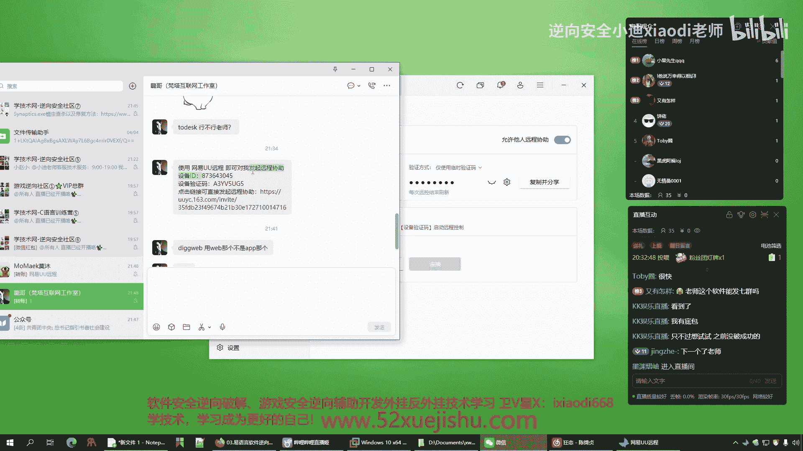
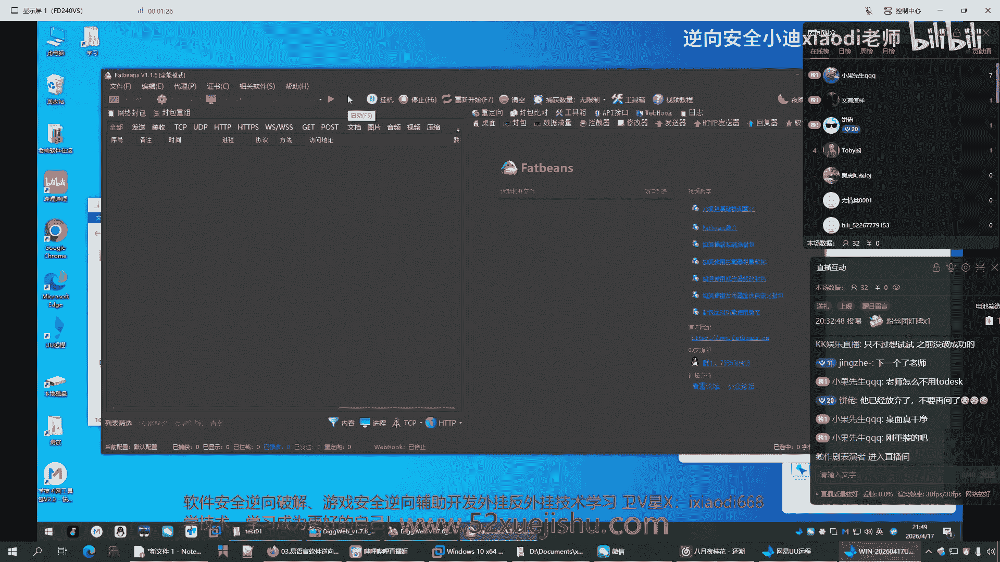
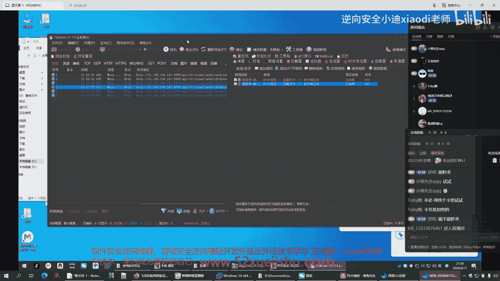

# 🛠️ 软件逆向破解技术：01：网络封包抓包实战破解卡密网络验证软件



## 📖 本节概述

在本节课中，我们将一起研究如何对一款带有卡密网络验证的软件进行逆向破解。我们会使用网络封包抓包工具，观察程序与验证服务器之间的通信，识别验证服务的特征，并通过修改关键返回值来绕过验证。整个过程强调实战，即使你没有任何经验，只要跟着步骤操作，也能明白其中的原理。需要注意的是，逆向分析经常遇到“程序没反应”或“验证不通过”的情况，这时候不要对自己失去信心，更不要轻易放弃。保持冷静，逐步排查，就能找到突破口。

## 🔍 第一步：运行目标程序并观察验证提示



首先，我们把目标程序准备好。从视频中可以看到，主播先看了下软件说明，然后运行了它。程序启动后，界面显示出来了，点击某个入口时，弹出提示“卡号不存在”。这个提示非常重要，因为它直接暴露了程序存在网络验证逻辑。我们还注意到，程序中调用了类似 `rapd jackson` 的发包工具，这说明它依赖网络封包，因此我们可以直接用封包工具来分析它。另外，在开始调试之前，保持良好的桌面整洁度也是有好处的——一个干净的环境有助于集中注意力，这也是“勤快人”的优势。

## 📦 第二步：识别验证平台特征

观察到“卡号不存在”后，我们开始思考：这个验证系统是自研的，还是使用了第三方网络验证服务？通过搜索和观察，我们发现验证服务的登录界面或文档中出现了“飞鸟快验”的字样。继续查看快速入门文档，我们找到了一个关键信息：飞鸟快验的通信端口是 `18888`。记住，这个端口特征非常关键。大部分网络验证服务都有固定的端口，只要识别出端口，我们就能在抓包时快速定位到验证数据包，甚至可以通过端口重定向来构造“山寨”验证服务器。为了不忘记这个知识点，最好的办法就是立刻把它发到论坛或笔记中，方便以后查阅。

验证逻辑的简化流程可以写成如下伪代码：

```csharp
客户端发送卡号 -> 服务器验证 -> 返回结果
if (result == 0) { 验证通过 } else { 提示“卡密不存在” }
```

## 🌐 第三步：抓包分析通信数据

在识别验证平台之后，我们开始正式抓包。运行目标程序，同时启动封包工具（例如 WPE、Fiddler 等），捕获所有网络请求。在这个例子中，我们注意到目标程序是一个自解压文件，释放后得到完整的程序文件。它的主体是一个名为 `mon.exe` 的可执行程序，使用 `C#` 和 `.NET` 开发。更幸运的是，程序竟然保留了调试符号，这意味着我们可以直接看到函数名和变量名，调试起来非常方便。

抓包后发现，验证数据包中包含了卡号和服务器返回的状态。常见的验证数据格式可能类似这样：


```json
请求: { "cardKey": "xxx", "type": "login" }
响应: { "type": "error", "result": 200 }
```

在这里，`result` 字段的值 `200` 很可能代表验证失败。我们能想到的直接思路就是：把这个值改成 `0`，看看程序会不会认为验证成功。这就是所谓的“修改返回值”秒杀法。当然，程序也可能同时校验 `type` 字段，所以我们还需要观察其他字段的含义。但由于没有正版卡，我们不知道正确返回值是什么，只能像“死马当活马医”一样反复尝试。

## ⚙️ 第四步：修改返回值，尝试绕过验证

现在，我们打开内存修改工具或封包拦截工具，添加一条修改规则：将响应数据包中 `result` 的值从 `200` 改为 `0`。然后重新运行程序，输入任意卡号点击验证。第一次尝试后，提示仍然是“卡密不存在”。这说明修改没有生效，或者验证逻辑还依赖其他字段。我们进一步检查，发现响应中还有一个 `type` 字段，而只修改 `result` 是不够的。于是在修改规则中，我们把 `type` 也一并修改为 `"success"`，再次测试。这一次，程序出现了不同的反应！虽然还不确定是否完全通过，但已经看到了希望。

用公式表示核心操作：

```text
修改前: response = { type: "error", result: 200 }
修改后: response = { type: "success", result: 0 }
```

如果程序只检查 `result`，那么这一招就奏效了。如果还检查 `type`，就需要二者配合。在我们这个案例中，通过不断调整，最终成功改变了程序的走向。为了少走弯路，最好能拿到一个正版卡密，这样可以对比正确的返回值，逆向效率会大大提高。



## 📌 总结

本节课中，我们完整地学习了一遍网络验证破解的实战流程：首先运行程序，观察“卡密不存在”提示；然后通过搜索确认验证平台是“飞鸟快验”，并记录端口 `18888`；接着使用抓包工具捕获通信数据，分析出响应字段 `result`；最后通过修改 `result` 和 `type` 的返回值，成功绕过了验证。整个过程的核心思想是：**让客户端误以为服务器返回了“验证通过”的结果**。我们还了解到，程序是否保留调试符号、是否使用现成验证服务，都直接影响破解的难度。这节课只是一个开始，在后续的课程中，我们还会遇到更复杂的验证策略，但只要掌握了抓包和修返回值的基本功，就能举一反三。感谢阅读，我们下节再见！
