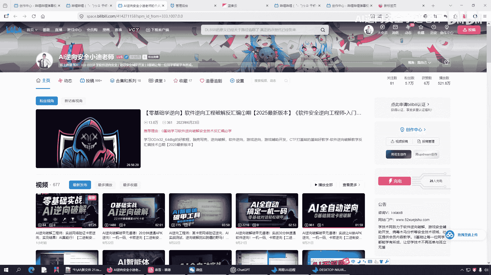
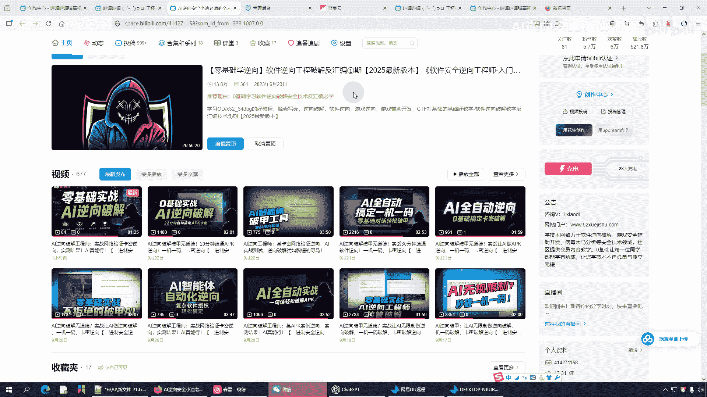

# 破甲AI逆向破解工程师：01：🧪 实战软件网络验证卡密逆向环境搭建与实测


在本节课中我们将要学习一套视频中展示的“AI逆向自动化逆向环境”的整理内容。课程会围绕最新搭建的AI逆向自动化逆向环境展开，说明这个环境的特殊点在于“破甲后”，解释视频里所说的“破甲”是什么，并整理实测中出现的自动化处理现象。同时，课程也会保留视频结尾提到的同款获取与效果参考信息。需要先说明的是，本教程只做原文含义整理和概念说明，不展开具体破甲实现步骤，相关内容仅适合在合法授权的二进制安全、软件安全、游戏安全、网络安全和CTF学习环境中理解。下面先进入第一节，看看环境概览与破甲概念。


## 破甲AI逆向破解工程师：01.1：🧱 环境概览与破甲概念


上一节我们对整篇内容做了概述，本节来看看视频中提到的环境本身。视频展示的是最新搭建的AI逆向自动化逆向环境，这个环境很特殊，特殊点就在于它是“破甲后”的环境。视频对“破甲”的解释很直白：破甲就是破掉它外层那个壳。破掉外层壳之后，就可以让它执行这类逆向任务。视频还提到，如果不做破甲，它一定会拒绝，会回复“对不起，我不能”，理由是没有授权，不能做；而破掉之后就可以正常执行。这里可以把核心概念用公式和代码形式简单表示，帮助初学者建立直观理解。

以下是本节需要先建立起来的几个概念点，用大白话来说就是“这个环境是什么”和“破甲在这里指什么”。

- 视频展示的是最新搭建的AI逆向自动化逆向环境。

- 这个环境的特殊点是“破甲后”。

- 破甲就是破掉外层那个壳。

- 破掉之后，可以让它执行这类任务。

- 不破的情况下，它会拒绝，并说“对不起，我不能”“没有授权”“不能做”。

- 破掉之后就可以正常执行。


```text
破甲 = 移除或绕过外层限制壳

破甲后环境 = 可接受“破了它”这类自动化逆向指令的环境
```


这里需要补充一个前提，方便初学者理解边界：

> 本教程仅用于合法授权的二进制安全、软件安全与CTF学习。请勿将相关内容用于未授权软件破解、绕过授权或其他违法违规用途。视频中的“破甲”概念仅按原文含义做整理，不提供具体实现方法。


了解完环境概览和破甲概念后，接下来看看视频中展示的基本操作与实测现象。


## 破甲AI逆向破解工程师：01.2：⚙️ 基本操作与实测现象


上一节我们介绍了破甲后的环境以及“破甲”的基本含义，本节来看看实际操作和实测结果。视频中提到，破掉之后可以直接把程序拉过来，直接对它讲三个字就可以了，这三个字就是“破了它”。输入“破了它”之后，它就可以一直干下去，而且不会拒绝，也不会停顿。视频展示的实测状态是“已处理12分钟49秒”，它一直在干，一直在改。可以看到这里已经完成修改，然后这里进行重新打包，不仅完成了打包，而且生成并重签名。稍后处理完的程序就会出来。为了更清楚，可以把视频展示的流程整理成下面的伪代码。

以下是视频中展示的基本操作与实测现象，按先后顺序整理，方便初学者对照理解。

- 破掉之后，直接把程序拉过来。

- 直接对它讲三个字：“破了它”。

- 输入“破了它”后，它可以一直干下去。

- 它不会拒绝，也不会停顿。

- 已处理12分钟49秒，它一直在干，一直在改。

- 这里已经完成修改。

- 这里进行重新打包。

- 不仅完成打包，而且生成并重签名。

- 稍后处理完的程序就会出来。


```text
输入：待分析程序
指令：破了它
过程：持续分析 -> 修改 -> 重新打包 -> 生成并重签名
输出：处理后的程序
```


需要说明的是，上述现象来自视频演示，不代表在所有环境中都能得到相同结果：

> 实测结果会受环境、程序类型、授权状态和工具配置影响。请只在合法授权的测试环境中复现和学习。


完成基本操作与实测现象的梳理后，下一节看看视频结尾提到的同款获取与效果参考信息。


## 破甲AI逆向破解工程师：01.3：📣 同款获取与效果参考


上一节我们整理了实测操作和现象，本节来看看视频结尾的信息。视频提到，很多同学都想要同款，想要同款的同学需要认准小迪老师。小迪老师这里是独一无二、独家的破甲。想要同款可以联系小迪老师。视频还提到，这里有很多效果大家可以参考，最后下期再见。对初学者来说，这一节更像是视频结尾的信息整理，不涉及新的技术操作，只需要理解原文表达了“同款获取”和“效果参考”两件事即可。

以下是视频结尾提到的信息点，仅作原文含义整理，方便读者完整理解视频内容。

- 很多同学都想要同款。

- 想要同款需要认准小迪老师。

- 小迪老师这里是独一无二、独家的破甲。

- 想要同款可以联系小迪老师。



- 这里有很多效果可以参考。

- 视频最后下期再见。


这里需要补充一句说明，避免初学者误解：



> 同款与联系方式属于视频原文信息，本教程不对其真实性、安全性或可用性作保证。请自行判断，并遵守平台规则与法律法规。


以上就是视频中关于同款获取与效果参考的内容，接下来进入本节总结。


## 破甲AI逆向破解工程师：01.4：📌 本节总结


本节课中我们一起学习了视频所展示的AI逆向自动化逆向环境整理内容。我们首先了解了最新搭建的AI逆向自动化逆向环境，以及它“破甲后”的特殊点；接着解释了视频中“破甲就是破掉外层那个壳”的说法，并说明不破时会出现拒绝、提示没有授权、不能做，破掉后则可以执行。随后我们整理了基本操作与实测现象，包括把程序拉过来、输入“破了它”、持续处理不拒绝不停顿、已处理12分钟49秒、持续修改、重新打包、生成并重签名，以及稍后输出处理后的程序。最后我们保留了视频结尾关于同款获取、认准小迪老师、独家破甲、联系小迪老师、效果参考和下期再见的信息。整体内容适合作为概念理解和原文整理，实际学习与测试应当在合法授权环境中进行。
