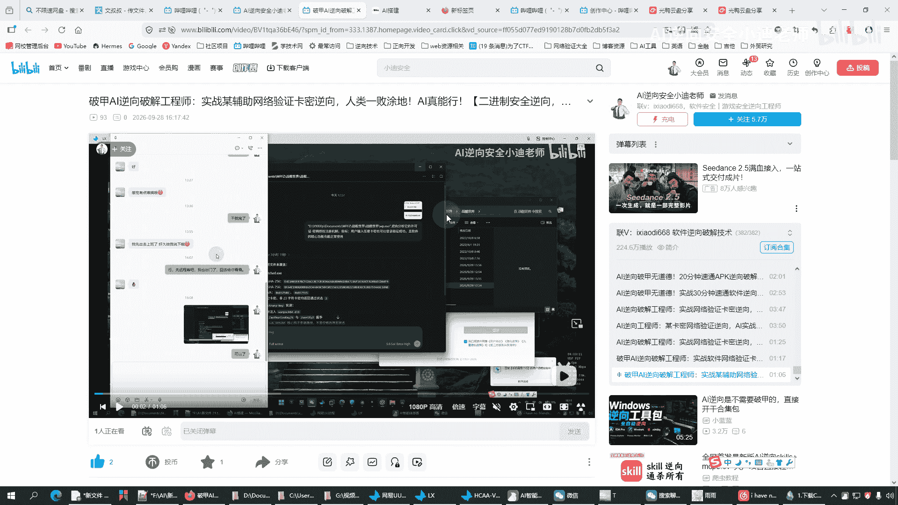
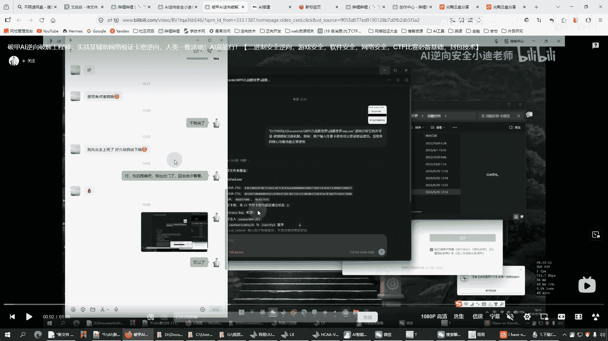
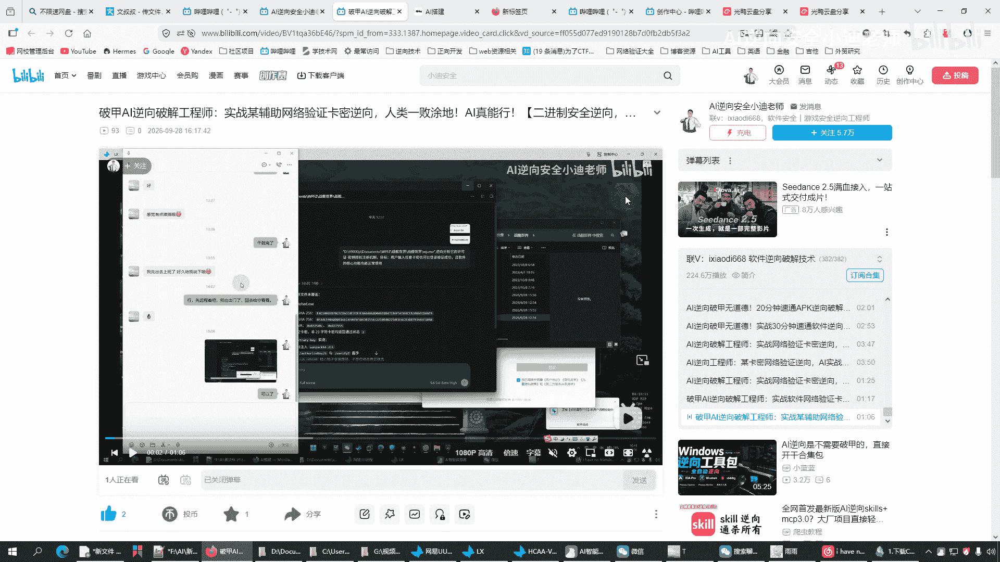

## 🧭 破甲AI逆向破解智能体搭建服务：01：课程概述与合规边界

在本节课中，我们将要学习“破甲AI逆向破解智能体搭建服务”这个主题的书面整理内容。原文开场由小迪老师进行自我介绍，并提到近期大家对AI逆向比较感兴趣。换句话说，这个教程要讨论的核心问题是：AI逆向到底能不能做，以及原文展示的AI自动化逆向环境大概是什么样子。这里需要先说明，本教程只做内容整理和概念说明，不提供任何绕过授权、破解商业软件或规避网络验证的可操作步骤。

为了便于初学者理解，可以把“AI逆向”先直白地理解为：让AI辅助分析程序行为、整理验证逻辑和记录测试结果。原文表达的观点是AI逆向可以做，并且给出了一个“最新时间为17点45分、17点46分”的记录。这个时间点本身不是技术重点，它的含义是原文用具体时间说明演示是近期录制的，并强调“看到没有”，也就是让观众注意这个时间记录。

以下是本教程在合规边界上需要明确的几个基本点：

- 任何逆向分析都应只在合法授权、隔离测试和教学研究环境中进行。
- 原文提到的“任意卡密登录验证成功”属于现象描述，不应被理解为可以用于未授权软件。
- 学习者应优先掌握程序分析、日志记录和结果验证等基础能力，而不是直接尝试绕过验证。

> 合规声明：本教程仅用于授权安全学习、软件测试和二进制安全基础认知。严禁将相关内容用于侵犯软件著作权、绕过授权、破坏计算机信息系统或其他违法违规行为。

在明确课程概述和合规边界之后，下一节我们来看看原文对AI逆向可行性的判断，以及时间记录的含义。

## 🤖 破甲AI逆向破解智能体搭建服务：02：AI逆向可行性与时间记录

上一节我们介绍了课程主题和合规边界，本节中我们来看看原文对“AI逆向到底可不可以”的回答。原文的判断很直接：AI逆向当然是可以的，并且给出了17点45分、17点46分这样的最新时间记录。对初学者来说，这里的重点不是时间本身，而是原文想表达“这是一个近期演示，并且演示结果已经展示出来”。

如果把原文的意思整理成一个直白公式，可以写成下面这样。这个公式只是帮助理解原文逻辑，不代表可以跳过授权直接操作。

```text
AI逆向可行性 = 合法授权 + 自动化环境 + 提示词引导 + 结果验证
```

从原文看，作者想说明的是：在搭建好的AI自动化逆向环境中，AI可以辅助完成一部分程序分析工作。这里要强调“辅助”两个字，因为AI不是凭空完成所有事情，它仍然需要人给出目标、提供提示词、检查结果，并在合法范围内判断输出是否正确。换句话说，原文说“AI真能行”，更准确的理解是“AI可以在授权测试中辅助分析，并给出可参考的结果”。

以下是原文在可行性部分提到的几个关键信息：

- 原文明确说AI逆向“当然是可以的”，并给出了17点45分、17点46分的时间记录。
- 原文用“看到没有”来强调演示时间，目的是让观众注意这是近期效果。
- 原文的整体语气是肯定AI逆向的可行性，但本教程只保留概念说明，不展开绕过方法。

到这里，我们已经把“AI逆向可行不可行”和“时间记录”的含义讲清楚了。接下来，在了解可行性之后，本节继续往下看原文搭建的AI自动化逆向环境到底能覆盖哪些程序类型。

## 🧰 破甲AI逆向破解智能体搭建服务：03：AI自动化逆向环境的能力范围

在上一节我们说明了原文对AI逆向可行性的判断，本节中我们来看看原文提到的AI自动化逆向环境能做什么。原文说，这个环境是“给大家搭建的AI自动化逆向的一个环境”，它可以做Windows程序，也可以做安卓程序逆向。对初学者来说，这句话的意思是：这个环境不是只针对某一种程序，而是把Windows程序和安卓程序都纳入了演示范围。

原文还提到，可以直接把程序发过去，然后目标用户输入任意卡密也可以登录验证成功，并且该软件的核心功能也正常使用。这里需要特别说明：这段内容是原文对演示现象的描述，本教程只做含义保留，不提供任何实际绕过验证的做法。对合法测试而言，正确的理解是：在获得授权的测试环境中，可以记录输入不同卡密后的验证结果，并检查核心功能是否可用，而不是把这种方法用于未授权软件。

如果把原文的能力范围用代码结构表示，可以写成下面这种“能力矩阵”形式，便于初学者理解它覆盖了哪些对象。

```text
环境能力 = {
    Windows程序分析: 支持,
    Android程序分析: 支持,
    程序提交方式: 直接发送程序,
    验证结果记录: 支持,
    核心功能可用性检查: 支持
}
```

以下是原文在能力范围部分提到的几个要点：

- 这个环境是AI自动化逆向环境，不是单纯的手工分析工具。
- 它同时覆盖Windows程序和安卓程序两类目标。
- 原文说可以直接把程序发过去，说明演示流程中包含程序提交环节。
- 原文提到目标用户输入任意卡密也能登录验证成功，并说核心功能正常使用；本教程仅保留该现象描述，不提供绕过方法。

本节我们弄清了环境覆盖的范围和原文描述的现象。下一节我们来看看原文中提到的提示词参考、软件运行状态和授权输入现象。

## 🧪 破甲AI逆向破解智能体搭建服务：04：案例现象记录与提示词参考

前面我们介绍了AI自动化逆向环境的能力范围，本节中我们来看看原文对具体案例现象的记录。原文说“这个提示词呢，大家可以参考一下”，意思是演示中使用的提示词可以作为参考材料。原文还说“然后的确是破开了”，这句话表达的是演示者认为验证已经被突破。对初学者来说，这里要把“现象描述”和“可操作方法”区分开：我们可以理解原文在说什么，但不应把“破开了”理解为可以随意用于未授权软件。


原文还提到，软件一开始是不是能够正常打开的，并且说“我们再试一遍”。接着原文描述“这个软件。运行。它只能运行一个”，意思是这个软件可以运行，但只能运行一个实例。原文又说“现在呢它已经是开的一个状态”，也就是当前已经处于开启状态。原文还补充，一开始打开的时候，它是需要让你输入这个授权那个东西。为了确认演示材料，原文说“我看一下有没有图片，没有图片”。最后原文总结“总之就是开了”，也就是不管中间细节如何，软件已经处于开启状态。

如果把这段案例现象整理成授权测试记录，可以用下面的伪代码表示。这个伪代码只用于说明“记录现象”的思路，不包含任何绕过验证的实现。

```text
# 仅用于授权测试记录
if 已获得书面授权 and 环境为隔离测试环境:
    记录软件启动状态
    记录是否只能运行一个实例
    记录初始打开时是否要求输入授权
    记录是否有图片材料
    记录最终开启状态
else:
    停止测试并删除相关数据
```

以下是原文在这部分提到的现象要点：

- 提示词可以参考，说明演示中包含提示词引导环节。
- 原文认为验证“的确是破开了”，本教程只保留这一现象描述。
- 软件一开始能够正常打开，并且原文建议再试一遍。
- 软件运行时只能运行一个实例。
- 当前已经处于开启状态。
- 一开始打开时需要输入授权。
- 原文检查过有没有图片，结论是没有图片。
- 原文用“总之就是开了”总结当前状态。

到这里，案例现象和提示词参考的含义已经整理完毕。接下来，在记录完这些现象之后，本节继续看原文提到的同款服务和B站联系说明。

## 📺 破甲AI逆向破解智能体搭建服务：05：同款服务与B站联系说明



上一节我们记录了案例现象和提示词参考，本节中我们来看看原文提到的同款服务和联系渠道。原文说，如果大家想要同款的AI自动化逆向环境，欢迎联系小李老师。原文还说明，联系的时候可以看一下B站，因为他们在B站上分享了很多效果。这里的“效果”包括大家做逆向分析的效果，也就是说B站内容主要用于展示演示结果和分析效果。

原文还提到，这个提示词其实都差不多。这句话的意思是，不同演示里使用的提示词思路比较接近，并不是每个案例都完全不同。最后原文再次提醒，想要同款的话要抓紧联系小李老师，不要迷路。对学习者来说，这部分本质上是原文的联系方式说明和演示效果展示说明，不包含具体技术步骤。



以下是原文在联系说明部分提到的几个要点：

- 如需同款环境，原文欢迎联系小李老师。
- 联系渠道可以看B站。
- B站上分享了很多演示效果。
- 这些效果也包括逆向分析的效果展示。
- 原文认为提示词其实都差不多。
- 想要同款的话，原文建议抓紧联系小李老师，不要迷路。

本节我们弄清了原文的联系说明和B站展示说明。下面进入最后一节，对整篇教程做一个总结。



## ✅ 破甲AI逆向破解智能体搭建服务：06：课程总结

到这里，我们已经把原文的含义按照教程形式整理完了，本节做最后总结。本节课中我们一起学习了原文对小迪老师开场自我介绍和AI逆向兴趣背景的说明，也学习了原文对“AI逆向当然可以”的判断，以及17点45分、17点46分的时间记录。我们还了解了原文搭建的AI自动化逆向环境可以覆盖Windows程序和安卓程序，原文说可以直接把程序发过去，并描述了任意卡密登录验证成功、核心功能正常使用的现象。

同时，我们整理了原文关于提示词参考、软件能够正常打开、再试一遍、只能运行一个实例、当前已经开启、初始打开需要输入授权、没有图片以及“总之就是开了”的案例现象。最后，我们保留了原文关于同款服务、联系小李老师、查看B站、B站分享很多逆向分析效果以及提示词差不多的说明。希望读者在学习时始终记住：相关内容只应在合法授权和隔离测试环境中使用，不能用于未授权破解或规避验证。

