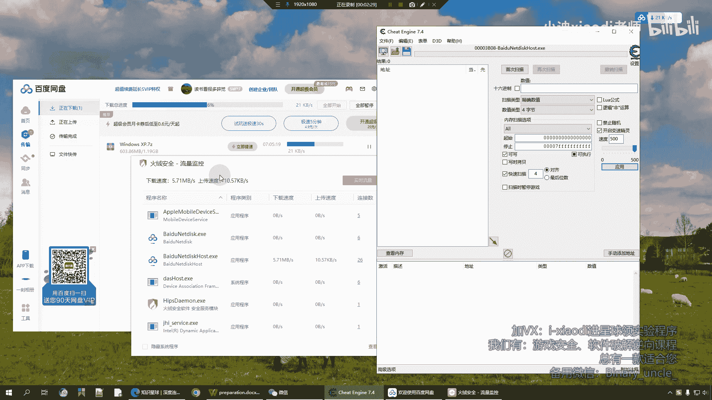

## 🚀 网盘下载加速教程：01：课程概述与准备工作

在本节课中我们将要学习网盘下载加速的完整操作流程，主题是拒绝限速、提升下载体验。本教程整理自原视频 BV1HM4y1p7sq，是一份免费分享的实用教程，内容从网盘安装完成后的下载测试开始，一直讲到使用 CE 工具调整进度条、查看下载速度并验证软件是否正常。对初学者来说，整个流程按步骤操作即可，不需要理解复杂原理，重点是把每一步做对。

在正式操作前，先说明准备工作。网盘安装是基础，测试文件用于观察下载过程，CE 工具则是后续加速操作要用到的工具。以下是本节准备清单。

- 网盘已经安装完成，可以直接打开使用。
- 准备一个测试文件，例如叉P文件，用来测试下载。
- 准备 CE 工具，工具包中已经包含该工具。

完成这些准备后，下面进入实际下载测试。准备工作看起来简单，但测试文件和工具都准备好，后面的步骤才不会中断。

## 📥 网盘下载加速教程：02：下载测试与限速现象

上一节我们完成了课程概述和准备工作，本节中我们来看看下载测试以及限速现象。先通过实际下载一个文件，观察刚开始的速度和后续变化，这样才能确认限速确实存在，也方便后面用 CE 工具进行对比。

以下是下载测试的具体步骤和现象观察。

- 在网盘中随意点击一个文件，例如叉P文件。
- 点击下载，将保存位置选择为桌面，然后点击确认下载。
- 当前会员已经过期，因此会触发限速场景。
- 下载开始后会出现一个请求，按照界面提示继续。
- 刚开始下载速度正常，随后会被限速，体验较差。
- 遇到限速时，可以通过 CE 工具进行后续处理。

从概念上看，限速可以理解为下载速度被压低。用公式表示就是：

$实际下载速度 < 初始下载速度$

这里的含义很直白：一开始速度正常，后面被限制住，所以进度条推进会变慢。确认这个现象后，下面进入 CE 工具操作。

## 🛠️ 网盘下载加速教程：03：使用CE工具打开目标进程

通过上一节的下载测试，已经确认会出现限速现象。本节中我们来看看如何用 CE 工具打开目标进程。CE 工具在工具包中已经提供，操作时先打开工具，再找到百度网盘对应的进程，这样才能继续调整变速精灵。

以下是使用 CE 工具打开目标进程的操作。


- 先打开 CE 工具，该工具在工具包中已经提供。
- 在进程列表中找到百度网盘的 `netdi host` 进程。
- 点击当前进程，然后点击打开。
- 打开后观察进度条，当前约为 0.4%。
- 0.4% 对应的进度条推进速度较慢，说明需要调整。

可以把当前状态记录为下面的代码信息。

```
目标进程：netdi host
当前进度：约 0.4%
```

0.4% 这个进度说明下载推进得比较慢，正好可以用来观察后续变速效果。目标进程打开后，下一步就是调整变速精灵。


## ⚡ 网盘下载加速教程：04：开启变速精灵并设置倍率

目标进程打开后，接下来就是调整变速精灵的倍率。本节中我们来看看具体设置和效果。操作顺序并不复杂，先开启变速精灵，再应用设置，然后把倍率拖到 500，最后再次应用即可。

以下是开启变速精灵并设置倍率的具体操作。


- 点击开启变速精灵。
- 直接点击应用。
- 将变速倍率拖到 500。
- 再次点击应用，使设置生效。
- 设置后进度条推进速度明显加快。
- 界面仍会显示 KB 数值，但显示刷新速度明显变快。
- 在 500 倍率下，下载很快完成。

这里可以用公式理解变速倍率的作用：

$进度条推进速度 \approx 原始推进速度 \times 变速倍率$

用大白话解释，倍率越大，客户端里的进度条走得越快；这里选择 500 已经足够。对应的设置可以记为下面的代码。

```
CE 变速设置：
进程：netdi host
变速倍率：500
```

加速设置完成后，还需要确认速度和资源占用，避免只看进度条而忽略实际状态。

## 📊 网盘下载加速教程：05：查看速度、资源占用与倍率选择

完成加速设置后，还需要查看下载速度、任务管理器资源占用以及不同倍率的效果。本节中我们来看看流量监控和倍率选择。进度条变快只是表面现象，实际下载速度还需要通过流量监控确认。

以下是查看下载速度、资源占用以及选择倍率的步骤。

- 打开任务管理器，查看该进程的内存占用情况。
- 在任务管理器中寻找网速查看位置。
- 网速可以通过流量监控查看，打开流量监控。
- 在流量监控中选择百度网盘。
- 可以看到下载速度为 7.85，基本属于正常速度。
- 这个 7.85 就是当前的下载速度。
- 也可以将倍率改为 5000，向上调整即可。
- 5000 倍率偏高，不太推荐，使用 500 就足够。
- 5000 时速度反而下降，因此 500 更合适。
- 500 倍率下速度比较正常，可以看到这是正常速度。

可以把推荐设置记为：

$推荐变速倍率 = 500$

这里的结论很直白：500 倍率已经够用，5000 倍率偏高，而且速度反而会下降。倍率选择完成后，最后进行下载完成验证和总结。

## ✅ 网盘下载加速教程：06：完成验证与课程总结

前面已经完成了加速、速度查看和倍率选择，本节中我们来看看下载完成后的验证以及课程总结。最后要确认下载完成的软件状态是否正常，并回顾整个操作流程。

以下是下载完成后的验证与收尾事项。



- 在 500 倍率下继续下载，一会儿就会完成。
- 下载完成的软件状态正常，没有任何损耗。
- 本次教程到此结束，该方法绝对可用，已经测试过。
- 下期再见。

本节课中我们一起学习了网盘下载加速的完整流程：从网盘安装完成后的文件下载测试，到观察会员过期后的限速现象，再到使用 CE 工具找到 `netdi host` 进程、开启变速精灵、将倍率设置为 500，最后通过流量监控查看 7.85 的下载速度，并验证下载完成的软件正常无损耗。整个流程按步骤操作，初学者也能跟着完成。

