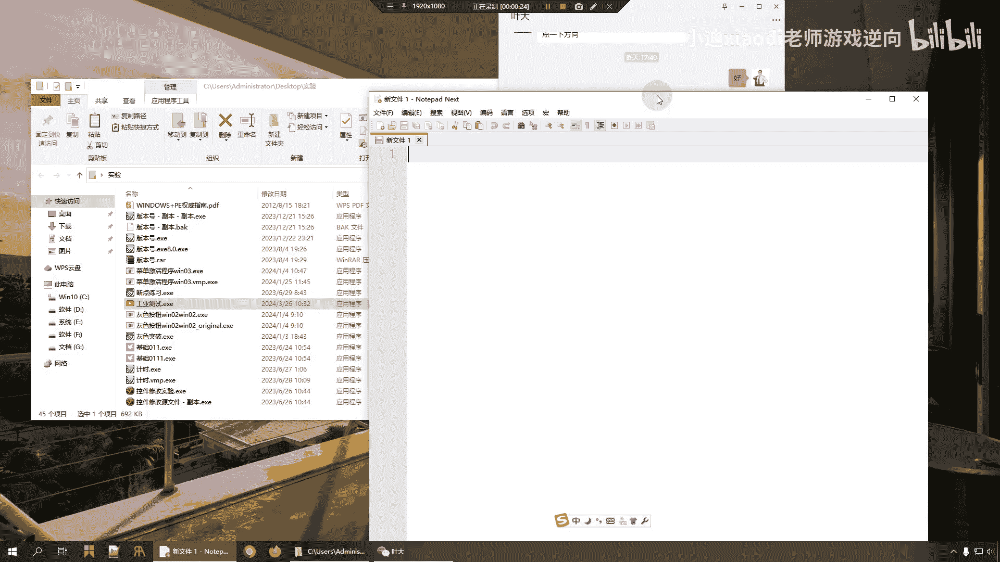
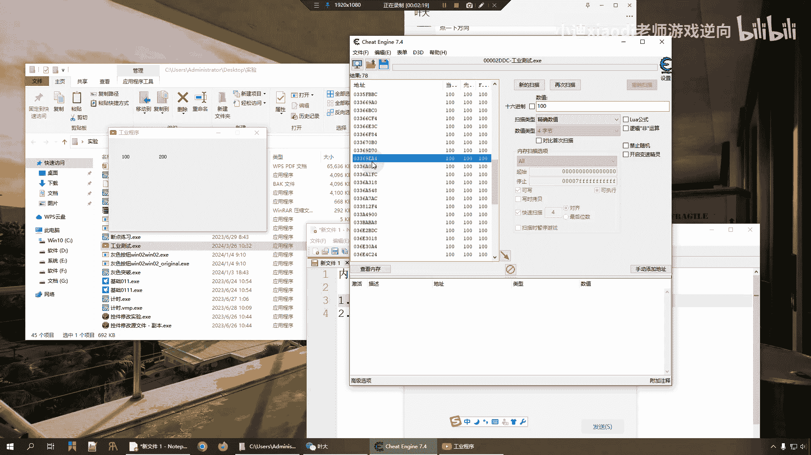
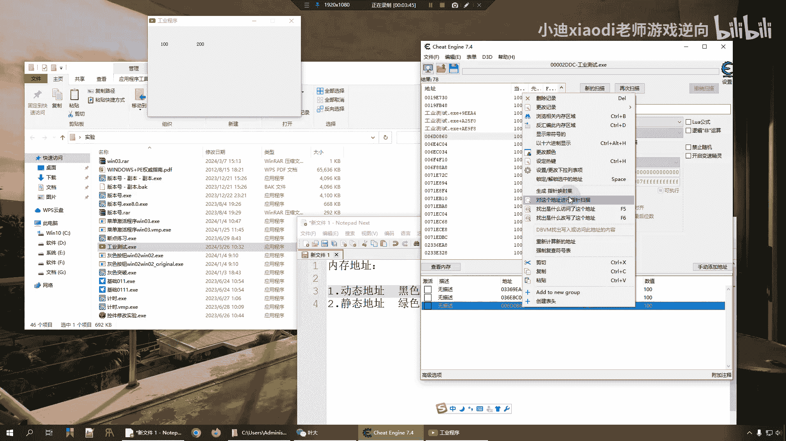
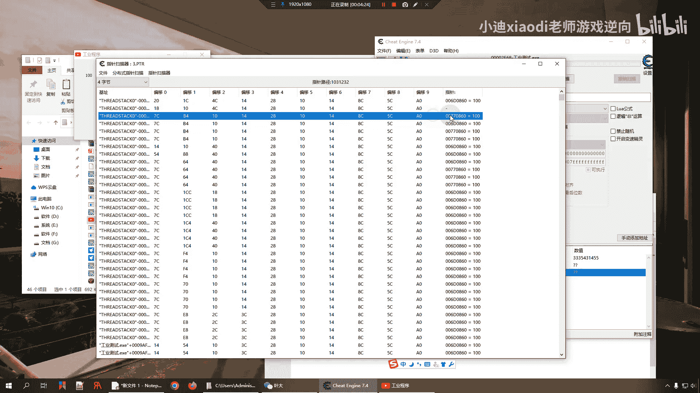
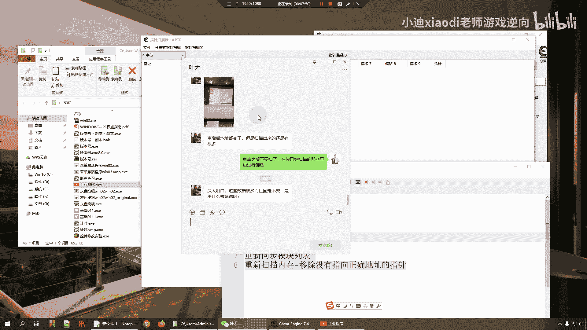

🔧 游戏安全与软件安全：第一章：用CE固定动态地址——指针扫描法

本节课我们将要学习一个非常实际的内存定位问题：程序重启之后，内存地址发生变化，导致之前用CE找到的数据失效。我们将先回顾这个问题，然后认识动态地址和静态地址，接着讲解如何使用CE的指针扫描功能找到固定的基地址，最后学习两种筛选有效指针的方法。整个过程中会用大白话解释每个概念，即使是初学者也能跟着做。



## 一、问题背景


先来回顾一下这个典型场景：公司有一台工业控制系统，系统里运行一个软件，软件中保存着许多关键数据。使用CE（Cheat Engine）可以搜索到这些数据，但每次软件重启之后，内存地址都会变，这样就无法继续定位真实数据了。这种情况在很多程序里都会出现，尤其是工业软件、游戏等需要动态分配内存的应用。


要解决这个问题，我们首先要理解内存地址的概念。所谓内存地址，就是数据在内存中的存放位置，你可以把它想象成门牌号。如果门牌号每次开机都变，你就不可能直接找到房间。所以我们先要弄清楚，为什么有些地址会变，有些地址不变。

## 二、动态地址与静态地址

内存地址按照稳定性可以分为两种类型：动态地址和静态地址。如果用CE搜索某个数据，发现重启程序后地址变了，那这个地址就是动态地址；如果重启后地址仍然不变，那这个地址就是静态地址。用公式表达就是：

```
动态地址 = 程序每次启动时重新分配的内存位置
静态地址 = 程序每次启动时始终保持不变的内存位置
```

在CE的搜索结果中，这两种地址会用颜色区分开。黑色显示的是动态地址，绿色显示的是静态地址。比如，对一个工业程序附加进程后随便搜索一个数值，结果列表里可能有87个匹配项，其中大部分是黑色，少数是绿色。接着关闭程序再重新打开，再次搜索同样的数值，你会看到绿色地址仍然指向原来的数值（例如100），而黑色地址中有很多已经变了。这就是区分动态地址和静态地址最直观的方法。



如果你要定位的数据正好是动态地址，那么直接搜索地址是不行的。此时，我们需要用指针扫描来找到它背后不变的基地址。

## 三、使用指针扫描查找基址

先说明什么是指针。指针是一种特殊变量，它保存的是另一个变量的内存地址。在动态地址背后，通常存在一个固定的静态地址，通过多层指针和偏移量可以最终定位到那个动态数据。这个关系可以表示成公式：



```
目标数据地址 = 基地址 + 偏移量1 + 偏移量2 + ... + 偏移量n
```

其中基地址是固定的，偏移量是每一层指针访问时的差值。只要基地址和偏移量不变，即使目标地址每次启动都变，我们也能通过计算重新找到它。



具体的操作步骤如下：

1. 用CE附加目标进程，搜索一个具体数值，比如100。
2. 在搜索结果中的某个动态地址上点击鼠标右键，选择“指针扫描”。
3. 在弹出的扫描窗口中，设置“最大级别”。这个“级别”实际上就是偏移量层级，直白地说，就是最多允许经过几层偏移来找到目标。可以先填写8，点击确定。如果结果特别多，就把级别改小一点，比如5，再点击确定。
4. 将指针扫描结果保存到临时文件，文件名随意，比如“1”，点击保存。CE会自动开始扫描。
5. 如果扫描后的结果列表是空的，说明在当前的最大偏移级别下，找不到可用的指针链。此时可以再换一个更大的级别试一下，比如10，重新扫描。如果仍然没有结果，那么说明这个地址可能没有对应的基址和偏移链；若确实存在，CE是能够扫出来的。

当扫描成功后，结果列表中会显示基地址和偏移量。有了这些数据，过我们就可以在程序重启后重新计算出目标地址了。

## 四、筛选有效指针

得到基址和偏移量之后，我们还不能马上放心使用，因为指针扫描的结果往往包含很多无效指针。程序重启后再打开，有些指针可能已经不能用。所以我们需要筛选，只保留那些依然有效的指针。下面介绍两种方法。

第一种方法叫作“重启同步法”，操作很简单：把目标程序关闭，再重新打开，然后用CE重新附加进程，并保留指针扫描器窗口。接着在指针扫描器界面中点击鼠标右键，选择“重新同步模块列表”。同步完成后，你会发现有一部分指针仍然可以正常显示，而另一部分指针则变成失效状态。能够继续显示的指针就是有效的，可以直接用；不能显示的无效指针，就可以舍弃了。在剩余的有效指针中，你只需要选一个使用，就像“万花丛中过，只摘一片”，不需要纠结。

如果第一次筛选之后有效指针还是很多，可以再重复一次“关闭程序再打开程序→重新同步模块列表”的操作。因为单次重启可能筛选得不够干净，多关几次、多同步几次，直到剩下的指针数量满足要求为止。

第二种方法更智能，叫作“重新扫描内存过滤法”。如果你看到扫描结果中有些指针指向的是108，而我们要找的是100，这些108指针就不是目标，需要剔除。在指针扫描器中，点击“重新扫描内存”，选择“移除没有指向正确地址的指针”。这里要注意，因为我们搜索的数值是100，所以需要在查找数值里填上100，然后在所有指针数据中找仍然指向数值100的地址，点击确定。CE会自动把无效指针过滤掉，然后把结果重新保存为一个新文件。如果过滤之后没有结果，也很正常，因为演示用的模拟程序并不是真正的目标程序；但这个方法放在真实软件上，只要目标数据确实存在，一般都能筛出可用指针。

## 总结



本节课我们一起学习了动态地址与静态地址的区分，了解了CE指针扫描的基本原理，并且实际操作了指针扫描和筛选的完整流程。关键步骤可以概括为：先搜索数值，然后对动态地址做指针扫描，找到基址和偏移量；再通过“关闭程序重新打开”并“重新同步模块列表”来筛选，如果结果仍然太多，就使用“重新扫描内存”来移除没有指向正确地址的指针。掌握了这套方法，你就能解决软件重启后数据地址丢失的问题了。希望这些内容能给你带来帮助；配套的视频会稍后发送给你，同时也会发布在哔哩哔哩上。

