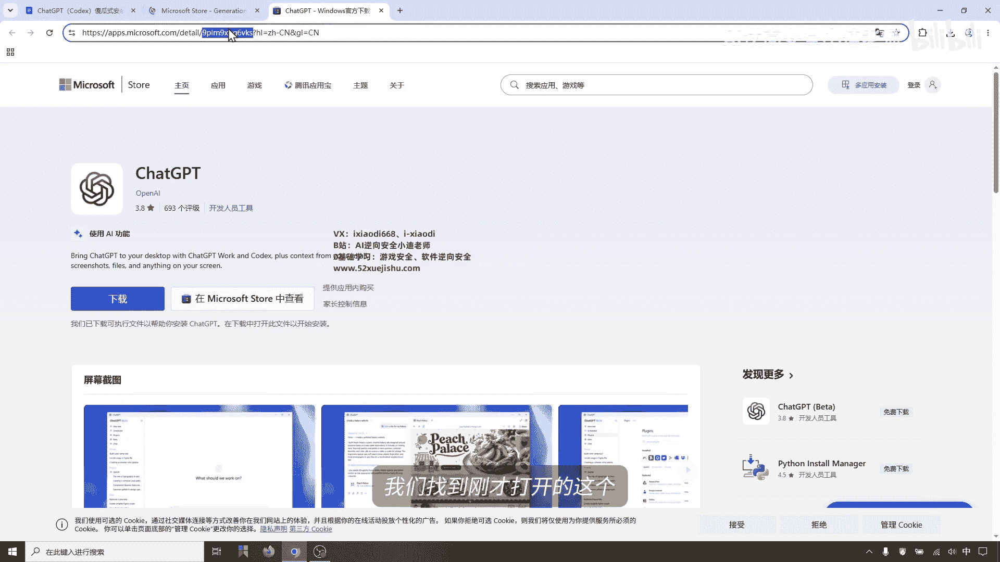
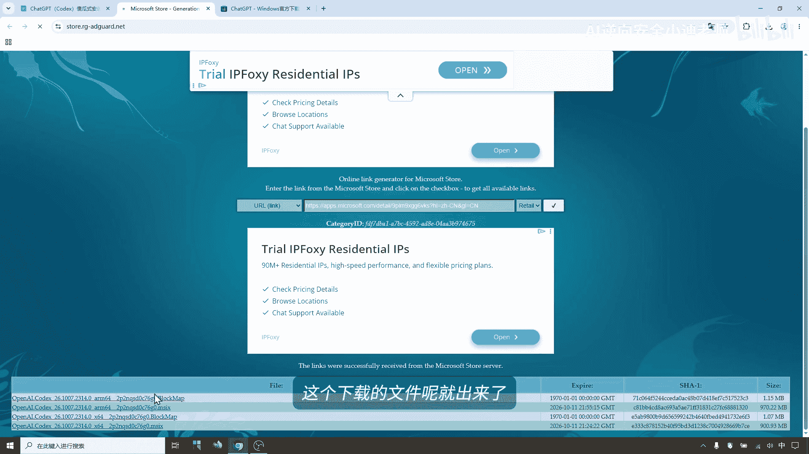
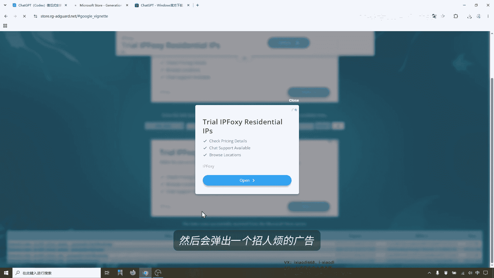
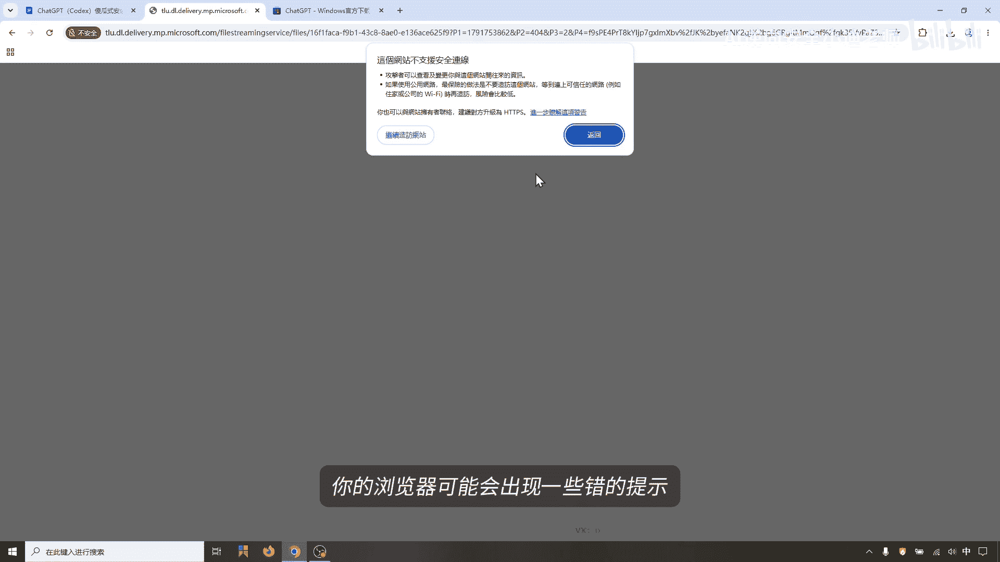
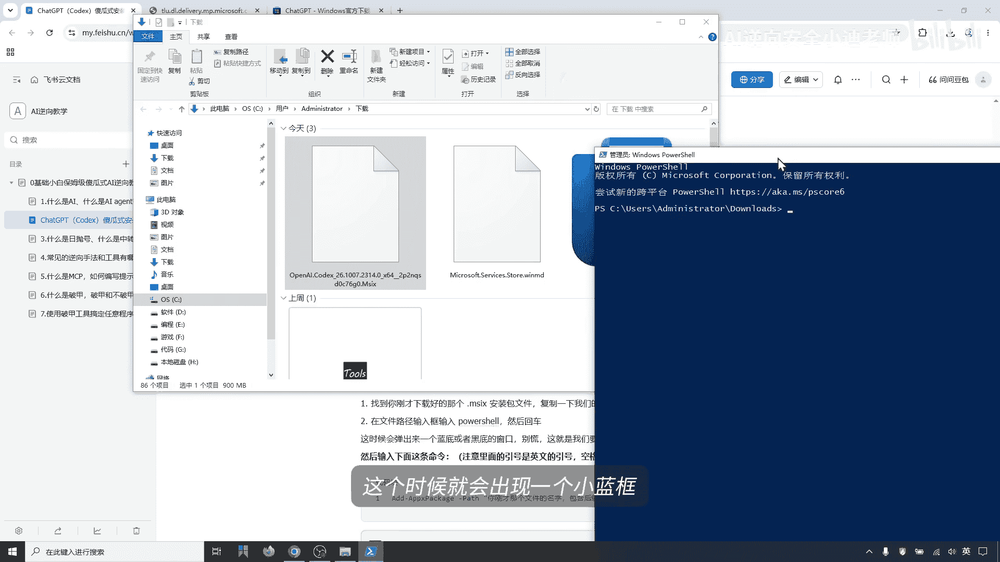
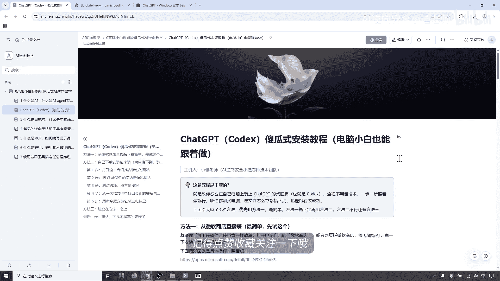

## 🧭 ChatGPT+Codex 桌面版安装教程：01：课程概述

在本节课中我们将要学习如何从零开始在电脑上安装 ChatGPT 桌面版，并整理出三种可操作的安装方法。主讲人是小雅老师，她欢迎大家来到今天的视频内容。本教程面向电脑小白，全程不需要理解技术原理，只要一步一步照着做即可。哪怕你刚买电脑，连文件怎么存都搞不清，也能跟着步骤装成功。

> 原始课程标题：纯0基础！最新！无废话保姆级ChatGPT+Codex下载安装最详细保姆级教学【Codex破甲：0基础小白保姆级傻瓜式AI逆向破解教学】--BV1WUpH6bE2f-

这篇教程要解决的问题很明确，就是教大家在自己的电脑上安装 ChatGPT 桌面版。课程提供三种方法，优先使用方法一，方法一搞不定再用方法二，方法二不行还有方法三。课程也表达了明确态度：无论如何，一定要让大家用上这个工具。为了让初学者更容易理解，下面先把三种方法列出来。

以下是本节课提供的三种安装思路：

- 方法一：从微软商店直接安装，操作最简单，优先使用。

- 方法二：自己下载安装包并手动安装，适合商店里找不到或点安装没反应的情况。

- 方法三：在方法二基础上修改文件后缀并解压运行，作为保底方案。

上面对三种方法做了总体说明，接下来进入实际操作。先看最简单的方法一，它和手机上安装微信、抖音一样简单。

## 🛒 ChatGPT+Codex 桌面版安装教程：02：方法一：从微软商店直接安装

上一节介绍了三种安装思路，本节中我们来看看方法一。方法一是从微软商店直接安装，整个过程最简单。你可以打开电脑自带的微软商店，也可以打开网页版微软商店，然后搜索 ChatGPT，点击安装，等它自己装完即可。拿到文档后，只需要点击文档里的链接，就会跳转到微软应用商店网页版。

方法一的操作不复杂，下面按顺序列出步骤，照着做即可。

1. 打开电脑自带的微软商店或网页版微软商店，搜索 ChatGPT，点击安装，等待系统自动完成安装。

2. 在文档中点击提供的链接，页面会跳转到微软应用商店网页版；点击下载按钮，并注意浏览器中的下载位置，很快就能下载完成。

3. 下载下来的文件后缀是 `.exe`，也就是可执行文件，核心概念可以写成：`ChatGPT 安装包 = *.exe 可执行程序`。

4. 点击这个文件，会弹出一个窗口并显示正在下载，随后等待下载完成。

5. 接近下载完成时，程序会自动安装；安装完成后，程序会自动打开。

6. 如果等待一会儿仍未显示程序，不用着急，把鼠标移到左下角，找到 C 开头的项目，点击 ChatGPT，程序就会运行；稍等片刻，程序会显示出来。

7. 只要耐心等待并看到程序窗口，就说明安装成功。

8. 如果要彻底关闭程序，找到右下角任务栏中的图标，鼠标右键点击退出即可。

以上是方法一的操作流程。方法一是最简单的方式，所以能直接从商店安装时，就优先使用方法一。到这里方法一就介绍完了，如果商店方式无法使用，接下来看方法二。

## ⚙️ ChatGPT+Codex 桌面版安装教程：03：方法二：下载安装包并用 PowerShell 安装

上一节介绍了微软商店直接安装的方法，本节中我们来看看方法二。什么时候使用方法二？如果你在应用商店里找不到 ChatGPT，或者点击安装没有反应，就可以用这个方法。说白了，就是自己把安装包“偷下来”，然后手动装到电脑上，不经过商店那道程序。

不过方法二有一定的局限性，它只适用于 Win10 21H1 以上的操作系统。核心条件可以写成：`Windows 版本 ≥ Win10 21H1`。如果你的系统版本比较低，方法二就不能使用，但后面还有方法三作为保底。具体怎么“偷”安装包？需要借助一个网站。点击网站并打开后，界面会显示出来；找到刚才打开的 ChatGPT 下载地址链接，剪切并粘贴到网站输入框中。

粘贴完成后，右边有一个小方块，点一下并选择 `relative`，然后点一下对勾。稍等片刻，把页面往下拉一拉，下载文件就会出来。四个文件中选最后一个点击，会弹出一个烦人的广告，点击 `close` 关闭。浏览器可能出现错误提示，点击继续访问网站。此时查看浏览器下载列表，程序已经在下载中。

下载好之后先不要着急，不要直接双击或点击下载好的安装包，因为直接双击有可能装不上。使用 Windows 自带命令来安装会稳定一点。下面按顺序列出方法二的具体操作步骤，照着执行即可。

1. 找到文件所在的文件夹，可以点击文件夹按钮，确认这个文件原来就在该文件夹里面。

2. 在文件路径输入框输入 `powershell`，然后回车。文件路径输入框的位置就是地址栏：鼠标左键点击一下，把里面的内容全选，然后输入 `POWERSHELL` 并回车，这时会出现一个小蓝框，不用紧张，这个蓝框就是接下来用来安装软件的地方。核心操作可以写成：`文件路径输入框 → 输入 powershell → 回车`。

3. 回到蓝窗口，把教程提供的命令复制一下，切换到蓝窗口后，鼠标右键可以粘贴，然后按一下空格键。

4. 再回到文件夹，找到刚才下载的文件，把文件的完整名称复制下来，可以鼠标右键复制；然后回到蓝框，鼠标右键粘贴，再直接按下回车键。

5. 按下回车后，窗口会提示部署操作进程，并出现一个进度条，等待进度条走到底部即可。

进度条走完后，需要判断是否安装成功。按下回车后等几秒钟，进度条走完；如果窗口中没有出现一大段红色文字，就说明安装好了。核心判断可以写成：`无红色错误输出 = 安装成功`。如果窗口中出现红字，就说明有错误，这时就尝试方法三。到这里方法二介绍完毕，如果命令安装报错，就继续看方法三。

## 🧰 ChatGPT+Codex 桌面版安装教程：04：方法三：修改后缀并解压运行保底方案

上一节介绍了方法二以及可能出现的红字报错，本节中我们来看看方法三。方法三建立在方法二之上，如果上面的安装过程报错，就可以尝试这个方法。首先还是找到刚才下载的文件，可以看到这个文件的后缀是 `.MSIX`。如果你看不到文件后缀，可以点击查看，并勾选文件扩展名。

能看到文件扩展名后，点击这个文件，把扩展名改成 `.ZIP`，然后回车，弹窗出现时点击是。核心变化可以写成：`*.MSIX → *.zip`。改完之后就可以解压这个 ZIP 文件。下面按顺序列出方法三的操作步骤，按步骤执行即可。

1. 先找到一个文件夹，新建一个文件夹，名字设为 `AI`，然后双击进入这个文件夹。

2. 再找到刚才下载的文件，用解压工具打开这个压缩包，把里面所有的文件全部拖到刚刚建立的 `AI` 文件夹中。

3. 这时就解压完成了，解压完成后进入解压后的 `APP` 文件夹，直接双击运行。

4. 具体操作是双击 `APP` 文件夹，在里面找到 `ChatGPT.exe`，然后双击运行；稍等片刻，程序就会运行起来。它的初始化时间会稍微久一点，需要耐心等待；初始化完成后会再次来到程序窗口，这就意味着安装成功。核心路径可以写成：`APP 文件夹 → ChatGPT.exe → 双击运行`。

5. 如果要退出程序，找到右下角任务栏中的图标，鼠标右键点击退出即可。

以上是方法三的保底安装流程。到这里三种安装方法都介绍完了，接下来需要确认电脑上是否真的安装成功。

## ✅ ChatGPT+Codex 桌面版安装教程：05：安装结果确认与课程总结

前面几节分别介绍了三种安装方法，本节中我们来看看如何确认安装结果并做总结。如果使用的是方法一或方法二，点击电脑屏幕最左下角的按钮，然后从上往下查看 C 开头的项目；如果能看到 ChatGPT，就说明安装成功。如果使用的是方法三，就找到解压后的文件夹，找到 ChatGPT；如果能够运行成功，就说明安装成功。

为了更清楚地检查，下面列出两个确认安装结果的检查点。

- 方法一或方法二：开始菜单的 C 开头项目中出现 ChatGPT。

- 方法三：解压文件夹中的 ChatGPT 能够正常启动运行。

最后做一个小总结：能从商店直接安装就用方法一，方法一最简单；商店搞不定再用方法二；方法二还不行，还有方法三作为保底。这就是今天全部的内容。如果看完视频后也能安装成功，记得点赞、收藏、关注，下期再见。本节课中我们一起学习了 ChatGPT 桌面版的三种安装方法、安装结果确认方式以及不同情况下的选择顺序。

