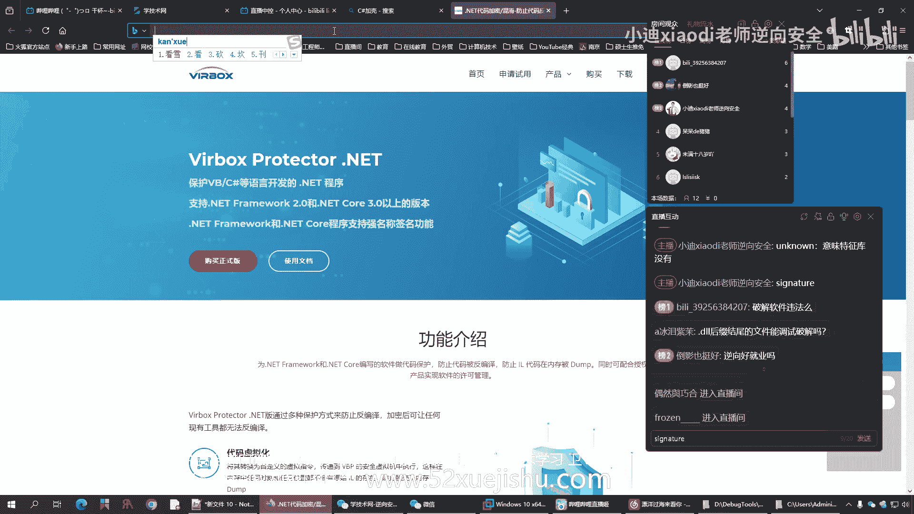
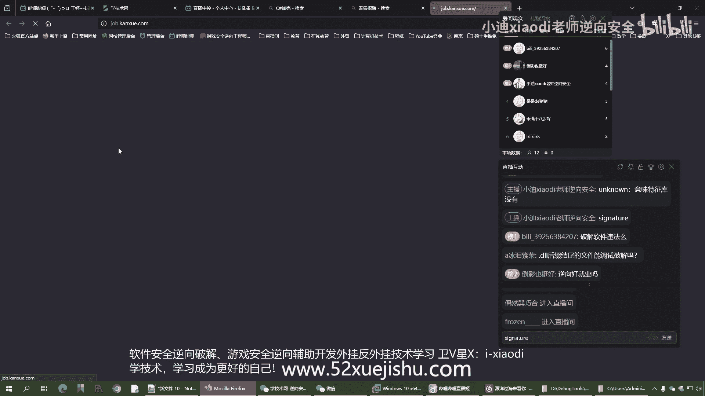
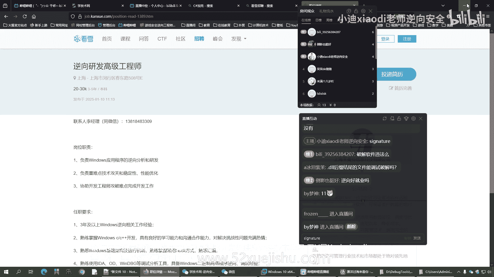

# 💼 网络安全逆向安全就业指南：第1章：逆向安全岗位就业形势与求职方法

在本节课中，我们来聊一聊网络安全行业里逆向安全岗位的就业情况到底怎么样，以及如果你对这个方向感兴趣，具体应该通过哪些渠道和方法去找工作。网上关于这个岗位的说法五花八门，有人唱衰，有人鼓吹，所以咱们直接看实际情况，从真实的招聘信息出发，一步步分析这个岗位到底好不好入行、需要具备哪些技能、工资待遇大概是什么水平。

## 📊 逆向安全岗位好就业吗



首先来回答大家最关心的一个问题：逆向安全岗位好就业吗？答案其实是比较乐观的。整体来看，逆向安全这个岗位的就业情况还是可以的，机会并不少。为什么这么说呢？因为在网络安全这个大的行业范围内，安全类的岗位数量本身就还挺多的，并不是那种极度冷门、一年到头都看不到几个招聘需求的方向。

如果你不太相信，或者想亲自验证一下市场行情，那么你可以自己去网上搜一搜，看看实际情况。这里给大家推荐一个非常精准的渠道：直接打开“看雪招聘”这个平台去搜索。看雪论坛可以说是国内安全圈子里一个老牌的、很有影响力的社区，很多做逆向、做底层安全的技术人员都会在那里活跃，所以看雪招聘上面发布的安全类岗位质量通常是比较高的，而且很多都是技术导向性很强的职位，非常适合走技术路线的朋友去关注。

具体来说，在每年秋季开学之后，也就是大家常说的秋招季节，看雪招聘上会发布大量的安全相关岗位。这些岗位不仅数量多，而且很多都来自业内比较有实力的公司，含金量相当高。如果你正在考虑进入这个行业，那么在秋招期间多刷刷这些平台，会是一个很不错的策略。

## 📋 招聘岗位实例：逆向研发高级工程师

那么，这些招聘信息里具体都是什么样的岗位呢？我们随便挑一个例子来看看。你可以看到，平台上有很多逆向方向的岗位，比如有个岗位叫做“逆向研发高级工程师”。这个岗位虽然名字里带了“高级”两个字，听起来好像门槛很高，但实际上它给出的要求都是非常具体、非常实在的，并不是那种虚头巴脑的招聘启事。我们就拿这个岗位来当例子，拆解一下它到底需要什么样的能力，这样你对这个岗位的认知就会非常清晰了。

### 📌 工作年限要求

首先，这个岗位要求三年以上的Windows逆向开发经验。翻译成大白话就是：你需要有一些实际的逆向工作经验，不是说你刚看完几篇教程、会一点皮毛就能直接上的。对于这一点，你其实不用太担心，因为工作经验这个东西是可以积累的。比如你跟着课程系统地学习，然后自己动手做一些实际的逆向项目，等时间长了，经验自然而然就有了。

### ⚙️ 核心技术要求

接下来是这个岗位在技术层面的一些具体技能要求，把这些技能点列出来，你就能清楚地知道自己该往哪个方向去使劲。我特别要说的是，这些要求里面提到的好多东西，其实只要你跟着课程认真学习，都是可以掌握的，并没有你想象中那么神秘和高不可攀。我们来详细看一下这些技术要求：

```cpp
// 逆向研发高级工程师 - 核心技术要求
struct ReverseEngineeringJobRequirements {
    std::string language = "C/C++";
    std::string osArchitecture = "Windows基础架构";
    std::string hackMethods = "常用黑客方式";
    std::string assembly = "汇编语言";
    
    struct DebuggingSkills {
        std::string debuggingExperience = "调试经验";
        bool independentUnpacking = true;        // 独立的脱壳能力
        bool patchRepair = true;                 // 修补能力
        bool antiTracking = true;                // 反跟踪能力
    };
};
```

上面这段代码描述了这个岗位最核心的能力模型。首先是熟练掌握C/C++开发，这是基础中的基础，因为逆向工程本质上就是和底层代码打交道，如果你连C/C++都不熟，那后面很多东西都很难开展。其次是Windows基础架构，你要对操作系统的底层运行机制有一个比较全面的了解。然后是常用的黑客方法，也就是攻击者的常见思维方式和操作手段，你要熟悉这些，才能反过来去分析和破解别人的代码。再就是汇编语言，这是逆向绕不开的一个东西，因为你要直接面对机器指令级别的代码。然后是调试经验，就是你实际去调试程序、找逻辑漏洞的能力。最后是一套组合能力，包括独立的脱壳能力、修补能力还有反跟踪能力，这些就属于比较进阶的技能了，需要你花时间去深入钻研。



### 💰 薪资待遇分析



把上面这些技能都搞定之后，接下来的事情就变得非常直接了：你直接去联系这个岗位的招聘负责人，也就是我们常说的李经理，然后投递简历参加面试就行了。整个过程其实就是一条非常明确的路线，人家需要什么样的能力，你就展示什么样的能力。只要你能够把上述这些要求里列出来的技能点都一一完成，那么应聘成功就是顺理成章的事情。

再说说大家最关心的薪资问题。这个岗位的工作地点在上海，作为一个一线城市，上海的薪资水平本身就处在全国前列。在满足招聘要求的前提下，本科学历的起薪大概在两到三万块钱一个月，这个数字对于刚进入行业的开发者来说已经是相当不错的水平了。如果你有硕士研究生学历，那么薪资还会在这个基础之上再加一万块钱，也就是说硕士学历大概能拿到三到四万。你看，这个岗位对学历的加持是有明确体现的，所以有能力读研的话，提升学历也是一个不错的选择。

## 🤝 学习交流与职业发展

当你真正掌握了上面提到的这些技术，并且顺利进入到这个行业之后，你会发现有一个人与人之间交流学习的圈子是一件非常重要的事情。在我们这个学习社群里，大家平常都会在群里聊天，互相讨论技术问题。你可以在群里直接看到大家的学习效果，那种真实的交流互动情况，这种氛围绝对不是装出来的，而是实实在在一群人共同在钻研技术。

对于学习者来说，最重要的其实就是有一个能够随时交流技术问题的地方。如果只是一个人闷头自己学，遇到不懂的地方没人讨论，没人指点，那很容易就会卡在一个地方很久，然后慢慢失去学习的动力。但是如果你有一个活跃的交流圈子，有人带着你去学习，带着你去实际操作，情况就完全不一样了。你学了知识之后，在自己动手实践的过程中肯定会遇到各种问题，这种情况下必须要有经验更丰富的人来帮你纠正错误，这样才能让你少走很多弯路。

打个比方，一辆车虽然装了四个轮子确实能跑，但是如果没有人来把握方向盘，没有人来指路，这辆车是走不了远路的。为什么呢？因为道路本身是弯弯曲曲的，有很多路口，你需要有人告诉你应该在什么地方拐弯，什么地方直行，什么地方减速。顺着这个逻辑，人的学习过程其实也是一样的。一个人光靠自己摸索，很容易迷失方向，你需要有经验的人在前面指引你，才能更顺利地抵达目的地。

## 💎 总结

本节课中，我们一起了解了网络安全逆向安全岗位的整体就业形势，可以看到这个方向的机会是真实存在的，就业前景也比较乐观。同时，我们还通过一个真实的“逆向研发高级工程师”岗位，详细拆解了它的技能要求、工作经验和学历要求，内容包括C/C++、Windows基础架构、常用黑客方法、汇编语言、调试经验以及独立的脱壳修补反跟踪能力。薪资方面，上海地区本科大概两三万，硕士加一万。最后我们还讨论了学习交流的重要性，一个人学习容易走弯路，有一个好的交流社群和懂行的人指引，会大大提升学习效率。希望这节课能让你对这个岗位有一个清晰的认识，并对自己的学习路线有一个更明确的规划。
