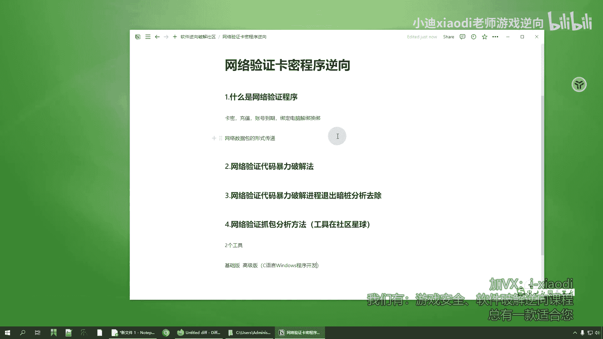

# 网络验证抓包分析：01：课程概述与抓包对象 🎯

本课程由小迪老师讲解，属于软件逆向破解社区的科普内容，本次是第四讲，主题是网络验证抓包分析方法。在本节课中我们将要学习网络验证抓包分析的基本概念和操作流程，理解本地客户端如何与服务器通信，掌握用抓包工具拦截、查看和对比数据包的方法，并认识服务器随机变量在防破解中的作用。

抓包抓的是网络数据包。网络验证本身是一个本地程序，本地程序会和服务器建立联系。当我们输入账号和密码时，账号密码会被组合打包成数据包并发送到服务器，服务器校验数据包，然后判断账号密码正确还是错误。

```text
网络验证数据包 = 账号信息 + 密码信息 + 服务器附加信息
```

明确抓包对象后，下一节准备工具并注入进程。


# 网络验证抓包分析：02：抓包工具准备与进程注入 🛠️

上一节我们明确了抓包对象是网络数据包，本节来看看抓包工具的准备工作与进程注入。发送到服务器的数据在未拦截时无法直接知道具体内容，因此可以用工具拦截发送的数据。拦截后可以用肉眼查看数据长什么样，也可以查看每次发送数据的差异在哪里。输入正确账号密码和错误账号密码时产生的数据差异，可以及时比对，可以用肉眼比对，也可以借助文本比较工具比对。

```text
启动客户端 -> 注入抓包工具 -> 输入账号密码 -> 点击注册/登录 -> 拦截发送包与接收包 -> 复制数据 -> 对比差异
```

以下是工具准备与注入的操作步骤：


- 工具准备了两款，推荐使用主工具，两款工具都上传在社区星球。
- 运行工具后会出现进程注入器。
- 运行目标程序和客户端。
- 先输入账号和密码，不点击登录。
- 在进程注入器中找到客户端进程。
- 点击确定，再点击注入，工具可以正常拦截。
- 不点击注册时没有数据包，点击注册后出现数据包。

完成注入后，下一节观察注册时产生的数据包。


# 网络验证抓包分析：03：拦截注册数据包 📦

完成工具注入后，本节查看注册数据包的具体内容。数据包的内容可以在工具中查看。可以看到发送的数据，也可以看到接收的数据。接收的数据较多，长度为90字节。编码可以更改，这一点之前讲过。这里显示为单独的十六进制，用字符串形式无法直接看出内容，说明它是普通字节组合。

以下是观察注册数据包时需要关注的内容：

- 发送数据区域用于查看客户端发出的数据。
- 接收数据区域用于查看服务器返回的数据。
- 接收数据较多，长度为90字节。
- 编码可以切换，之前课程讲过相关设置。
- 当前显示为单独的十六进制形式。
- 用字符串形式无法直接看出内容。
- 这说明数据是普通字节组合。

看到数据包后，下一节比较相同账号密码的数据差异。

# 网络验证抓包分析：04：对比相同账号密码的数据差异 🔍

上一节已经看到注册时产生的数据包，本节比较相同账号密码产生的数据差异。再次发送注册请求，先记录第一次数据包：全选并复制到文本比较工具。再次点击注册，工具又接收到一个数据包，再次复制并寻找差异。可以看到，同样的账号和密码仍然存在差异。说明这里存在服务器随机加密或随机变量，这种随机变量用于防止直接用正版卡补数据。如果这个数据不变，直接复制正版卡密数据就可能直接使用，因此随机变量用于防止破解。

```text
同样账号密码的数据包差异 = 服务器随机变量 / 随机加密
```


以下是相同账号密码数据对比的操作与结论：


- 记录第一次数据包，并复制到文本比较工具。
- 再次点击注册，接收第二个数据包。
- 复制第二个数据包。
- 使用文本比较工具寻找差异。
- 同样的账号和密码仍然存在差异。
- 差异来自服务器随机变量或随机加密。
- 随机变量用于防止直接用正版卡密复制数据包。


理解随机差异后，下一节分析错误账号密码的数据表现。

# 网络验证抓包分析：05：错误账号密码的数据表现 ❌

已经分析相同账号密码的随机差异，本节看看错误账号密码的数据表现。随便输入错误账号和密码，错误账号密码产生的数据也是90字节。先复制一次数据包，再刷新并重新获取，复制最新的数据包，对比第一次和第二次的数据，不用比较工具也能发现数据截然不同。寻找差异时可以看到完全不一样。因此错误账号密码无法登录，登录不上。只有把正版网络数据包补上去，再分析这个随机变量，才可以登录。

以下是错误账号密码数据包的分析步骤：

- 输入错误的账号和密码。
- 错误账号密码产生的数据同样是90字节。
- 复制第一次错误账号密码的数据包。
- 刷新并重新获取数据。
- 复制最新的错误账号密码数据包。
- 对比后发现数据截然不同。
- 寻找差异时可以看到完全不一样。
- 错误账号密码无法登录。
- 需要把正版网络数据包补上去，并分析随机变量，才可以登录。

分析错误数据后，下一节了解工具中出现的网络收发函数。


# 网络验证抓包分析：06：网络收发函数识别 🧩


通过前面几节的数据包对比，可以定位网络验证中的数据差异，本节了解工具中出现的网络收发函数。工具中显示了收包、获取数据包和发送数据包相关函数。其他网络验证程序也可以使用同样的抓包方法自行尝试，这些函数可以作为分析网络验证逻辑的入口。

以下是工具中可见的网络收发相关函数：

```text
send
sendto
receive
receivefrom
WSASend
WSASendTo
WSAReceive
WSAReceiveFrom
```

这些函数可以帮助定位网络验证的收发逻辑，其他网络验证程序也可以按同样思路尝试。

了解函数后，下一节看另一款工具的兼容性。


# 网络验证抓包分析：07：另一款工具与兼容性说明 🧰

了解网络收发函数后，本节介绍另一款工具的可用性。另一款工具不是特别好用。点击确定和点击登录时，工具会闪退。它并不是所有程序都能使用，有的程序可以用，有的程序不能用。工具选择可以灵活，觉得哪个更合适就用哪个。通常推荐主工具，使用体验最好，打开后32位和64位自动兼容，32位和64位都支持。

以下是另一款工具的情况和工具选择建议：

- 另一款工具不是特别好用。
- 点击确定和点击登录时可能闪退。
- 有的程序可以用，有的程序不能用。
- 工具选择可以灵活，根据程序情况选择更合适的工具。
- 通常推荐主工具，使用体验最好。
- 主工具打开后32位和64位自动兼容，32位和64位都支持。

工具选择明确后，下一节说明工具获取和课程信息。


# 网络验证抓包分析：08：工具获取与课程说明 📚

前面完成了抓包流程、数据差异和工具函数的分析，本节说明工具获取和课程相关信息。工具上传在社区星球，想学习可以联系右下角微信。自己研究、自己下载工具时没有人答疑。想要答疑、工具、课件和丰富有趣的交流环境，可以联系加入软件逆向破解社区。

以下是工具获取与课程说明事项：

- 工具上传在社区星球，想学习可以联系右下角微信。
- 自己研究、自己下载工具时没有人答疑。
- 想要答疑、工具、课件和丰富有趣的交流环境，可以联系加入软件逆向破解社区。
- 社区有基础版和高级版，基础版199，高级版249。
- 想学习编程，社区带有编程、CE0、Windows程序开发内容。
- 所有内容为原创内容。
- 想学习并支持小迪老师，可以加入社区。
- 视频录制到这里，所有资料会打包提供，下期再见。

说明完课程信息后，下一节进行总结。

# 网络验证抓包分析：09：课程总结 📝

前面我们完成了网络验证抓包分析的概念、工具注入、数据包拦截、数据差异对比、函数识别和工具说明。本节课中我们一起学习了网络验证抓包分析的基本方法，重点是通过抓包工具查看本地客户端与服务器之间发送和接收的数据，并通过对比正确账号、错误账号和重复请求的数据差异，理解随机变量在防破解中的作用。

以下是本节课的要点回顾：

- 抓包对象是网络数据包。
- 工具注入后可以拦截注册数据包。
- 接收数据长度为90字节，编码可以切换。
- 相同账号密码的数据仍然存在随机差异。
- 错误账号密码的数据截然不同。
- 网络收发函数包括send、sendto、receive、receivefrom、WSASend、WSASendTo、WSAReceive、WSAReceiveFrom。
- 另一款工具可能闪退，主工具兼容32位和64位。
- 工具和课程获取方式已经说明。



以上就是本节课的全部内容，所有资料会打包提供，下期再见。
