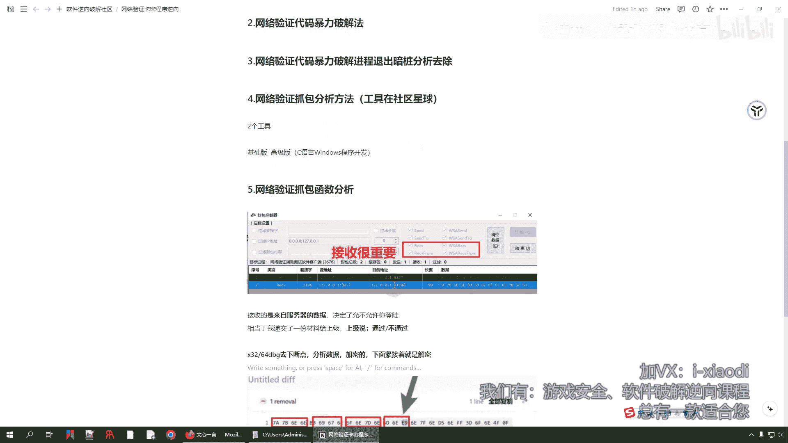
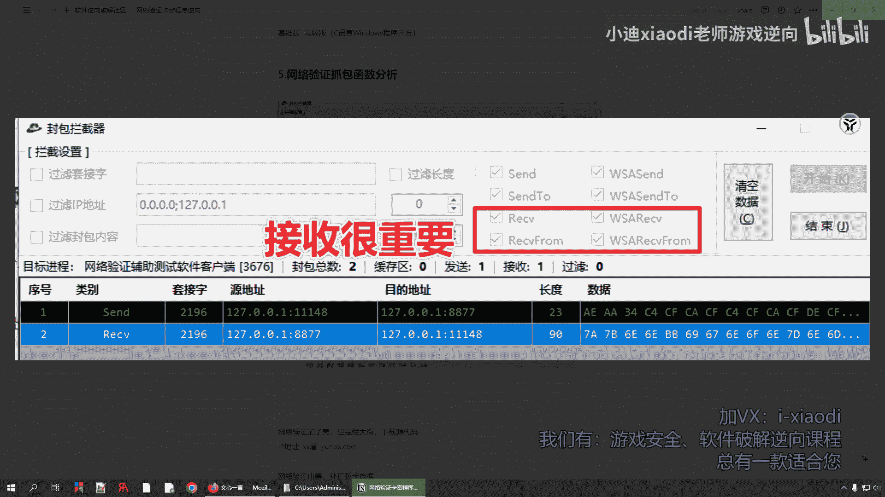
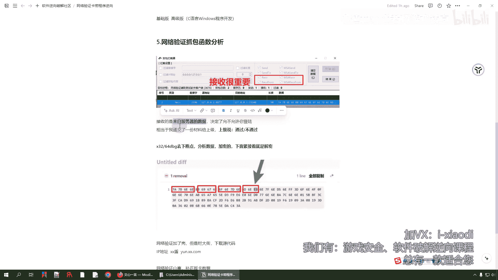
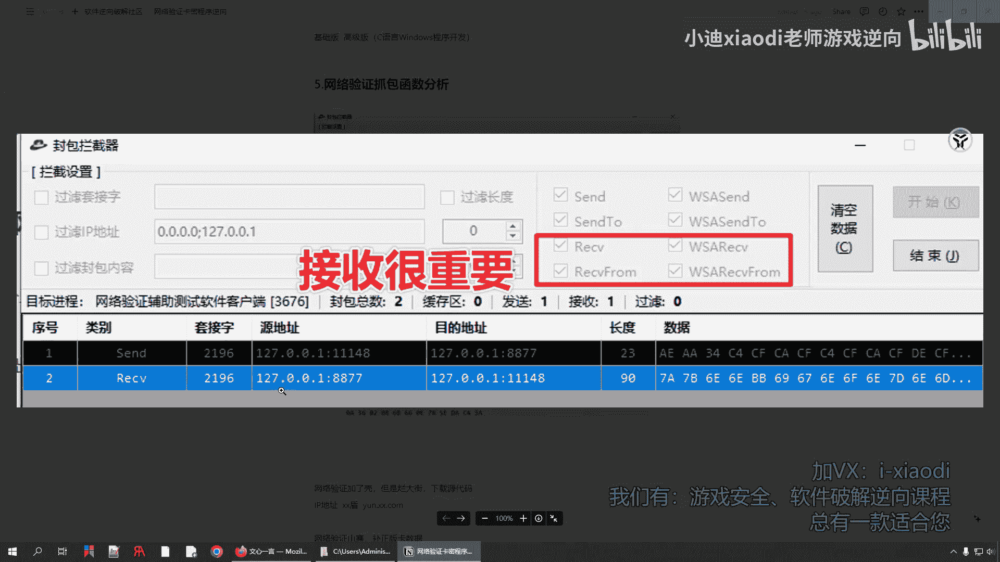
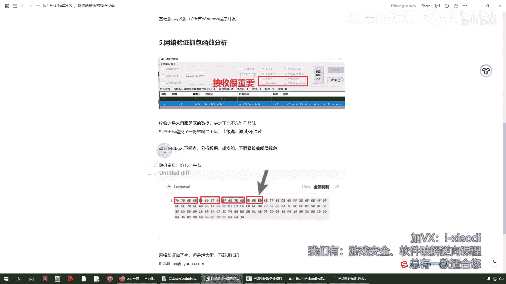
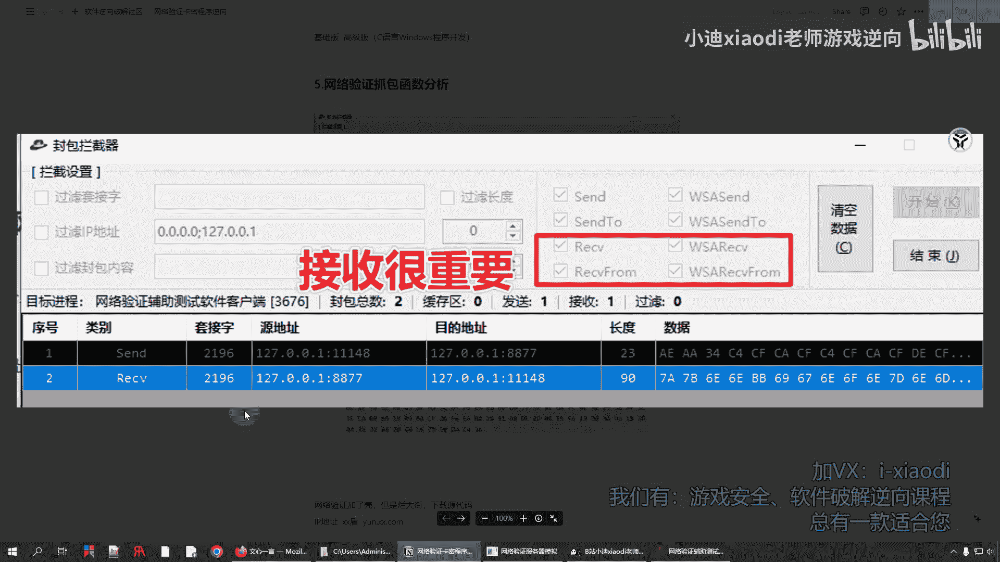
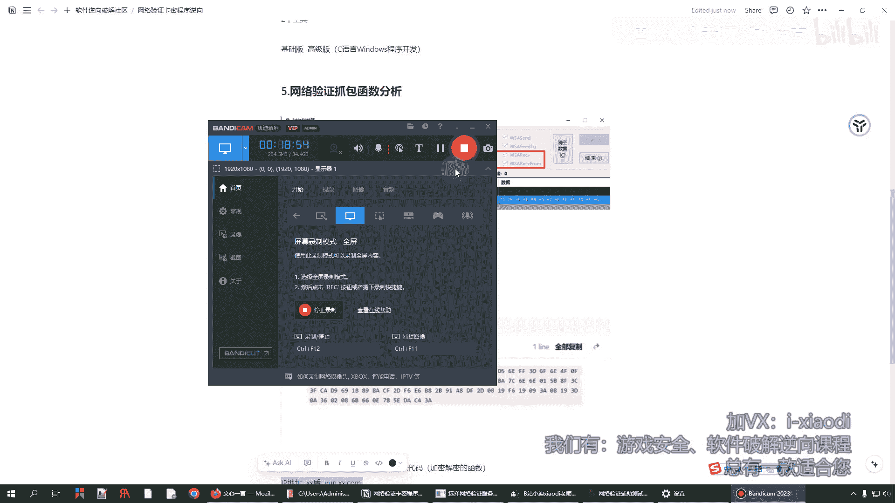

# 🛠️ 网络验证卡密程序逆向破解：5：网络验证正版卡补数据实战

在本节课中我们将要学习网络验证抓包函数分析，重点完成正版卡补数据实战。课程由小李老师讲解，会先说明软件逆向破解和卡密系统能学到什么，再回顾抓包函数与 Windows API 函数，解释发送与接收数据包的关系，随后用调试工具在 `recv` 函数下断点，查看正版卡数据，跟随程序完成异或解密和封包校验，最后通过补正版卡数据实现注册成功，并补充网络验证山寨和源码获取思路。课程强调只做技术交流和研究，不用于违法犯罪和非法事情。

## 🧭 网络验证卡密程序逆向破解：5.1：课程定位与学习边界

上一节我们进入网络验证抓包函数分析的内容，本节先说明课程定位和学习边界。有同学会疑问，为什么很多同学喜欢听软件逆向破解，加入软件逆向破解到底能学到什么。第一，软件逆向常见技术会全部掌握到位。第二，有些软件带有卡密系统，需要了解卡密系统的原理，了解原理后可以尝试通过技术手段突破验证。这里的突破不是白嫖，只是技术交流和研究，不能用于违法犯罪，也不能做非法事情。



可以用一个简单判断来描述学习边界：

```text
技术研究 = 允许
白嫖、违法犯罪、非法事情 = 禁止
```

> ⚠️ 注意：课程内容只用于安全研究和学习交流，不要用于非法用途。

以下是本节需要记住的几个关键点。

- 软件逆向常见技术是课程基础内容。

- 卡密系统原理需要理解，目的是研究验证逻辑。



- 技术突破只做研究和技术交流，不用于非法事情。

理解课程定位后，接下来进入抓包函数和接收数据的重要性。

## 📦 网络验证卡密程序逆向破解：5.2：抓包函数与接收数据的重要性

上一节说明了课程定位，本节回顾抓包函数和接收数据的重要性。上节课已经看到，用风包拦截器拦截辅助软件客户端时，发现 `12345678` 这 8 个东西。这 8 个东西是函数，是 Windows API 函数。Windows API 函数的内容前面已经讲过，没有看到的可以加入社区学习。



这 8 个函数中，上面四个是发送数据包，下面四个是接收数据包。发送和接收哪个更重要，接收更重要。因为接收的是来自服务器的数据，服务器数据决定允不允许登录。服务器数据先来到本地客户端，客户端再判断能不能登录，所以关键源头在服务器数据。



可以用公式表示登录判断的来源：

```text
登录是否允许 = f(服务器返回数据)
```

破解网络验证相关软件时，服务器数据非常重要，相当于递交一份材料给上级，上级说通过就允许登录，不通过就不允许登录。上节课使用风暴拦截器，实际上相当于在相关函数上下了断点，只是这个断点不中断，它把数据截获后显示出来，本质上相当于在函数上下的断点。

以下是本节需要记住的几个要点。

- 8 个 Windows API 函数中，上面四个负责发送数据包。


- 下面四个负责接收数据包。

- 接收服务器数据比发送数据更关键，因为服务器数据决定登录是否允许。


- 拦截器不中断，但相当于在函数上下断点并截获数据。

本节还特别提醒，加密数据中第 15 个字节是随机变量，第 15 个字节就是随机变量的位置，后续查看数据时不要看迷糊。理解这些关系后，本节使用工具去分析，下断点并分析数据。分析出来的数据是加密的，暂时看不懂，后面会讲加密解密。接下来准备运行环境和调试工具。



## 🧪 网络验证卡密程序逆向破解：5.3：运行环境与调试工具准备

上一节回顾了抓包函数和接收数据的重要性，本节准备运行环境和调试工具。先运行服务器软件，这个服务器软件看不见也摸不着，随后运行客户端。打开调试工具，调试工具的获取方式可以加入右下角知心社区获取。点击文件，点击附加，附加后双击客户端程序，因为这个程序是接触到的软件辅助本体程序，输入哔哩哔哩。

这时会看到正版卡数据，也就是正版卡的数据。接下来需要下断点，下断点之前要观察程序使用的发包和收包函数。准备过程可以用下面的操作链路表示：

```text
运行服务器软件（不可见） -> 运行客户端 -> 打开调试工具 -> 文件 -> 附加 -> 双击客户端进程 -> 输入哔哩哔哩
```



以下是准备阶段的操作要点。

- 服务器软件看不见摸不着，但仍然需要运行。

- 调试工具通过社区获取，打开后使用“文件”菜单中的“附加”。

- 附加时双击客户端程序，这是软件辅助本体程序。

- 输入哔哩哔哩后可以看到正版卡数据。

准备好环境后，接下来在收包函数上下断点。

## 🎯 网络验证卡密程序逆向破解：5.4：在recv函数下断点并查看参数

上一节准备好了调试环境，本节在 `recv` 函数下断点并查看函数参数。先观察程序：客户端辅助程序发封包使用 `send`，收封包使用 `recv`。`send` 和 `recv` 是一对成对出现的函数，像公母一样成对出现，也就是一个负责发送，一个负责接收。`recv` 是本节要下断点的函数。

回到 x64dbg，直接按 `Ctrl+G` 跳到 `recv` 的位置，按 `F2` 打一个断点，断点变成红色。点击登录，程序断下来。断下来后可以看到函数参数。`recv` 的第一个参数是描述符 `548`，第二个参数是缓冲区指针，这个缓冲区里放的是正版卡数据，此时里面还没有东西。`1F4` 是缓冲区长度，缓冲区长度不用管，它不一定填满缓冲区。现在还没有数据，需要让程序执行完，也就是让这个函数执行完，按 `Ctrl+F9` 到函数尾部。刚才断的是函数头部，现在到函数尾部，函数尾部意味着函数执行完了。

此时可以看到正版卡数据。虽然 `1F4` 是 500 个字节，但用到的只有 90 个字节，一行 16 个，5 行是 80 个，再加 10 个就是 90 个。90 个字节是有用的。把这 90 个字节复制为二进制数据，放到这里，这就是正版卡数据。为了让显示更合理，可以把选定的行也粘贴上，把地址也显示出来，形成带地址的正版卡数据。

相关长度关系可以写成：

```text
1F4(十六进制) = 500(十进制)
5 × 16 + 10 = 90
有效正版卡数据 = 前 90 个字节
send ↔ recv 成对出现
```

以下是 `recv` 断点操作与观察要点。

- 发包使用 `send`，收包使用 `recv`，两者成对出现。

- 在 x64dbg 中用 `Ctrl+G` 跳到 `recv`，按 `F2` 下断点。

- 点击登录后程序断下，查看描述符、缓冲区指针和缓冲区长度。

- 用 `Ctrl+F9` 执行到函数尾部，查看缓冲区中的正版卡数据。

- 正版卡数据有效长度为 90 个字节，按二进制复制出来。

按 `F8` 走出函数，这个位置就是调用收包函数的出口。接收到的封包是加密的，人看不懂，程序在这个时刻也看不懂。程序是一行一行代码执行的，下面必然有解密流程，程序想要看懂数据，就必须按照代码逻辑解密。接下来跟随解密流程。

## 🔐 网络验证卡密程序逆向破解：5.5：跟随解密流程与异或算法

上一节拿到了正版卡数据，并判断下面会进行解密，本节跟随 `F8` 观察解密流程。按 `F8` 往下走，暂时还没有关键数据，继续走。随后出现大批量赋值，`1D2D0` 这个位置看起来不明白，点击内存查看 `1D2D0` 里是什么，看到 `0x6E`，原文口语说成“6亿”，这里实际指 `0x6E`。`0x6E` 放进去后仍然看不明白。

继续按 `F8`，到 4 行附近，这里进行赋值，出现 `XOR 0x6E`，`XOR` 就是异或。`EBP+ECX-38` 这个表达式不知道做什么，可以用计算器算一下，输入 `EBP+ECX` 再减去 `38`，得到 `73F2F8`。往程序里看，`73F2F8` 刚好在正版卡数据附近，所以这里就是正版卡封包头部指针。随后做操作，如果不会可以复制到文心一言让人工智能解释，它会说明这是传输 16 个字节。这一行本来就是 16 个字节，把这 16 个字节复制到 `XMM0` 寄存器。往下查看 `XMM0`，按 `F8` 后出现数据，从 `7A7B6E` 一直到 `B56E`，刚好是这一整行的数据。`PSO2` 做异或，`XMM0` 和 `XMM1` 做异或，和 `0x6E` 做异或，所有数据都和 `0x6E` 做异或，这大概率就是解密。

解密后的数据放到 `1D49D0+13X`，`X` 是 0，跳转到 `1DC9D0`。按 `F8` 后出现数据，解密完成。第一行、第二行、第三行、第四行，四行解密完成。还有两行，从下面解密流程查看，`EBP+ECX-328` 对应 `2B` 的位置，`2B` 给到 `AL`，`AL` 和 `0x6E` 异或，再放到 `C9D0+1XX`。按 `F8` 单步执行，看到赋值，`45` 也和 `0x6E` 做异或，这边也是和 `0x6E` 做异或。一直执行，按 `F8` 走完，解密完成，得到解密后的分包数据。解密后的数据暂时不需要关心，继续往下看校验。

异或解密可以概括为：

```text
明文 = 密文 XOR 0x6E
XMM0 = 16字节密文
XMM0 中每个字节 XOR 0x6E
```

分析过程中如果录屏画笔找不到，可以改用截图继续记录；录制声音正常，录屏工具使用体验一般。

以下是本节解密流程要点。

- 大批量赋值后出现 `XOR 0x6E`，`0x6E` 是异或密钥。

- `EBP+ECX-38` 计算后得到 `73F2F8`，对应正版卡封包头部指针。

- 16 个字节被复制到 `XMM0`，再与 `0x6E` 异或。

- 四行数据完成解密，后面两行也用同样方式处理。

- 解密结果放到 `1DC9D0` 等位置，得到解密后的分包数据。

解密完成后，接下来查看封包校验和随机变量定位。

## ✅ 网络验证卡密程序逆向破解：5.6：封包校验与随机变量定位

上一节完成了解密，本节查看封包校验和随机变量定位。继续往下走，出现 `cmp` 比较，比较第 4 和第 5 个位置。点击查看第 4 个位置，第 4 和第 5 进行比较，这就是数据包第一次校验，也就是封包第一次校验。

继续往下走，出现 `EBP-340`，也就是 `EBP` 减 `340`。这个位置是 `73F210`，往上翻，`210` 在 `DB` 附近。`DB` 和正版卡加密数据挨得很近，也就是正版卡加密后的封包很近。这里用解密后的数据和 `DB` 做比较，同时可以看到这是一个随机变量。为什么说是随机变量，往下看它和 `C9DE` 做比较，`C9DE` 就是随机变量。做比较的是 `EBP-340` 或 `EBP-40`，也就是正版卡数据上面一部分，正版卡加密数据上面的随机变量上面的一个数。这里就是和随机变量做比较。

随机变量的获取位置在正版卡上边，也就是正版卡数据减去差值，或者直接用 `EBP-340` 定位。正版卡数据中的 `DB` 怎么变成 `B5`，因为 `DB` 和 `0x6E` 做了异或。第一行全部和 `0x6E` 做异或，所以知道随机变量原值是 `DB`，只需要再做一次异或。异或是可逆算法，计算 `DB XOR 6E` 得到 `B5`。所有内容分析完后，可以重新运行程序进行补数据。

相关计算可以写成：

```text
随机变量位置 = 加密数据第15个字节
0xDB XOR 0x6E = 0xB5
异或可逆：A XOR K XOR K = A
```

以下是本节校验与随机变量要点。

- `cmp` 比较第 4 和第 5 个位置，属于封包第一次校验。

- `EBP-340` 定位到 `73F210`，附近有正版卡加密数据 `DB`。

- `C9DE` 位置是随机变量，程序会把上面的数与随机变量比较。

- 随机变量在正版卡数据上方，可以通过差值或 `EBP-340` 定位。

- `DB` 与 `0x6E` 异或得到 `B5`，说明异或操作可逆。

掌握异或可逆后，接下来补正版卡数据并验证注册成功。

## 🧩 网络验证卡密程序逆向破解：5.7：补正版卡数据实战注册成功

上一节确认异或可逆并得到随机变量关系，本节补正版卡数据完成注册。重新运行程序，界面显示注册成功。随便输入内容，让程序断下来，按 `Ctrl+F9` 执行到返回。这里是包指针，查看包指针内存一，里面全部是错误数据。使用二进制鼠标右键选择二进制编辑，编辑后把正版卡数据直接复制过来。复制后 `B5` 位置就是随机变量相关位置，不用管它，不需要处理。往上一翻，`6C` 的位置就是随机变量。`6C` 和 `0x6E` 做异或，用计算器计算 `6C XOR 6E` 得到 `02`。把这个位置改成 `02`，运行程序，界面显示注册成功。

为什么注册成功，因为把正版卡数据写进去了，写进去后直接注册成功。服务器登录信息不用管，但注册成功后软件辅助功能可以使用。这种补正版卡数据的弊端是软件作者可能发现，因为登录 IP 和发送的包都会发送到服务器，登录信息错误也都在服务器上。

再操作一遍：程序断下后按 `Ctrl+F9`，转到目标位置，二进制编辑，把正版卡数据粘贴到此处。这次看到随机变量是 `18`，`18` 和 `0x6E` 做异或得到 `76`，把 `76` 改到对应位置，运行程序，界面显示注册成功，没有问题。

补数据计算可以写成：

```text
0x6C XOR 0x6E = 0x02
0x18 XOR 0x6E = 0x76
补入正版卡数据 -> 修改随机变量异或值 -> 运行 -> 注册成功
```

以下是补数据实操步骤。

- 重新运行程序，随便输入内容并让程序断下。

- 按 `Ctrl+F9` 执行到返回，找到包指针和缓冲区。

- 使用二进制编辑，把正版卡数据完整复制到缓冲区。

- 查看随机变量位置，`B5` 位置不用处理，往上是 `6C`。

- 计算 `6C XOR 6E = 02`，把对应位置改为 `02` 后运行。

- 第二次操作中随机变量为 `18`，计算 `18 XOR 6E = 76`，改为 `76` 后运行。

> ⚠️ 注意：补正版卡数据可能被软件作者发现，因为登录 IP 和发送的数据包都会到达服务器，登录错误信息也会留在服务器上。

补数据完成后，接下来补充网络验证山寨和源码获取思路。

## 🧱 网络验证卡密程序逆向破解：5.8：网络验证山寨与源码获取思路

上一节完成了正版卡补数据，本节补充网络验证山寨和源码获取思路。除了补正版卡数据，还有一种方式是网络验证山寨，原文口语中说成“删寨”或“删战”。网络验证山寨基本上不容易被发现，因为会把 IP 地址全部替换成自己的 IP，自己开卡自己玩。

关于解密算法，有的网络验证加了壳，还加了 VMP，看不到算法怎么办。很多网络验证已经烂大街，可以直接下载源代码。下载源代码的方法是，在这种程序里点击符号，切换到主模块，搜索字符串，搜索当前模块字符串。一般来说会有很多字符串，这些字符串里有很多信息，例如 IP 地址、域名，还可能看到什么云、什么云点什么 ca、什么盾。这类信息就是网络验证的名字，程序里会有相关信息。随后去百度搜索这些信息，例如什么盾、易盾、易云等各种名称。只要它有这些信息，它肯定是盈利性的，这种网络验证都是盈利性的，所以基本上会在网上发布源码。下载到源码后，源码里会有加密解密函数，直接调用即可，不用管它怎么实现、实现多么复杂，直接调用这些函数就可以。后面有机会可以自己搞一份源码来研究。

山寨和源码思路可以概括为：

```text
IP替换：服务器IP -> 自己的IP
自己开卡 -> 自己玩
搜索字符串 -> 找到网络验证名称 -> 百度搜索 -> 下载源码
直接调用源码中的加密解密函数()
```

以下是本节补充要点。

- 网络验证山寨会把 IP 地址替换成自己的 IP，实现自己开卡自己玩。

- 部分网络验证加壳或加 VMP，直接看算法比较困难。

- 很多网络验证的源码在网上可以找到，可以下载源码。

- 在程序符号中切换到主模块，搜索当前模块字符串，寻找 IP、域名、云、盾等名称。

- 根据名称去百度搜索，找到盈利性网络验证的源码。

- 源码中一般包含加解密函数，可以直接调用，不必关心内部实现。

- 后续有机会可以自己获取源码并继续研究。



本节课中我们一起学习了网络验证抓包函数分析和正版卡补数据实战。课程说明了逆向破解和卡密系统的学习边界，回顾了 8 个 Windows API 函数以及 `send`、`recv` 成对关系，理解了服务器数据对登录判断的重要性；随后在 `recv` 函数下断点，获取正版卡数据，跟随程序完成 `XOR 0x6E` 解密和封包校验，定位随机变量，计算 `DB XOR 6E = B5`、`6C XOR 6E = 02`、`18 XOR 6E = 76`，通过补正版卡数据实现注册成功；最后补充了网络验证山寨和源码获取思路。本次录制约 18 分钟，下期再见。

