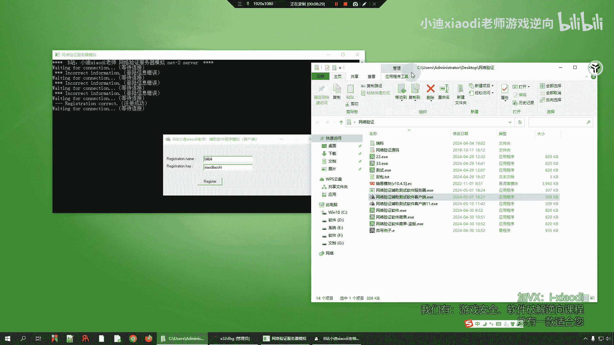

# 🔧 网络验证卡密软件逆向分析方法教学：1：代码暴力破解法

在本节课中，我们将学习网络验证卡密软件的基本原理，并采用代码暴力破解法对一个模拟客户端进行破解。这种方法不依赖服务器，只修改本地代码执行逻辑，从而绕过账号密码校验。


我们先来理解网络验证和普通程序验证的区别。普通程序的账号密码校验是本地完成的，而网络验证软件会通过网络数据包把账号密码发送到服务器。比如我们下载了一个辅助软件，需要登录账号密码。这个账号密码通常要向软件作者购买，购买后作者会在服务器上开通权限。登录时，客户端把账号信息发送到服务器，服务器会检测账号剩余时长、等级、是否VIP等信息，然后返回结果，决定是否允许登录。

所以，整个校验流程比普通程序多了一步服务器校验。服务器可能架设在国内或国外，我们看不见也摸不着，无法直接操作它。我们唯一能接触到的，就是下载到本地的这个客户端软件。

以下是网络验证的基本流程，可以用伪代码表示：

```plaintext
客户端输入账号密码
    -> 打包为网络数据包
    -> 发送到服务器
    -> 服务器校验账号、密码、时长、等级、VIP状态
    -> 返回允许或拒绝
    -> 客户端根据返回结果进入成功或失败分支
```

本节课，我们就用传统逆向破解方法来处理这个客户端。先使用 x32dbg 附加进程，然后定位关键代码，最终通过 NOP 填充所有跳转指令来强制程序走成功分支。

## 附加进程并定位主模块

首先打开 x32dbg，点击“文件”，再点击“附加”，在附加列表中找到目标客户端进程，双击即可附加。附加完成后，程序会暂停在系统断点位置。

接下来，我们点击“符号”按钮。符号列表中会显示程序本身以及它依赖的所有动态链接库和必要文件。要查看程序自身的代码，我们需要双击与程序同名的模块，这个模块也叫主模块。双击后，就进入了程序的主模块界面，当前模块会显示在主模块上。

## 搜索关键字符串

进入主模块后，下一步是查找程序用到的关键字符串。因为字符串就是文本信息，程序的所有提示、按钮、标题等内容都会以字符串形式存在。我们可以在主模块界面任意位置点击鼠标右键，选择“搜索”，然后选择“当前模块”，再点击“搜索字符串”。这样就能看到当前模块中所有的字符串信息。

以下是搜索字符串后可能看到的一些关键信息：

- 服务器 IP 地址，例如本地地址 `127.0.0.1`。
- 各种提示信息，例如“连接服务器失败”、“注册成功”等。
- 标题或按钮文字。

这些字符串有什么用呢？注意看字符串窗口的布局：左边是代码，右边是字符串。也就是说，左边代码引用了右边的字符串。因此，只要我们定位到某个关键字符串，就能顺藤摸瓜，找到使用这个字符串的代码逻辑。

我们找到“注册成功”这个字符串，双击它，就会跳转到代码区域中引用该字符串的位置。在这里可以看到下方有一个 `MessageBox` 信息框提示。继续往上看，会发现一堆跳转指令。跳转指令是改变代码执行逻辑的关键。如果程序执行到某个跳转指令，就可能跳到失败分支或成功分支。

## 暴力破解：NOP 填充跳转

要破解成功，一种暴力的方法就是把所有带箭头的跳转指令全部干掉。这样程序就会直接执行到成功分支，而不会跳走了。

以下是暴力破解的具体操作步骤，我们先找到最靠上的一个跳转指令：

1. 在那一行按 `F2` 下一个断点。
2. 运行程序，在界面上输入任意账号和密码（例如 `11`），点击登录。
3. 程序会在断点处暂停，左下角显示“已暂停”，说明程序中断在这个位置。
4. 再按一次 `F2` 解除断点。
5. 查看当前代码流程，找到所有会改变逻辑的跳转指令。

现在，我们要把这些跳转全部替换为 `NOP`（空操作）指令。操作方法是：选中某条跳转指令，点击鼠标右键，选择“二进制”，然后选择“用 NOP 填充”。重复这个操作，把所有跳转指令都替换成 NOP。这样，程序执行到这些位置时不会跳转，而是继续向下执行。


修改完成后，需要把补丁保存到文件中。点击菜单栏的“补丁”，选择“修补文件”，将修改后的程序保存为新的文件。然后运行修补后的程序，输入任意账号密码，可以看到程序直接提示“注册成功”。

注意，程序在提示“注册成功”后出现了闪退。这说明暴力 NOP 填充虽然绕过了验证，但可能会破坏程序的正常运行逻辑。为什么会出现闪退？有没有更好的处理方法？我们将在下节课继续讨论。

## 总结



本节课中，我们一起学习了网络验证软件的基本原理，以及如何使用 x32dbg 通过搜索字符串、定位关键跳转、NOP 填充和打补丁的方式实现暴力破解。这种方法简单直接，但可能带来闪退等问题。下节课我们将探讨更完善的破解思路和补丁处理方法。
