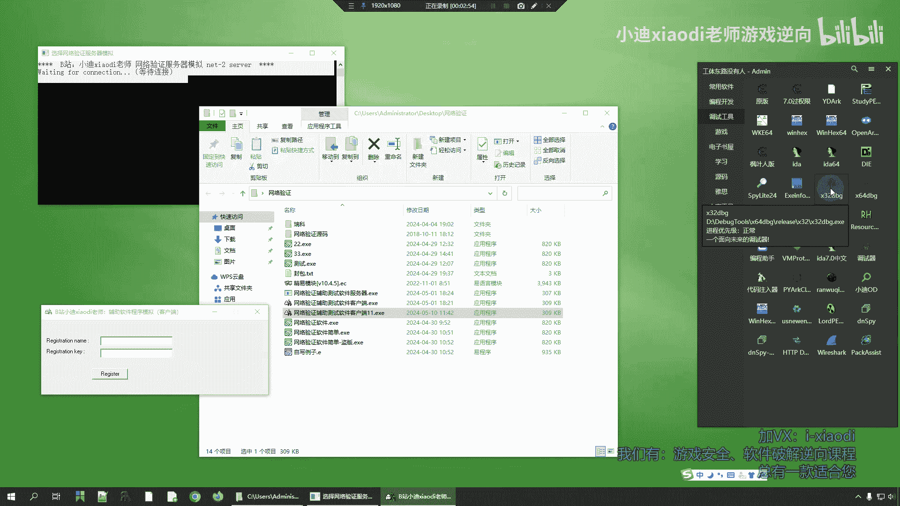
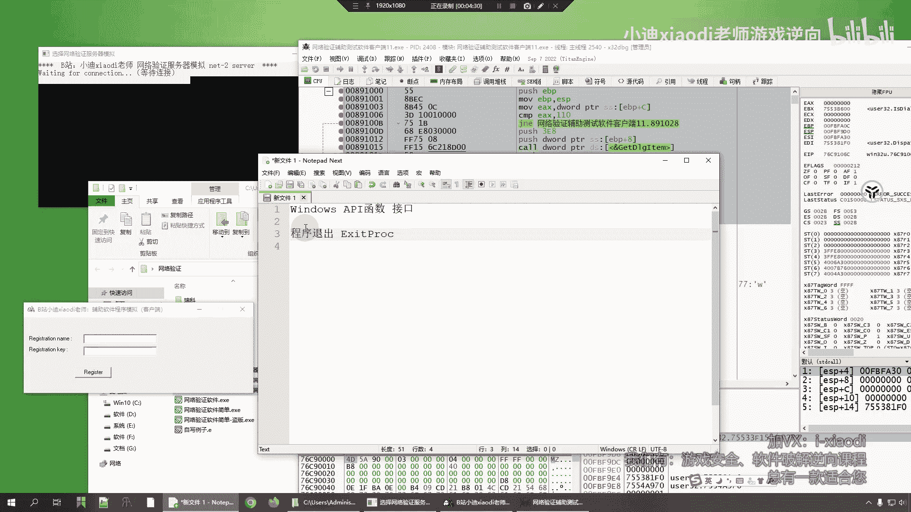
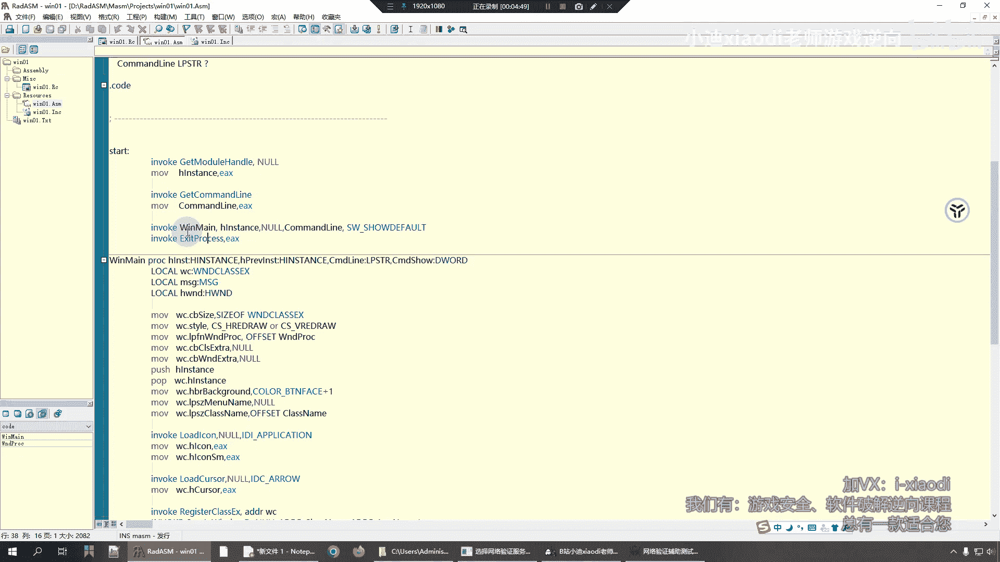
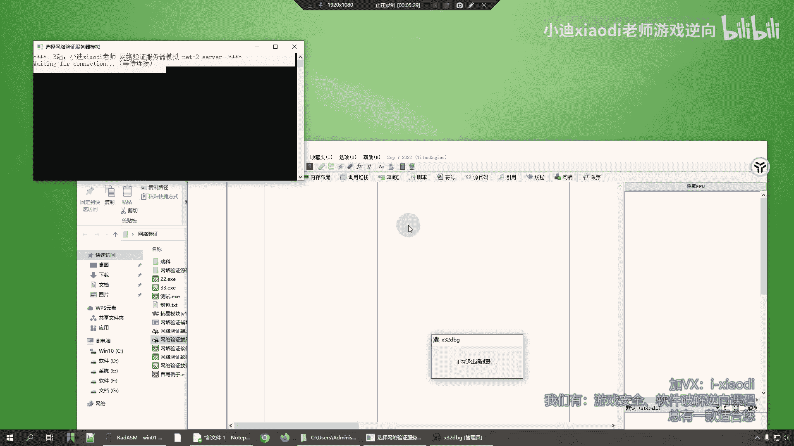
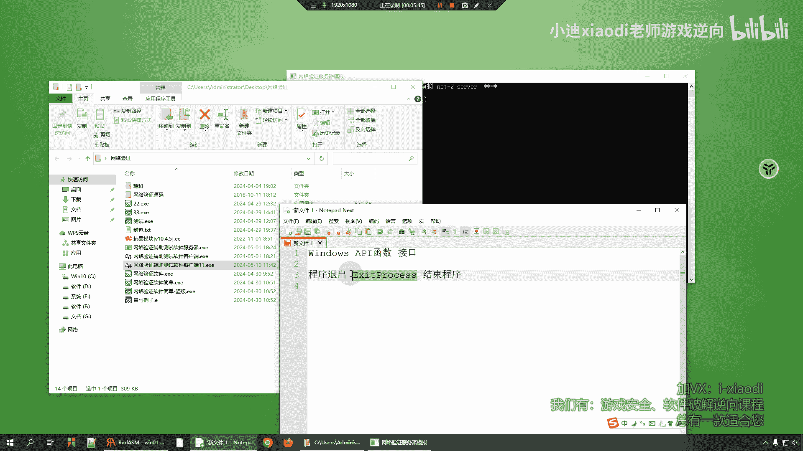
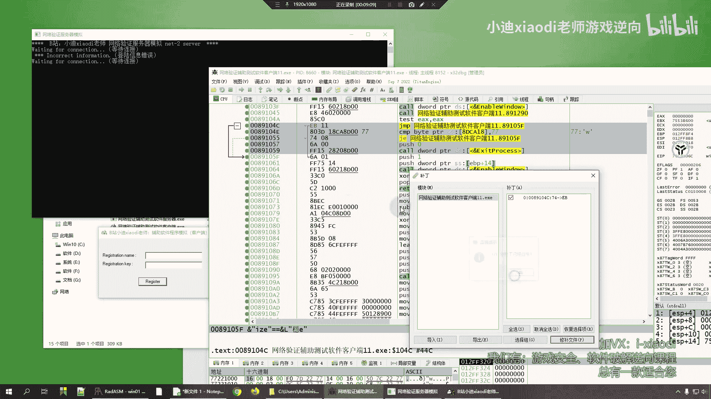
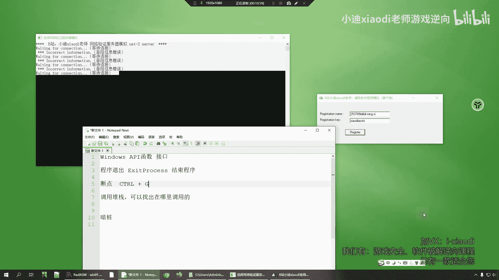
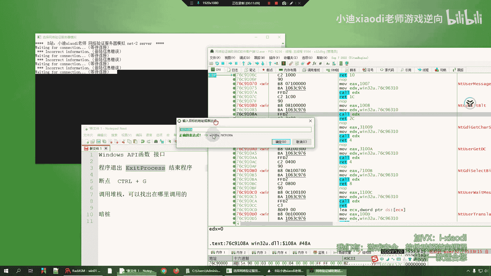
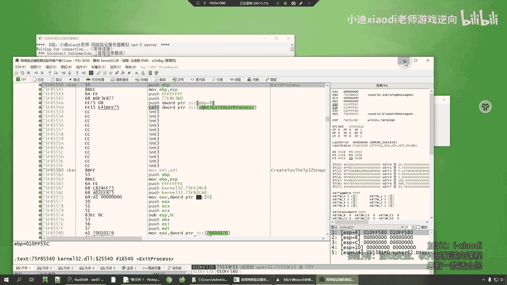
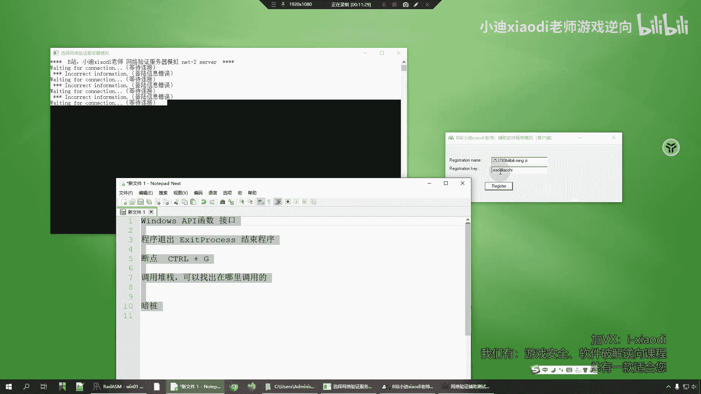

## 🔧 网络验证卡密软件逆向分析方法教学：2：进程退出暗桩分析去除

大家好，我是小李老师。欢迎跟着小李老师学习软件安全逆向破解。有些同学可能会好奇，为什么这么多人跟着小李老师学习这门课程？它到底有什么吸引力，又能干什么呢？这里简单说明一下：我们平时在电脑上使用的一些小软件，有些是需要付费才能用的，或者需要注册码才能正常使用。如果你自己感兴趣，可以通过逆向分析来研究它的验证过程。当然，这些东西仅限技术交流，请勿用来做一些不太好的事情。本节课的内容属于软件逆向的基础，也是游戏安全、软件安全、网络安全和 CTF 比赛中的常见技能。

在本节课中，我们将继续上一节课的内容，学习如何处理“程序被破解后却自动退出”的问题。我们会从 Windows API 中的退出函数入手，利用调试器定位进程退出的位置，再通过修改汇编跳转指令来跳过它。最后，我们还会把修改后的代码保存到程序文件里，让破解结果在程序重启后依然生效。学完这一节，你会掌握一套非常实用的分析流程：根据程序表现出来的现象，找到对应的 API 断点，再顺着调用堆栈找到真正需要修改的逻辑分支。

上一节我们实现了什么？我们实现了一种暴力破解代码的思路。当时的操作是：先启动服务器程序，再启动客户端程序。服务器程序是我们看不见也摸不着的东西，它可能在美国，也可能在其他国家。我们唯一能掌握的是客户端程序。这个客户端程序就是别人发布的软件，它需要输入账号和密码，而这些账号密码要联系软件作者才能购买。购买后，我们把账号密码填入客户端，点击登录按钮，客户端就会把账号密码发送到远程服务器。服务器收到后，会校验这个账号密码是否存在、是否到期，以及是否允许登录。如果账号不存在、密码错误，或者已经到期了，服务器就会返回“不允许登录”，软件登不上；如果还没有到期，服务器就会返回“可以登录”，软件就能正常使用。

上一节课，我们做的是把服务器返回之后的那一层本地校验逻辑破坏掉。点击登录后，虽然程序提示“注册成功”，但紧接着整个程序就退出了。注册成功却退出，这肯定没法正常使用。所以，今天我们的内容就是：分析这个程序为什么会退出，并把退出逻辑给剔除掉。



我们继续运行这个破解后的程序进行分析。先用调试工具把它加载起来。在演示中使用的是 x32dbg 调试器，它是我自己电脑里的一个常用工具。另外，在知识星球里还有另一个工具包，里面存放的是各种杂项工具。如果大家对我们如何创建工具包或者制作工具包感兴趣，以后可以专门录制一期工具包制作教学视频。我们先打开 x32dbg，然后调整一下界面大小，方便观察。

接下来，点击菜单栏的“文件”，选择“附加”，在附加列表里找到我们这个辅助程序的客户端。附加成功后，点击“符号”标签，你会看到当前进程加载的所有模块，包括程序本身的模块和它所依赖的各种动态链接库。如果要看这个程序的主要代码，就要在符号列表里双击与程序名字完全匹配的那个模块。程序名字到哪里去找？就直接看你的程序目录里的可执行文件名。找到后，在符号列表里双击这个模块，代码窗口就会显示出程序相关的汇编代码。这个是调试分析的第一步。

程序会退出，那么它是怎么退出的呢？之前我们在讲 Windows 汇编和 Windows 程序开发的时候，曾经提到过 Windows API 这个概念。Windows API 的全称是 Windows Application Programming Interface，翻译过来就是 Windows 应用程序开发接口，它是微软提供给软件开发人员的一组功能接口。你输入账号也好，把账号消息发送出去也好，还是最后退出程序也好，所有操作本质上都是依赖这些接口完成的。那么，程序退出有没有对应的接口？当然有。这个接口就是 `ExitProcess`。`ExitProcess` 的作用就是退出当前进程，也就是结束当前正在运行的程序。



```asm
; 结束当前进程的 API
ExitProcess
```



因为程序点完注册之后出现了退出的现象，我们可以大胆猜测：程序大概率是调用了 `ExitProcess`。既然它要经过这个函数，我们就在这个函数附近做点文章。先把程序和调试器重新启动一下，服务器也重新打开，然后再让调试器附加到客户端上。附加完成后，继续在“符号”面板里双击程序模块，进入程序代码区。





接着，我们要给 `ExitProcess` 下断点。什么是断点？断点就是中断程序的运行点，当程序执行到断点地址时，会立刻停下来，方便我们观察现场。在调试器中按 `Ctrl+G`，会弹出跳转输入框，输入 `ExitProcess`，点击确定，调试器就会跳转到这个函数的位置。跳到目标地址后，按 `F2` 键打下一个断点。打好之后，我们回到客户端程序，随便输入一个账号和密码，点击“注册”，再点击“注册成功”弹窗中的“确定”。这时候你会发现，程序果然中断在了 `ExitProcess` 附近。这说明我们的猜测是正确的，程序的的确确调用了这个退出接口。

不过，程序停在 `ExitProcess` 里还远远不够，我们真正想改的是“谁调用了它”。这就需要用到“调用堆栈”窗口了。调用堆栈的作用，是找出当前函数是从哪里被调用的，它能把一层一层的调用关系列出来。点击调试器里的“调用堆栈”标签，你会看到一长串调用记录。这些记录里有系统动态链接库的调用，也有程序模块自身的调用。具体看哪一项呢？我们要找的就是和当前程序模块名字一致的那一条。双击那条与程序名相匹配的调用记录，代码窗口就会跳到上层调用位置。

跳到上层之后，你会看到一条跳转指令。这条跳转指令带有一个小箭头，箭头指向后面的几行代码。在汇编语言里，跳转指令是可以选择的：比如条件跳转，条件成立就跳过去，条件不成立就不跳。如果不跳，程序就会一行一行继续向下执行，最终执行到 `ExitProcess`，然后进程退出；如果跳过去，那后面的退出代码就不会执行。此时，我们在这个跳转指令上再下一个断点，然后重新运行程序。再次走一遍注册流程，程序中断在这个跳转指令上时，调试器会提示我们：跳转不会执行。这说明当前的逻辑确实会走向退出分支。

我们需要让程序跳过退出代码。最简单的方法就是把这条条件跳转指令改成无条件跳转指令 `JMP`。`JMP` 和条件跳转不一样，它不管条件成立与否，都会直接跳转到指定位置。这样一来，程序走到这里就必然跳过后面那几行退出代码，自然也就不会执行 `ExitProcess` 了。修改的时候，调试器里会有一个修改指令的窗口，我们把它改成 `JMP`，并把窗口内相关的两个选项都勾上，然后点击确定。修改完成后，我们再运行程序，发现注册成功之后，程序没有退出。这个现象说明，我们已经成功把退出暗桩跳过去了。

```asm
; 原始代码结构
00401234  jnz short 00401240   ; 条件跳转：满足条件则跳过退出代码
00401236  call ExitProcess      ; 退出进程
00401240  ...

; 修改后
00401234  jmp short 00401240   ; 无条件跳转：永远跳过退出代码
00401236  call ExitProcess      ; 不会被执行
```

为了方便你照着操作，我们把刚才的完整流程整理成下面几个步骤：



- 打开调试工具，附加到客户端程序，并在符号面板中双击程序模块。
- 按 `Ctrl+G`，输入 `ExitProcess`，跳转到进程退出函数。
- 按 `F2` 在 `ExitProcess` 函数入口设置断点。
- 回到程序点击注册，触发断点，确认程序确实调用了 `ExitProcess`。
- 打开调用堆栈，找到程序模块对应的调用位置并双击进入。
- 在上层代码中找到条件跳转指令，并在该指令处设置断点。
- 重新运行程序，观察跳转指令是否执行。
- 将条件跳转指令修改为无条件跳转指令 `JMP`。
- 运行验证程序是否还会退出。

虽然调试器里已经改好了，但这种修改只存在于内存中，程序一旦重启就会恢复成原来的样子。为了让修改永久保存，我们需要给程序打补丁。点击调试器里的“补丁”按钮，把修改过的指令写入程序文件。在保存过程中，可以看到某些字节被改写，比如原来的 `11` 变成了 `12`。保存之后，调试器会提示“补丁已经应用”。我们关闭程序，重新运行，输入任意用户名和密码（比如哔哩哔哩），点击注册，程序依然提示“注册成功”，而且完全没有退出。到这里，这个实验程序就被我们初步搞定了。

不过要注意，服务器端依然会进行校验。如果你输入的账号和密码是无效的，服务器会返回“登录信息错误”。但因为我们把本地的校验和退出逻辑都处理了，所以本地功能已经可以正常使用。至于能不能连服务器这一层也一起突破，这也是可以做到的。我们可以伪造一个合法的网络数据包发送给服务器，让服务器返回“可以登录”。这部分内容需要分析网络数据包，后续我们再详细讲解。另外，暴力破解这种方式有一定概率会让部分功能丢失，但功能丢失也不要紧，通过分析网络数据包，还是可以重新加上这些功能。





这种进程退出的手法，在逆向中有一个专门的名词，叫“暗桩”。暗桩就是暗地里搞事情的代码。开发者把一些检查逻辑藏在程序深处，一旦检测到异常情况，就让程序退出，让人感觉破解好像没有成功。很多新手在破解软件时，明明已经改对了验证逻辑，但只要程序一退出，就完全不知道下一步该怎么办。今天这个思路就解决了这个问题：程序退出不可怕，先找到退出相关的 API 函数，比如 `ExitProcess`，然后顺着调用堆栈找到上层的判断跳转，最后把跳转改成 `JMP`，让退出代码永远不执行。这个思路简单，但非常实用。





总结一下，本节课我们一起学习了进程退出暗桩的分析与去除方法。我们从 Windows API 中的 `ExitProcess` 函数入手，在调试器中附加客户端程序，给退出函数下断点，再通过调用堆栈定位到上层条件跳转指令，最后将条件跳转改成无条件跳转 `JMP`，并打补丁保存修改。整个过程不仅解决了程序退出问题，也巩固了断点、调用堆栈、跳转指令和补丁应用这些逆向分析的基础知识点。后面我们还会继续分析这个实验程序，一步一步把它彻底搞定。如果大家对软件安全逆向感兴趣，可以关注视频右下角的信息，及时加入我们。我是小李老师，我们下期再见。
