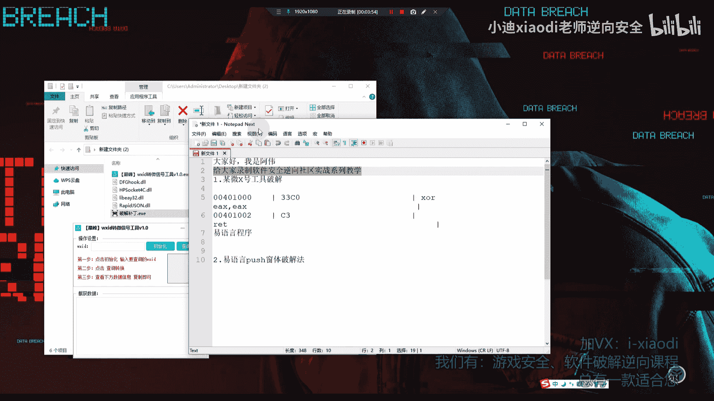

# 🛠️ 网络验证卡密软件逆向分析：第一讲：某微信号工具卡密登录破解

在本节课中我们将要学习网络验证卡密软件逆向分析的基础流程。课程由阿伟录制，属于软件安全逆向社区实战系列教学，今天是第一讲，主题是某微信号工具破解。这节课会从运行工具、观察登录失败提示开始，再通过调试器附加、搜索字符串、定位关键跳转、修改指令和制作补丁，完成第一种破解方式。需要说明的是，本内容仅作科普，重点是学会保护自己的软件，理解验证逻辑和常见修改点，而不是鼓励非法使用。

下面是本课程的定位与适用范围，先明确学习边界：

> 课程主题：网络验证卡密软件逆向分析方法教学。仅作科普，学会保护自己的软件。内容面向小白软件破解、反汇编、逆向安全工程师，以及2025最新游戏安全、软件安全、网络安全、CTF比赛必备基础。

上面已经明确了课程定位，接下来我们进入实际操作，先观察工具运行后的表现。

## 🔍 网络验证卡密软件逆向分析：1.1：观察工具运行与登录失败提示

上一节我们说明了课程目标，本节我们来看看工具启动后的第一现象。首先打开这个工具，运行之后它要求输入卡号。我们随便输入一个卡号，然后点击登录，工具会提示登录失败。这个“登录失败”就是非常关键的信息，因为它告诉我们验证没有通过，也给我们后续定位失败分支提供了线索。基于这个现象，我们尝试去破解它，观察它是如何判断成功和失败的。

以下是观察工具运行情况的具体步骤：

1. 运行这个微信号工具，等待它显示卡号输入界面。
2. 在卡号输入框中随便输入内容，然后点击登录按钮。
3. 观察提示信息，工具会弹出或显示“登录失败”。
4. 记录“登录失败”这个关键信息，作为后续字符串搜索和分支定位的入口。

完成观察后，我们知道了失败提示的存在。接下来在正式修改之前，还需要先查看这个工具本身的信息，判断它有没有加壳，以及采用哪种调试方式更合适。


## 🧰 网络验证卡密软件逆向分析：1.2：查看程序信息与调试方式选择

上一节我们看到了登录失败提示，本节我们来看看程序信息。破解之前可以先查看这个工具的基本信息，发现它是UPX壳。对于UPX壳，可以选择手动脱壳，也可以不脱壳，直接带壳调试，这两种方式都可以继续分析。随后把这个工具关掉，准备在调试器里进行附加。这里的选择不影响我们后面定位字符串和修改跳转，初学者可以先从带壳调试入手，减少脱壳步骤带来的干扰。

以下是查看程序信息和选择调试方式的步骤：

1. 在破解之前查看工具信息，确认它是UPX壳。
2. 明确处理方式：可以手动脱壳，也可以不脱壳直接带壳调试。
3. 把这个工具关掉，准备打开调试器进行附加操作。


工具信息确认之后，我们就可以进入调试器。下一节将把目标程序附加起来，并识别它是不是易语言程序。

## 🧵 网络验证卡密软件逆向分析：1.3：附加程序并识别易语言特征

上一节我们确认了壳和调试方式，本节我们来附加程序。打开调试工具之后，对目标程序进行附加，双击目标程序，然后点击符号位置切换到我们的程序。看到类似XOYESES的模块标识后，可以很清晰地了解到这是一个易语言写的程序。易语言程序的特征就是这样，我们可以做一个简单记录。识别语言类型有助于后续理解字符串、窗口和验证逻辑的组织方式，也让搜索关键字符串时更有方向。

以下是附加程序并识别语言特征的操作：

1. 打开调试工具，对目标程序进行附加。
2. 双击目标程序，再点击符号位置切换到程序模块。
3. 观察模块信息，看到类似XOYESES的标识后，判断这是易语言程序。
4. 简单记录“这是易语言程序”，并记住易语言程序的这种特征。

识别出易语言程序后，下一步就可以在当前模块中搜索字符串。通过字符串往往能快速找到网络验证、版本号、失败提示等关键信息。

## 🔤 网络验证卡密软件逆向分析：1.4：搜索字符串定位网络验证与失败分支

上一节我们识别了易语言程序，本节我们来搜索当前模块的字符串。在调试器里鼠标右键搜索当前模块的一些字符串，看看有没有关键信息。搜索之后可以在里面发现一些有价值的内容，这些内容能帮助我们理解网络验证的实现和失败提示的位置。字符串是逆向分析中非常直观的入口，尤其是登录失败、版本号、访问次数这类文本，通常会出现在验证逻辑附近。

以下是搜索字符串后可以关注的关键信息：

1. 网络验证使用的是福瑞银网络验证。
2. 软件累计访问次数显示在这里。
3. 这里还有一些提示信息。
4. 这里也是网络验证相关的内容。
5. 这里是软件的版本号。
6. 这里出现“换网失败”和“登录失败错码”等提示。

找到这些字符串后，双击“登录失败”过去，就可以看到这边是登录失败的位置。它的上边应该就是登录成功的位置。此时可以看到一个JNE，这是一个非常关键的跳转。如果它从这里跳下去，就会跳到一个失败的位置。因此我们要做的就是让它不跳转，这样就能改变验证走向。这个思路可以用下面的条件跳转逻辑来描述：

```text
若 ZF = 0，则 JNE 发生跳转，进入失败分支；
若不希望进入失败分支，就把 JNE 改成不跳转。
```

既然问题定位到了JNE，接下来就是修改指令。最简单的方式是在对应地址用NOP填充，让这条条件跳转失效。

## 🧠 网络验证卡密软件逆向分析：1.5：分析JNE跳转与NOP修改思路

上一节我们定位到了登录失败附近的JNE，本节我们来分析修改思路。关键地址是40CD29，在这个位置鼠标右键选择二进制，然后用NOP填充，点击确定。NOP的作用可以理解成“什么都不做”，用它覆盖原来的条件跳转后，程序就不会再按原来的条件跳到失败位置。这个修改可以用下面的公式和代码来描述：

```text
NOP = 0x90
地址 0x40CD29：JNE（条件跳转） -> NOP（空指令）
效果：不跳转到失败分支
```

修改完成之后，要记录一下这个地址，方便制作补丁。接下来找到我们的程序，直接拖到补丁工具里，然后把地址40CD29写上去。把这个地址复制一下，把修改后的二进制指令也复制出来，贴到补丁工具里，点击添加，尝试生成补丁。这个工具是补丁工具，用来生成破解补丁，生成后点击保存。最后回到文件夹，把原来的程序先关掉，准备测试补丁效果。


以下是制作补丁的具体步骤：

1. 在地址40CD29处鼠标右键，选择二进制，用NOP填充并点击确定。
2. 记录修改地址40CD29，确认这是修改后的指令位置。
3. 找到程序，把它直接拖到补丁工具里。
4. 在补丁工具中填写地址40CD29。
5. 复制修改后的二进制指令，粘贴到补丁工具中。
6. 点击添加，尝试生成补丁。
7. 这是补丁工具，生成的是破解补丁，点击保存。
8. 回到文件夹，把原来的程序先关掉。

补丁生成并保存后，就进入验证阶段。下一节我们运行补丁，检查修改是否生效。

## ✅ 网络验证卡密软件逆向分析：1.6：测试补丁与第一种破解方式

上一节我们制作好了补丁，本节我们来测试效果。回到文件夹后进行测试，运行破解补丁，随便输入卡号，点击登录。这个时候可以看到已经登录进去了，这说明修改JNE并制作补丁的方式生效了。这个方式就是当前这个软件的第一种破解方式，核心点就是定位失败分支前的条件跳转，再用NOP让它不再跳转。

以下是测试补丁的操作步骤：

1. 运行破解补丁。
2. 在卡号输入框中随便输入内容，点击登录。
3. 观察结果，确认已经登录进去。
4. 记录这是当前软件的第一种破解方式。

第一种方式完成后，我们自然会问：针对易语言程序，还有没有其他破解方式？答案是有的。下节课可以演示易语言程序的另外一种破解方式，大家可以回去做一个预习，这种方式的名称叫做“一元铺式窗体破解法”。最后希望大家回去练习一下这个工具，工具也会放到社区里。本讲到此结束，下集再见。



## 🧾 网络验证卡密软件逆向分析：第一讲：课程总结与练习安排

上一节完成了补丁测试并引出了下节内容，本节我们对第一讲做总结。本节课中我们一起学习了某微信号工具卡密登录破解的第一种方式：先运行工具并观察“登录失败”提示，再查看UPX壳信息并选择带壳调试，随后附加程序识别易语言特征，搜索字符串找到福瑞银网络验证、累计访问次数、版本号、换网失败和登录失败错码等信息，双击失败字符串定位到JNE关键跳转，在40CD29地址用NOP填充，最后通过补丁工具生成补丁并测试登录成功。整个过程的核心可以概括为：定位失败分支，修改条件跳转，让程序不进入失败位置。课后请练习这个工具，工具会放到社区里，同时预习“一元铺式窗体破解法”，下集再见。

