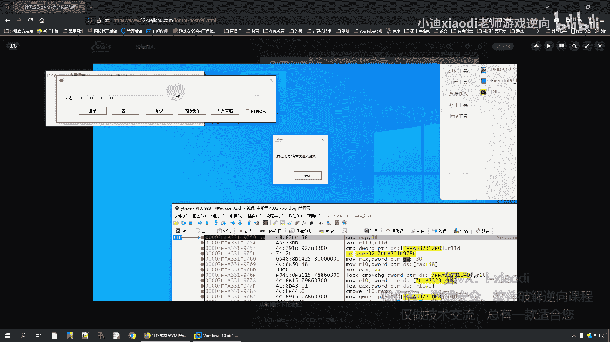
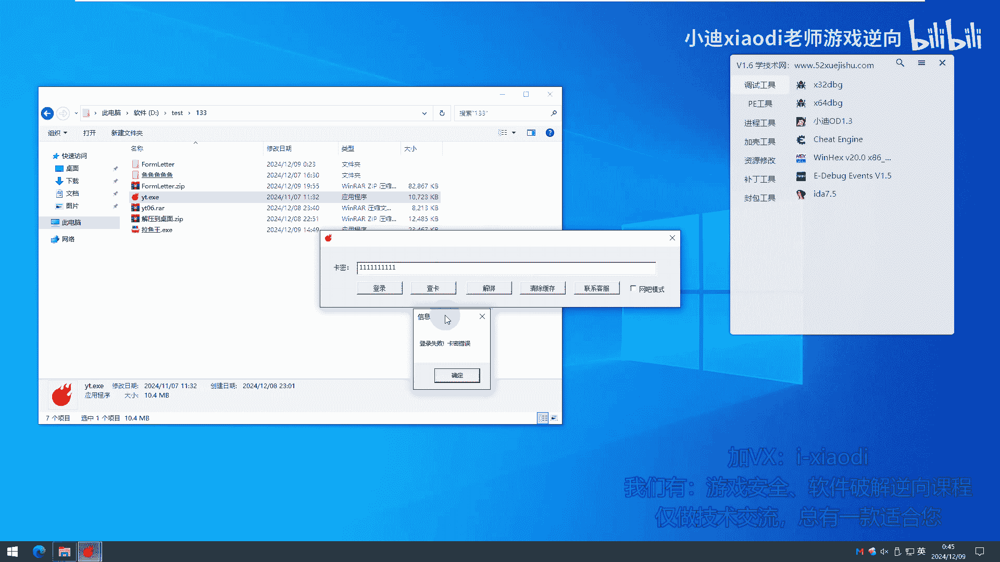
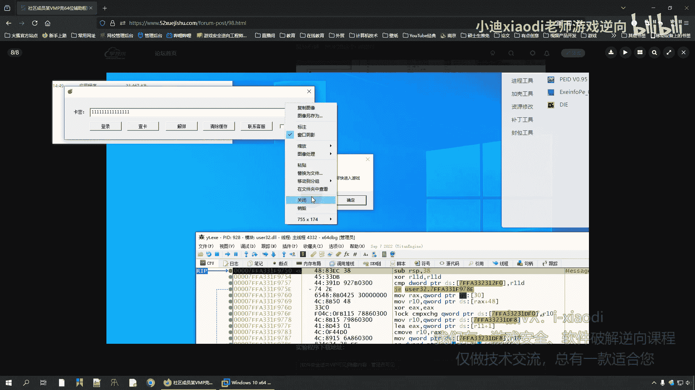
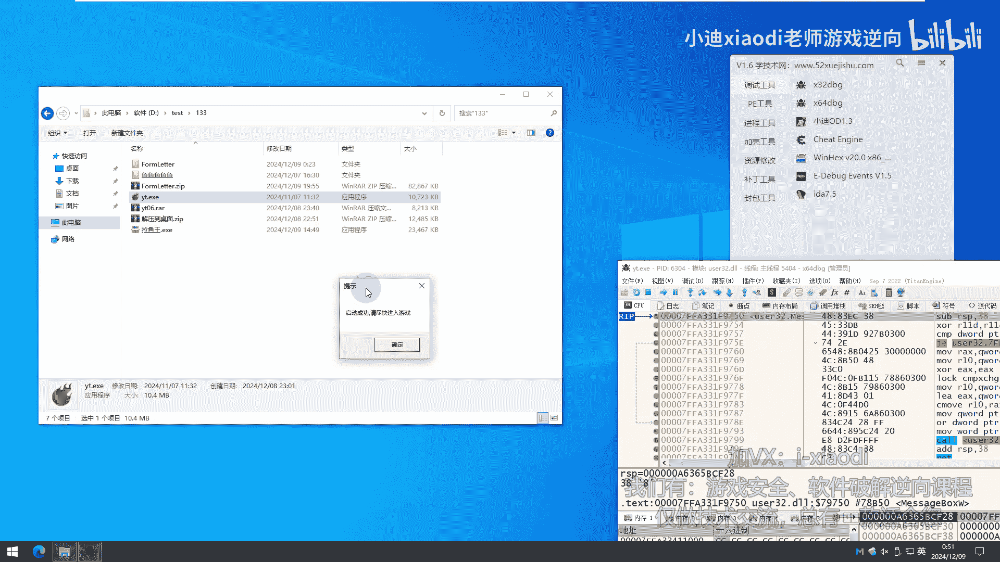

# 🧭 网络验证卡密软件逆向分析方法教学：01：课程概述与破解原理

在本节课中我们将要学习 64 位游戏辅助外挂的逆向分析流程，了解付费软件如何被逆向分析，内容围绕游戏安全、软件安全、网络安全展开，面向小白讲解软件破解、反汇编与逆向安全的基础思路。课程案例来源为 `BV1QMqNYYErQ-`。讲师小李老师继续讲解软件逆向破解。有同学会纳闷：讲逆向破解，为什么这么多人听，这个逆向破解到底能干啥。实际上，它是通过技术手段去突破一些软件登录的限制。说得通俗一点，就是通过分析程序执行流程，找到登录验证中的关键位置，从而绕过原有登录限制。

接下来我们从外挂程序的角度理解这个技术。说得直接一点，这类技术可以用于破解软件。例如手里有一款游戏外挂程序。大家都知道，游戏外挂会破坏游戏平衡。那么我们破坏外挂软件，是不是也可以理解为维护游戏平衡，从这个角度想一想。所以这个技术学了之后，有利于游戏平衡，有机会还是要学一学。下面看这个外挂的运转原理。

我们先看登录逻辑。随便输入卡密之后点击登录，它会提示登录失败、卡密错误。那么我们就可以通过技术手段，让它直接登录上。登录上之后，它会提示启动成功，请尽快进入游戏。接下来一起看这个外挂软件怎么分析、怎么破解。首先点击确定。

核心登录逻辑可以用下面代码表示：

```text
输入卡密 -> 点击登录
if 卡密正确:
    提示“启动成功，请尽快进入游戏”
else:
    提示“登录失败，卡密错误”
```



这里要先建立一个基本认识：分析登录验证时，重点是找到程序在“卡密正确”和“卡密错误”之间做出的判断位置。下面进入实际操作，先判断程序的架构和防护情况。






# 🛡️ 网络验证卡密软件逆向分析方法教学：02：识别程序架构与防护

上一节我们介绍了登录验证的基本逻辑，本节中我们来看看第一步：判断软件有没有防护。第一步要看软件有没有防护，怎么去看，使用工具包里的这个工具，拖过来看哪里，看这里。首先这是一个 64 位程序。电脑分为 32 位和 64 位，程序现在也分为 32 位和 64 位。识别程序位数很重要，因为它会影响后续调试工具的选择。然后看区段，区段里多了一个 `VMP0`。稍微懂点软件的人可能知道，VMP 是一个壳，是软件的一种防护。接着再用其他工具看一看。例如把这个工具拉过来，界面这边倒没有提示什么。工具会给出类似 `voning fi神`、`section protected with VMP` 的提示。实际上还是有防护的，这边看不出什么东西，但下边有提示，说明存在这个防护。总体来说，这个软件就是有防护的。有防护怕不怕，不怕，继续处理。先运行这个程序。

防护识别可以用下面的代码理解：

```text
程序位数 = 64
区段包含 VMP0 -> 可能使用 VMP 壳
工具提示 section protected with VMP -> 存在防护
```

以下是识别程序架构与防护时可以参考的要点。

- 先看程序位数：这里是 64 位程序。
- 再看区段信息：区段中出现 `VMP0`，说明可能有 VMP 壳。
- 再用工具交叉验证：工具提示 `section protected with VMP`，说明存在防护。
- 最后得出结论：程序有防护，但可以继续分析。

判断完程序和防护之后，下一步就是运行程序并打开调试工具。接下来我们进入调试阶段。


# 🔍 网络验证卡密软件逆向分析方法教学：03：定位登录弹窗与关键跳转

上一节我们确认了程序是 64 位并且存在防护，本节中我们来看看如何定位登录弹窗和关键跳转。先运行这个程序，运行起来之后打开调试工具，选择这个工具。因为这个程序是 64 位的，所以使用 64 位调试器。点击文件，点击附加，然后切换到程序的主模块。这个程序有一个弹窗，当我们点击登录的时候会出现一个弹窗，所以要下一个弹窗断点。断点就是中断的点，当程序执行到这个位置时就会中断。只有让它中断下来，才有机会分析软件的执行流程。现在让它在这里中断。然后点击登录，程序直接中断在这里，显示已暂停。

接下来要返回程序的上一层。什么叫程序的上一层，就是找到谁调用了这个弹窗，我们要找到它。使用 `Ctrl+F9`，运行到返回位置，执行到这个位置，它会有一个弹窗。然后按 `F8` 单步执行。这样我们就来到了上一层。我们是从哪里出来的，是从这里出来的。你会发现它实际上就是从这里出来的，这里是错误弹窗，也就是 `MessageBox` 弹窗的位置。`MessageBox` 就是弹窗消息框。然后这边会发现，它会调用 `GetCurrentProcess` 获取当前进程的一些信息，接着在这里调用 `TerminateProcess`，也就是结束进程。实际上就是在这里进行结束进程的操作。那么你会发现，关键的一个跳转、关键的一个逻辑就在这里，往上一看就能看到。所以只要把这个跳转改成无条件往下跳，就可以实现破解。

关键逻辑可以用下面的汇编示意表示：

```asm
call MessageBoxA        ; 错误弹窗
call GetCurrentProcess  ; 获取当前进程信息
call TerminateProcess   ; 结束进程
jne  ...                ; 条件跳转：卡密错误时不跳过
```

以下是定位登录弹窗和关键跳转时的主要操作顺序。

- 运行程序，打开 64 位调试器。
- 点击文件，点击附加，切换到程序主模块。
- 在登录弹窗处下断点。
- 点击登录，让程序中断下来。
- 使用 `Ctrl+F9` 返回上一层。
- 使用 `F8` 单步执行，观察调用流程。
- 找到 `MessageBox`、`GetCurrentProcess` 和 `TerminateProcess` 附近的关键跳转。

这个时候在这里打一个断点，然后先关掉程序。接下来重新运行并修改关键跳转，再处理程序里的退出暗桩。


# 🧩 网络验证卡密软件逆向分析方法教学：04：修改跳转与处理退出暗桩

上一节我们找到了错误弹窗、结束进程和关键跳转，本节中我们来看看如何修改跳转并处理退出暗桩。先跑起来，点击文件，点击附加，切过来，点登录。程序直接在这里中断了。你会发现它没有往下跳，这个箭头是虚线，说明没有往下跳。如果我们要让程序不结束，就要让它无条件跳过去。所以这个时候要把 `JNE` 改成 `JMP`。`JMP` 就是无条件跳转，这样就可以跳过这个位置。

然后按 `F8` 单步执行。走到这里有一个函数，注意看。当我继续执行，按 `F8`，程序直接崩了，程序直接退出。这说明它有一个退出暗桩。原文口述为“退出安装”，实际可以理解为退出暗桩。执行这个 `call`，程序立马闪退，判断为退出暗桩。这里是我们的论坛，可以输入 `3W点52学技术点com` 访问这个笔记，这个笔记都是公开访问的。

接下来去掉暗桩。点击登录，这时候断下来了。断下来之后，在这里按空格，把这里改掉，原文口述为改成“展品”，点击确定。然后它要执行到这儿，执行到这儿会退出。怎么办呢，鼠标右键，选择二进制，用 `NOP` 填充，点击确定。这个时候就可以放心跑一下这个程序，直接点击运行。它会有一个弹窗，又出现一个弹窗。然后点运行，看到启动成功，请尽快进入游戏。这样这个程序就破解了。我们就通过技术手段维护了游戏平衡。现在是破坏外挂，外挂破坏游戏，我们破坏外挂，这就是维护游戏平衡。

修改思路可以用下面代码概括：

```text
关键条件跳转：JNE -> JMP
退出暗桩：call 退出函数 -> 用 NOP 填充
处理完成后运行：提示“启动成功，请尽快进入游戏”
```

以下是修改跳转并处理退出暗桩时的操作要点。

- 把条件跳转 `JNE` 改成无条件跳转 `JMP`。
- 用 `F8` 单步确认是否触发退出。
- 找到导致闪退的退出暗桩 `call`。
- 在暗桩位置使用二进制 `NOP` 填充。
- 重新运行程序，验证是否出现启动成功提示。

到这里，整个分析流程已经走完。最后我们对本节课的内容做一个总结。


# ✅ 网络验证卡密软件逆向分析方法教学：05：课程总结

上一节我们完成了关键跳转修改和退出暗桩处理，本节中我们对课程内容进行总结。本节课中我们一起学习了软件逆向破解的基本思路，包括通过技术手段突破软件登录限制，理解外挂程序破坏游戏平衡、破坏外挂可以理解为维护游戏平衡这一角度。我们还学习了识别 64 位程序和 VMP 防护，使用 64 位调试器附加程序，下弹窗断点，使用 `Ctrl+F9` 返回上一层，使用 `F8` 单步执行，定位 `MessageBox`、`GetCurrentProcess` 和 `TerminateProcess` 附近的关键逻辑，把 `JNE` 改成 `JMP`，以及用 `NOP` 填充退出暗桩，最后运行程序并看到“启动成功，请尽快进入游戏”的提示。



如果想继续学习，可以联系右下角，或者访问这个论坛。论坛刚刚建立，可以进去浏览、访问和提问。今天的内容到这里，下集再见。
