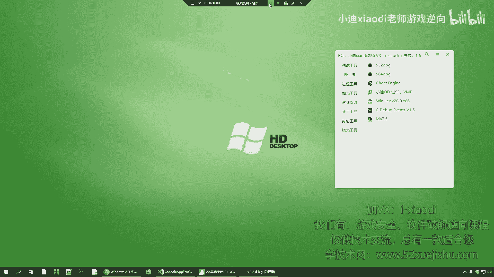
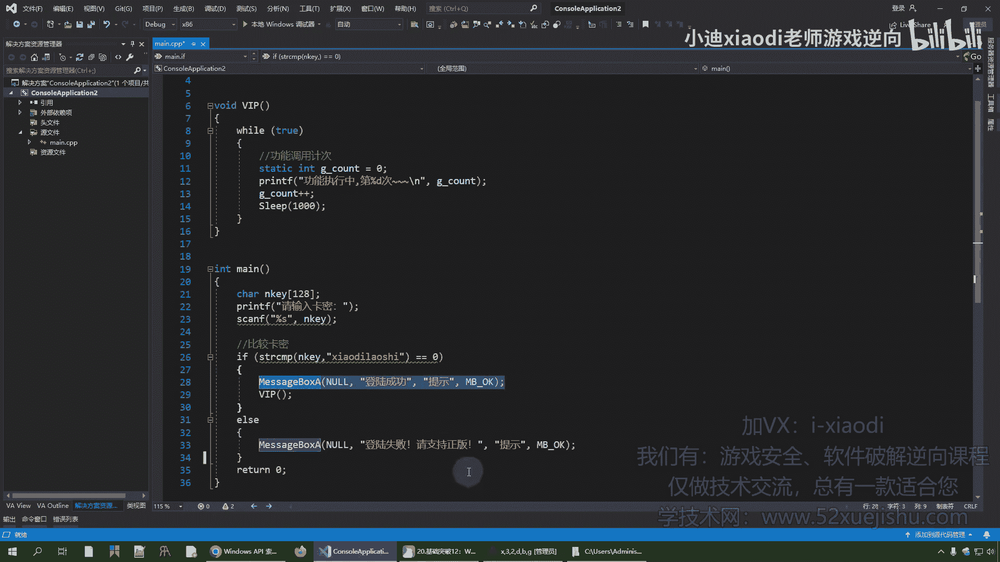
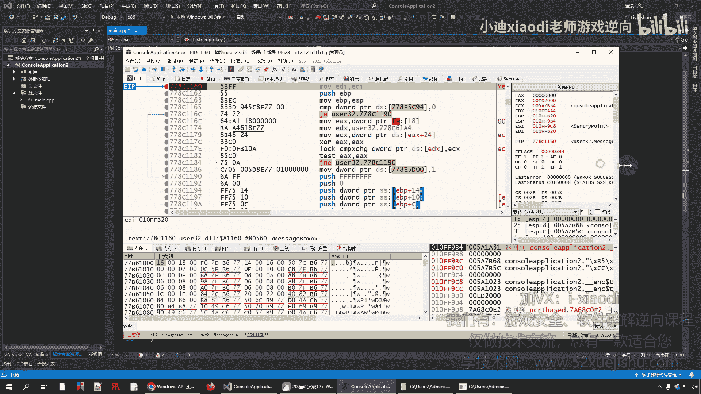
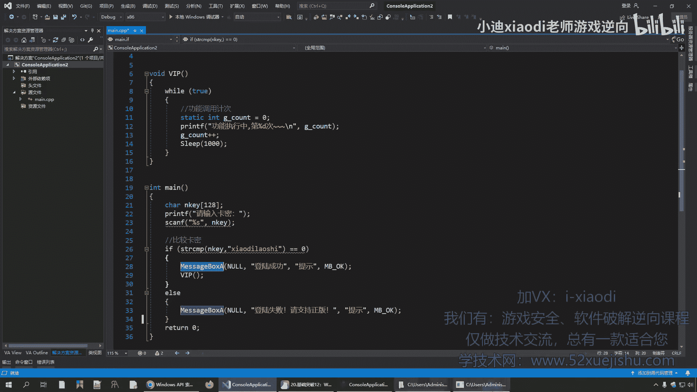
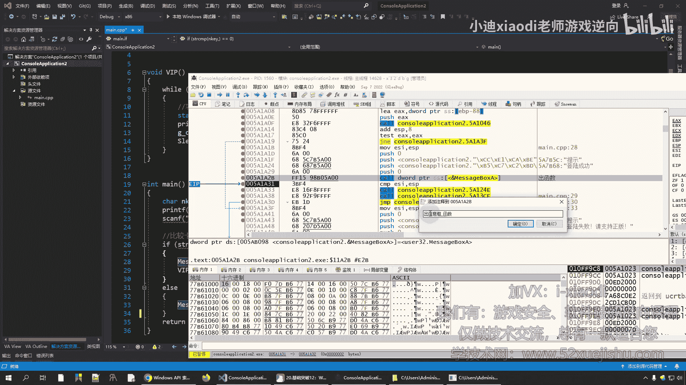
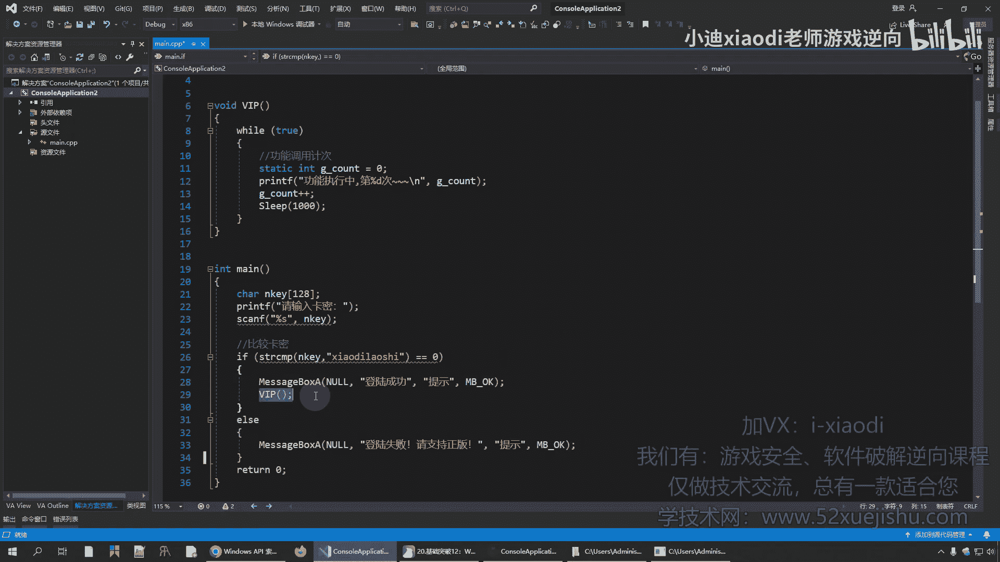
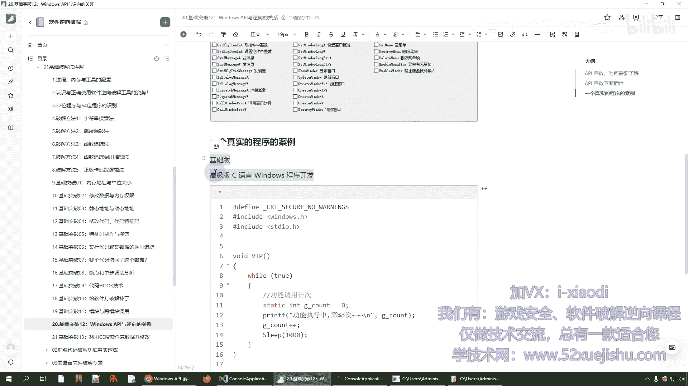

# Windows API 与逆向分析：01：课程概述与学习目标 🧭

在本节课中我们将要学习 Windows API 与逆向分析之间的关系。课程讲解者为小李老师。之前我们在函数追踪法里下过一个断点，名字叫 MessageBox。当时对这个内容只有比较模糊的认识，也没有系统学习过。本节从宏观角度系统介绍 Windows API。课程会说明 API 函数为何需要了解、API 函数如何分类、API 断点插件如何批量下断、真实卡密程序如何定位 VIP 功能、如何通过修改条件跳转和打补丁完成破解，并给出后续学习建议。理解这些目标后，下一节进入 Windows API 的定义和必要性。

## Windows API 与逆向分析：02：Windows API 的定义与必要性 🧩

上一节明确了课程目标，本节来看看 Windows API 到底是什么，以及逆向分析为什么需要了解它。Windows API 又叫 API 函数，全称是应用程序编程接口，英文为 Application Programming Interface。Windows 是微软公司的一款操作系统。操作系统的 API 就是操作系统的应用程序编程接口。也就是说，如果要写程序，并且要让程序在 Windows 操作系统上运行，就可能需要用到这个应用程序编程接口，也就是 API。

核心概念可以用下面的公式描述：

$$
\text{Windows API}=\text{操作系统提供给应用程序的编程接口}
$$

微软公司是盈利性公司，不会把内部代码开放给开发者。原文还提到，如果微软开放内部代码，其他人就可能做出自己的 Windows，中国人的复制能力和学习能力很强，开放代码后中国也可能做出自己的系统。基于这一点，微软只开放功能接口。只开放功能接口也给开发人员带来便利性，开发人员不需要学习内部复杂冗余的代码，只需要调用功能接口。

可以用下面的代码示意这种关系：

```c
// 开发人员不需要知道系统内部实现
// 只需要调用系统提供的功能接口
MessageBoxA(NULL, "提示内容", "标题", MB_OK);
```

原文用开车作比喻：出门只需要会开车，不需要了解造车。只要掌握如何把钥匙插进去、如何打火、如何起步开车即可，不需要了解汽车的制造，也不需要了解发动机的制造和原理。逆向分析时，我们分析软件作者开发的软件，这些软件都会用到所谓的 API 函数。因此，了解 API 函数具有必要性。

以下是本节需要记住的关键点。

- Windows API 是应用程序编程接口。
- Windows API 是操作系统提供给应用程序的功能接口。
- 微软不开放内部代码，只开放功能接口。
- 开放功能接口让开发人员不必学习内部复杂代码。
- 开车比喻说明调用接口和使用内部实现是两件事。
- 软件作者开发的软件会调用 API 函数，所以逆向分析需要了解 API。

理解 API 的定义和必要性后，下一节来看 API 函数的分类、常见示例以及 Windows 的消息机制。

## Windows API 与逆向分析：03：API 函数分类与消息机制 🗂️

上一节介绍了 API 的定义和必要性，本节来看看 API 函数有哪些常见分类，以及 Windows 的消息机制如何工作。API 函数很多，可以通过课程提供的链接简单了解，相关链接和笔记会发给大家。打开链接后可以看到很多分类。例如用户界面相关函数：一个程序有界面，就会有对话框、菜单、列表框、图标等内容，这些内容都依赖 API。以图标为例，程序要加载图标，就要调用 LoadIcon。

可以用下面的代码示意加载图标。

```c
LoadIcon(...); // 程序加载图标时调用相关 API
```

再看用户输入相关函数。一个程序如果有窗口，就会涉及窗口过程函数。窗口过程函数会把消息信息传递到指定的窗口过程。Windows 操作系统是一个消息机制的系统。复制一个文本时，窗口会发送复制的消息。关闭窗口时，会有窗口销毁或者窗口关闭的消息。类似的消息还有很多。

消息机制可以用下面的公式描述：

$$
\text{窗口消息}\rightarrow\text{窗口过程函数}\rightarrow\text{处理消息}
$$

API 函数特别多，大家简单了解即可，不需要全部记住。一个软件要联网时，也可能调用这里的一些函数。这一部分先介绍到这里。

以下是 API 函数的常见分类示例。

- 用户界面相关：对话框、菜单、列表框、图标等。
- 图标相关：加载图标会调用 LoadIcon。
- 窗口相关：窗口过程函数负责接收消息信息。
- 消息机制相关：复制文本会发送复制消息，关闭窗口会发送窗口销毁或关闭消息。
- 文件相关：文件读写、删除、移动等操作会涉及相关 API。
- 网络相关：软件联网时可能调用网络相关 API。

了解 API 分类后，下一节来看 API 断点插件如何帮助调试，以及如何批量下断点。

## Windows API 与逆向分析：04：API 断点插件与批量下断 🔌

上一节介绍了 API 分类和消息机制，本节来看看 API 断点插件的用法。API 函数太多，不需要背，也不需要记，需要借助一些技巧方便调试。API 函数下断插件就是其中一个技巧。先随便打开一个程序，例如测试程序 01-18。程序加载后，点击插件，点击 API break point，再点击对应项，插件就会显示出来。插件对每个函数做了归类。常用分类包括查找文件、程序退出、关机等。如果一个程序会关机，就可以在关机相关项下断。还有对话框分类，对话框就是窗口之类的功能。还有文件处理分类，如果程序涉及文件读写、删除、移动，就可以在对应项勾选。常用项包括 MessageBoxA，可以观察这个函数。


以下是该插件的主要功能和操作要点。

- 插件入口为 API break point。
- 插件会对常见 API 函数做归类。
- 查找文件、程序退出、关机等函数可以快速找到。
- 对话框和窗口相关函数可以快速找到。
- 文件读写、删除、移动相关函数可以快速找到。
- 勾选 MessageBoxA 可以自动下断点。
- 插件支持批量下断点，方便调试。


以前在 MessageBoxA 上下断点，需要在这里按 F2 下断点。现在使用插件勾选 MessageBoxA，插件会自动打断点。插件可以批量打断点，这是它的一个好处。插件还专门对常见函数做了归类，批量下断也很方便。这个 API 下断插件非常好用，大家简单了解。

以下是使用插件下断的简化流程。

```text
打开测试程序 -> 点击插件 -> 点击 API break point
-> 勾选 MessageBoxA -> 插件自动下断点
```

掌握插件用法后，下一节进入真实程序案例，观察卡密验证程序的运行现象和代码逻辑。

## Windows API 与逆向分析：05：真实卡密程序案例与代码逻辑 🔐

上一节介绍了 API 断点插件，本节用真实程序案例了解 Windows API 与逆向的关系。先退出前一个测试程序，再打开真实程序。程序运行后会提示请输入卡密。输入 1231212121 这类错误卡密，程序会提示登录失败，请支持正版。点击确定后程序退出。再次运行程序，输入正确卡密，原文中的正确卡密为“小迪老师来小迪老师来”，按回车后会提示登录成功。点击登录成功后的确定，程序会执行 VIP 功能，开始执行 VIP 功能。这个程序是一个简单小案例，下面看代码如何编写。

写这样一个程序，首先需要一个东西存放卡密。原文中的 NK 用来存放卡密，把输入的卡密存放起来。存放完成后需要比较，原文使用 SD2RCMP 这个函数进行字符串比较。比较结果等于 0 表示相等，表示没有差异；不等于 0 表示有差异。等于 0 没有差异，就登录成功。登录成功使用 MessageBoxA 提示。MessageBoxA 是一个原生态的操作系统信息化弹窗。

核心判断可以用下面的公式描述：

$$
\text{SD2RCMP 返回 0}\Rightarrow\text{字符串相等}\Rightarrow\text{登录成功}
$$


代码逻辑可以用下面的代码示意。



```c
char NK[...];                    // 存放输入的卡密
strcpy(NK, 输入卡密);             // 把输入卡密放进 NK

if (SD2RCMP(NK, 正确卡密) == 0)   // 原文中的字符串比较函数
{
    MessageBoxA(...);            // 登录成功提示
    run_vip();                   // 执行 VIP 功能
}
else
{
    MessageBoxA(...);            // 登录失败，请支持正版
    exit(0);                     // 程序退出
}
```

以下是真实卡密程序的运行现象和代码结构。

- 程序启动后提示输入卡密。
- 输入错误卡密 1231212121 会提示登录失败，请支持正版。
- 点击确定后程序退出。
- 输入正确卡密“小迪老师来小迪老师来”会提示登录成功。
- 点击确定后程序执行 VIP 功能。
- NK 用来存放输入的卡密。
- SD2RCMP 用来比较字符串。
- 比较结果等于 0 表示没有差异，表示登录成功。
- 登录成功使用 MessageBoxA 弹窗提示。
- MessageBoxA 是操作系统提供的信息化弹窗。

理解程序逻辑后，下一节来看下断点的意义，以及如何用 API 断点定位核心逻辑。

## Windows API 与逆向分析：06：用 API 断点定位核心逻辑 🎯

上一节分析了卡密程序的代码逻辑，本节来看下断点的意义和定位过程。把真实程序跑起来，点击文件，点击附加，然后切换过来。使用插件下断，勾选 MessageBoxA。输入“小李老师”，按回车，程序断下来。此时断在函数内部，相当于断在系统领空，因为程序调用的是系统内容，也就是 Windows 操作系统的接口。查看模块窗口可以看到 user32.dll。此时使用 Ctrl+view 相关操作，然后按 F8。返回来之后，继续往下执行。这里是函数出口，要出这个信息化弹窗函数。

以下是使用 API 断点定位核心逻辑的操作步骤和观察结果。

- 运行真实程序。
- 点击文件，点击附加，切换进程。
- 使用插件勾选 MessageBoxA。
- 输入“小李老师”，按回车。
- 程序断在 MessageBoxA 函数内部。
- 当前处于系统领空，模块显示 user32.dll。
- 使用 Ctrl+view 相关操作，再按 F8 返回。
- 返回后继续往下执行，经过信息化弹窗函数出口。

出来之后，接下来要执行 VIP 功能。把代码放到左边观察更方便分析。弹框已经执行完，接下来走 VIP 流程。这里猜测是 VIP 流程。继续按 F8 单步，继续执行相关操作，相关功能运行起来。这边就是功能相关代码。下断点的意义在于，我们实际上断在核心逻辑的内部。如果要逆向 VIP 功能，提示就在 VIP 功能旁边或者周边附近，距离可能不远。现在这两条代码以及其他代码，反正都在附近。程序给出提示之后，如果成功，紧接着就会执行 VIP。所以我们在这里下断，然后回溯。回溯就是从函数内部出来，往下执行，往下看，就能看到 VIP，这边就是 VIP 相关内容。不必管具体代码含义，看到两条看似陌生的代码（原文说两个 ca）也不用管，这就是 VIP 相关代码。

回溯思路可以用下面的公式描述：

$$
\text{MessageBoxA 断点}\rightarrow\text{函数出口}\rightarrow\text{VIP 功能附近}
$$



也可以用下面的流程描述。

```text
系统函数内部断下 -> 执行到函数出口 -> 回到程序领空
-> 往下看 VIP 功能 -> 往上看正版判断
```

以下是回溯定位的基本思路。


- 断点下在 MessageBoxA。
- 断下位置在系统领空。
- 从系统函数出口返回程序领空。
- 往下看可以看到 VIP 功能。
- 往上看可以看到正版判断。
- 提示信息通常靠近 VIP 功能，便于回溯定位。



完成定位后，下一节来看如何根据 VIP 功能和正版判断找到破解点。

## Windows API 与逆向分析：07：回溯定位 VIP 功能与正版判断 🧭

上一节通过 API 断点回到了程序领空，本节来看如何利用位置关系找到正版判断。定位到这里后，往下看是正版功能，往上看是是否正版的判断。从函数出口出来后往下看，可以看到正版功能。往上看可以看到是否正版的判断。这个判断刚好跳过登录成功，来到登录失败。破解时，在这里下断，断下来后到达判断位置，往上看有一个条件跳转，这个条件跳转刚好跳过登录成功。如果要让程序无论如何都跳转成功，就需要修改这个条件跳转。



破解思路可以用下面的公式描述：

$$
\text{修改条件跳转}\Rightarrow\text{始终进入登录成功分支}\Rightarrow\text{VIP 功能可执行}
$$



原始逻辑可以用下面的代码示意。

```c
if (卡密正确)
{
    登录成功;
    VIP功能;
}
else
{
    登录失败;
    退出;
}

// 破解思路：修改条件跳转，让程序无论如何都进入登录成功分支
```

以下是回溯定位 VIP 功能与正版判断的思路。



- 从 MessageBoxA 断点回溯到程序领空。
- 往下看，通常可以看到正版功能。
- 往上看，通常可以看到是否正版的判断。
- 判断位置附近存在条件跳转。
- 条件跳转可能跳过登录成功，进入登录失败。
- 破解点是修改条件跳转，让程序始终进入登录成功分支。

找到判断位置后，下一节进行修改条件跳转和打补丁的演示。

## Windows API 与逆向分析：08：修改条件跳转与打补丁破解 🛠️

上一节找到了正版判断和条件跳转，本节进行破解演示。在这里下断，断下来后到达判断位置，往上看有一个条件跳转。这个条件跳转刚好跳过登录成功。要让程序无论如何都跳转成功，可以在这里使用鼠标右键，选择二进制填充。填充完成后打一个补丁，修补文件。把文件改名为 111，再回来。到目录里运行 111，随便输入账号和密码，按回车，程序提示登录成功，破解成功。

补丁流程可以用下面的代码示意。

```text
定位条件跳转 -> 鼠标右键 -> 二进制填充
-> 打补丁 -> 修补文件 -> 改名为 111
-> 运行 111 -> 输入任意账号密码 -> 登录成功
```

破解逻辑可以用下面的公式描述：

$$
\text{条件跳转被修改}\Rightarrow\text{登录失败分支被绕过}\Rightarrow\text{登录成功}
$$

以下是修改条件跳转并打补丁的演示步骤。

- 在判断位置下断点。
- 断下来后向上查看条件跳转。
- 条件跳转原本会跳过登录成功。
- 鼠标右键选择二进制填充。
- 填充后打补丁。
- 修补文件。
- 把文件改名为 111。
- 到目录运行 111。
- 输入任意账号和密码。
- 程序提示登录成功，破解完成。

完成演示后，下一节总结定位关键函数后的判断方法和学习建议。

## Windows API 与逆向分析：09：方法总结与学习建议 📚

上一节完成了补丁破解演示，本节总结方法并给出学习建议。本节的内容是了解 Windows API 与逆向的关系，以及破解逻辑如何完成。定位到一个关键函数后，往下看一般是正版功能，往上看一般是正版判断。查看这个判断并修改判断即可。如果想看正版功能，就往下看。

以下是定位关键函数后可采用的判断方法。

- 定位到关键函数后，先往下看正版功能。
- 再往上看是否正版的判断。
- 找到条件跳转并分析跳转方向。
- 修改条件跳转可以改变程序走向。
- 想看正版功能时，重点往下看。

回去之后，如果懂 C 语言，可以结合代码理解程序逻辑。C 语言是高级版的内容。高级版包含 Windows 程序开发，也包含 C 语言 Windows 开发。正在学习这些内容时，可以复制案例代码自己运行。想学习可以联系课程方，课程分为基础版和高级版。

以下是学习建议。

- 结合 C 语言理解卡密程序逻辑。
- 高级版包含 Windows 程序开发。
- 高级版包含 C 语言 Windows 开发。
- 可以复制案例代码自己运行。
- 想系统学习可以联系课程方。
- 课程分为基础版和高级版。

本节方法总结完成后，下一节对整节课内容做最终总结。

## Windows API 与逆向分析：10：课程总结 🧾


上一节总结了定位方法和学习建议，本节对整节课做收尾。本节课中我们一起学习了 Windows API 与逆向分析的关系。我们了解了 Windows API 又叫 API 函数，全称是应用程序编程接口，Windows 是微软公司的操作系统，操作系统的 API 是操作系统提供给应用程序的编程接口。微软不开放内部代码，只开放功能接口，开发人员调用接口即可，不需要学习内部复杂代码。原文用开车比喻说明调用接口和使用内部实现是两件事。软件作者开发的软件会调用 API 函数，所以逆向分析需要了解 API。


本节课中我们一起学习了 API 函数的分类和消息机制。API 函数包括用户界面、图标、窗口、消息、文件、网络等分类。程序加载图标会调用 LoadIcon。窗口过程函数会接收消息信息。Windows 是消息机制系统，复制文本会发送复制消息，关闭窗口会发送窗口销毁或关闭消息。API 函数很多，不需要背诵和记忆，可以借助 API 断点插件方便调试。插件提供常见函数归类，支持批量下断点。使用插件勾选 MessageBoxA 可以自动下断点。

本节课中我们一起学习了真实卡密程序案例。程序提示输入卡密，错误卡密会提示登录失败并退出，正确卡密会提示登录成功并执行 VIP 功能。代码使用 NK 存放卡密，使用 SD2RCMP 比较字符串，比较结果等于 0 表示没有差异并登录成功，登录成功使用 MessageBoxA 弹窗提示。下断点的意义是断在核心逻辑内部。通过 MessageBoxA 断点断在系统领空，查看 user32.dll，使用 Ctrl+view 相关操作和 F8 返回程序领空，从函数出口继续往下执行即可到达 VIP 功能附近。回溯就是从函数内部出来，往下看 VIP 功能，往上看正版判断。

本节课中我们一起学习了破解演示。定位到关键函数后，往下看是正版功能，往上看是正版判断。条件跳转原本会跳过登录成功并进入登录失败。使用鼠标右键二进制填充，打补丁并修补文件，把文件改名为 111，运行 111 后输入任意账号密码即可登录成功。课程最后还介绍了学习建议：C 语言属于高级版内容，高级版包含 Windows 程序开发和 C 语言 Windows 开发，可以复制案例代码自己运行，想学习可以联系课程方，课程分为基础版和高级版。本节课内容到这里结束，下期再见，有问题可以在群里联系。

以下是本节课的核心收获。



- Windows API 是操作系统提供给应用程序的编程接口。
- 开发人员调用功能接口，不需要学习系统内部复杂代码。
- API 函数分类很多，不需要背诵，可以借助插件调试。
- API 断点插件支持常见函数归类和批量下断点。
- 卡密程序使用字符串比较判断登录是否成功。
- MessageBoxA 断点可以用于定位 VIP 功能和正版判断。
- 定位关键函数后，往下看正版功能，往上看正版判断。
- 修改条件跳转并打补丁可以绕过登录失败分支。
- 学习时可以结合 C 语言和 Windows 程序开发内容理解案例。

