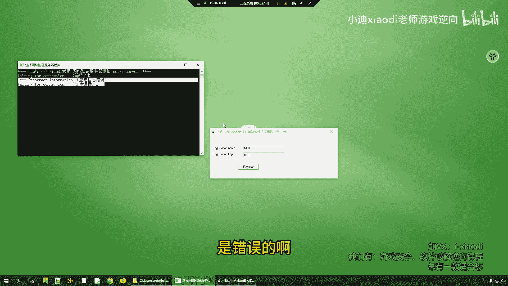
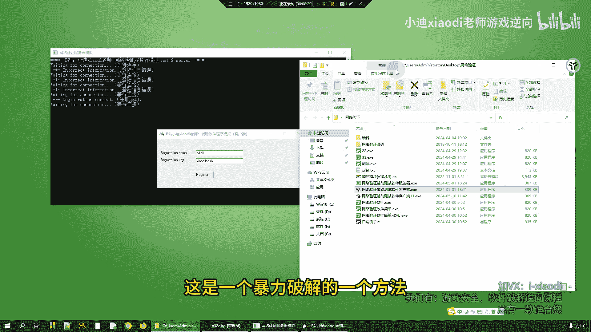

# 网络验证卡密软件逆向分析方法教学：01：代码暴力破解法

## 📖 课程概述

在本节课中，我们将要学习如何对一款带有网络验证功能的辅助软件进行逆向破解。课程内容主要围绕着代码暴力破解法展开，逐步讲解从附加进程、定位关键代码到最终实现破解的完整流程。在当下软件安全与网络安全日益重要的时代，掌握基础的逆向分析方法可以帮助技术爱好者深入理解程序运行原理，也能在合法合规的前提下与其他技术人员进行技术交流。

在此之前，我们曾经在系列课程中介绍过一些基础的软件逆向知识。当时提到了程序校验相关的一些基本概念，而今天要讲解的网络验证软件本质上与普通程序差别不大。接下来，我们就正式进入今天的课程内容。

## 🔍 网络验证软件的工作原理

### 什么是网络验证软件

大家或许会有疑问，为什么那么多人喜欢听软件安全逆向类的课程？这东西到底有什么用？实际上，它的一个主要用途就是去分析一些小软件，与技术圈子里的人进行技术交流。

我们在日常学习中经常会遇到一些需要注册账号和密码才能使用的辅助软件，这类软件就属于网络验证软件。网络验证软件跟普通的程序在整体架构上差不多，唯一不同的地方在于，账号密码的校验过程是通过网络数据包的形式来完成的，这是它与本地验证最本质的区别。

### 验证流程的完整链路

![验证流程图]，整个验证流程可以描述为：

1. 下载一款别人的辅助软件
2. 联系软件作者进行购买，作者在服务器上为你开通账号
3. 登录时，软件将你的账号信息发送到服务器
4. 服务器检测你的账号剩余时长、等级（是否为VIP等）
5. 服务器返回结果给软件，决定允许或拒绝登录

从流程图可以看到，这个过程中比普通程序多了一步，那就是在服务器上进行校验的环节。服务器部署在中国大陆、美国或者其他国家都有可能，这是一个我们看不见也摸不着的东西，完全无法触碰。作为学习者，我们唯一能够直接接触到的对象，就是你下载到的这款辅助软件客户端。而值得额外说明的一点是，即使客户端界面没有弹出任何提示，服务器实际上也可能已经在后台给出了判断结果，这些稍后我们在演示中会看到。

## 🛠️ 附加目标进程

### 打开调试工具

打开X32Debug调试工具，点击文件菜单，选择附加选项，找到我们这个客户端软件，也就是你下载的这个辅助软件，双击加载。附加完成后，我们就可以看到该程序当前的运行状态与各种调试信息了。

### 认识主模块

在调试工具中，我们需要找到主模块。进入程序后，首先要做的是点击符号功能。这里的符号，指的就是这个程序本身以及它所依赖的各种动态链接库，还有运行时所需要的一些必要文件。

查看程序相关信息的方式是双击与程序名字相同的那个模块。这个模块又被称之为主模块。主模块具体指的是与程序名称同名的那个模块，它在整个程序的结构中是最核心的部分。双击主模块后，我们就进入了程序的主模块区域。在调试工具中，界面上会显示当前模块的名称，我们可以确认现在所在的位置就是程序的主模块。

## 🔎 定位关键代码

### 搜索字符串列表

在进入主模块之后，我们接下来需要做的事情就是搜索字符串。具体操作位置很灵活：在界面的任意位置，比如左侧代码区、右侧寄存器区，甚至是窗口的空白区域都可以，点击鼠标右键，选择搜索，再点击当前模块。这里要注意，由于我们现在已经在程序的主模块中，所以搜索范围就直接选择当前模块。

搜索字符串实际上就是在查看程序中所有被使用的关键字符串信息。字符串从本质上来说就是文本信息，这些文本信息包括程序界面上的标题、提示语、错误信息等一系统内容。通过查看字符串，可以快速定位到程序的关键逻辑代码附近。

在搜索结果中，我们会看到各种各样的字符串信息。这些内容可能是窗口标题，也可能是一个IP地址，例如当前示例中就可以看到连接的本机地址。往下翻阅时，还会看到各种状态提示文本，比如连接服务器失败会提示服务器失败信息，注册成功会有注册成功公告的信息。

看到这些字符串有什么作用呢？在字符串窗口中，你会注意到一个关键的现象：右侧是字符串，而左侧对应的是代码。左方的代码就是引用右侧字符串的那段代码。它们是紧密关联的，也就是说，程序执行到这段代码时，会使用到右侧对应的字符串内容。

### 跟踪关键跳转

既然字符串与代码的执行逻辑息息相关，那么我们需要做的，就是定位到关键字符串所在的那一行。选中目标字符串后，双击这一行，界面就会自动跳转到引用该字符串的代码位置。在这里，我们可以看到注册成功公告的相关提示文本，同时下方还会有一个message box函数调用，这是消息框的提示操作，用于在界面上显示弹窗。

继续往上看代码，我们会发现这里存在大量的跳转指令。在之前的视频课程中，我们曾经详细讲过跳转指令的作用，它可以改变代码的执行逻辑。简单来说，如果程序执行到某个跳转指令并且满足跳转条件，程序就会跳转到指定位置，跳过中间的代码段。

那么，怎样才能让破解成功呢？一个思路是，我们找到跳转的源头位置，把所有的跳转指令全部干掉，这样程序就无法跳转，只能顺着代码顺序一路执行下去，直到到达注册成功的信息框。这是一种暴力的破解方法。

### 设置断点观察程序流向

先来观察一下程序的执行方向，看看程序会在哪个位置停下。继续往上看跳转指令，我们会发现这段代码区域中，最靠上的一个跳转指令大约在当前位置的上方区域。我们选择在这个位置下断点，方法是按F2键。下断点后，再运行程序，程序就会在断点处停住。这时调试工具的界面中，程序的运行状态会变为已暂停，这意味着程序中断在了这个位置。

所谓断点，就是让程序执行到该处时中断下来，方便我们进行观察和分析。确定位置后，我们按F2键先解除这个断点，因为我们已经知道程序原本的执行路径就是从这个跳转开始的。

## 💥 暴力破解的实施

### NOP填充全部跳转

现在进入暴力破解的核心操作环节。具体手段就是把程序里的跳转指令全部干掉，怎么干掉呢？方法是：选中需要修改的代码行，鼠标右键选择二进制，再用NOP填充。操作流程是鼠标右键 → 二进制 → 使用NOP填充 → 点击确认。

对所有的跳转指令重复这一操作，把所有跳转指令全部用NOP填充掉。NOP是空操作指令，填充之后等于把这些代码全部替换成空代码。这样一来，所有的跳转指令都不再跳转，程序会直接忽略这些跳转，一路顺序执行下去，就必然能够到达注册成功的逻辑区域。

### 保存补丁并运行验证

完成全部NOP填充后，保存对程序的修改。在调试器中执行补丁操作，选择修补文件，将修改后的程序保存为新的文件。之后运行打上补丁的程序。第一次运行时程序可能会卡顿一下，稍等片刻，等待其反应。实际上，运行结果是注册成功提示框出现了。从执行结果来看，这段程序先要连接服务器，然后才会走到注册成功的逻辑。输入用户名和密码，连接完成后，注册成功的提示就弹出来了。

### 处理闪退问题及思考

不过这里出现了一个问题，程序在注册成功后闪退了。我们观察一下原始的源代码：如果使用正确的账号密码进行登录，正常情况下是不会闪退的。但是刚才使用NOP填充跳转后，出现了闪退的现象。这是一个值得注意的细节，也侧面说明了这种暴力破解方式存在一定的缺陷。

## 💬 总结

本节课中，我们一起学习了网络验证卡密软件逆向分析方法中，代码暴力破解法的基本实现流程。我们将网络验证软件的原理归纳为一个简单公式：

`客户端发送账号密码 → 服务器校验 → 返回许可结果 → 客户端判断并执行对应逻辑`

其核心思路就是：把校验过程中关键跳转全部用NOP填充掉，让程序永远走“注册成功”那条分支。回顾整个过程，我们从附加进程开始，了解了主模块的概念，通过搜索字符串定位到关键代码位置，再通过NOP填充跳转指令实现暴力破解。最后，我们也发现了一个新的问题：暴力破解可能会导致程序闪退。至于为什么闪退，有没有更好的处理方法，我们将在下节课中继续讨论。
