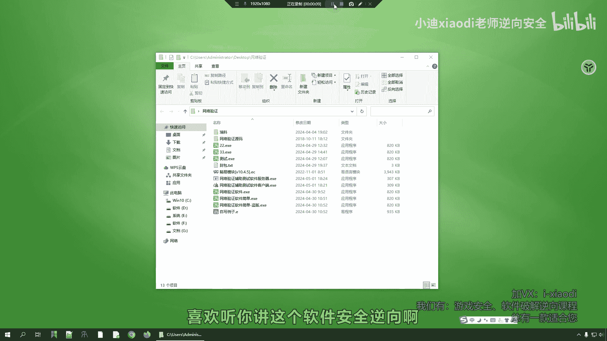
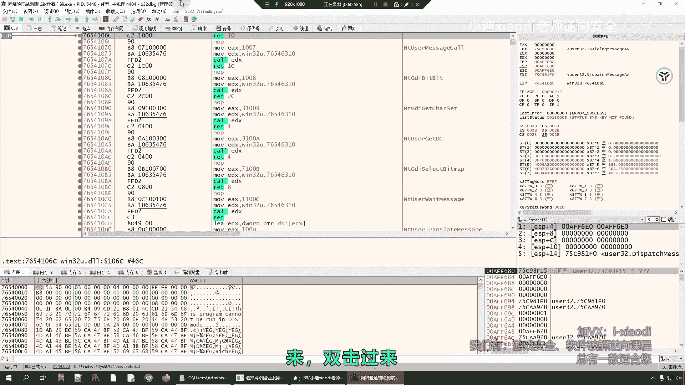
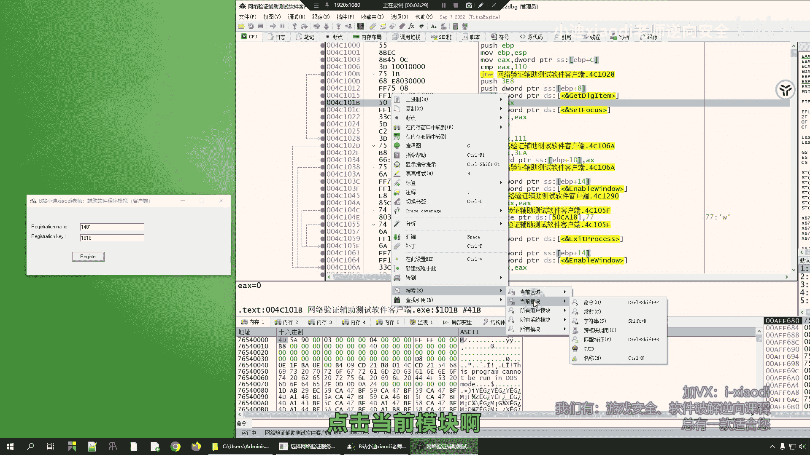
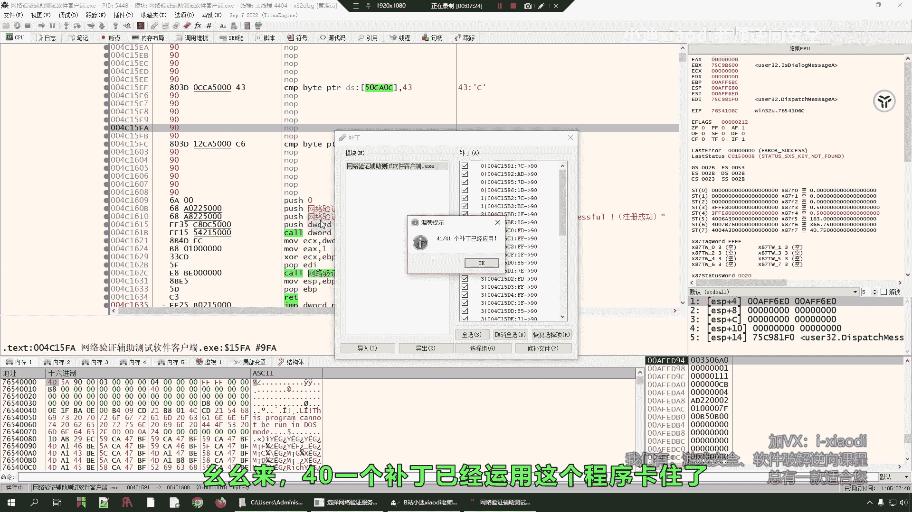
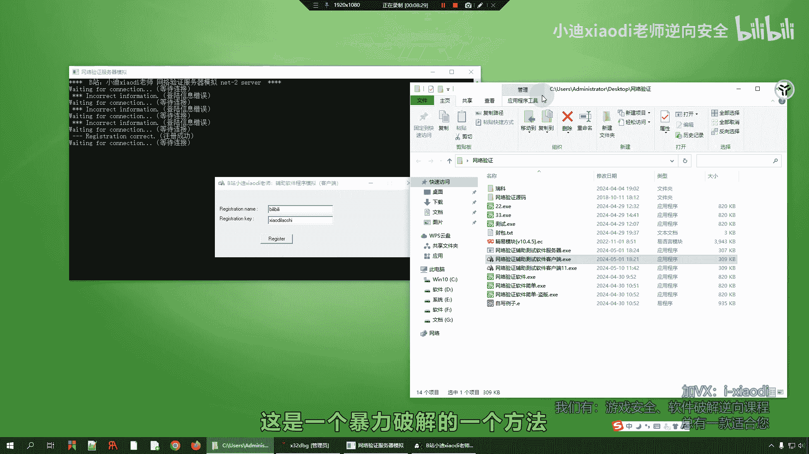

# 🧩 网络验证卡密软件逆向分析教学：01：代码暴力破解法

本课程由小迪老师继续讲解软件逆向破解。在本节课中我们将要学习网络验证卡密软件逆向分析中的代码暴力破解法。有同学会疑问：为什么很多人喜欢听软件安全逆向，这个内容到底有什么用。这里先说明，它的用途之一是分析一些小软件，做技术交流。

举例来说，网络验证软件和普通程序差不多，只是账号密码校验通过网络数据包的形式完成。围绕一款网络验证卡密软件，本课程先看账号密码校验流程，再用传统逆向方法做一次暴力破解。课程会涉及客户端附加、主模块、字符串定位、跳转处理、断点、NOP填充、补丁测试以及闪退现象。



## 🧭 网络验证卡密软件逆向分析教学：02：网络验证校验流程

上一节概述中我们说明了课程目标和网络验证软件的基本特点，本节来看看账号密码校验流程和服务器作用。我们先看下载、购买、登录、服务器检测和返回结果的完整过程，理解为什么网络验证比普通本地校验多一步。

以下是网络验证登录校验的关键环节，按顺序列出便于初学者理解。

- 我们现在下载了一款别人的小辅助软件，需要账号和密码。
- 账号和密码可能需要联系软件作者购买，购买后作者在服务器上为你开通。
- 登录时客户端会把账号信息发送到服务器，可以看到信息被发过去。
- 服务器会检测账号剩余时长、等级、是否VIP等信息，检测完返回给软件允许登录或不允登录。
- 整个流程比普通本地校验多了一步，也就是多了在服务器上进行校验。
- 服务器看不见摸不着，可能架设在中国大陆，也可能架设在美国等其他国家，你碰不到。
- 唯一能接触的是你下载到的别人的辅助软件。

举例来说，在客户端输入账号和密码，随便输入并点击，客户端没有任何反应；但服务器实际上有反应，服务器提示登录信息错误。也就是说，虽然软件没有反应，服务器已经回应你输入的账号和密码错误。把流程写成公式就是下面这样。

```
客户端登录请求
→ 服务器校验：账号 / 密码 / 剩余时长 / 等级 / VIP
→ 返回：允许登录 / 禁止登录
→ 客户端显示结果
```

服务器看不见摸不着，所以只能分析本地客户端软件。本节先用传统逆向破解方法把软件做一个破解来。下面进入客户端附加和主模块查看。

## 🔍 网络验证卡密软件逆向分析教学：03：附加客户端与主模块

上一节我们介绍了服务器校验流程和只能接触客户端这一限制，本节来看看如何把客户端附加到调试器并查看主模块。先把目标客户端的进程附加到调试器中，再找到主模块，为后续搜索字符串做准备。

以下是附加客户端和查看主模块的操作步骤。

- 首先打开x32dbg（原文称叉32debug）。
- 点击文件，点击附加，直接附加，找到客户端软件，双击过来。
- 第一步点击符号。
- 符号是程序以及它依赖的动态链接库或必要文件。
- 如何查看程序相关信息？双击跟程序名字一样的模块。
- 跟程序名字一样的模块又叫主模块，记下来，双击来到程序主模块。
- 在这里也可以看到当前模块是程序主模块。

核心操作可以用下面代码概括。

```
文件 → 附加 → 双击客户端
→ 符号 → 双击同名主模块
```



完成这些后，我们已经来到程序主模块。接下来搜索字符串，利用文本信息定位关键成功提示。

## 🧾 网络验证卡密软件逆向分析教学：04：搜索字符串并定位成功提示

上一节我们完成了客户端附加并查看了主模块，本节来看看如何通过字符串定位到关键成功提示。字符串窗口可以理解为程序文本线索列表，初学者可以通过它快速找到和登录、注册、连接服务器有关的提示。

搜索字符串的操作是：鼠标右键在任意位置，点击搜索，点击当前模块，因为现在就在程序主模块，然后搜索字符串。搜索字符串后可以看到程序用到的所有关键字符串信息，字符串信息就是文本信息。

以下是字符串窗口中常见的信息类型，以及它们与代码的对应关系。

- 这边有可能是标题。
- 这边应该是它连接的IP地址，当前是本地地址。
- 这边是提示信息。
- 连接服务器失败会有服务器失败信息。
- 注册成功会有注册成功恭喜信息。

这些字符串有什么作用？往左看是字符串，往下看来到这，再往左看，这边是代码。你会发现代码用到了字符串：左边是代码，右边是字符串，左边代码用到右边字符串。既然用到了，它跟关键代码执行逻辑息息相关。



所以需要定位关键字符串，选中这一行双击，来到这一行。这边可以拉一下，这边就是注册成功和恭喜，也就是成功提示，而且可以看到下边有一个message box信息框提示。字符串和代码的关联可以用下面公式表示。

```
字符串窗口文本 → 代码引用 → 关键执行逻辑
```

定位到成功提示后，本节继续往上看跳转。下一节处理这些跳转，并学习断点。

## 🧪 网络验证卡密软件逆向分析教学：05：跳转与下断点

上一节我们通过搜索字符串定位到了注册成功和恭喜提示，并看到下方有message box信息框，本节来看看这些提示上方的跳转以及断点操作。跳转会影响代码执行方向，所以先找到最靠上的跳转，再下断点观察程序停在哪里。

继续往上看，会发现一堆跳转。之前讲过，在主要社区视频里也讲过，跳转就是更改代码执行逻辑。假如程序执行到这儿，然后碰到一个跳转A，它会往上走。怎么才能让破解成功？要把所有带箭头的、带箭头的东西全部干掉，它就可以直接来到成功提示这里。

这里有一种暴力破解方法，先看程序在哪个方向、哪个位置先停下来。继续往上看，跳转跳转，目光所致这边是最靠上的一个跳转，相对来说是在这个区域最靠上的跳转。先在这里下断点，F2打一个断点，然后点一下。程序断下来，程序在这儿停住，程序卡住，左下角显示已暂停，说明程序中断在这个位置。所谓断点就是让程序执行中断，点F2下断点。F2再解除断点。我们知道程序原来是这么往下走，从这里它就要跳。先运行起来。

以下是断点相关的基本概念和操作，用代码形式描述更直观。

```
F2：下断点 / 取消断点
断点作用：让程序执行中断在指定位置
显示：左下角“已暂停”
```

以下是定位跳转和下断点的操作顺序。

- 继续往上看，找到最靠上的跳转。
- 在跳转处按F2下断点，然后点击运行，让程序断下来。
- 程序停住并卡住，左下角显示已暂停，说明中断在该位置。
- 再按F2解除断点，观察程序原来向下走，从这里要跳转。
- 先运行起来，为后续暴力处理跳转做准备。

断点操作完成后，本节接下来介绍暴力破解的核心：把所有跳转用NOP填充干掉。

## 🛠️ 网络验证卡密软件逆向分析教学：06：NOP填充与补丁测试

上一节我们找到了跳转并练习了下断点和取消断点，本节来看看如何用NOP填充把所有跳转干掉，并测试补丁效果。NOP填充可以理解为把相关指令改成空代码，让跳转不再发生，从而让程序顺序执行到成功提示。

暴力破解方法怎么暴力破解？可以把所有跳转全部干掉。怎么干掉？鼠标右键二进制，用NOP填充。右键二进制用NOP填充，点确定。右键二进制用NOP填充，把全部干掉。这里用NOP就是空代码，把所有代码全部让它不执行，所有跳转不再跳转。NOP填充。这样就可以了，这样之后来试一下。程序卡住了。先打一个补丁试一下，打补丁，修补文件，然后网络认证客户端11，应用补丁。程序卡住，先关掉。

以下是NOP填充和补丁测试的关键操作及现象。

- 暴力破解思路：把所有跳转全部干掉。
- 操作：鼠标右键，选择二进制，用NOP填充，点确定。
- NOP就是空代码，让相关代码不执行，让所有跳转不再跳转。
- 填充完成后试运行，程序出现卡住。
- 打补丁：修补文件，保存为网络认证客户端11，应用补丁。
- 补丁应用后程序卡住，先关掉程序。

核心操作可以用下面代码表示。

```
右键 → 二进制 → 用 NOP 填充
修补文件 → 网络认证客户端11 → 应用补丁
```

关掉后重新运行，出现注册成功。实际现象是注册成功，刚才程序卡了一下。运行后，连接服务器失败，说明它还要先连接服务器；使用补丁文件网络认证客户端11后，再次操作出现注册成功。这时就注册成功了。当然，这时注册成功会有问题，就是程序闪退。下一节看看闪退现象和遗留问题。

## ⚠️ 网络验证卡密软件逆向分析教学：07：实验现象与遗留问题

上一节我们完成了NOP填充和补丁测试，看到了注册成功但程序闪退，本节来看看正确账号密码下的现象以及闪退问题遗留。先区分正常登录和使用NOP填充后的差异，再说明为什么需要下节课继续处理。



当然，这时注册成功会有一个问题，就是程序闪退，程序闪退了。我们看一下源代码，如果说是正确的账号和密码，会不会闪退？小迪老师来验证：注册成功不会闪退。但是刚才用NOP填充，它出现闪退。至于为什么闪退，有没有更好的处理方法，下节课继续聊。这就是简单处理方法，网络验证破解，暴力破解方法。

以下是本节观察到的现象和需要下节课继续处理的问题。

- 通过NOP填充后，程序出现注册成功，但随后闪退。
- 正确账号和密码下注册成功不会闪退。
- 用NOP填充后出现闪退，说明暴力方法还有遗留问题。
- 闪退原因和更好的处理方法留到下节课继续讨论。
- 本节展示的是网络验证暴力破解的一种简单处理方法。

到这里，本节内容结束。下面总结课程，并回顾整个暴力破解流程。

## ✅ 网络验证卡密软件逆向分析教学：08：课程总结

最后对本课程做总结。本节课中我们一起学习了网络验证卡密软件逆向分析中的代码暴力破解法，包括网络验证校验流程、客户端附加、主模块查看、字符串搜索与成功提示定位、跳转与F2断点、NOP填充、补丁测试以及闪退现象。



整个流程可以概括为：先理解服务器校验看不见摸不着，只能分析本地客户端；再附加客户端并查看主模块；然后通过字符串定位注册成功提示；接着找到跳转并用NOP填充让跳转不执行；最后打补丁测试，观察注册成功和闪退问题。本课程到这里，下集再见。

