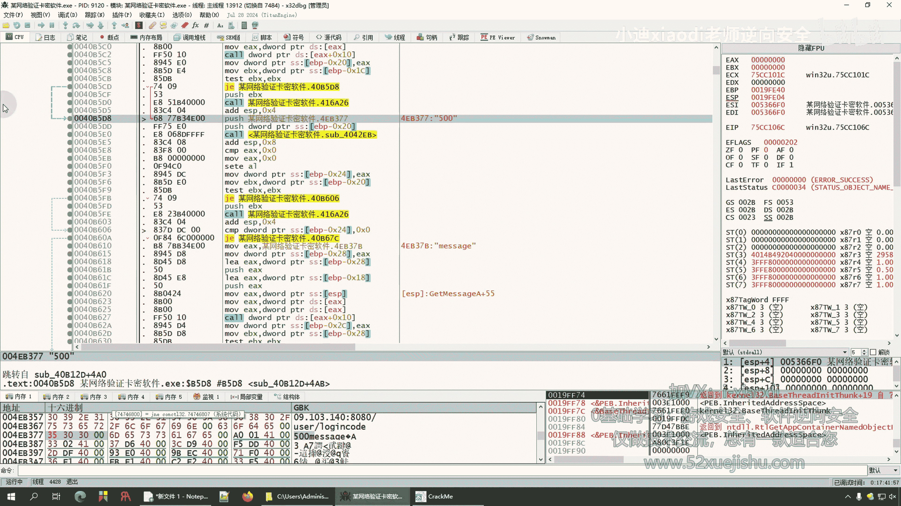

# 网络验证卡密软件逆向分析：01：课程概述与安全视角 🧭

在本节课中我们将要学习网络验证卡密软件逆向分析中的卡密登录状态码篡改破解法，也会看到付费软件如何逆向破解的基本观察思路。课程内容会涉及游戏安全、软件安全、网络安全，也会面向小白理解软件破解、反汇编、逆向安全工程师相关内容。课程来源可以记为 BV1rRbQzBEqE-，主题是 2025 最新软件逆向安全学习内容。

> 课程来源：BV1rRbQzBEqE-，主题包含游戏安全、软件安全、网络安全、小白软件破解反汇编逆向安全工程师 2025 最新内容。

大家好，我是小李老师，今天继续讲软件逆向破解。有些同学会纳闷：为什么讲软件逆向破解有这么多人听，逆向破解到底能做什么。实际上，软件逆向破解技术可以帮助我们从安全角度分析一个软件，从而保护我们的软件，让软件更加健壮。知己知彼，百战不殆，知道哪里存在薄弱点，才能重点针对这些薄弱点进行防护。

从学习角度看，逆向分析不是为了停留在表面操作，而是通过观察程序行为、数据流和判断条件，理解软件防护可能被绕过的位置。下面先总结逆向破解在安全视角下的价值，再进入今天的案例软件。

以下是软件逆向破解在安全学习中的主要价值。

- 从安全角度分析软件行为，理解程序在登录、验证、返回数据时发生了什么。

- 通过分析薄弱点，帮助软件开发者加强防护，让软件更加健壮。

- 建立知己知彼的思路，知道攻击可能从哪里进入，才能做针对性防护。

理解这些价值后，本节先建立一个整体认识，下一节我们来看看今天的案例软件是什么样子的。

# 网络验证卡密软件逆向分析：02：案例认识与网络验证卡密软件 🧩

上一节我们从安全角度说明了逆向破解的学习价值，本节来看看今天的案例软件。这个软件是今天的案例，主题是网络验证卡密软件破解。这个软件不仅是一机一码，还会绑定机器，而且通过网络进行验证。点击验证后，会出现一个提示，内容是网络或密码错误，这就是我们后续分析的入口。

认识案例软件时，需要先明确它的几个特点，这些特点决定了后面为什么要观察登录代码、服务器返回数据和状态码。下面是案例软件的基本特点。

- 软件采用一机一码方式，并且绑定机器。


- 软件通过网络进行验证，不是纯本地校验。

- 点击验证后会提示网络或密码错误，说明存在登录验证流程。

- 后续需要观察登录代码、服务器返回数据和状态码判断。

了解案例特点后，下一步就是让分析工具和程序建立联系，本节先不急着改代码，下一节我们来看看如何附加程序。

# 网络验证卡密软件逆向分析：03：工具附加与程序建立联系 🔗

前面我们认识了网络验证卡密软件的基本特点，本节看看如何让工具和程序建立联系。首先打开工具包里的 DJ，点击文件，点击附加，然后找到我们的程序并双击。这样操作后，这个工具和程序就建立了一种联系，后续才能查看程序内部的数据和代码。

附加程序是后续分析的基础步骤，操作不复杂，但顺序要清楚。以下是附加程序的基本流程。

- 打开工具包里的 DJ。

- 点击“文件”菜单，再点击“附加”。

- 找到目标程序，双击它。

- 工具和目标程序建立联系，后续可以查看数据与代码。

完成附加后，工具已经和目标程序连接起来，但还需要知道从哪里查看代码和数据。下一节我们来看看如何查看程序模块并搜索字符串。

# 网络验证卡密软件逆向分析：04：字符串搜索与登录状态码线索 🔎

上一节我们让工具和程序建立了联系，本节来看看如何查看程序相关数据和代码。要查看程序相关数据或代码，可以点击符号，双击这个程序模块，就可以看到程序内部信息。这时我们去搜索字符串，在字符串里寻找关键信息，然后往下翻，看看有没有和登录、时间、状态码相关的内容。

搜索字符串时，可以重点留意下面这些线索，这些线索能帮助我们猜测验证流程。以下是字符串搜索中值得关注的信息。

- 可以看到 get time，这个字符串是获取服务器时间，有可能和获取时间有关系。

- 继续往下翻，还能看到 wifi 字样。

- 可以看到 user lo，lo 就是登录的意思，可能是登录相关代码。

- 可以猜测点击验证时会执行这里的登录代码。


- 登录成功时，有可能出现 200 状态码，code 就是状态码。

- 这里也可能出现数据包格式，这个可能性需要后续验证。


这些线索目前只是猜测，猜完后必须实践验证。所以双击这个线索位置，就会来到对应代码处。下一节我们来看看如何下断点并单步跟踪登录代码。

# 网络验证卡密软件逆向分析：05：断点设置与单步跟踪登录代码 ⏸️

上一节我们从字符串里找到了登录和状态码线索，本节看看如何用断点验证猜测。这时在对应代码处打一个断点。断点的作用可以用下面的代码关系来理解。

```text
断点：程序执行到指定代码位置 -> 暂停 -> 方便查看寄存器、内存、栈等数据
```

断点就是程序代码执行到某个位置时能中断下来的点，方便查看相关数据。设置断点后点击验证，程序果然中断下来，这说明代码的确执行到了这边。随后按 F8 单步执行，可以看到这里确实执行了一个登录流程。

往下走，继续执行登录，然后一步步往下跟踪，继续查看。往下可以看到一个 200，这里先至少看到 200 这个值，继续走，200 仍然在附近。继续走，走到这里要注意，它返回了一个数据，这个数据应该是从服务器返回下来的，然后由本地软件进行了格式化。下一节我们来看看这个返回数据和状态码到底代表什么。

# 网络验证卡密软件逆向分析：06：服务器返回数据与状态码含义 📦

通过断点和单步跟踪，我们已经看到一个返回数据和 200 附近的值，本节来分析状态码含义。格式化结果是 code 等于 500，message 等于信息，也就是账号或密码错误。这句话的意思是，500 时意味着错误，500 时就是错误。一般来说，凭经验分享，code 等于 200 时就是成功，code 等于 200 是成功。

状态码判断可以用下面的关系来描述，初学者可以先记住这个基本对应关系。

```text
code == 200  => 成功
code == 500  => 失败（账号或密码错误）
```

现在的问题是 500 时是错误，200 时是成功。可以考虑改一下：把 200 这个成功状态改成 500，按原文说法，把错误的改成正确的。下面进入修改和验证环节。

# 网络验证卡密软件逆向分析：07：状态码篡改与破解验证 🛠️

上一节我们理解了 200 和 500 的状态码含义，本节看看如何篡改状态码并验证效果。修改方法很简单，在 4EB377 这个位置找到 200，把 200 里的字符 2 转到，看到它是 0x32，改成 0x35。把正确的改成错误的，按原文说法，错误的就变成正确的，这个思路需要理解。修改关系可以用下面的代码表示。

```text
0x32 ('2') -> 0x35 ('5')
200 -> 500
```

这时去测试。随便输入密钥，点击验证，这时程序会中断下来，不用管，点击运行，可以看到破解成功。以下是验证破解效果的步骤。

- 随便输入一个密钥。



- 点击验证，程序会中断下来。

- 不需要处理中断，直接点击运行。

- 可以看到破解成功，说明状态码判断被绕过的思路得到验证。

完成验证后，今天的主要操作流程就完整走了一遍，下一节我们对课程内容做总结。

# 网络验证卡密软件逆向分析：08：课程总结与学习建议 ✅

到这里，今天课程的操作流程已经走完。好的，这就是今天课程的全部内容，分享软件逆向破解的小技巧。如果大家想学习软件安全逆向破解相关知识，欢迎在右下角联系，我们下期再见。

本节课中我们一起学习了网络验证卡密软件逆向分析的基本流程，包括从安全角度理解逆向破解价值、认识一机一码并绑定机器的网络验证卡密软件、使用 DJ 附加程序、搜索字符串寻找 get time 和 user lo 等线索、设置断点并用 F8 单步跟踪登录代码、观察服务器返回数据与 code 等于 200 和 code 等于 500 的状态码含义，以及在 4EB377 位置把 0x32 改成 0x35 来篡改状态码并验证破解效果。

