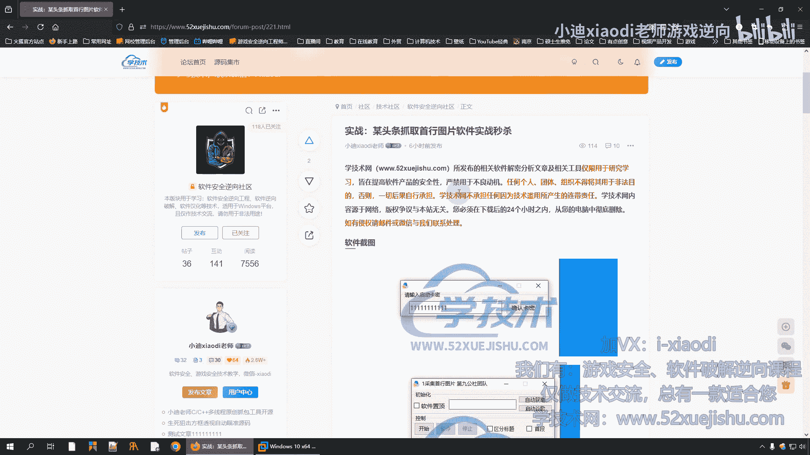

# 网络验证卡密软件逆向分析：01：课程概述与案例背景 🧭

在本节课中我们将要学习网络验证卡密软件的逆向分析入门流程，围绕一个付费卡密软件案例，演示从运行软件、附加进程、设置弹窗断点、回溯调用、定位错误分支、修改跳转，到验证授权状态和处理时间异常的过程。课程面向游戏安全、软件安全、网络安全方向的小白学习者，属于反汇编与软件逆向的科普演示，对应视频编号为 BV1BfkqYjEAS-。课程由小李老师讲解，重点是把分析思路讲清楚，让初学者能看懂每一步在做什么，而不是只记工具按钮。

不少同学会问，逆向破解为什么有人听，逆向能做什么。这里所说的场景是：拿到一款软件后，如果是为了技术交流、学习相关技术并且自己感兴趣，可以研究；有些软件应当是自己先购买过，再研究它的防护程度。这个边界必须先讲清楚，因为逆向分析不是拿来随意使用的工具，学习技术也要知道什么场景可以做、什么场景不能做。

上一段说明了学习场景，本节先看案例来源与合规边界。原文中提到的文章已经发布，发布时间显示为6小时前，文章里包含软件运行状态的动态图片。如果对该文章感兴趣，可以到学技术网（3W点52学技术点com）查阅。这个案例是同学前一天晚上提供的，文章里使用的是另一种处理方法。处理这类软件有很多种方法，本教程演示其中一种，目标是让小白能够学会、能够看懂；更细的细节仍需要跟着课程系统学习，否则遇到很多软件仍然无法处理。

以下是本节需要记住的合规边界和案例要点，先看边界再看案例。


> 本内容仅用于技术交流与学习，必须在合法授权环境中进行，严禁用于其他用途和不良用途。

- 案例对象：一款需要输入卡密并点击确认的付费卡密软件。
- 案例来源：文章已发布6小时前，包含运行状态动态图片，可在学技术网查阅。
- 演示目标：用小白能理解的方式展示一种逆向分析流程。
- 学习提醒：细节需要系统学习，不能只靠一个科普视频处理所有软件。

到这里，案例背景和边界已经交代清楚。上一节我们说明了课程目标和案例来源，本节中我们来看看软件运行后的表现，以及如何把分析工具附加到目标进程上。

# 网络验证卡密软件逆向分析：02：运行目标软件与附加进程 🛠️

上一节我们说明了案例背景和边界，本节中我们来看看软件运行后的表现，以及如何把分析工具附加到目标进程上。先运行软件观察大概模样，软件界面要求输入卡密，输入后点击确认，会出现一个弹窗。这个弹窗就是后续分析的切入点，因为弹窗出现时说明程序走到了校验失败或提示分支，分析者可以从这里反向追踪程序从哪里来。

观察完界面后，打开工具包里的逆向分析工具。点击“文件”，再点击“附加”，附加的作用是让工具和目标软件产生联系。联系建立后，工具显示的内容是线程主线程一类信息。此时点击符号并双击，界面就会显示为自身程序的数据。这个过程可以理解为先和目标程序建立观察通道，再进入它的内部数据结构，后面才能在关键位置拦住程序。

以下是附加进程时需要关注的操作顺序，按顺序理解即可。

1. 运行目标软件，确认输入卡密和点击确认后会出现弹窗。
2. 打开工具包中的分析工具。
3. 点击“文件”，再点击“附加”，与目标软件建立联系。
4. 在符号位置双击，让界面显示为自身程序的数据。

完成附加后，工具已经能观察目标程序。上一节我们完成了进程附加，本节中我们来看看如何在弹窗位置下断点，并通过调用回溯找到错误提示的来源。

# 网络验证卡密软件逆向分析：03：弹窗断点与调用回溯 🧷

上一节我们完成了进程附加，本节中我们来看看如何在弹窗位置下断点，并通过调用回溯找到错误提示的来源。由于软件会出现弹窗，所以要在弹窗的位置把它拦截住。拦截的方法就是下一个断点。断点就是中断点，意思是程序运行到某个位置时先暂停下来。弹窗一出现，程序就在弹窗位置中断，分析者就能观察现场并回溯调用过程。用大白话讲，程序被拦下后，就可以问它“你家在哪”“你从哪里过来”，从而顺着调用关系找到来源。


弹窗断点的核心逻辑可以用下面的公式描述。

```text
程序运行 -> 触发弹窗 -> 断点命中 -> 暂停执行 -> 回溯调用链 -> 定位提示来源
```

设置好断点后，点击确认。此时可以看到程序断在弹窗相关位置，左下角运行状态显示为已暂停。拦截住之后，还可以继续“问话”，也就是查看调用栈和参数信息。原文用“半路杀出程咬金”作比喻：把程序拦下来后，问它从哪里来、带了什么东西、身上有什么东西。此时可以看到提示信息中出现“APPK或K错误”一类内容，这类错误提示就是定位问题的重要线索。

以下是断点命中后的观察与回溯动作，目的是从错误提示反推执行路径。

1. 点击确认触发弹窗，确认程序已经断下。
2. 查看左下角运行状态，确认显示为已暂停。
3. 查看错误提示和调用信息，记录“APPK或K错误”等线索。
4. 使用“执行到返回”回到上层调用，继续观察调用关系。

观察完断点现场后，需要返回上层继续追踪。上一节我们完成了弹窗拦截，本节中我们来看看如何执行到返回、逐层退出，并定位到真正决定走向的错误分支。

# 网络验证卡密软件逆向分析：04：定位错误分支与NOP修改 🧭

观察完断点现场后，需要返回上层继续追踪。上一节我们完成了弹窗拦截，本节中我们来看看如何执行到返回、逐层退出，并定位到真正决定走向的错误分支。先执行到返回，快捷键是 Ctrl+F9。也就是从上边执行到 return（原文口述为 right），然后点击确定。接着按 F8 出一层，此时这个位置没有关键调整；再出一层，来到一个关键位置。继续往上看，就会发现一个错误位置。执行整个这一块，基本就是错误处理所在的位置。再往上看，会发现上方有一个跳转，这个跳转会影响是否跳过错误位置，因此非常关键。对小白来说，可以先看红色箭头，红色箭头表示跳转方向，能直观看到它跳过了某些代码。

这里的核心问题是：希望代码继续执行到正确路径，但实际执行没有走预期位置，而是走了另一边的逻辑。因此要找“谁跳到了这里”“谁执行到了这里”。操作方式是鼠标右键，选择“查找引用”，再选择“选定的地址”。随后会看到一个地址，按回车就能跳到那个错误位置。接下来要解决的问题是：怎么才能不让它跳。办法是不让这条跳转执行，也就是鼠标右键选择“二进制”，再用 NOP 填充。这样逻辑会非常清晰。

跳转修改可以用下面的代码关系表示，NOP 的作用是把跳转指令占位但不执行跳转。

```asm
; 修改前：某条跳转指令把执行流带到错误分支
jmp 错误分支地址

; 修改后：用 NOP 填充跳转指令，让执行流继续向下
NOP
NOP
```

以下是定位错误分支并修改跳转的步骤，顺序体现从观察到修改的过程。

1. 使用 Ctrl+F9 执行到返回，再点击确定。
2. 按 F8 出一层，再出一层，观察是否存在关键调整。
3. 向上查看错误处理代码块，找到控制跳过错误位置的跳转。
4. 右键“查找引用”，选择“选定的地址”，按回车定位跳转来源。
5. 右键“二进制”，使用 NOP 填充，去掉这条跳转的影响。

修改完成后，需要重新运行验证。上一节我们通过 NOP 去掉了跳转影响，本节中我们来看看重新输入卡密后的运行结果，以及出现时间异常时应该注意什么。

# 网络验证卡密软件逆向分析：05：验证结果与时间异常 ⚠️

修改完成后，需要重新运行验证。上一节我们通过 NOP 去掉了跳转影响，本节中我们来看看重新输入卡密后的运行结果，以及出现时间异常时应该注意什么。修改后运行程序，重新输入卡密。此时原来的跳转已经被去掉，程序会继续执行，直接执行到卡密到期时间相关逻辑，从而跳过所谓错误位置。然后随便输入一个卡密，点击确认。此时可以看到软件已经进入，说明前面的修改让程序绕开了错误提示分支。不过，软件进入并不代表结果完全正确，还需要检查授权状态和时间显示。

以下是第一次验证时需要检查的项目，重点是看软件是否进入以及时间是否合理。

1. 重新运行修改后的软件。
2. 输入任意卡密并点击确认。
3. 观察程序是否跳过错误位置并进入软件。
4. 检查卡密到期时间是否正常。

此时会发现卡密到期时间有问题，显示为 1970-01-01。这个时间通常是默认时间或异常时间。有的软件出现这种情况后不能正常使用，所以还需要继续处理。原文也提醒，要系统学习如何处理这类时间问题，以及处理完之后的效果是什么。也就是说，绕过弹窗只是第一步，后续还要让软件状态完整、可用。

第一次验证发现了时间异常。上一节我们看到了 1970-01-01 的问题，本节中我们来看看完整处理后的程序效果，并对照正常时间显示。

# 网络验证卡密软件逆向分析：06：完整处理效果与合规提醒 ✅

第一次验证发现了时间异常。上一节我们看到了 1970-01-01 的问题，本节中我们来看看完整处理后的程序效果，并对照正常时间显示。先找到原来的程序，再看处理过后的软件。运行处理后的软件，界面提示“请输入情动卡密”，随便输入 6666，点击确认卡密。此时卡密到期时间显示为 2025-02-26 12点23-38，时间显示正常，效果比较丝滑。这个结果就是完整处理后的结果。软件怎么运行、怎么操作都可以，说明完整处理不仅解决了弹窗分支，也解决了时间显示问题。

以下是完整处理效果的对照要点，便于理解第一次验证和完整处理之间的差别。

1. 第一次修改后软件能进入，但到期时间显示为 1970-01-01。
2. 完整处理后的软件输入 6666 后可以正常确认。
3. 完整处理后的到期时间显示为 2025-02-26 12点23-38。
4. 完整处理后的运行效果稳定，操作过程正常。

看到完整效果后，还要再次强调使用边界。原文明确提醒，学习相关技术仅做技术交流，不要用于其他用途，严禁用于不良用途。如果想学习相关技术，可以一起探讨。到这里，案例演示部分已经完成。上一节我们看了完整处理效果，本节最后对整节课的内容做总结。

# 网络验证卡密软件逆向分析：07：课程总结与下期说明 🧾


看到完整效果后，还要再次强调使用边界。上一节我们看了完整处理效果，本节最后对整节课的内容做总结。本节课中我们一起学习了网络验证卡密软件逆向分析的入门流程。课程从一个付费卡密软件案例出发，先说明案例来源和技术交流边界，再运行软件观察卡密输入与弹窗，随后使用工具附加进程，在弹窗位置下断点，通过调用回溯查看错误提示。接着使用 Ctrl+F9 执行到返回，按 F8 逐层退出，定位错误处理代码块和影响执行流的跳转，再通过查找引用找到跳转来源，并用 NOP 填充修改跳转。修改后重新输入卡密验证，发现软件可以进入，但出现 1970-01-01 时间异常；最后对照完整处理后的程序，看到输入 6666 后到期时间正常显示为 2025-02-26 12点23-38。

以下是本节课的要点回顾，方便初学者把流程串起来。

1. 弹窗是分析切入点，断点是中断点。
2. 附加进程用于和目标软件建立联系并观察数据。
3. Ctrl+F9 执行到返回，F8 逐层退出，用于回溯调用。
4. 查找引用可以定位是谁跳到了错误位置。
5. NOP 填充可以让跳转不执行，从而改变执行流。
6. 软件进入后还要检查到期时间，1970-01-01 可能是异常状态。
7. 完整处理需要让程序状态正常，而不只是绕过弹窗。



最后再次提醒，相关技术仅用于技术交流和合法授权学习，严禁用于其他用途和不良用途。本节课内容到这里，下期再见。

