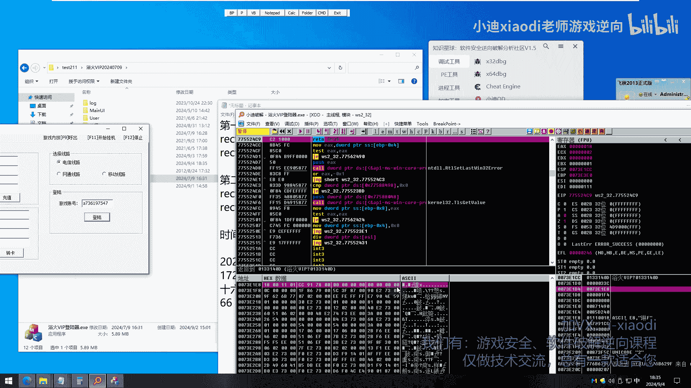
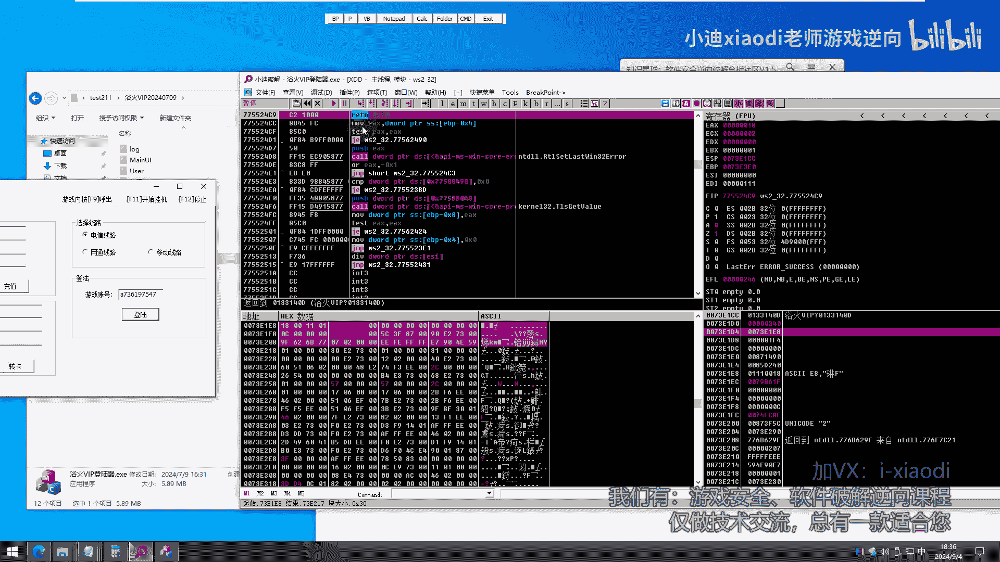
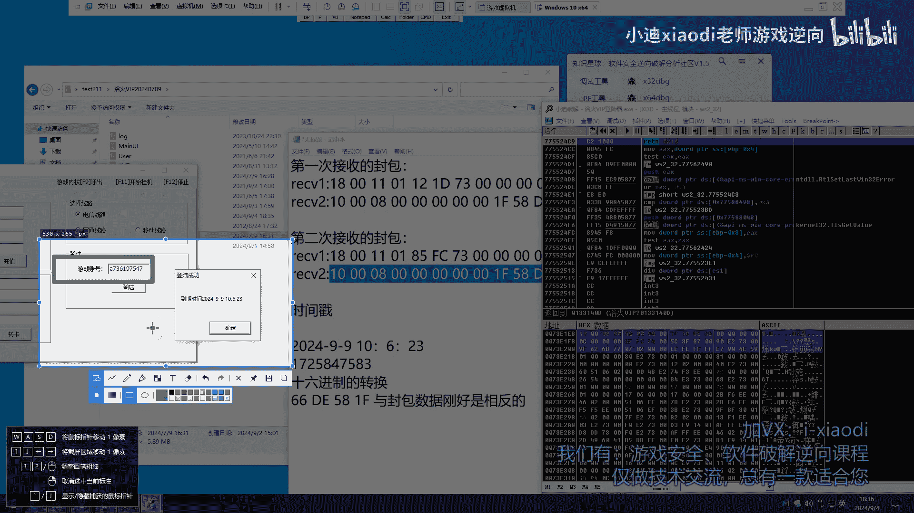
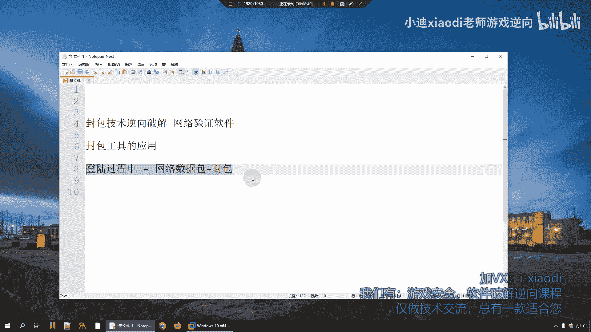
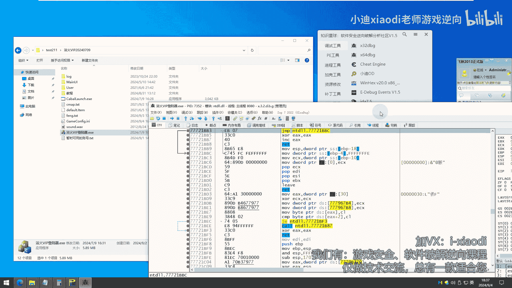
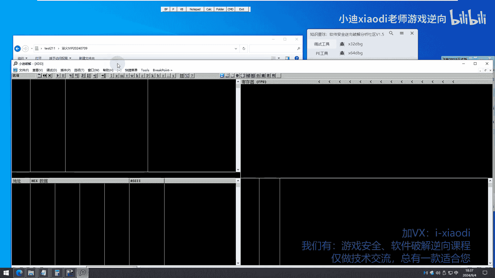
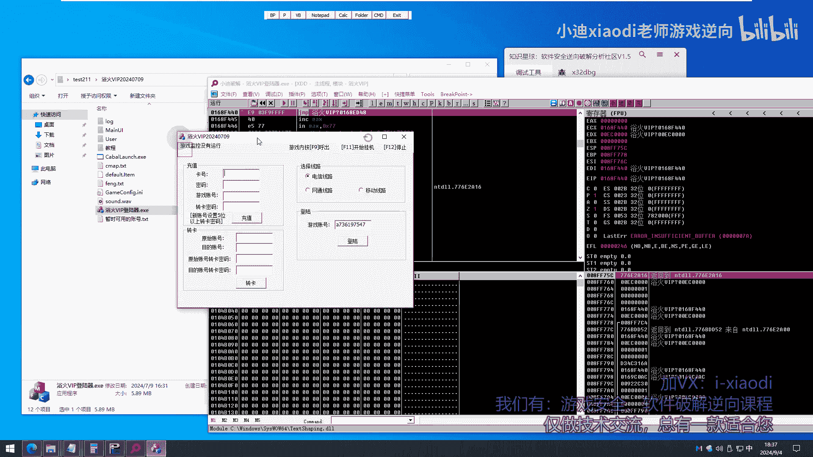
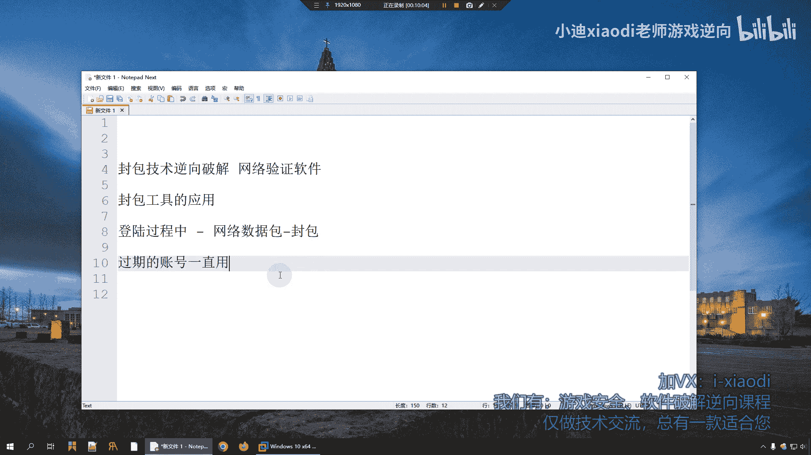

# 🧩 网络验证卡密软件逆向分析：第1章：封包强制登录破解法

在本节课中我们将要学习网络验证卡密软件逆向分析中的封包强制登录破解法。本教程来自小迪老师的视频讲解，对应内容主题包括游戏安全、软件安全、网络安全、CTF比赛必备基础、小白软件破解、反汇编、逆向安全工程师和2025最新相关内容，视频编号为 BV1SWrsYZEcU。学习这类内容时，先不用急着记所有工具按钮，先理解数据流向和登录验证逻辑更重要，因为后面所有操作都是围绕“登录时客户端和服务器之间到底交换了什么数据”展开的。

> 说明：本教程仅用于授权环境下的安全学习、CTF 基础和软件安全研究，请勿用于非法用途。

## 📌 网络验证卡密软件逆向分析：1.1：课程概述

在概述部分先说明本视频的主题：使用封包技术破解网络验证软件，使用的工具是星球的风暴工具，工具包中包含原创工具，也是内部社区工具。有同学可能了解过逆向破解技术，会有疑问：为什么很多朋友在听你讲逆向破解，逆向破解到底能干什么。逆向破解可以绕过一些网络验证软件的限制。下面先看一个网络验证软件的实际登录表现。

以下是该软件登录验证的基本表现：

- 软件需要先输入账号，然后点击登录。
- 如果没有这个用户，软件会提示没有这个用户。
- 如果这个用户到期了，软件会提示账号到期。
- 如果没有到期，软件会提示到期时间，然后登录成功。
- 这是一个网络验证软件，所以登录过程中会发送网络数据包。

上一节我们说明了课程主题和软件表现，本节中我们来看看封包是什么，以及抓包前需要准备什么。

## 🧰 网络验证卡密软件逆向分析：1.2：封包概念与抓包准备

网络数据包又叫做封包，它是在登录过程中产生的。通俗地说，封包就像登录时客户端和服务器互相发送的消息，客户端把账号发到服务器，服务器再返回登录结果和到期时间等信息。理解这个概念后，后面的抓包、对比和修改才有明确目标。

核心概念可以用下面的公式表示：

```text
封包 = 客户端与服务器在登录过程中发送和接收的网络数据包
```

接下来运行程序，再运行工具。工具在工具包里，找到进程，例如 x86 进程，这个工具是原创工具，也是内部社区工具。然后点击开始抓包，再点击登录。

以下是抓包前和抓包时的基本操作：

- 先运行目标程序。
- 再运行工具包中的原创抓包工具。
- 在工具中找到目标进程，例如 x86 进程。
- 点击开始抓包。
- 回到软件点击登录。
- 观察工具中产生的数据包。

上一节我们理解了封包的含义，本节中我们来看看第一次抓包后如何记录接收到的返回封包。

## 📥 网络验证卡密软件逆向分析：1.3：第一次抓包与记录返回封包

点击登录后，工具中会出现几个数据包。主要看收到 RE 位的数据包，也就是返回的数据包。打开文档记录一下，接收的服务包表示账号发到服务器后，服务器返回“登录是否成功、到期时间是多少”等信息。然后把两条数据复制下来，也可以鼠标右键复制封包数据，效果一样。

以下是第一次记录封包时的操作要点：

- 主要查看接收方向，也就是 RE 位返回的数据包。
- 打开文档做记录。
- 理解接收服务包的含义：账号发到服务器，服务器返回登录成功状态和到期时间。
- 复制两条数据。
- 也可以右键复制封包数据，操作结果一样。
- 记录第一次接收到的封包。

记录完成后先关掉，再重新打开，重新运行程序，重新进行拦截注入，步骤和前面差不多。然后点击开始抓包，再点击登录，登录成功后会显示到期时间。接下来对比两次登录的数据。

上一节我们记录了第一次封包，本节中我们来看看两次封包对比时发现了什么关键字段。

## 🔍 网络验证卡密软件逆向分析：1.4：对比两次封包发现时间戳

对比两次登录数据时会发现，180011 这边有一点不同，先不对这里做处理。接着看第二个封包，第一次是 IV1 收到封包1，第二次是 IV2 收到封包2。注意观察，会发现某一部分是一样的，这个部分像时间戳，例如 1F58D166。为了验证这个判断，可以关掉再运行一遍，重复操作并不啰嗦，因为这是讲干货，掌握后以后见到这个字段就知道它是什么，不会糊涂。

以下是验证时间戳时记录的信息：

- 两次封包中有一部分相同。
- 相同部分看起来像时间戳。
- 示例字段为 1F58D166。
- 重复运行程序，什么都不用管，点击登录。
- 记录登录时间：2024-9-9 10:06:23。
- 该时间可以转换为一组数据，用于和封包字段对照。

上一节我们发现了疑似时间戳字段，本节中我们来看看如何用时间戳转换和十六进制转换验证它。

## 🧮 网络验证卡密软件逆向分析：1.5：验证时间戳与十六进制字节序


关掉程序后，去百度搜索“时间戳”，找到时间戳转换工具，把时间改成 2024-9-9 10:06:23，点击转换，得到一组数据。拿到数据后再进行十六进制转换：打开计算器，切换到程序员模式，把数据复制过来，观察到 66DE581F。这个结果跟封包数据刚好相反，封包中的 1F58D166 与它形成相反关系。它实际上验证的就是这样一个东西。

核心转换关系可以用下面的代码描述：

```text
2024-09-09 10:06:23
-> Unix 时间戳
-> 十六进制数据 66DE581F
-> 与封包字段 1F58D166 呈相反字节序关系
```

也可以用公式表示：


```text
封包时间字段 = reverse_byte_order(十六进制时间戳)
```

以下是验证时间戳的关键步骤：

- 使用时间戳转换工具转换 2024-9-9 10:06:23。
- 得到对应时间戳数据。
- 打开计算器并切换到程序员模式。
- 将时间戳数据转换为十六进制，得到 66DE581F。
- 对比封包字段 1F58D166，发现两者刚好相反。
- 说明封包会验证这个时间字段。

上一节我们验证了时间字段，本节中我们来看看能否直接修改这个时间，尝试强制登录。



## 🛠️ 网络验证卡密软件逆向分析：1.6：修改封包尝试强制登录

既然封包会验证时间字段，就可以尝试修改这个时间。打开软件并运行，先做账号替换，把到期账号拖进去。先不放到某个位置，直接拖入即可。拖进去之后，去 21CV 打一个断点，先运行起来，再把账号复制过来，这是一个到期账号。点击登录，第一次断下来，第二次断下来，这边就是封包数据，使用数据窗口跟随查看。此时看到的是到期封包。没有到期的封包也可以试一下：复制选中数据，切换到二进制视图粘贴，然后运行，看到到期时间变成 1970-1-1，软件登录上了，但登录有点问题，说明第一次修改也有影响。



以下是第一次修改封包时的操作流程：

```text
运行目标软件
-> 拖入到期账号
-> 在 21CV 处下断点
-> 运行程序
-> 复制到期账号并点击登录
-> 第一次断下
-> 第二次断下
-> 数据窗口跟随查看封包数据
-> 复制选中数据
-> 二进制粘贴
-> 运行并观察到期时间
```

上一节第一次修改后出现了 1970-1-1 和登录异常，本节中我们来看看重新操作时如何处理两次接收封包。

## 🔁 网络验证卡密软件逆向分析：1.7：处理两次收包并利用过期账号

关掉重新来一遍，把程序拖过来。虽然两次封包有一点不一样的地方，但不影响暴力测试。点击登录，第一次断下来，按 Ctrl+F9，这个操作之前讲过。看到 1800 位置，复制一下，可以多复制几行，没有问题，然后二进制粘贴。再次执行又会断下来，按 Ctrl+F9，这是第二次数据包，使用数据窗口跟随。这边直接粘贴成目标内容，二进制粘贴后运行，看到 2024-9-9 登录成功。两次发包、两次收包，两次接收的封包都处理即可。




以下是第二次修改和验证时的操作流程：



```text
点击登录
-> 第一次断下
-> Ctrl+F9
-> 观察 1800 位置
-> 复制该位置，可多复制几行
-> 二进制粘贴
-> 再次执行并断下
-> Ctrl+F9 到第二次数据包
-> 数据窗口跟随
-> 粘贴目标内容并二进制粘贴
-> 运行
-> 观察 2024-9-9 登录成功
```

刚才已经知道这是到期账号，现在登录成功了，这说明封包有妙用。想深入学习技术细节，可以跟着系统化课程学习。辅助程序被破开后，也说明破解方式不一定需要没有账号才能破开，可以有一个过期账号，过期账号一直用也是一种破解方法。

上一节我们完成了过期账号的封包修改登录，本节中我们来看看程序的 VMP 壳和工具运行问题。

## 🛡️ 网络验证卡密软件逆向分析：1.8：VMP壳与工具运行

这个程序有墙壳，也就是强壳。有同学会问：VMP 的壳能不能搞。这就是 VMP 的壳。也有同学问：这个工具能不能过 VMP。刚才的体现很好，这就是过了 VMP，程序加了 VMP 壳后直接运行起来了。如果没有这些工具，可以试一下，没有工具时连运行都运行不起来，程序会直接退出。所以需要使用这个工具，使用工具后程序可以直接运行起来。


以下是 VMP 壳场景下的要点：





- 程序带有墙壳，也就是强壳。
- 示例壳类型是 VMP 壳。
- 工具需要具备过 VMP 壳的能力。
- 使用工具后，加 VMP 壳的程序可以直接运行。
- 没有工具时，程序可能连运行都运行不起来并直接退出。
- 因此需要准备对应工具。

上一节我们说明了 VMP 壳和工具运行问题，本节中我们对整节课内容做总结。



## ✅ 网络验证卡密软件逆向分析：1.9：课程总结



本节课中我们一起学习了网络验证卡密软件逆向分析中的封包强制登录破解法。我们了解了逆向破解可以绕过一些网络验证软件的限制，认识了网络验证软件在登录过程中会产生封包，学习了用工具抓包并记录接收方向的返回封包，对比两次封包后发现时间戳字段，使用时间戳转换和十六进制转换验证了封包时间字段与十六进制数据之间的相反字节序关系，并尝试修改封包实现强制登录。我们还看到到期账号在修改两次接收封包后可以登录成功，过期账号一直用也是一种破解方法。最后说明了程序带有 VMP 壳时，需要使用能够过 VMP 的工具，否则程序可能无法运行。今天的内容是简单了解封包技术可以破解网络验证，下期再见。
