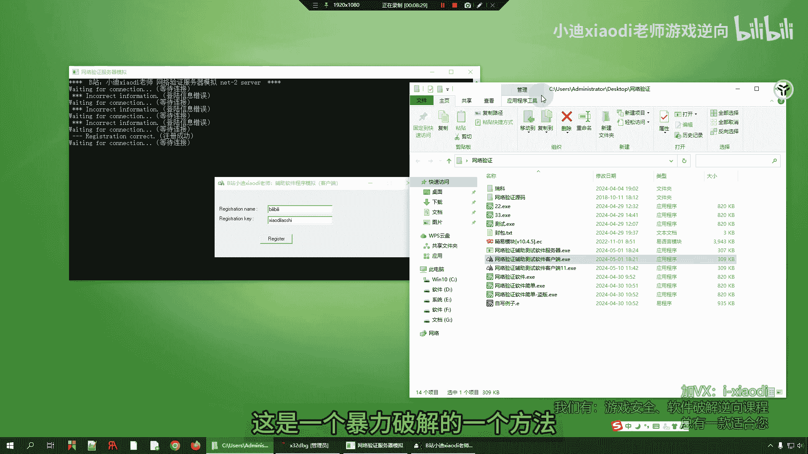

# 🛠️ 网络验证卡密软件逆向分析：01：代码暴力破解法

## 📖 概述

本节课中我们将要学习网络验证类软件的逆向破解方法，重点掌握一种名为“代码暴力破解法”的技术手段。网络验证软件在现实中非常常见，很多商业软件、游戏辅助工具都会采用这种验证机制来保护自己的产品。我们以一款典型的网络验证客户端为案例，从原理到实战，完整演示如何使用调试工具进行附加进程、定位关键代码、修改跳转逻辑，最终实现暴力破解的整个过程。这个过程中会涉及调试器的基本操作、字符串搜索技巧、断点设置以及二进制补丁等核心技术，希望通过本节课的学习，大家能够对软件逆向分析有一个初步但完整的认识。


## 🧠 网络验证软件的核心原理

### 🔄 与普通程序的本质区别

很多同学可能有疑问，为什么那么多人喜欢听软件安全逆向的课程，这东西到底有什么用？其实分析一些小软件，做一下技术交流，就是逆向工程最常见的应用场景。比如网络验证软件，我们之前说过它跟普通的程序本质上差不多，二者最大的区别在哪里呢？这个区别体现在账号密码的校验方式上。普通程序的校验是在本地直接判断，而网络验证软件的校验则是通过网络数据包的形式，将账号信息发送到远程服务器，由服务器来完成验证工作。这就像我们去银行办事，普通程序是柜台的柜员直接判断你是谁，而网络验证则是柜员打电话给总行核实你的身份信息。

### 📡 完整的登录验证流程

我们现在假设下载了一款别人的小辅助软件，那么使用它需要账号和密码，这是最基础的准入条件。这个账号和密码需要联系软件的作者进行购买，购买之后作者会在服务器上为你开通使用权限。当你登录的时候，客户端会把你输入的账号信息发送到服务器，服务器收到这些信息之后会做一系列重要的工作：首先检测你的账号剩余的时长还有多少，同时还会检查你的账号等级，判断你是否是VIP用户，以及是否存在其他特殊权限，它会逐项检测这些信息。检测完了之后，服务器会给出一个明确的结果，把这个结果返回给软件客户端，然后根据这个结果来决定是允许你登录，还是直接拒绝你的访问请求。所以整个流程比普通的本地校验多了一步，多了在服务器上进行校验的这个环节，正是因为多了这一道工序，才让网络验证比普通验证要复杂一些。

这里我们可以用一个简单的图示来描述整个流程：

```
客户端输入账号密码 
    → 发送到服务器 
        → 服务器检测剩余时长、等级、VIP状态 
            → 返回验证结果 
                → 允许登录 / 拒绝登录
```

### 🌐 服务器的不可控性


那么这个服务器到底是什么样的存在呢？它是我们看不见也摸不着的。服务器可能架设在中国大陆，也可能架设在美国或者其他国家，这些远在千里之外的设备不是我们能够直接接触到的。我们唯一能够接触到的，就是你下载到的这个辅助软件本身，也就是运行在你电脑上的客户端程序。所以逆向分析的切入点就很清晰了，既然服务器端我们无法干预，那我们就从客户端入手，通过分析本地程序的执行逻辑来找到破解的突破口。这也是本节课整个分析思路的核心出发点。

## 🔍 实战破解操作流程

### 🐛 第一步：附加目标进程

好，我们先用传统的逆向破解方法，去把这个软件做一个破解。让我们来看一下这个软件界面，这里有两个输入框，需要输入账号和密码，现在随便输入一些内容，点击登录按钮，软件这边没有任何的反应，界面上的按钮点击之后就像石沉大海一样。但是服务器有反应吗？服务器实际上是有反应的，我们看一下服务器端的日志，它提示了登录信息错误。虽然软件没有反应，但是服务器已经做出了一个明确的回应，告诉我们输入的账号和密码是错误的。由于服务器看不见也摸不着，我们只能分析本地客户端的这个软件，接下来就看看到底怎么去分析。


首先打开我们的x32dbg调试工具，这是一个非常强大的32位程序调试器，在软件逆向领域应用非常广泛。打开之后，点击菜单栏中的“文件”选项，然后在下拉菜单中选择“附加”功能，这时会弹出一个进程列表窗口，列出了当前系统正在运行的所有进程，我们直接从列表中找到我们这个客户端的软件，这个就是目标程序。双击这个进程，调试器就会开始附加到该程序上，附加成功之后，我们就可以对这个程序进行各种调试操作了。

### 🧩 第二步：定位主模块与搜索关键字符串

双击附加过来之后，我们首先要做的第一件事，就是点击界面上的“符号”标签页。这个符号选项卡里包含的是程序以及它所依赖的所有动态链接库，也就是DLL文件，或者说它所依赖的一些必要文件，比如系统运行库、第三方组件等。那么如何查看程序相关的一些关键信息呢？正确的做法是双击跟程序名字一样的那个模块。这个东西叫做主模块，也就是程序自身的可执行文件部分，它包含了程序的主要代码和逻辑。主模块是逆向分析最重要的目标，因为程序的主要功能代码都集中在主模块中。

双击进入主模块之后，就来到了程序的主模块代码区域。在这个视图中，我们可以看到当前模块的状态信息。接下来我们就要搜索字符串了，这是定位关键代码的最有效手段之一。鼠标随便在代码区域点击一下，在任意位置都可以，在右侧区域也行，然后点击鼠标右键，在弹出的右键菜单中点击“搜索”选项，然后选择“当前模块”，因为我们现在就在程序的主模块里面，所以搜索范围就限制在主模块中。接着点击“搜索字符串”功能，执行之后，调试器会列出程序中使用到的所有关键字符串信息。

字符串信息就是文本信息，比如提示消息、错误信息、界面标题等。我们来看一下搜索结果，这边显示的可能是程序的标题文本，这边应该是它连接的一个IP地址，当前显示的是本地地址，然后这边就是它的一些提示信息。我们会发现，如果连接服务器失败，它会显示一个服务器失败的信息，注册成功会显示一个注册成功的提示信息。看到这些字符串有什么作用呢？关键的操作来了，你往左看，左边是代码，你往下看来到字符串对应的位置，然后往左看，你会发现左边全部是汇编代码。代码用到了这个字符串，左边是代码，右边是字符串，是左边的代码用到了右边的字符串，这样就建立了代码与字符串之间的关联。既然代码用到了这些字符串，那么它跟关键代码的执行逻辑就息息相关了。所以我们要做的事情就是定位到关键字符串，然后找到使用这个字符串的代码位置，这个位置附近的代码就是我们需要重点分析的区域。

### 🎯 第三步：定位关键代码与跳转指令

选中关键字符串的那一行，然后双击鼠标，就会自动跳转到引用该字符串的代码位置。我们看这里的代码区域，可以拉一下界面，这边显示的就是注册成功的提示信息，而且我们可以看到下边有一个message box调用，这是一个信息框的提示函数，用于在图形界面上弹出提示消息。继续往上看，我们会发现什么呢？会发现一堆的跳转指令。之前我们就讲过，跳转指令的作用就是更改代码的执行逻辑。假如程序执行到某一个位置，然后碰到一个跳转指令，它会改变执行流向，往上走或者往下跳，从而绕过某些代码块。

那么怎么才能让破解成功呢？你会发现，我们要把这个区域里所有带箭头的跳转指令全部干掉，这样程序执行的时候就无法跳转到其他位置，只能一路直行，直接来到我们想要的代码区域。我们先来看一下程序在哪个位置会停下来，继续往上看，跳转跳转，我们会发现整个目光所及之处，这边是最靠上的一个跳转，相对来说应该是在这个区域中最靠上的跳转指令。我们先在这里下一个断点，按F2键打一个断点。断点是调试器的重要功能，它的作用就是让程序执行到此处时暂停下来，方便我们分析当前的状态和代码流程。

打上断点之后，我们点击运行按钮，让程序跑起来，这个时候你会发现程序断下来了。程序在这里停住了，而且这个程序界面卡住了，调试器左下角显示“已暂停”的状态，说明程序中断在这个位置。所谓断点，就是让程序执行中断的点，F2是切换断点的快捷键，再按一次F2可以取消断点。我们知道程序原来是这么往下走的，走到这里它就要根据判断条件决定是否跳转了。我们先让程序继续运行起来，把断点取消掉。

### 💥 第四步：暴力破解——NOP填充

现在我们要使用暴力的破解方法，具体怎么暴力破解呢？原理非常简单粗暴，就是把所有的跳转指令全部给它干掉，一条都不留。怎么干掉呢？方法就是鼠标右键点击代码行，选择“二进制”菜单，然后选择“用NOP填充”。NOP是什么？NOP是汇编语言中的空操作指令，它的英文全称是No Operation，执行NOP指令时CPU什么也不做，直接执行下一条指令。当我们把跳转指令全部替换成NOP之后，原来的跳转逻辑就被完全抹除了，程序执行到这些位置时不会发生任何跳转，只会一直往下顺序执行。

```
原始代码:  JNZ 00401234 (条件跳转)
修改后:    NOP           (空操作)
           NOP           (空操作)
```

来，对每一个跳转指令都执行这个操作，鼠标右键，二进制，用NOP填充，把所有带箭头的全部干掉。看，这个填充完成之后，所有的跳转都不再跳转了。这里也是，二进制用NOP填充。经过一番操作之后，这个区域里所有的跳转指令就都变成了NOP空操作。

填充完成之后，我们来测试一下效果。这个时候程序卡住了，界面无响应，没关系，这是正常现象。我们来打一个补丁试一下，点击“修补文件”功能，然后选择保存路径，文件名设置为“网络认证客户端11”，这里可以看到“41个补丁已经运用”，说明有41处代码被修改了。程序卡住了，我们先关掉这个调试会话。


### ✅ 第五步：验证破解结果

关掉调试器之后，我们重新运行这个修补过的程序。大家注意看，注册成功，看到没有？实际上注册成功了。刚才程序卡了一下，现在重新运行。连接服务器失败，它还要先连接服务器的，然后再进行一次登录操作。输入账号密码，看到没有？这个时候就注册成功了，程序成功绕过了服务器端的验证，直接显示注册成功的提示信息。

当然这个时候注册成功会有一个问题，就是程序闪退了。程序直接退出了，我们看一下源代码，如果说是正确的账号和密码，会不会闪退？小迪老师来测试一下，使用正确的账号密码登录，注册成功不会闪退。但是刚才我们用NOP填充之后，出现了闪退的情况。这个问题出在哪里呢？这是因为我们粗暴地干掉了所有跳转指令，有些跳转指令本来是用来控制程序正常流程的，比如初始化操作、资源释放等，这些流程被破坏之后，程序在运行过程中就会因为缺少必要的初始化或者资源清理而出错，最终导致闪退。至于为什么闪退，有没有更好的处理方法，我们下节课继续去聊这个事情。

## 📝 总结



本节课中我们一起学习了网络验证软件逆向分析的完整流程和暴力破解方法。我们从网络验证软件的基本原理入手，理解了它与普通程序在校验方式上的本质区别，明白了服务器端验证逻辑的不可控性。在实战环节中，我们操作了x32dbg调试器，完成了附加进程、定位主模块、搜索字符串、分析关键代码、设置断点、NOP填充修改跳转指令、生成补丁文件等一系列操作，最终成功绕过了服务器验证，让程序显示注册成功。虽然本方法存在闪退的副作用，但它确实验证了暴力破解的可行性和基本原理。这种方法的本质就是修改程序的执行逻辑，让条件跳转失效，从而强制执行我们想要的分支路径。破解成功后程序闪退的原因分析，以及更加优雅的破解方案，我们将留到下一节课继续探讨。本节课的内容就到这里，希望大家可以动手实践一下，加深对逆向分析流程的理解。
