# 🛡️ 软件安全逆向破解：第16讲：基础突破08 - 断点和单步调试分析

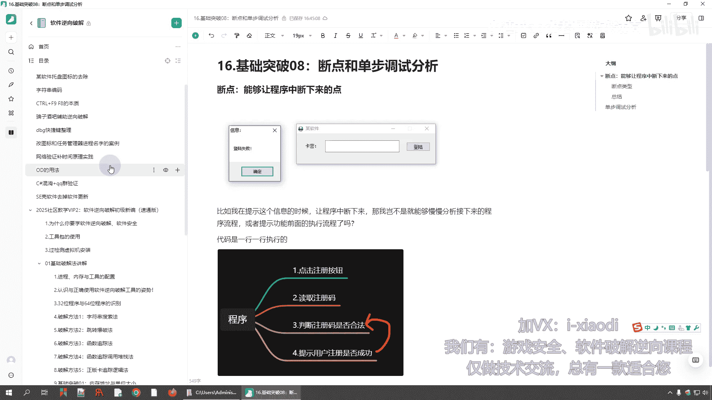

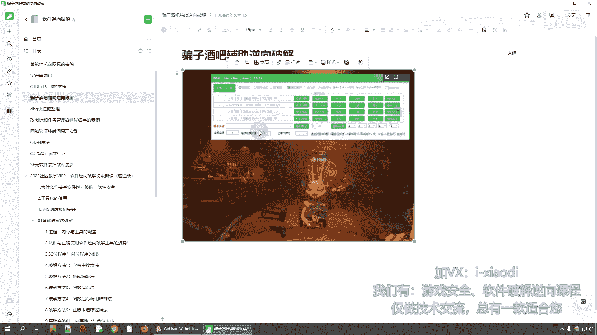

大家好，我是小李老师。今天是我们软件安全逆向破解的第十六讲，基础突破08，主题是断点和单步调试分析。很多朋友比较好奇，讲逆向破解怎么会有这么多人听？逆向到底能干什么呢？我举个例子：前段时间，社区里有一位朋友给我们提交了一款最近比较火的游戏辅助，名字叫“骗子酒吧”的辅助。我们可以通过技术手段对它进行突破。这个辅助本身可能是需要卡密的，但是通过技术突破，我们就可以实现突破卡密限制，然后自己直接使用。我们内部教学中有很多类似案例，之后都会陆续更新，今天这个也是一个案例。

再说一下教学版本。这是我们 VPR 教学的第二版。我们还有另外一套版本，第一套有几百集，我个人感觉可能讲得比较啰嗦。第二版属于速通版，学起来会比较快。废话不多说，直接进入今天的内容。

## 什么是断点

首先我们要搞清楚断点是什么。断点就是能够让程序中断下来的点。举个例子：现在有一个软件处于运行状态，我们输入卡密并点击登录的时候，程序会判断卡密，然后给我们一个提示。如果我在这个提示信息出现的时候让程序中断下来，那我岂不是就可以慢慢分析接下来的程序流程，或者分析提示功能前面的执行流程了吗？为什么可以这样？因为代码是一行一行执行的。

当我们中断在“登录失败”提示信息这一行的时候，注意看，这是第四个环节。然后你往回回溯一下，大概率就能找到判断注册码是否合法的代码位置。接下来修改相关代码逻辑，就能实现对应的技术突破。当然，我们也可以在读取注册码的位置进行中断。中断下来之后，往下看代码逻辑，下面的逻辑就是判断注册码是否合法的位置。这是根据程序常见的执行流程进行分析的。你会发现，断点断在哪里都行，都能找到相对应的破解位置。破解本身是一个非常灵活的思维。

## 断点的类型

在逆向分析技术中，断点类型主要分为三类：硬件断点、F2 断点和内存断点。这里只需要记住一点：分析代码的执行流程，我们就用 F2 断点。F2 断点是专门用于调试分析的断点。其他断点类型在我们的内部视频中也会有所应用，比如硬件断点，在之前的课程中已经讲过了，大家可以去自己看一下，用的就是硬件断点的功能。下面这张图表，大家可以暂停视频或截图保存。

## F2 断点的演示与本质

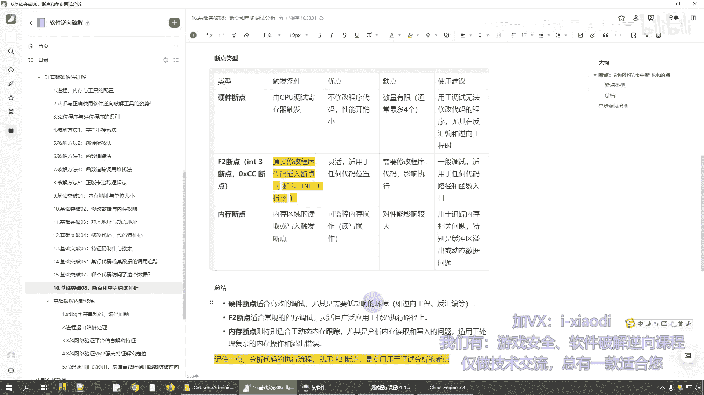

现在我们演示一下 F2 断点，看看为什么它叫 F2 断点，以及它后面的那些名字到底是怎么来的。先运行实验程序，然后打开我们的调试器。点击“文件”，点击“附加”，切换过来。点击“符号”这个按钮，然后切换到程序的主模块。接着搜索当前模块字符串，这时候我们会看到“登录失败”这个字样。切换过去，这里就是提示登录失败的位置。那到底是不是呢？我们可以在这里设断点。怎么设呢？实际上就是按下 F2 键，断点就设在这个位置了。按下 F2 后，系统会提示“断点已设置”，位置就在这。把鼠标放上去，会提示“断点已启用”。再点一下，它会变成绿色，绿色就是禁用的意思，也就是不生效。再点一下，它变成灰色，灰色表示这个断点完全没了。那怎么再设置上呢？你可以再点一下，也可以按 F2 键，一样可以设置。看到没？这就是为什么叫 F2 断点：因为 F2 是调试器里的一个快捷键，所以叫 F2 断点。

那又有同学会问：为什么它也叫 int3 断点？为什么还有 0xCC 断点？这又是什么东西？我们来看一下。这样的话，我们就必须打开另一个调试器。打开另一个调试器，找到我们的程序，点击打开，点击“查看内存”，来到 4011D0 这个位置。你会惊奇地发现，这里显示竟然不一样。你看这个位置显示的是 `push` 什么什么，但这个位置俨然已经变成了 `int3`。为什么会出现这样一个现象？因为当我们按下 F2 断点的时候，它实际上会向程序的这个代码位置插入一个 `int3` 的代码。`int3` 是一条指令，它对应的字节数据是 `0xCC`。所以 F2 断点又叫 int3 断点，又叫 0xCC 断点。它的本质就是通过修改程序代码，插入 `int3` 指令。这就是它的实现原理。

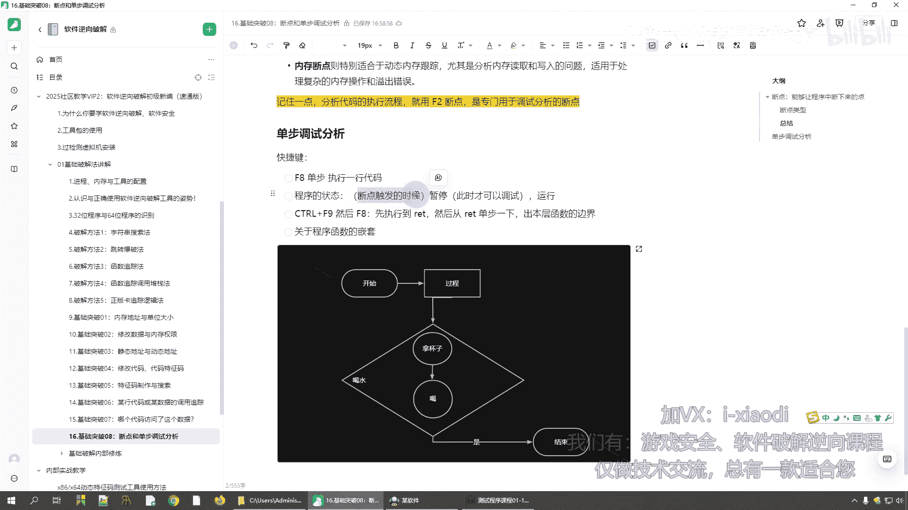

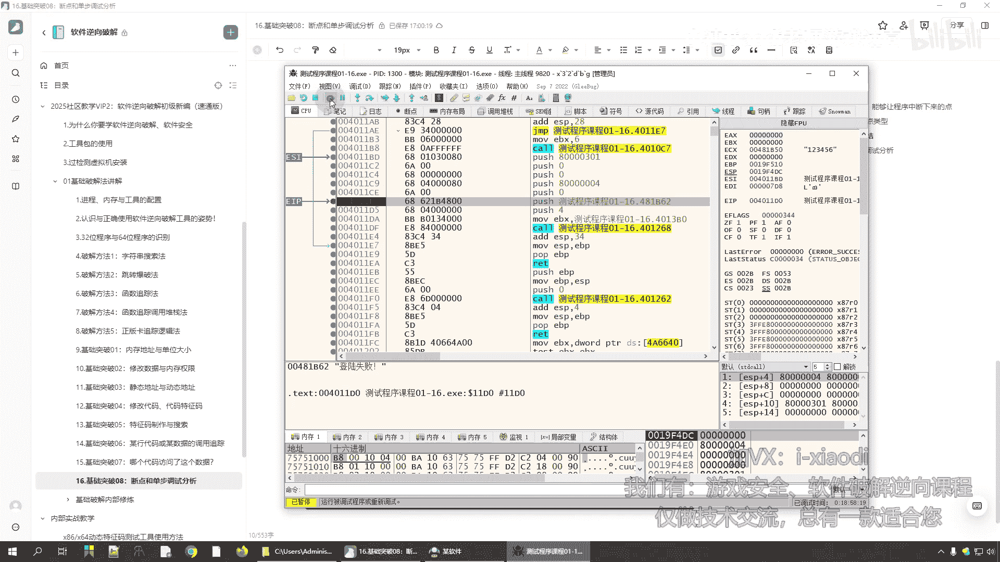

它的优点非常灵活，适用于代码的任何位置，我们想在哪里设就在哪里设，可以随便设。但是，这个程序的代码肯定已经被破坏了，因为代码已经被修改了。所以它有可能会触发程序内部的一定保护机制。如果程序有保护、有防护的话，有可能会触发。看了这么多，总之我们记住一点就可以：如果要分析代码的执行流程，就用 F2 断点，不用别的，就用 F2 断点。因为 F2 断点是专门用于调试分析代码的断点。

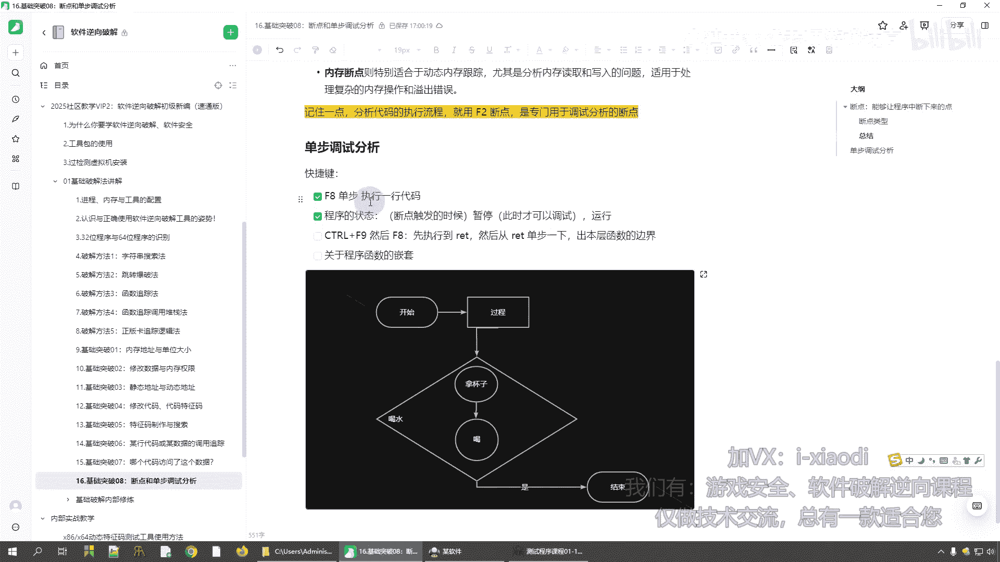

## 单步调试分析

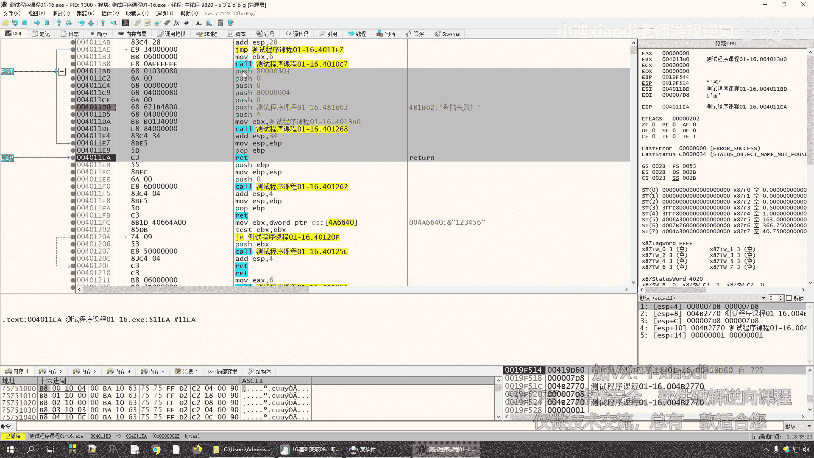

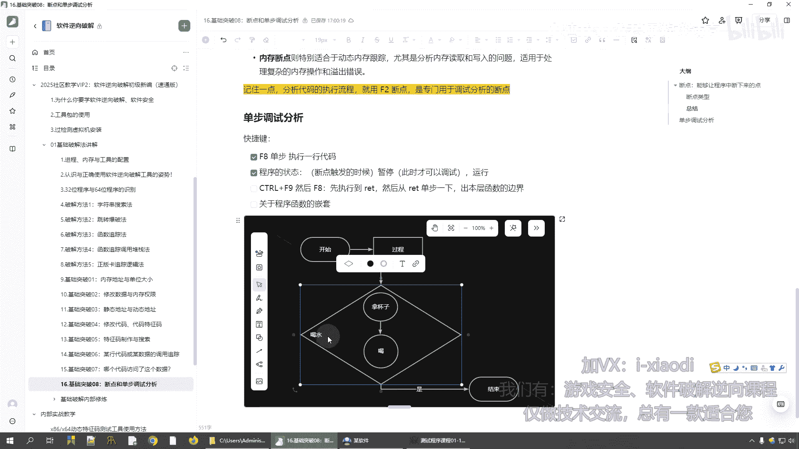

最后我们再来讲一下单步调试分析。前面说过，断点是单步调试分析的好朋友，那我们来看看它们是怎么配合的。首先，我们在这里已经设置了一个断点。点击登录，程序会中断在这里。此时程序的状态变成“已暂停”，而且它会提示 `int3 breakpoint`。你看，所以它又叫 int3 断点，breakpoint 就是断点的意思。断在哪个位置呢？在 4011D0。所以调试器会给我们一些相应的提示。此时程序处于暂停状态。那什么时候会暂停呢？断点触发的时候就会暂停。除了暂停，还有一种状态就是运行。这个时候我们点击“运行”，程序就开始运行了，可以看到“运行中”的提示，这就是程序运行的状态。

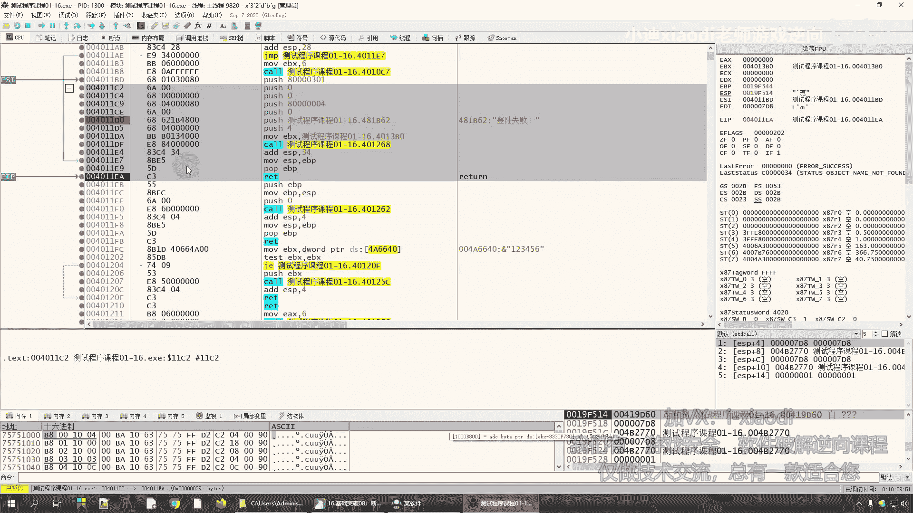

当程序暂停的时候，我们是不是可以执行相关代码呢？当然可以，这就是单步调试分析。我们再让程序中断下来。中断下来之后，如果我们想要执行一行代码，需要按下什么快捷键呢？需要按下 F8。按一下 F8，执行一行；再按一下 F8，再执行一行。所以如果我们想单步执行一行代码，就按 F8。F8 就是单步调试分析，一行一行地执行代码。大家注意看，当我们执行到 `ret` 的时候，会发现，已经来到了函数尾部。之前我们就讲过，`ret` 就是 `return`，也就是返回的意思。从哪里返回呢？从这层函数里面返回。因为程序是嵌套的，比如说喝水：拿杯子喝，现在我们在“喝”这个位置，那我们从“喝”突破边界，来到“喝水”的位置。懂这个意思吧？现在我们就要突破这个函数的边界。

大家会发现，我们单步执行也能来到 `ret`，然后 `Ctrl+F9` 也可以来到 `ret`。那么 `Ctrl+F9` 的本质是什么呢？好，这个问题有不少同学问过，不理解。我们先运行起来，点击登录。刚才我们是按 F8 一行一行执行的，对吧？如果我们按 `Ctrl+F9` 呢？你会发现它从这一行自动来到了这一行。那它是跳过来的吗？不是跳过来的，它是一行一行执行过来的。所以你可以理解为，`Ctrl+F9` 自动帮我们按了很多次 F8，直到这个位置停下来了。然后我们再手动按一下 F8，就出函数了。所以这就是配合 F8 来理解 `Ctrl+F9`，然后按 F8。

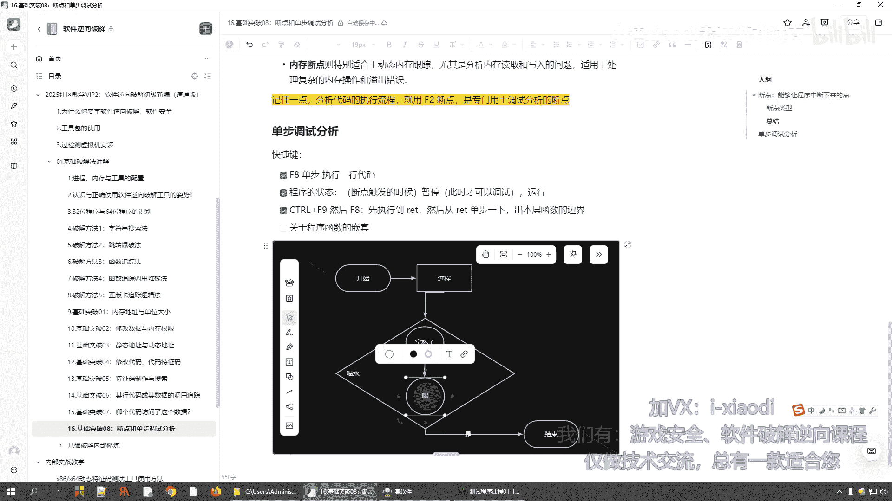

## 函数嵌套的理解

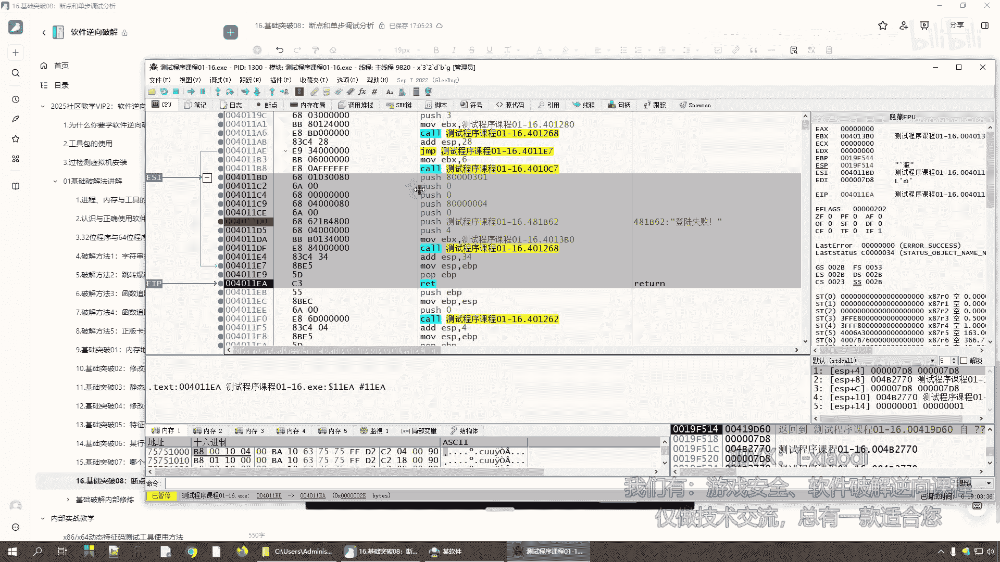

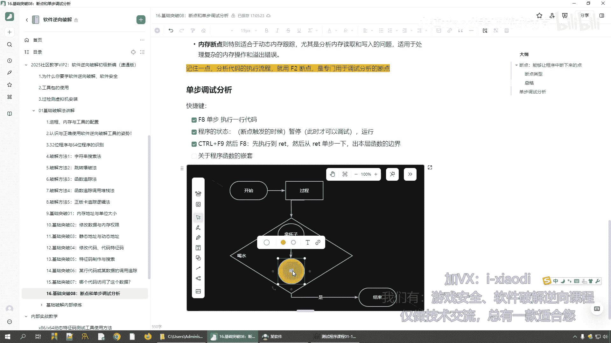

还有同学可能会对程序函数的嵌套产生疑问：我怎么就从这个内层函数出来了？怎么就出了本层函数的边界？这乱七八糟的到底怎么回事？我们就拿日常生活中最常见的喝水来举例。喝水是一个程序，当我们逆向分析程序的时候，实际上定位的位置一般来说是一个内层，也就是“喝”的这个位置。现在我们定位到“喝”了，那代码就在这里。比如我们重新跑一下，中断下来。好，这个位置实际上就是“喝”的位置。现在我们在“喝”这个圈里边，按 F8 执行，执行到 `ret`。到 `ret` 意味着什么呢？意味着我们从“喝”这个字的最中心，来到了白色圆圈。来到白色圆圈之后，再按一下 F8，这个时候我们就从这个函数里面出来了。也就是说，我们从白色圆圈里面突破出来了，像打破了次元壁一样。这就是出本层函数的边界。

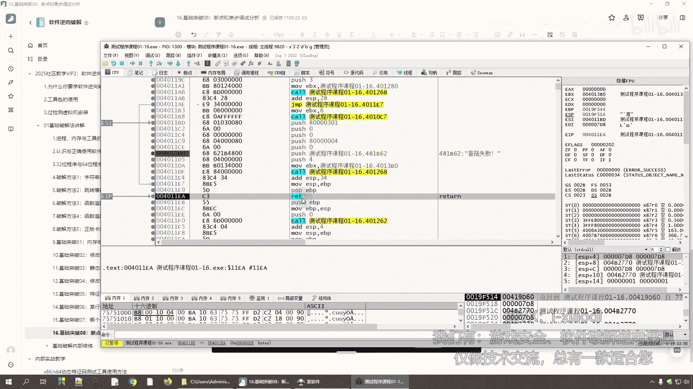

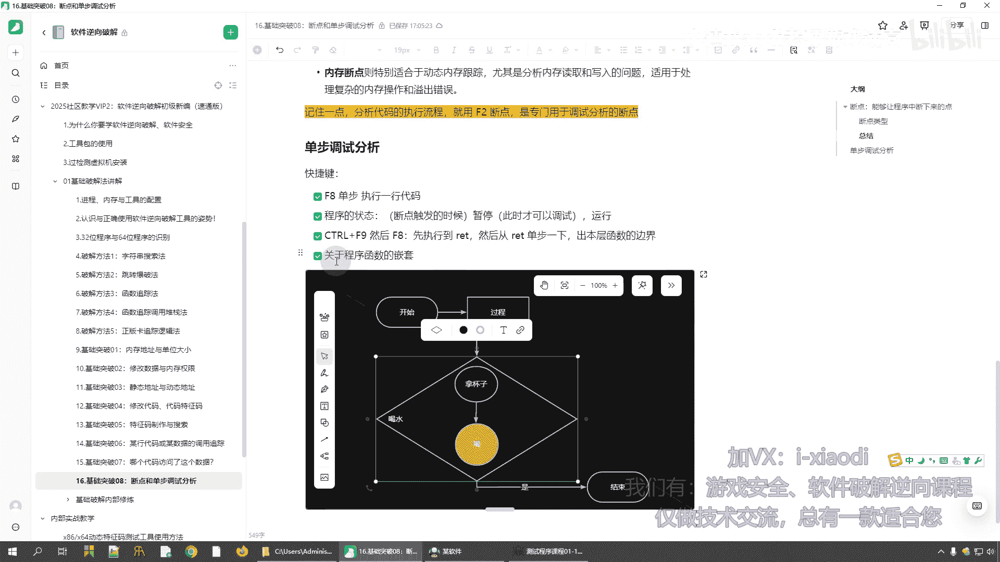

程序就是这样，一层套一层，一层套一层，有无数个圆圈。我们按 F8 到 `ret` 的时候，就可以突破出来。这就是程序函数的嵌套。

## 入口断点

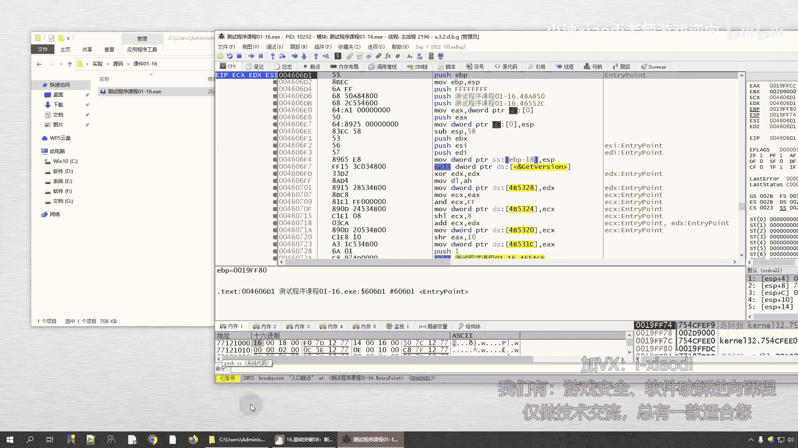

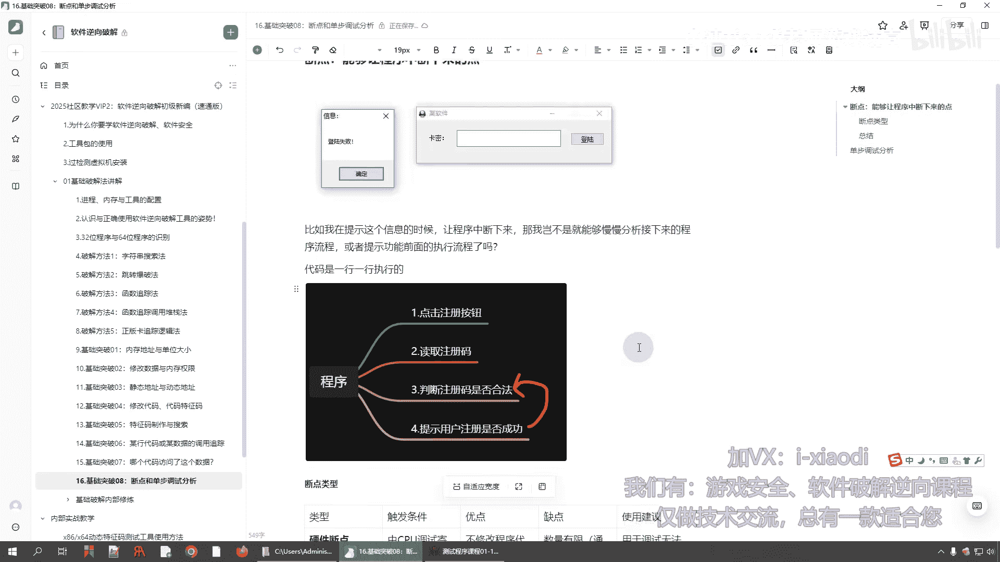

最后还有一点，细心的同学可能会问：当我们把程序拖进调试器的时候，我没下断点啊，程序为什么就暂停了呢？这不对啊，是不是？实际上，这是因为我们这里有一个设置。点击“选项”，里面有一个“当以下事件发生暂停”。这个工具可以自动帮我们设置一个入口断点。如果你把它取消掉，点击保存，然后关掉调试器，再拖入程序，程序就直接跑起来了。所以我们要怎么做呢？在“选项”里勾选“入口断点”。当我们勾选上之后，再拖入程序，它就会自动设置入口断点，并不是无缘无故就中断下来的。可以看到，程序已暂停，提示 `int3 breakpoint 入口断点`。这就是今天的内容，内容还是比较多的。大家回去之后自己好好吸收整理一下。我们下期再见。
