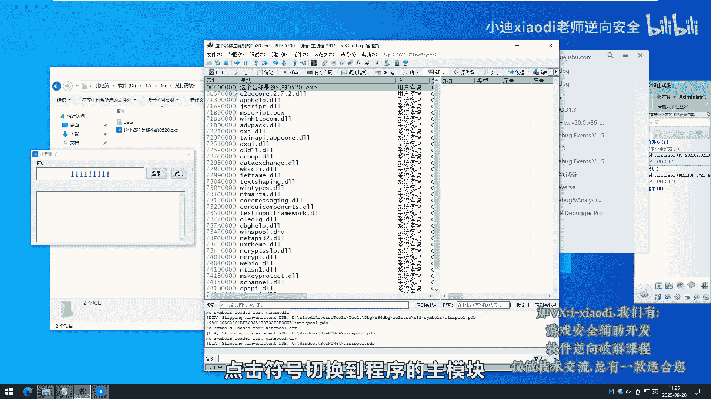
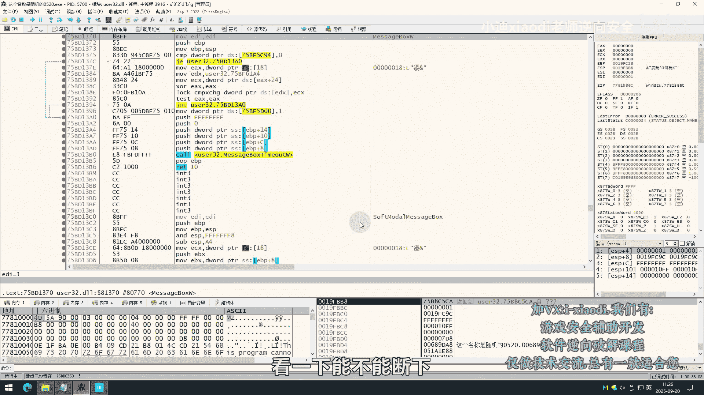
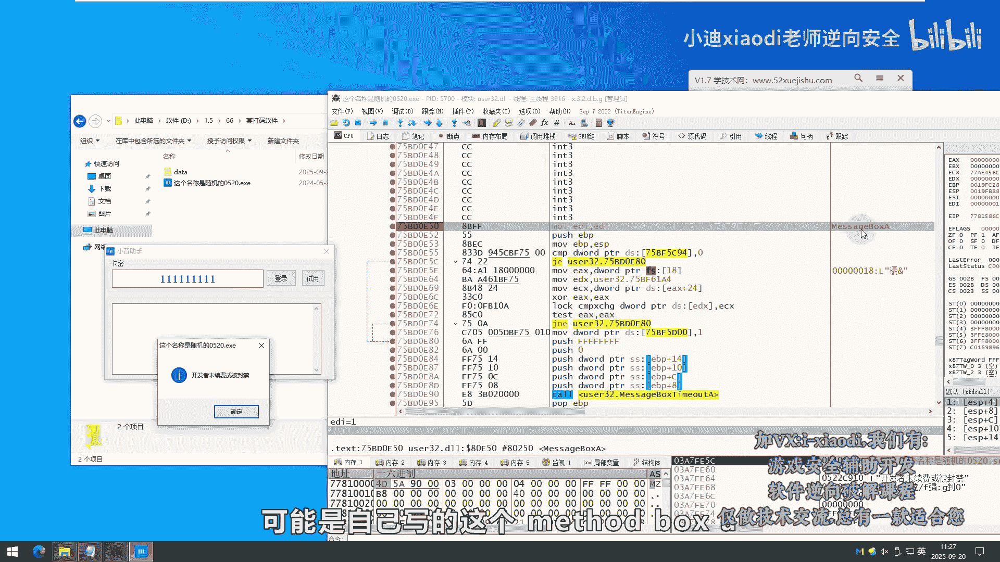
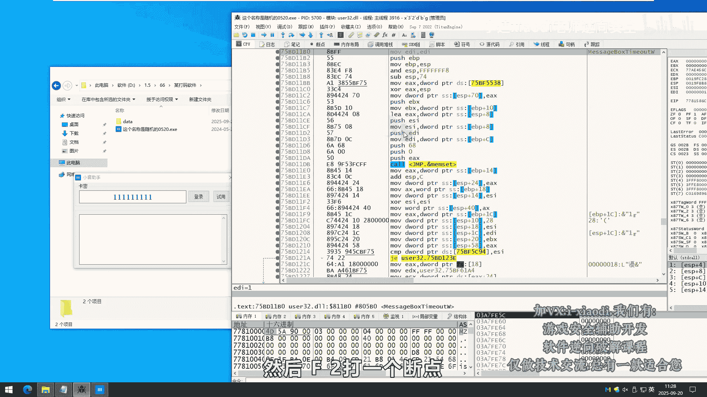
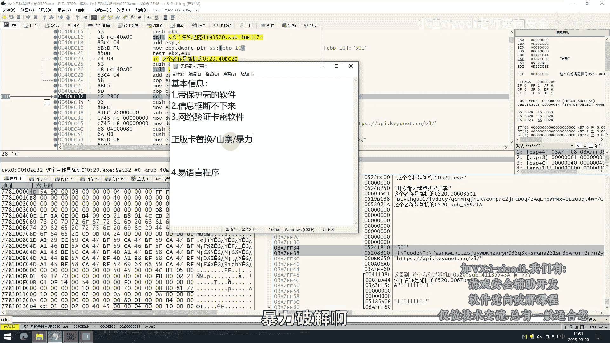
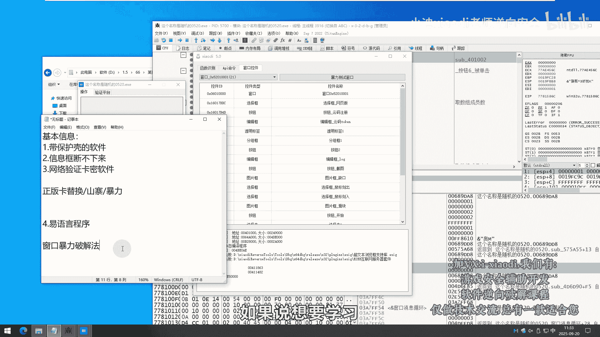

# 🛡️ 网络验证卡密软件逆向分析：01：课程概述与合法声明


在本节课中，我们将要学习网络验证卡密软件的逆向分析流程，内容围绕软件保护情况识别、登录弹框行为分析、调试断点定位、网络验证通信识别以及暴力破解思路展开。一天一个黑客小知识，今天学习的是软件逆向破解技术，属于游戏安全、软件安全和网络安全方向的正规技术科普，示例来源信息为 BV14QpDzFEfS。大家好，我是小李老师。今天我们继续讲软件逆向破解。有不少同学会疑问：讲软件逆向破解，为什么会有这么多人听？逆向破解能做什么？实际上，它可以用来分析一些小软件，也可以利用这些技术尝试突破软件的登录限制。当然，我们仅做技术交流。


> 郑重声明：本技术为正规网络安全技术科普。所有操作仅做技术交流，切勿把技术用在非法用途。


以上是本次课程的定位、来源说明和安全边界。接下来，我们带领大家挨个分析，先看拿到程序后如何判断它有没有保护。


# 🔍 网络验证卡密软件逆向分析：02：识别软件保护情况


上一节我们说明了课程定位和合法使用边界，本节中我们来看看拿到程序后的第一步：分析软件的保护情况，看看这个软件有没有保护。以下是识别保护壳的操作流程：


1. 点击 P 工具。


2. 点击 EXEP。


3. 把程序运行起来。


4. 运行起来之后，把目标程序拖过来。


5. 拖过来之后，在第一行查看保护信息，可以看到保护信息是 `UPX 0.89`。


通过以上操作可以看到，这个程序的保护器或者说保护壳就是 UPX。到这一步，我们就完成了第一点：识别出一个带保护壳的软件。保护壳可以简单理解为程序外面的一层包装，分析前先确认它有没有壳，后续观察行为时心里更有数。完成保护情况识别后，本节先告一段落，下一节我们来看看软件点击登录时会发生什么。


# 💬 网络验证卡密软件逆向分析：03：分析登录弹框行为与信息框函数


上一节我们确认了程序带有 UPX 保护壳，本节中我们来看看软件的行为：随便输入一个卡密，然后点击登录。此时程序会弹出一个信息框，提示“开发者未续费或被封禁”。这种弹框一般称为信息框。学过基础内容的同学会知道，它通常对应 `MessageBoxW` 或 `MessageBoxA` 这两个 API 函数。核心概念可以用下面的代码表示：


```text
信息框 API：MessageBoxA / MessageBoxW
```


接下来，我们点击调试工具，找到 DBJ，点击文件，点击附加，双击一下，再点击符号切换到程序的主模块。然后，我们在 `MessageBoxA` 和 `MessageBoxW` 上分别打一个断点，看看程序能不能断下来。断点就是程序运行到该位置时会中断的点；如果程序真的调用了这个信息框，它就会中断下来。以下是下断点并验证的流程：




1. 点击调试工具。




2. 找到 DBJ，点击文件，点击附加。


3. 双击一下，点击符号切换到程序的主模块。


4. 在 `MessageBoxA` 上打一个断点。


5. 在 `MessageBoxW` 上打一个断点。


6. 点击登录，观察程序是否中断。


实际操作中，点击登录后程序并没有中断下来。两个断点明明都已经下上，`MessageBoxA` 断点显示为红色，说明断点下成功了，`MessageBoxW` 断点也已经下上，但程序没有中断在这里。这意味着程序可能是自己写的 `MessageBoxA`。它怎么自己写？一般来说，是通过调用更底层的系统函数来实现。更底层的信息框函数一般仍然是 `MessageBox` 相关函数。于是我们双击进去，在这里按 `F2` 打一个断点。此时再点击登录，可以发现它仍然没有断下来，说明不是 A 版本，它有可能是一个 `MessageBoxW` 版本。所以我们去 `MessageBoxW` 上双击这个位置，再按 `F2` 打一个断点，然后点击登录。这个时候可以发现程序真的中断下来了，而且在这里也能看到弹窗的信息。接着按 `Ctrl+F9`，点击确定，再按 `F8` 返回，返回出来看到的就是软件作者自己实现的一个信息框函数。在这一层分析，似乎分析不出更多东西。以上断点验证过程说明，程序对信息框可能做了自己的封装，不能只盯着最外层的 `MessageBoxA`。本节围绕信息框断点的验证到这里结束，下一节我们继续返回，看看能否找到网络验证的关键信息。


# 🌐 网络验证卡密软件逆向分析：04：定位网络验证通信


上一节我们围绕信息框断点确认了程序可能自己封装消息框，本节中我们来看看继续返回后能看到什么。继续按 `Ctrl+F9` 后，可以发现这里已经出现了一些网络验证的关键信息。在栈里边，也可以看到网络验证的网址，这个位置还出现了我们输入的卡密。再往上翻一翻，上面就是服务器返回的数据。由此可以发现，它是一个网络验证卡密软件，通过服务端与本地软件的数据通信来实现登录验证。核心关系可以用下面的代码表示：




```text
本地软件 <-> 服务端
卡密 -> 登录请求 -> 服务器返回数据 -> 本地登录验证
```




破解方法是多种多样的。以下是原文提到的几类思路：


1. 正版卡替换：把正版卡的返回数据直接贴到这里，这是一种方法。


2. 山寨方法：把它的后台换成你的后台，这一类内容课程中也有讲解。


3. 暴力破解：这种方法比较简单，今天重点来看暴力破解。


到这里，我们已经从弹框行为追到了网络验证通信，知道了程序不是单纯本地判断，而是和服务端有数据往返。接下来，本节内容过渡到实际操作部分，我们看看暴力破解思路如何用于窗口分析。


# 🧩 网络验证卡密软件逆向分析：05：暴力破解与窗口识别


上一节我们定位到网络验证通信，本节中我们来看看暴力破解思路怎么落地。先把程序运行起来，然后点击符号切换到程序的主模块。如果点击符号进入程序主模块后，发现前两行代码呈现原文所说的 `XYEXEXright` 这类特征，就可以记住它是易语言程序，也就是原文口播里提到的“1元程序”。易语言程序可以使用一种方法，叫窗口暴力破解法。以下是窗口暴力破解的操作流程：


1. 点击插件。




2. 点击小迪 5.0。


3. 点击开始分析。


4. 点击窗口控件。


5. 查看窗口列表，会发现有两个窗口。


6. 查看第二个窗口，它应该就是登录窗口，也就是验证卡密的窗口。


7. 第一个窗口应该是功能窗口。


8. 点击暴力破解窗口，可以发现程序多了一个窗口出来，这个就是软件的功能窗口。


通过以上窗口分析，我们就能把登录窗口和功能窗口区分开，理解窗口暴力破解法在易语言程序上的基本操作路径。至此，前面关于保护情况、行为分析、信息框定位和网络验证定位这四点内容都已经讲完。我们也会发现，软件逆向破解实际上并没有那么难，零基础也可以学会，也可以掌握。不管大家是去分析别人的软件，还是想要更好地保护自己的软件，学好这样一门技术都是非常有必要的。本节操作部分到这里结束，下面做整体总结。


# ✅ 网络验证卡密软件逆向分析：06：课程总结




本节课中我们一起学习了网络验证卡密软件的逆向分析流程。我们先是识别了 UPX 保护壳，然后通过输入卡密和点击登录观察到信息框行为，接着用调试器在 `MessageBoxA` 和 `MessageBoxW` 上尝试下断点，发现程序可能自己封装了信息框函数，继续返回后又在栈里看到了网络验证网址、输入卡密和服务器返回数据，确认它是通过网络验证完成登录校验。最后，我们整理了几种破解思路，包括正版卡替换、山寨和暴力破解，并重点看了易语言程序下的窗口暴力破解法，区分了登录窗口和功能窗口。以上是今天全部内容。如果想学习，可以联系右下角，下集再见。

