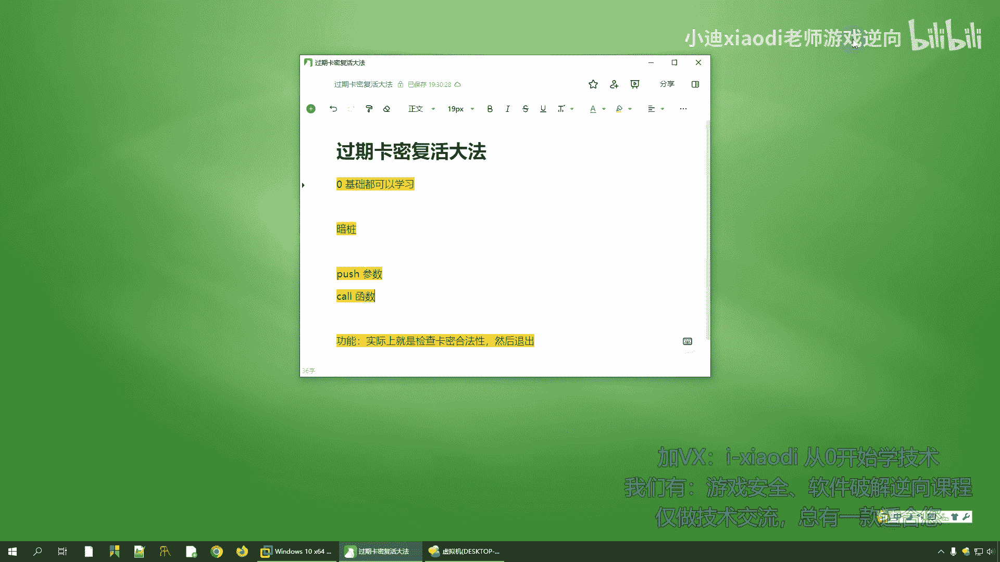

## 🧭 网络验证卡密软件逆向分析方法教学：01：课程概述与场景说明

我是小李老师。今天我们继续讲软件逆向破解。不少同学纳闷，讲逆向破解为什么有那么多人听，逆向破解能干什么。实际上，逆向破解可以分析一些小软件。

> 仅做技术交流。

例如，我们经常在网络上购买一些软件，这些软件可能带有卡密，比如天卡、月卡、日卡、周卡。卡密有一段期限。花钱购买并使用一段时间后，如果过期，再次登录时可能提示“卡密已过期，请联系管理员”。有同学比较调皮，不想联系管理员，想通过技术手段白嫖。这种想法从现实意义上不提倡，但做技术交流，这种求实求真的心态很好。今天来看过期卡密复活大法。这个技术零基础可以学习，没有问题。废话不多说，直接进入实战。

本节先把场景和目标讲清楚，核心概念可以先记成下面这个公式。


```
卡密有效 = 长度校验通过 && 期限校验通过
```

下面列出本次课程涉及的基本场景和学习目标。

- 常见卡密类型包括天卡、月卡、日卡、周卡，卡密本身存在使用期限。
- 过期后的典型提示是“卡密已过期，请联系管理员”。
- 本次技术目标是分析过期卡密复活方法，仅做技术交流。
- 学习门槛不高，零基础可以学习，跟着步骤了解基础即可。

以上就是课程背景和场景说明。上一节我们说明了卡密过期场景和本次目标，本节进入实战观察，先看软件效果，再定位关键字符串。

## 🧰 网络验证卡密软件逆向分析方法教学：02：软件效果观察与字符串定位

上一节我们介绍了课程背景和过期卡密场景，本节先看软件效果。软件卡密过期后，我只需要做一步操作，修改一些代码，然后点击登录，就可以直接登上。软件的所有配置信息都在里面，登录以及操作软件时都会读取这些内容，这就是软件能够正常登录并正常使用的体现。例如开启屏幕墙，但这个工具针对模拟器，具体怎么用我不太清楚，它是雷电模拟器用的一个工具。今天讲这个软件怎么分析，先关掉软件，把相关内容删掉，从头开始讲。

接下来先运行观察。首先要有卡密，这里讲一个场景：假如有过期卡密，找人借一个也行，自己买了卡密之后过期也行。点击登录，会提示卡密过期。此时用工具附加进程，点击符号切换到程序主模块。这个操作之前讲过，如果跟着视频看过，或者关注过我的粉丝朋友，应该都知道。然后鼠标右键搜索当前模块的字符串，在里面搜索“过期”。

下面列出从运行软件到定位关键字符串的基本操作步骤。

- 准备一个过期卡密，或者使用已经过期的卡密。
- 运行软件并点击登录，观察过期提示。
- 使用工具附加进程，点击符号切换到程序主模块。
- 鼠标右键搜索当前模块字符串，搜索“过期”。
- 查看搜索结果中的“卡密过期，请联系管理员”。

搜索操作可以用下面的代码形式表示。

```
搜索字符串：过期
命中内容：卡密过期，请联系管理员
```

这个位置就是过期提示所在的位置。接下来要判断谁跳转到这里开始执行。当前这里只是一个向下跳的过程，因此一定另有一个跳转跳到这个位置。查看谁跳到这里，可以右键查找引用，查看选中的地址。这个操作之前讲过。查看后没有找到直接引用。有同学可能觉得难度大，其实没关系，继续往上看。这里出现卡密过期，那里也出现卡密过期，再往上看，可以看到“验证失败，检查卡密位数”。这里是在检查卡密位数。如果卡密位数对上，例如卡密位数是30多位，填入三位肯定不行，所以真正的校验位置应该在卡密位数检查之后。可以类比去银行取钱，输入身份证号时，系统会先验证身份证号长度，这是正常的验证逻辑。

到这里已经定位到卡密位数检查这一层。上一节我们完成了字符串定位，本节继续围绕这条线索打断点、做单步跟踪，并定位第一处关键跳转。

## 🧩 网络验证卡密软件逆向分析方法教学：03：断点跟踪与第一处关键跳转定位

在卡密位数检查附近可以打一个断点，在这个位置打一个断点也可以。点击登录，程序断下来。此时是红色箭头，说明跳过去了，说明位数是对的。因为使用的是过期卡密，长度肯定没有问题。然后使用F8单步跟踪，逐步往下走。走到这里会发现一个跳转。这个跳转条件成立，跳转将要执行，按回车键查看目标，发现它会跳到“卡密过期”位置。因此这是第一处关键点，也就是第一处关键位置。这个关键位置会跳转到登录失败或过期提示位置，这是第一处。

下面列出跟踪第一处关键跳转的操作顺序。

- 在卡密位数检查附近打断点。
- 点击登录，让程序断下来。
- 观察红色箭头，判断卡密长度校验是否通过。
- 使用F8单步跟踪，逐步往下执行。
- 遇到条件成立的跳转时，按回车查看跳转目标。
- 确认目标为“卡密过期”提示位置，记录第一处关键跳转。

这一段的判断逻辑可以用下面的代码概括。

```
if (卡密长度 != 预期长度) {
    提示：验证失败，检查卡密位数
}

if (卡密已过期) {
    jmp 卡密过期，请联系管理员
}
```


第一处关键跳转已经明确。上一节我们定位了第一处关键跳转，本节继续处理程序中的暗桩和检查卡密合法性的关键函数。


## 🛠️ 网络验证卡密软件逆向分析方法教学：04：清除暗桩与关键函数

先运行程序。此时可以在二进制视图中用NOP把这段代码干掉。干掉之后在这里打一个断点。注意，这个程序有暗桩，这个暗桩很有意思，这个暗桩会导致程序退出。来看一下，点击登录，运行，程序断在这里，使用F8跟踪。走到这里时程序会闪退，地址419CA6处程序闪退。为什么闪退？因为卡密过期，所以程序不让正常登录，也就是这个意思。处理办法是把它干掉，把这个暗桩干掉。

找到那个位置。如果找不到，就从卡密过期提示往上翻。这里就是第一处跳转的位置，把它干掉，记住这一点。当时走到这里，程序就退出了。这里是call函数，函数上边是对应参数，push是参数，call是函数。基础都有讲，跟着学习慢慢了解基础就会了。push参数、call函数就是这里的结构。它会执行什么功能？实际上就是检查卡密合法性，然后退出，就是这样一个功能。只要把它的参数和函数全部干掉即可。

下面列出处理暗桩时需要用到的两个关键位置和对应动作。

- 第一处：卡密过期提示上方的关键跳转，定位后将其干掉。
- 第二处：检查卡密合法性并退出程序的call函数，连同上方push参数一起干掉。
- 操作方式：右键使用二进制NOP填充，把相关指令覆盖为空操作。


这里的函数结构可以用下面的代码表示。

```
push 参数
call 检查卡密合法性
退出程序
```


清除动作可以用下面的代码概括。

```
NOP 填充：跳转指令 / call 指令 -> 空操作
```


第二处在这里右键，用二进制NOP填充干掉。干掉之后成功。暗桩和关键函数已经处理，上一节我们清除了退出逻辑，本节验证过期卡密复活效果，并对课程内容做总结。

## ✅ 网络验证卡密软件逆向分析方法教学：05：过期卡密复活验证与课程总结

来试一下，把过期卡密放到这里，点击登录。之前下的断点没有关系，点击运行。可以看到可以了。这就是过期卡密复活大法。如果有一个过期卡密，可以使用这个方法。因为过期卡密的长度肯定是正确的，而且符合服务器的一些算法，所以比胡乱输入更好。当然这是常见情况，还有一些不寻常、不常见的情况。今天分享的内容就到这里。


下面的验证结果可以用公式概括。

```
过期卡密复活验证 = 关键跳转被跳过 && 暗桩退出逻辑被移除 && 登录流程继续执行
```

下面列出本节验证与后续学习要点。

- 验证方式：放入过期卡密，点击登录，观察是否进入软件。
- 成功表现：软件正常登录，并能读取配置、正常使用。
- 适用场景：常见过期卡密复活；不常见情况需要继续分析。
- 后续内容：混淆去除、特殊字符串干扰、内部视频深入讲解。
- 学习入口：想学习可以联系右下角。


如果想学习，可以联系右下角进行学习。如果想学习更深入的技术，例如这里会出现一种混淆，这种混淆怎么去除，怎么分析，有同学有疑问，想学习更深的技术。后面还会看到混淆，比如outSB骂你，“out”是滚出去的意思，“SB”都知道。如果想把这种干扰干掉，内部视频有讲解怎么干掉。它骂你，你需要跟它对着干。这就是今天的内容。想学习联系右下角，下集再见。



本节课中我们一起学习了过期卡密复活的分析流程：先说明卡密过期场景和仅做技术交流的边界，再运行软件观察过期提示，通过当前模块字符串搜索定位“卡密过期，请联系管理员”，继续向上找到卡密位数检查位置，打断点并用F8跟踪，定位第一处关键跳转，随后清除会导致程序退出的暗桩和检查卡密合法性的call函数，最后用过期卡密验证登录成功，并说明了常见情况、不常见情况以及混淆去除等后续学习方向。

