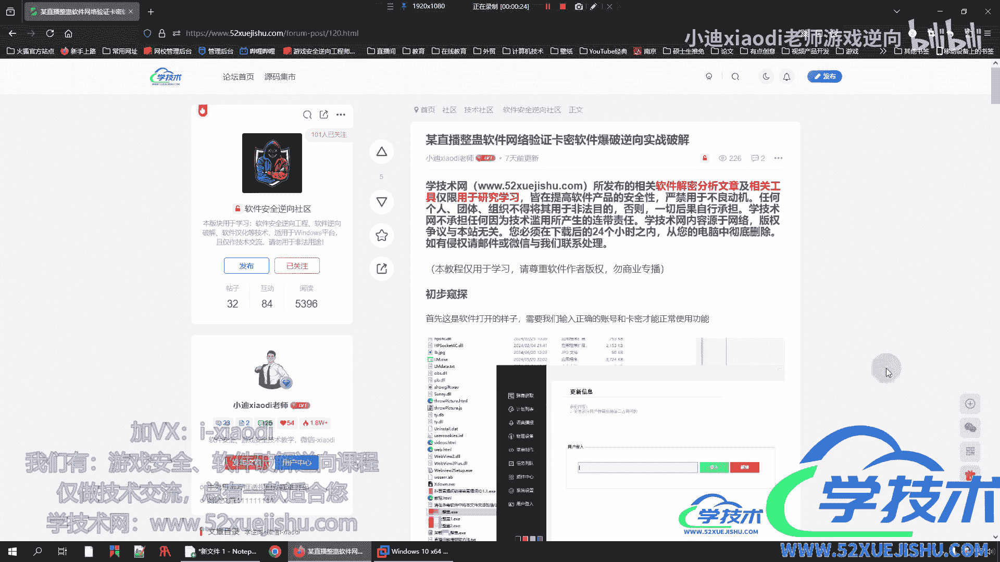
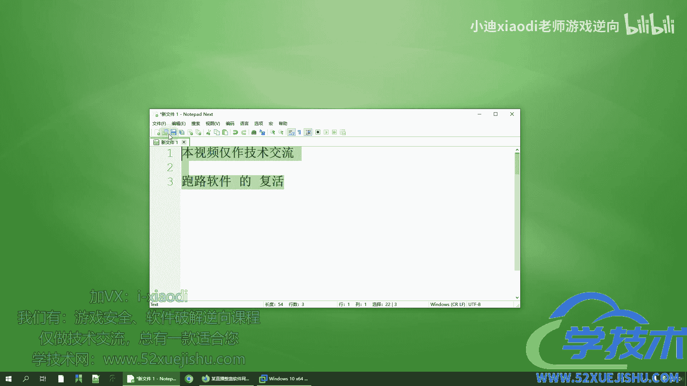

# 🧭 网络验证卡密软件逆向分析教程：01：课程概述与适用场景

在本节课中我们将要学习网络验证卡密软件在服务器跑路后的逆向分析思路，以及如何通过定位登录校验和关键阻塞调用，让本地功能恢复可用。大家好，我是小迪老师，今天我们继续讲软件逆向破解。很多同学会纳闷，讲逆向破解到底能干什么，这个疑问很正常，因为逆向分析本身是一个工具性很强的技术，关键要看用在什么场景里。

这里先看一个实际案例。前段时间社区成员买了一个软件，这个软件一开始可以正常使用，我们还写过一篇文章，教大家分析这个程序和软件，并实现登录层面的突破。最后测试时可以看到，软件完全正常，没有明显问题，可以正常使用。

但是这段时间软件跑路了。很多朋友可能都会碰到这种情况：自己买了一个软件，对方承诺永久更新、永久存活，结果突然有一天跑路，这时该怎么办。今天要用的就是这类场景下的分析技术。


> 郑重声明：本视频仅做技术交流。如果大家想学习相关内容，可以联系课程方。


在了解课程背景和适用场景后，本节我们来看看跑路软件具体会表现成什么样。


# 🔍 网络验证卡密软件逆向分析教程：02：跑路软件的现象与卡死原因




上一节我们介绍了课程背景和适用场景，本节我们来看看软件跑路后的具体现象。先看软件效果：这个软件要求输入卡密，其他所有功能在点击前都必须先登录。可是点击登录时，不管使用的是正版卡、盗版卡、过期卡还是未过期卡，现在都无法完成验证，因为服务器已经跑路，客户端已经连不上服务器。

服务器连不上之后，软件会卡住，出现未响应。这个软件本身是一款直播间互动软件，功能并不是完全不能运行，而是登录服务器失效后，客户端在等待服务器响应时被阻塞，最终导致界面卡死。

核心流程可以用下面的公式表示：

\[
客户端 \rightarrow 登录服务器 \rightarrow 卡密校验 \rightarrow 返回授权结果
\]

当服务器不可达时，就会出现下面的情况：


\[
服务器不可达 \Rightarrow 登录请求无法完成 \Rightarrow 界面卡死或未响应
\]

理解这个现象后，就能明白问题不一定出在本地功能本身，而可能出在登录验证和服务器通信这一段。接下来我们看看经过分析处理的软件是什么表现。

# ✅ 网络验证卡密软件逆向分析教程：03：分析后软件的正常表现

上一节我们分析了跑路软件卡死的原因，本节我们来看看分析处理后的软件表现。打开分析好的软件后，点击登录可以看到软件已经可以正常使用，界面会加载一些内容，功能也能正常进入。这说明软件的实际功能本身大概率是可以使用的，真正限制使用的地方在登录服务器，也就是服务器跑路后造成的验证阻塞。

换句话说，软件并不是所有代码都坏了，而是登录验证环节把后续功能挡住了。只要把登录流程中的关键阻塞点处理掉，本地功能就有机会恢复。下面进入实际操作，先定位登录入口和服务器连接逻辑。

# 🛠️ 网络验证卡密软件逆向分析教程：04：定位登录入口与服务器连接逻辑

上一节我们确认了分析后的软件可以正常使用，本节我们来看看如何定位登录入口。首先打开程序，再打开分析工具。工具列表里只有两个选项，按原文判断应该选择上面这个，另一个先不管。然后运行原文提到的“提V成空2”工具，并进行附加操作。

附加完成后，切换到程序主模块，这是课程中反复讲过的常规操作。程序肯定会连接服务器，这一点之前的文章里也讲过，因此可以先盲猜并寻找服务器连接相关部分。接下来向上翻代码，注意这个函数写得比较长，要翻到最开始登录的位置，再单步向下跟踪，这个过程需要耐心，不要着急。

找到登录函数头部后，可以看到登录相关代码从这里开始执行，课程中对这类流程有比较系统的讲解。此时在函数头下断点，再点击登录，程序断下来，说明这里就是登录代码入口。

以下是定位登录入口时的关键步骤：

- 打开程序和逆向分析工具，选择原文指定的工具。
- 附加目标进程，并切换到程序主模块。
- 向上翻到登录函数头部，在入口处设置断点。
- 点击登录触发断点，确认登录代码起点。

定位流程可以用下面的伪代码表示：

```text
附加进程
-> 切换到程序主模块
-> 定位登录函数头部
-> 设置断点
-> 点击登录触发断点
```

找到入口后，下一步就是单步跟踪登录校验流程，观察程序在什么地方阻塞。

# 🚶 网络验证卡密软件逆向分析教程：05：单步跟踪登录校验流程

上一节我们定位到了登录入口，本节我们来看看如何用 F8 单步跟踪登录校验流程。进入登录函数后，使用 F8 向下单步执行，一直按 F8 观察流程。如果出现 F8 直接退出的情况，说明那个位置存在异常或关键逻辑，需要放慢速度重新跟踪。

重新点击登录后，用 F8 一点点往下走，每一步都确认没有问题，再继续执行。跟踪过程中会看到程序生成 token 之类与登录相关的数据，继续往下会出现 soft、安全等字样，随后出现 card 卡密相关逻辑，再往后会出现日期相关判断，说明正在接近关键校验位置。

继续跟踪后，程序开始进行服务器连接，date 等服务器数据开始返回。此时会出现大量数据，说明程序准备把登录数据发送到服务器。当 F8 走到某个位置时，程序跑起来并卡死，这个位置非常关键，说明这里存在导致阻塞的调用。

以下是跟踪过程中可以关注的现象：

- 慢速 F8 单步执行，确认每一步都没有异常。
- 跟踪到生成 token 等登录数据的逻辑。
- 继续跟踪出现 soft、安全等字样，随后出现 card 卡密相关逻辑。
- 继续跟踪出现日期相关判断，说明接近关键校验位置。
- 随后开始建立服务器连接，date 等服务器数据开始返回。
- 大量数据出现，说明程序准备把登录数据发往服务器。
- 当 F8 走到某处时程序卡死，这个位置就是关键阻塞点。

跟踪过程可以概括为下面的流程：

```text
点击登录
-> 生成 token 等登录数据
-> 出现 card 卡密相关逻辑
-> 出现日期相关判断
-> 建立服务器连接
-> 接收 date 等返回数据
-> 准备发送登录数据
-> 走到关键调用后程序卡死
```

找到卡死位置后，就可以处理这个关键调用。接下来我们看看如何用 NOP 处理并保存补丁。

# 💥 网络验证卡密软件逆向分析教程：06：定位卡死调用并 NOP 处理

上一节我们通过单步跟踪找到了卡死位置，本节我们来看看如何处理这个关键函数。F8 走到卡死位置后，程序跑起来并卡死，这说明该函数存在问题。处理思路很简单，就是把它干掉，让这个位置不执行。

具体操作是在目标位置点击鼠标右键，选择二进制，用 NOP 填充，也就是原文说的“N 掉”。NOP 的含义是什么都不执行，处理之后这个位置什么都不做，程序就不会再因为这里卡死。处理完成后保存补丁，补丁名称可以写成“听云整某某整蛊666”。

核心处理思路可以用下面的公式表示：

\[
错误或阻塞调用 \rightarrow NOP \rightarrow 该调用不执行 \rightarrow 登录流程继续
\]

操作步骤可以用下面的伪代码表示：

```text
在目标调用处右键
-> 选择二进制
-> 用 NOP 填充
-> 保存补丁
-> 关闭程序并重新运行
```

保存补丁后关闭程序，再重新运行，接下来验证登录和功能是否恢复正常。

# 🧪 网络验证卡密软件逆向分析教程：07：打补丁后的功能验证

上一节我们完成了 NOP 处理和补丁保存，本节我们来看看补丁后的功能验证。重新运行程序后，可以看到程序已经开始连接服务器。此时点击登录，登录可以完成，软件进入可用状态。物理设备、任务队列、拆单制作等功能都正常，系统设置、弹幕获取、语音播报也可以正常开启，保存设置同样可以正常保存。

以下是补丁后的验证项：

- 点击登录，确认登录流程不再卡死。
- 检查物理设备、任务队列、拆单制作是否正常。
- 检查系统设置、弹幕获取、语音播报是否可以开启。
- 检查保存设置是否可以正常保存。

验证通过后，说明本次处理达到了预期效果。最后我们对整节课程做一个小结。

# 📌 网络验证卡密软件逆向分析教程：08：课程总结与风险提示


上一节我们完成了补丁后的功能验证，本节我们对今天的内容做总结。今天讨论的问题是软件可不可以复活，答案是可以复活，但有一定概率，并不是所有跑路软件都能恢复。能否恢复，取决于登录逻辑是否可以定位、关键阻塞点是否可以修补，以及本地功能是否不依赖服务器。

可以用下面的公式概括：

\[
跑路软件复活成功率 = 登录逻辑可定位 + 关键阻塞点可修补 + 本地功能不依赖服务器
\]



本节课中我们一起学习了跑路软件的现象、登录入口定位、F8 单步跟踪、卡死调用处理、NOP 补丁以及补丁后的功能验证。如果大家想学习相关内容，欢迎加入课程交流。本期内容到此结束，下期再见。

