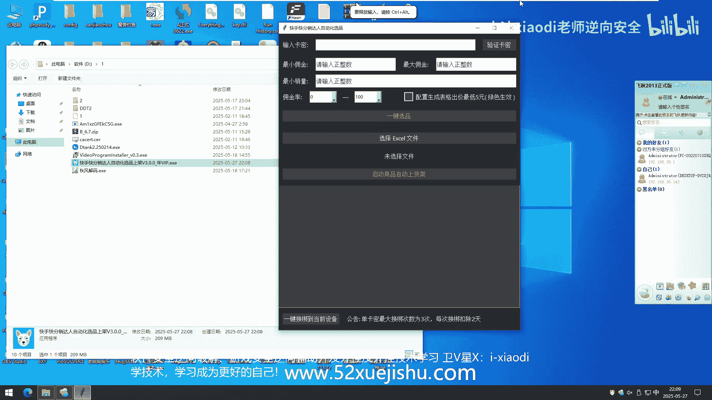

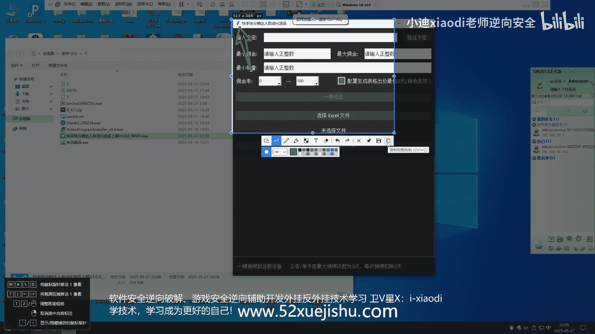

# 📦 网络验证卡密软件逆向：1：识别Python打包程序

在本节中，我们先来解决一个最基础的问题：拿到一个软件，如何判断它是不是 Python 写的。这非常重要，因为 Python 打包的软件和普通的 C/C++ 程序在分析思路上完全不同。如果一开始判断错了，后面所有工作都会白费。我们这一整节课都会围绕一个由 Python 打包的网络验证卡密软件展开，按照实际逆向流程逐步讲解。


首先，看图标。当你看到目标软件的图标时，如果发现它是那种典型的 `tkinter`（或者是 PyQt）风格的图标，那么你就要有心理准备了：这很可能是一个 Python 程序。Python 的 GUI 库就那么几个，其中 `tkinter` 是最常见的，用 `tkinter` 生成出来的窗口图标往往都长得很像。当然，图标只是一个初步猜测，我们不能光靠这个就下结论。


为了进一步印证，我们需要打开自己的工具包。工具箱里通常会有 PE 查看工具，例如 `Exeinfo PE`。把 exe 文件直接拖进去，等待分析结果。当你在结果中看到 `PyInstaller` 字样，并且后面还有 `support Python` 之类的提示时，就可以百分之百确定：这就是一个 Python 程序。


这里我们还可以把结论用一行伪代码表达出来：


```python
# 检测结果 = 图标特征 + PyInstaller 特征
# 如果检测到 PyInstaller，则程序为 Python 打包程序
is_python = "PyInstaller" in pe_info
```


为什么我们能确定呢？因为 `PyInstaller` 是一个打包器，它的作用就是把 Python 代码打包成一个 exe 文件。换句话说，你看到的这个 exe，本质上是一个 Python 解释器加上一堆 Python 代码的混合体。所以，直接使用 `x64dbg` 或 `OD` 去调试，效果会非常差。因为这个程序是虚拟机架构，你在反汇编窗口里看到的指令全是虚拟指令，全是假的，根本不是程序本身的代码。你要是想通过下断点来跟踪，基本上行不通。

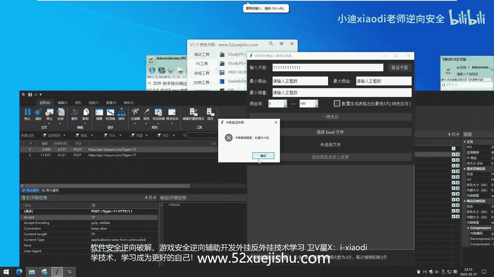

既然常规方法不行，那我们要换一个思路。在下一节中，我们就从网络验证这个角度入手，看看这个软件到底在做什么。

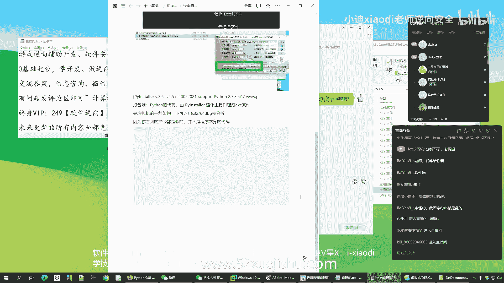

# 🕵️ 网络验证卡密软件逆向：2：分析网络验证：HTTP抓包

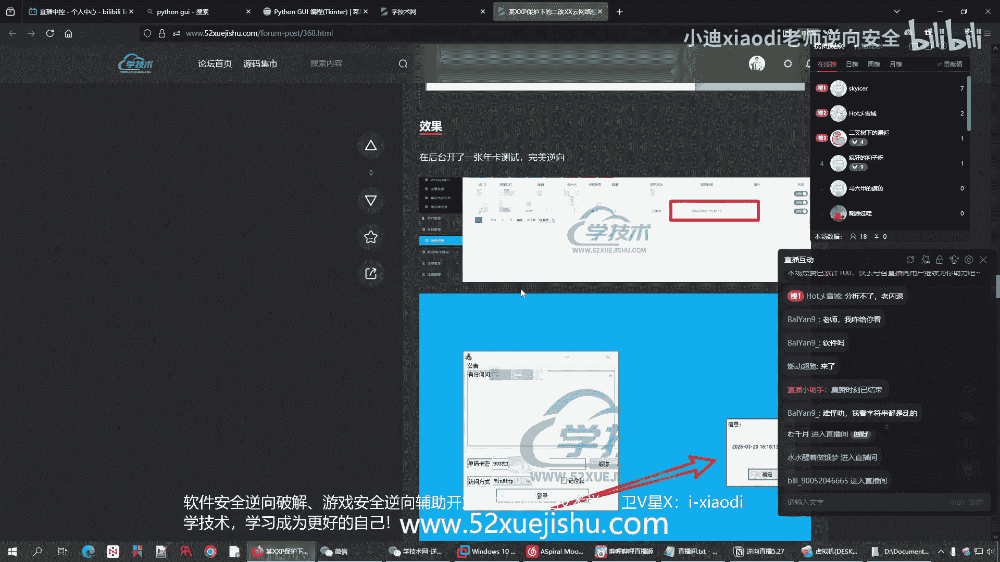

我们来分析一下这个程序是不是网络验证程序。虽然它可能是，也可能不是，但我们可以通过测试来确认。最常见的网络验证就是 HTTP 协议，所以我们用 HTTP 抓包工具来拦截它的流量。怎么测试呢？很简单，随便输入一个卡密，然后点击“验证卡密”按钮。

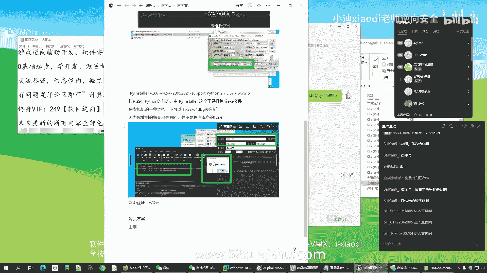

当你点击之后，抓包工具里立刻就会多出一些访问记录。比如在这个例子中，我们发现它访问了一个叫“文心云”的地址。看到没有？访问链接已经出来了。这个“文心云”是很多人都在用的一个网络验证平台。只要我们一输入卡密，软件就会向“文心云”发一个请求。这就说明，它确实是一个网络验证软件，而且验证服务商是“文心云”。


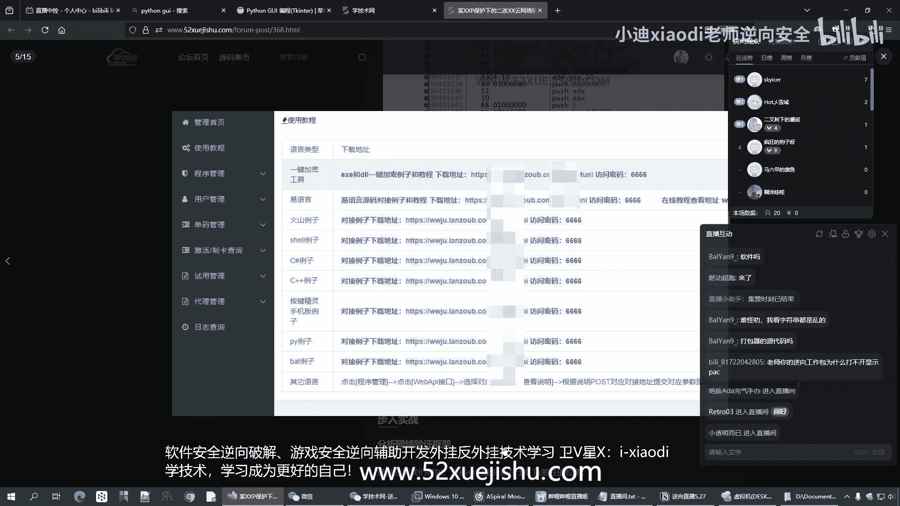

这里我们可以把它的行为描述成下面的流程：

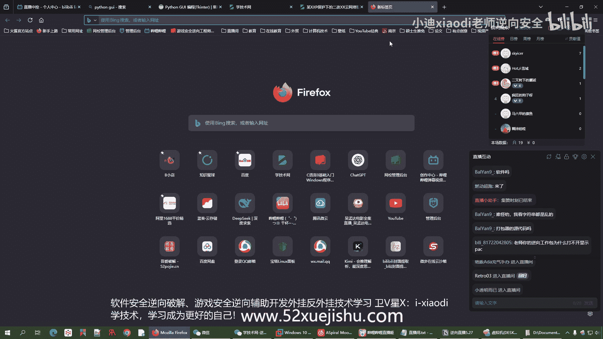

```text
用户输入卡密 -> 软件将卡密信息加密组包 -> 通过 HTTP 发送到文心云服务器 -> 等待服务器返回结果
```

关于“文心云”这个平台到底怎么搞定，我们论坛的精华帖里有参考资料。常见的方法就是“山寨”，也就是自己搭一套类似的验证服务，然后把软件的验证地址指向你本地或者你自己的服务器。不过，要实现“山寨”，你需要知道软件是怎么跟“文心云”对接的，所以需要去官网下载示例代码，看看它的 Python 打包到底是怎么写的。如果你没有 Python 基础，那就先去学一下 Python，否则你连人家的源代码都看不懂。


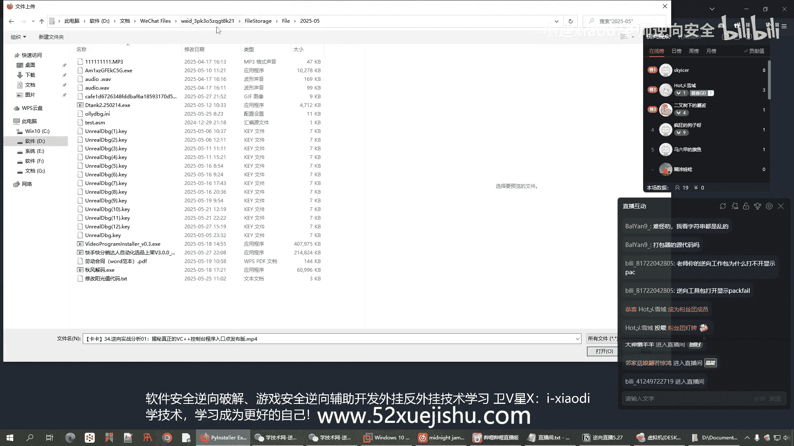

接下来，我们正式介绍两种大家最常用的解决问题方案。第一是山寨，第二是解包。这两种方法可以单独使用，也可以配合使用，下面我们分别来看一看。

# 🛠️ 网络验证卡密软件逆向：3：解决方案一：山寨

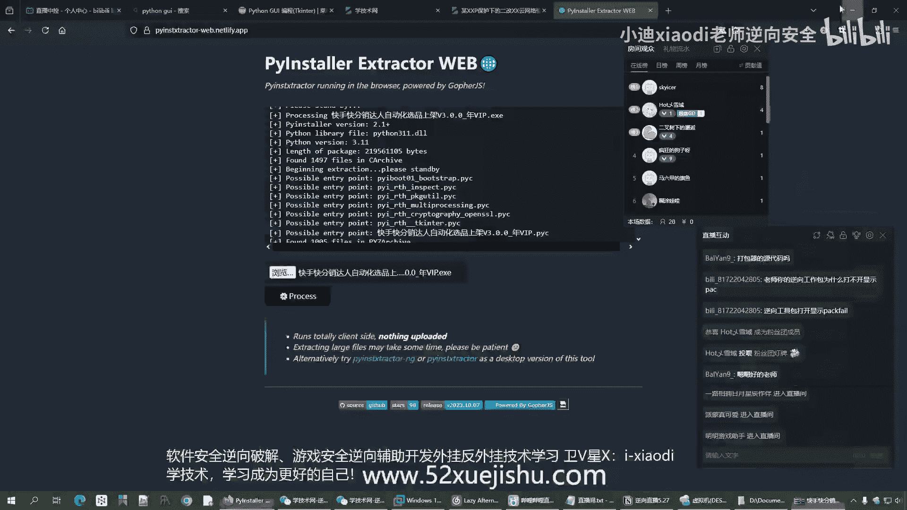

“山寨”这个思路其实很简单：既然软件要连服务器验证，那我就把这个服务器替换成我的。可是怎么替换呢？首先你要把软件里对应的平台信息和登录凭证换成你自己的。例如，“文心云”这种网络验证平台都会给每个开发者分配一个软件 ID，你在后台创建软件的时候就能拿到这个 ID。软件内部必然存着这个 ID，用来标识自己属于哪个软件。所以山寨的关键就是把这个 ID 换成你的。

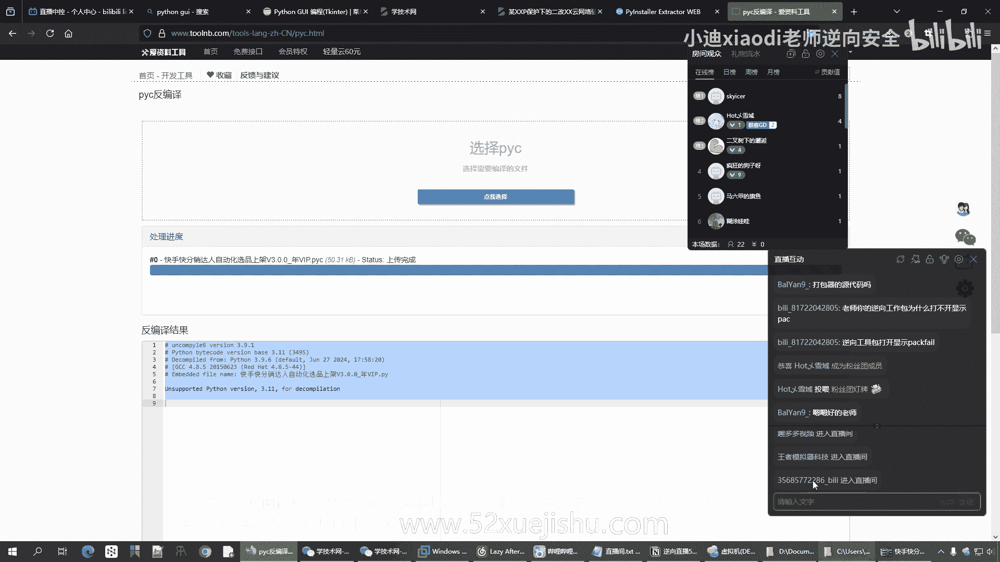

不过，前提是你得先把软件内部的信息揪出来。你需要去官网下载人家提供的对接例子，好好研究一下它的源代码。研究的时候，你可能会看到类似下面的伪代码：

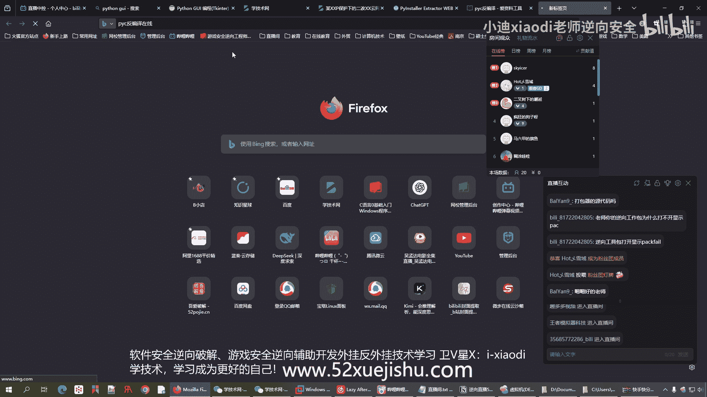

```python
# 官方示例代码中的软件 ID
soft_id = "官方软件ID"
# 如果这里换成你自己的 ID，整个请求就会发到你的服务器
soft_id = "你自己的ID"
```

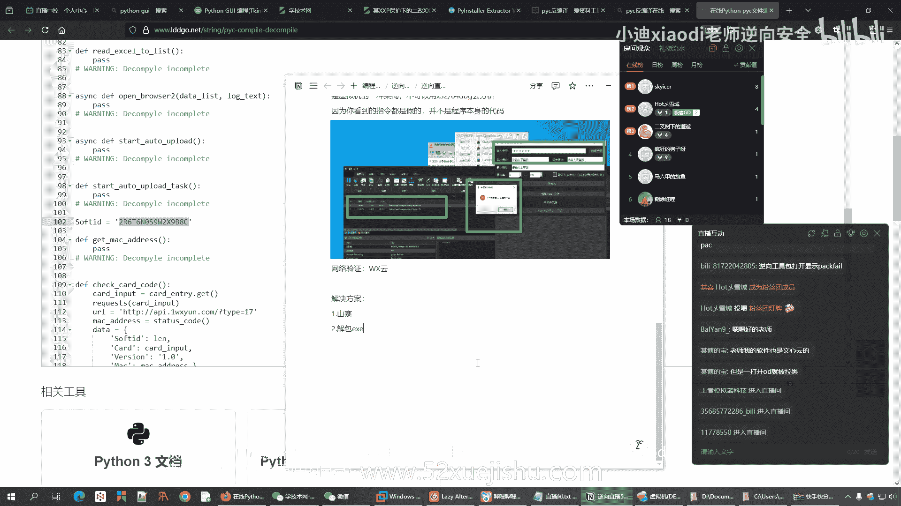

把代码里所有的相关标识都换掉，然后重新打包，你的“山寨版”就出来了。这听起来很简单，但实际操作时需要你能够看懂 Python 代码。要是你连 Python 的基础都没有，那这个事情基本上就是寸步难行。所以不要怕花时间，先补基础，再动手。

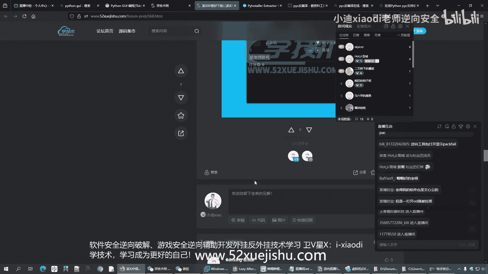


当然，光靠手动看代码可能还不够。有时候我们需要直接把软件的源代码扒出来，这就是第二种方法：Python 解包。

# 🔧 网络验证卡密软件逆向：4：解决方案二：Python解包与反编译

Python 解包，就是把打包好的 exe 里面真正的 Python 字节码文件（PYC）提取出来，然后再进行反编译。这样一来，我们就能直接看到源代码级别的信息，而不需要在反汇编窗口里去面对一堆虚拟指令。

具体做法是：找一个在线的解包工具，上传 exe，等待工具把内部文件解开。解包完成后，你会看到里面有几个 `.pyc` 文件。这些文件就是 Python 的编译结果。拿到 PYC 之后，还要继续进行反编译。你可以把 PYC 文件拖到在线反编译工具里，或者使用本地工具。反编译成功后，你就能看到一些关键信息，例如某个函数的名字，甚至直接看到网络验证平台的标识字段。

比如在这个案例中，反编译结果里出现了一个 `soft ID` 字段，还出现了类似 `get_in_time` 这样的函数名，这些都能帮助我们定位到验证逻辑的位置。下面是一个简单的示例：

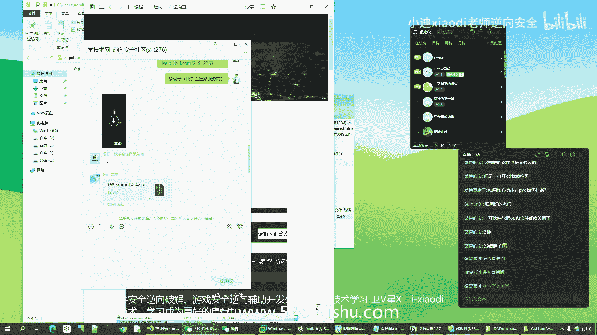

```python
# 反编译后看到的软件信息
soft_id = "xxxxxxxx"
# 这个 ID 就是你要替换成自己 ID 的位置
```


你看，只要把 `softID` 替换成你自己的 ID，然后重新打包，这就是一种非常有效的山寨方式。实际操作中，我们经常把“山寨”和“解包”结合起来。先用解包和反编译拿到源码，再对照官网示例，找出所有需要替换的地方，最后一步到位。

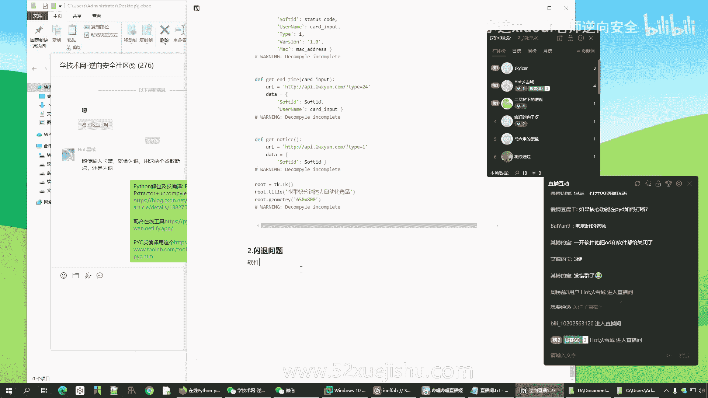

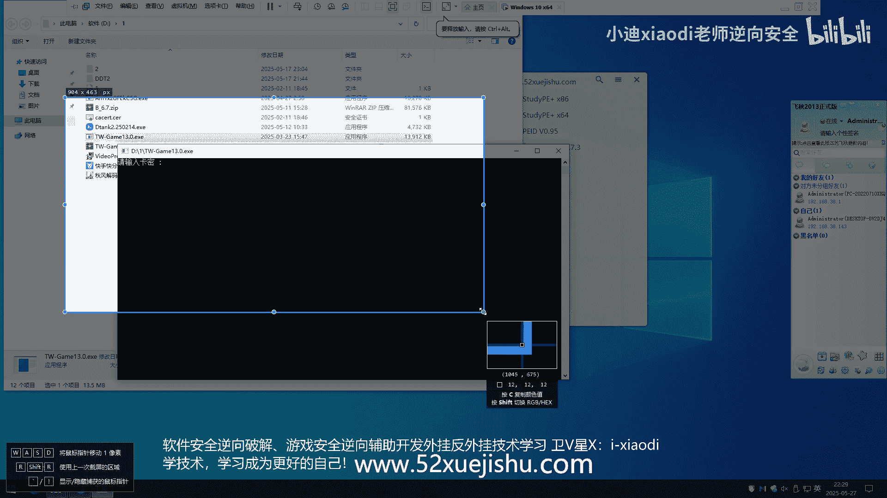

不过，有一点要提醒大家：如果核心功能不在 PYC 里，而是在一个 `.pyd` 文件里，那打断点分析就会非常困难。`.pyd` 是 Python 的 C 扩展模块，相当于一个 DLL，里面是原生代码，调试难度会大很多。这里暂时没有特别好的办法，等想起来什么好方法再分享到群里。


好，关于主要解决方案我们就讲到这里。接下来，我们看一个实际案例：一个 VMP 加壳程序出现闪退问题，我们应该怎么入手？


# 🐛 网络验证卡密软件逆向：5：实战案例：VMP加壳闪退程序分析


现在我们来分析一个更棘手的问题。有同学反应，他拿到一个软件，随便输入卡密就会闪退，用下断点的方式还是闪退。我们来看看这是怎么回事。首先，查一下壳，发现这是一个新版本的 VMP 壳。注意，VMP 是虚拟机保护，它会把很多代码转换成虚拟指令，分析起来比较麻烦。


我们先运行一下这个程序，输入卡密然后回车，发现登录失败，紧接着就退出。这显然是程序检测到卡密错误后直接退出了。那么如果我们想在关键时刻让它中断下来，该怎么办呢？你要明白软件行为。具体来分析：当你输入卡密时，软件会不会发送一个数据包？肯定会。它的流程是：输入卡密，然后软件把卡密信息进行加密，组包（也就是组成一个网络数据包），再发送到服务器。网络数据包通常是加密的，不可能明文传输，服务器处理后再返回加密的响应，软件收到响应后进行最终结果判断。

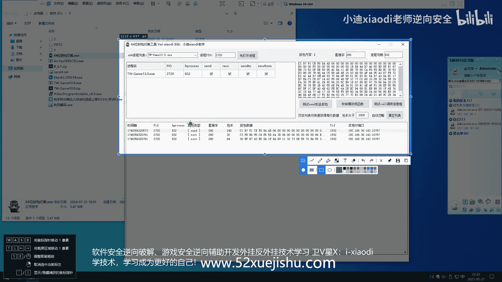

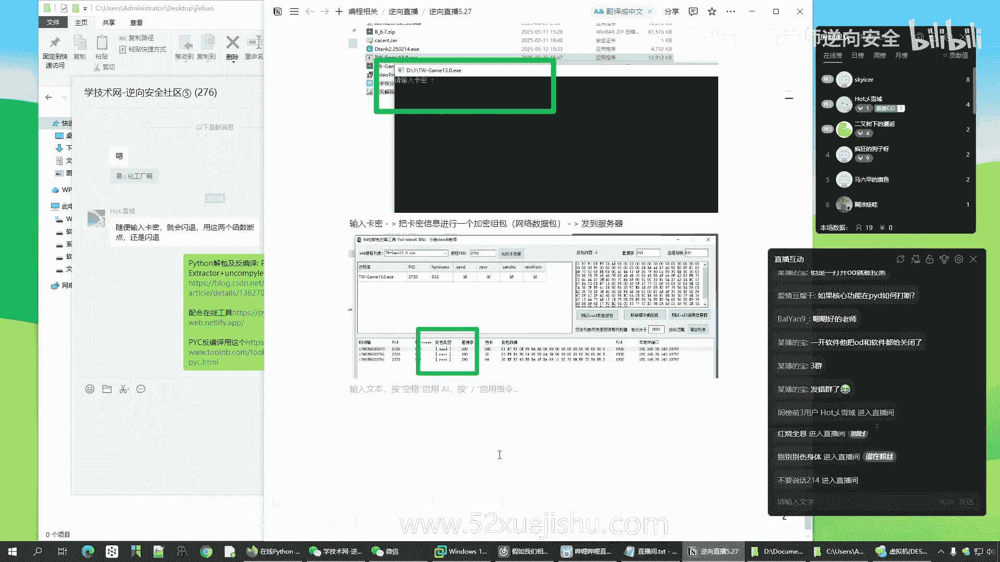

这个完整流程可以写成：


```text
输入卡密 -> 加密 -> 组包 -> send() 发送 -> 服务器 -> recv() 接收 -> 解密 -> 判断
```


既然有这个流程，那我们就应该根据软件行为来下断点。它是个 64 位程序，所以我们可以用 64 位封包拦截工具。把工具运行起来，然后启动软件，随便输入卡密，看看能不能截到数据包。拦截结果显示，数据包已经是加密的了，不是明文。这说明什么？说明它用到了 `send` 和 `recv` 这两个函数。所以我们可以在这两个函数上下断点。

实际操作时，我们打开调试器，用“附加”的方式把软件附加进来，然后在 `recv` 函数上下断点，再输入卡密。这时候你会发现，软件停在断点上了。停住之后，我们就开始回溯分析，看看这个软件的防护强度到底怎么样。一开始的几层跳转都很清晰，没有明显的混淆，这让人心里踏实了一些。我们还可以搜索字符串，看看它调用了什么接口。搜索结果里有 HTTP 之类的字样，说明它很可能是 HTTP 协议，甚至有可能是开发者自己写的网络验证。如果是自写验证，那分析难度会比较大，因为你不知道它的协议细节。

继续往前走，再往后进入关键层之后，情况就不对了。代码开始出现大量混淆，全是虚拟机的指令，到这一步就没有必要再分析了。因为真正的加解密逻辑都放在虚拟指令里，你看不到也调不动。除非你有一个正版卡，然后去分析它和服务器之间的封包，看看有没有可以利用的关键词。如果那些关键判断是在混淆层之前完成的，那你还有机会；如果所有敏感操作都在混淆层里，那就没有机会了。


所以最终结论就是：分析这种加壳程序，一定要先搞清楚软件行为，然后根据行为去找对应的函数下断点。例如它发包，你就在 `send` 或 `recv` 上下断；它对文件操作敏感，你就监控文件 API。总之，不要一头扎进反汇编代码里瞎转，先看行为，再下断点。

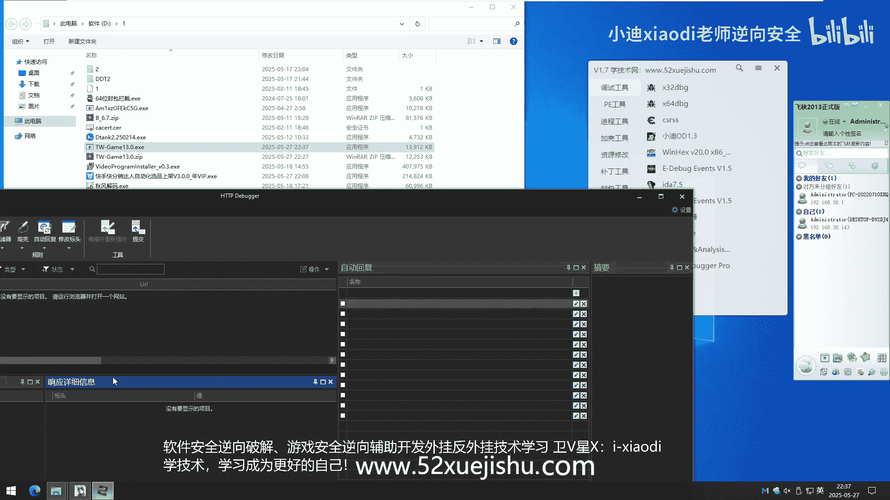


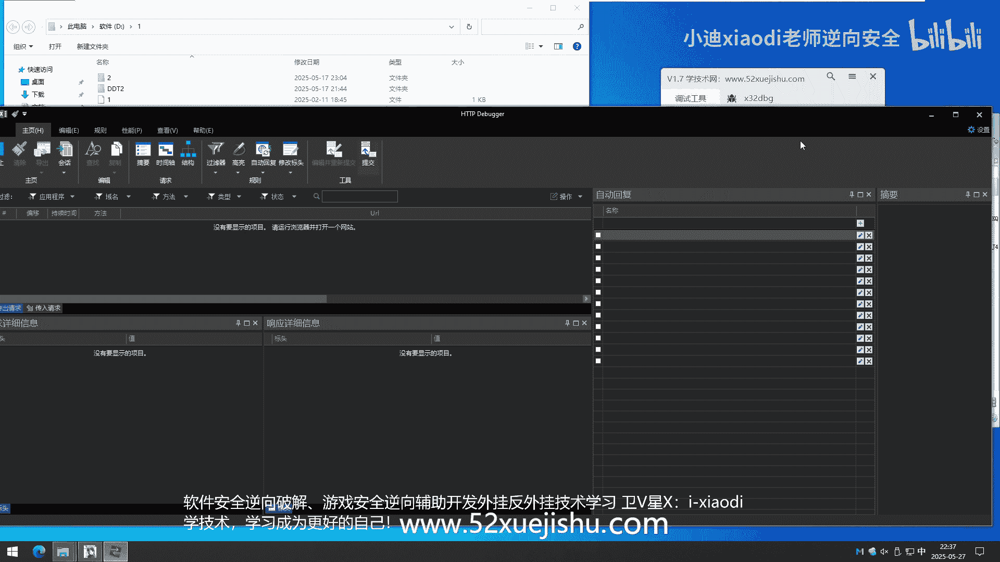

# 🎓 网络验证卡密软件逆向：总结

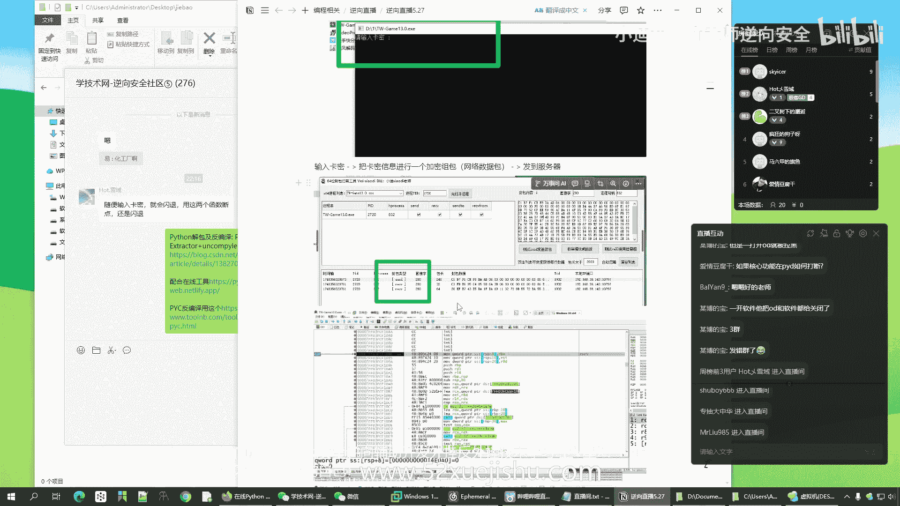

本节课中，我们一起学习了网络验证卡密软件逆向的基本思路。我们首先学会了通过图标和 `PyInstaller` 特征来识别 Python 打包程序；然后介绍了通过 HTTP 抓包确认网络验证服务商的方法；接着详细讲解了两种解决方案：山寨和 Python 解包反编译；最后用 VMP 加壳闪退程序作为案例，演示了如何根据软件行为在 `send`/`recv` 函数上下断点进行分析。这些方法可以组合使用，也是大多数同类软件逆向的核心思路。希望这节课能让你对网络验证软件的分析框架有一个清晰的认识，以后拿到相关程序不再畏惧。

