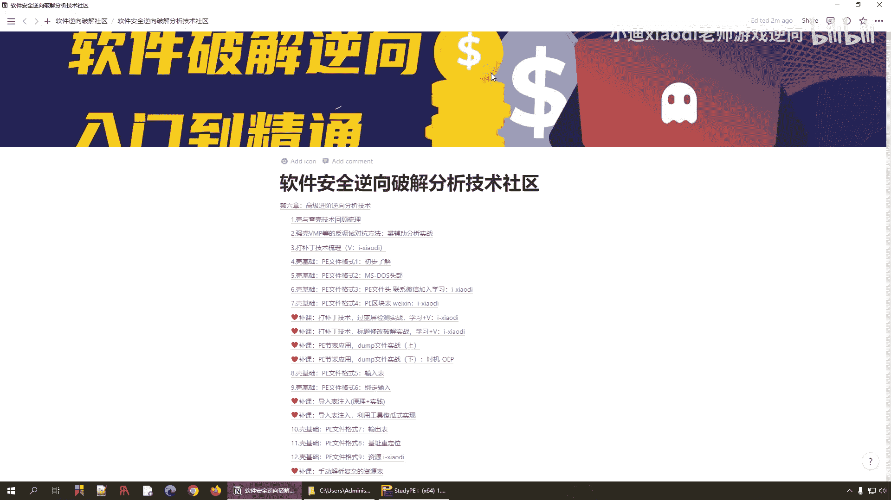
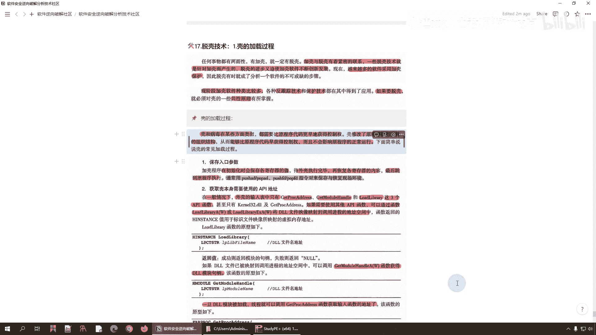
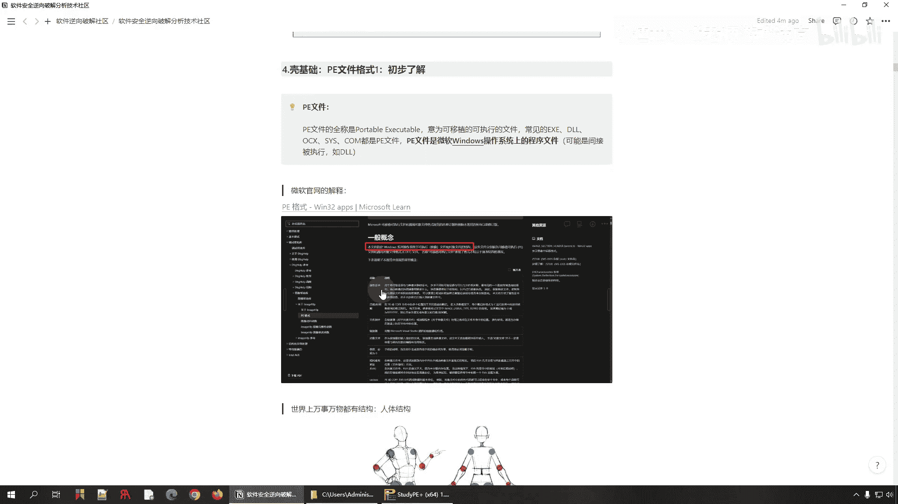
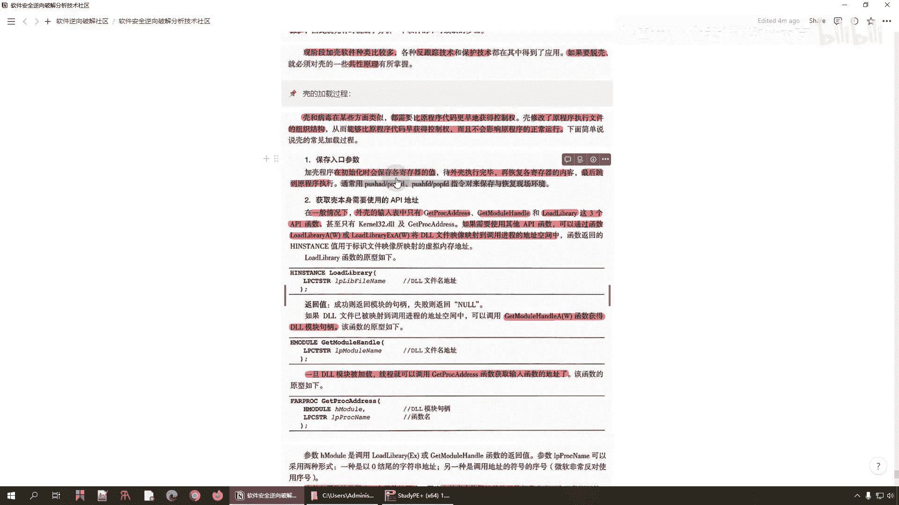
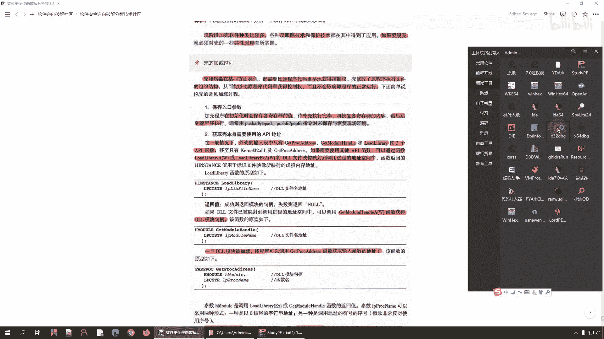
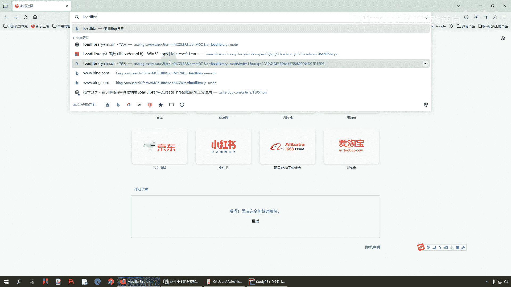
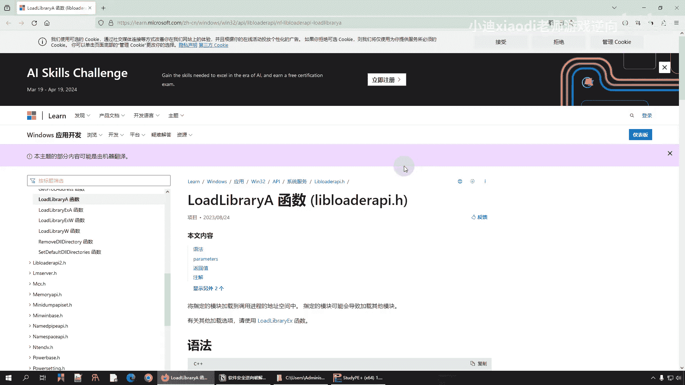
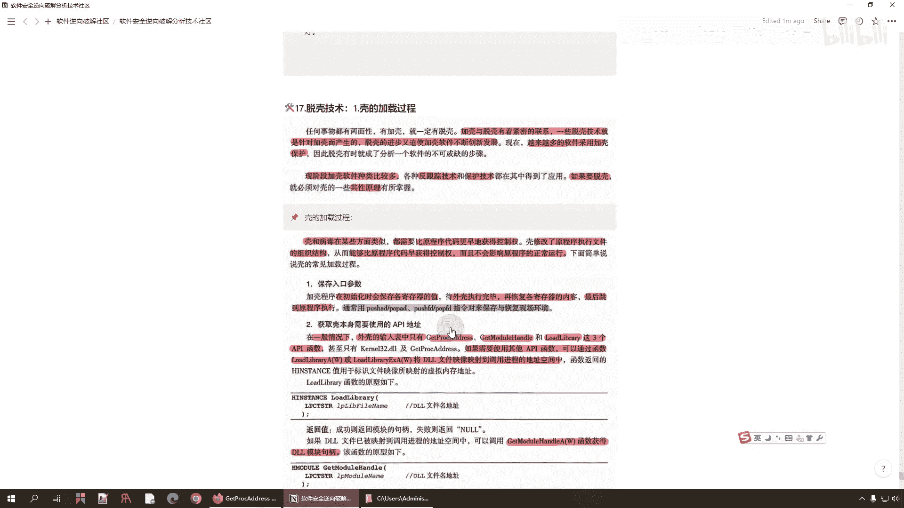

# 🔧 脱壳技术：1：壳的加载过程

大家好，我是小林老师。学习软件安全逆向破解，就讲小林老师。今天是我们第六章高级进阶逆向分析技术的第十七课：壳的加载过程。从今天开始，我们正式讲解怎么去脱壳。

这节课我们先讲一些理论性的知识。加壳与脱壳有着紧密的联系——一些脱壳技术是针对加壳产生的，而脱壳的进步又迫使加壳软件不断创新发展。这些话说起来有点像官话，但事实就是如此。现在越来越多的软件采用加壳保护，同时加壳软件的种类比较多，各种反跟踪技术和保护技术也都得到了充分的应用。如果我们要脱壳，就必须先掌握壳的一些共性原理。今天实际讲解的就是壳的共性原理之一：壳的加载流程。这个流程内容比较多，我们待会儿一个一个讲解，最后再给大家归纳一下，实际上可以分为六步。

在讲加载流程之前，先理解壳的本质。壳和病毒在某些方面类似，都需要比原程序代码更早地获得控制权。也就是说，壳是夹在程序上面的，它运行的时候肯定是壳先跑起来，然后它才能保护你。就像上战场穿防弹衣，谁先挨枪子儿？肯定是防弹衣先挨枪子儿，肯定不是你。所以壳一定比原程序的代码更早执行。壳修改了原程序执行文件的组织结构，从而能够比原程序代码更早获得控制权，而且不会影响原程序的正常运行。

这里有个问题：壳修改原程序执行文件的组织结构，是通过怎样的规则？为什么它能够这样修改呢？我们思考五秒钟。答案就是 PE 文件格式。因为这个程序遵循一定的 PE 文件格式，就像人的身体结构一样，我们可以移植肾脏、移植各种器官，因为结构是固定的。程序也有这样一个架构，我们只需要遵循这个架构，不越过它的规则，在它的规则里边进行相应操作就可以了。这样程序还是可以正常跑起来的。

举个例子，比如压缩。如果把一个程序进行压缩，可以先把它压得很小，所有数据紧密地联系在一起，把里面所有的空隙全部抹掉。当程序运行的时候，再按照 PE 文件结构的格式给它展开，重新写回文件，这不就是一个压缩壳吗？这就是压缩壳的原理。

下面我们正式看一下壳的加载过程。

## 第一步：保存入口参数

加壳程序在初始化时会保存各寄存器的值，等待外壳执行完毕之后，再恢复寄存器的内容，最后跳转到原程序执行。注意，寄存器的值非常重要。

在程序刚开始运行的时候，寄存器里的数据是极其重要的。寄存器扮演什么角色呢？我们可以随便打开一个程序来回顾一下。程序跑起来的时候，你会发现 EAX、EBX、ECX、EDX、ESI、EDI 这些寄存器都指向非常重要的数据。如果某个数据被更改了，比如把它们全部清零，我们看一下程序还能不能正常执行。全部改成 0 之后运行，你会看到程序直接异常了。也就是说，程序刚开始运行时，寄存器的值实际上是初始化程序的环境。如果把它清掉或者搞错，程序就根本跑不起来。所以最开始保存各寄存器的值非常有必要。

那么具体流程就是：先保存原程序运行时的寄存器值，然后让外壳加载；外壳加载完了，再把原程序的寄存器值恢复，这样原程序就可以正常运行了。最后跳到原程序执行。

通常用什么指令来保存和恢复现场环境呢？保存寄存器值又叫保存现场环境，或者上下文环境。通常用 `pushad` / `popad` 和 `pushfd` / `popfd`。这些指令我们之前都讲过，这里简单提一下。

## 第二步：获取壳本身需要使用的 API 地址

我们都知道，Windows 上的程序都需要调用 Windows API。Windows API 是微软提供给开发人员的应用程序编程接口，只有用了这些接口，才能调用函数、删除文件、操作各种内存，比如 `WriteProcessMemory`、`ReadProcessMemory` 等等，这些我们之前都讲过。壳本身如果需要使用一些 API，同样需要先加载，然后才能调用。

在一般情况下，外壳的输入表中只有 `GetProcAddress`、`GetModuleHandle` 和 `LoadLibrary` 这三个函数，甚至有的外壳只有 `GetProcAddress` 和 `LoadLibrary`。我们来看一个例子。这里有一个加壳的程序，区段有 UPS0、UPS1，这是一个 UPS 壳。看一下它的导入表，函数非常少。再看原程序的导入表，发现它依赖了很多函数。加了外壳之后，用 PE 工具检测到的只是外壳用了哪些东西。外壳的导入表是给自己用的，所以它就用这么几个函数。

如果外壳需要用其他 API 函数怎么办呢？它通过 `LoadLibrary` 这个函数，将待加载的文件映射到调用进程的地址空间里。我们来看一下 `LoadLibrary` 的文档。`LoadLibrary` 的作用是将指定的模块加载到调用进程的地址空间，也就是把动态链接库（比如 Kernel32.dll）加载进去，然后获取到一个模块的句柄。通过这个句柄，可以在 `GetProcAddress` 中获取带函数名的函数地址。在内存中有了地址不就可以调用了吗？直接 call 一下就可以了。用 `GetProcAddress` 把 `LoadLibraryA` 获取到的句柄填进去，再把函数名填进去，返回值就是函数的地址，然后直接 call 这个地址，函数就被调用上了。

这个设计非常精巧，充分隐藏了自己。也就是说，壳在导入表里把自己的目的全部隐藏起来了，想要调用的时候是隐藏调用的。这种东能不能抓到呢？可以抓到一点。因为一旦它要调用某个函数，就需要填入函数名，而函数名是一个字符串。所以如果我们用一些字符串查看工具去查看加壳程序的字符串，有可能能够看到它的函数名，从而知道它到底在用哪些函数。这第二步的核心目的就是提高函数调用的隐蔽性。

## 第三步：解密原程序各个区块的数据

我们来观察一下，这是一个加壳的程序，再看一个不加壳的程序。不加壳的程序区段有代码段、只读数据段、数据段和资源段。而加壳的程序只有两个区段。如果程序要正常运行，就必须保证原程序的正常执行，所以壳要把原来的区块按照原来的架构和格式放在内存中合适的位置，先解密回去，然后放回内存。这就是解密原程序各个区块数据的步骤。

## 第四步：IAT 的初始化

我们之前说过，IAT 是程序运行起来之后最重要的输入表，输入表就是给自己用的。这里说的是输入地址表（Import Address Table）。总结一句话：程序运行起来之后，一般最重要的只有 IAT。为什么？因为程序要正常执行，需要用到很多 API 函数，如果这个表格对不上，函数名单对不上，程序就跑不起来。所以 IAT 的初始化非常重要。

## 第五步：重定位项的处理

EXE 文件不需要重定位，所以有些加壳软件会直接删除原程序文件中用于保存重定位信息的区块，这样可以让文件更加小巧。但如果是 DLL 文件，情况就不一样了。之前我们说过，DLL 文件每次运行都不能保证提供相同的基地址，所以它是需要重定位的。如果给一个 DLL 加壳，壳就需要给这个 DLL 多做一个操作，多修正一个重定位表。总之，DLL 需要重定位，EXE 不需要。

## 第六步：Hook API

这一步我们简单说一下。Windows 程序需要调用 Windows API，壳在这里做了一件事。比如程序现在要定位 Windows API，正常情况下会直接调用。但加了壳之后，它不是直接调用，而是先跳到壳的自写代码，等到自写代码执行完毕，再跳转到 Windows API 的调用上。也就是说，壳会在 Windows API 上做一个手脚，从而可以直接获得程序的控制权。更准确地说，是间接获得程序的控制权。这里简单了解一下即可。

## 第七步：跳到程序的原入口点（OEP）

到了这一步，壳就把控制权还给原程序了。一般的壳在这里会有一条明显的分界线。现在越来越多的加密壳会先把入口的代码段搬到外壳的地址空间里，然后再将原来的代码清除，这种技术称为 stolen bytes。这样分界线就消失了，脱壳的难度也就增加了。

说了这么多，其实关键点并不是很多，并没有想象中那么复杂。我们做一下总结。

## 总结

壳代码的基本流程分这么六步：

1. 保存寄存器环境。使用 `pushad` / `popad`，`pushfd` / `popfd`。
2. 获取 API 函数地址，加载一些必要的 API。壳运行在 Windows 操作系统上，肯定需要依赖一些 API。
3. 解密代码和数据。
4. 填充 IAT。
5. 修复重定位。
6. 恢复寄存器环境。

我们最后再简单看一眼实际操作。用 OD 加载一个加了壳的原程序，可以看到程序入口处有一个 `pushad`。`pushad` 是保存寄存器环境，`push` 是压入，`pop` 是弹出。当你看到 `popad` 的时候，就说明这个壳基本加载完成了。我们可以简单单步看一下，看到 `pushad` 之后继续单步，尝试找 `popad`。但这个版本比较多，纯单步很费劲，因为跳转太多，手动找很难找到。我们需要依赖自动化的方法去找，后面会讲如何自动化寻找。这里大家知道：刚才看到 `pushad`，只需要找到 `popad` 的时候，就说明壳加载完成，控制权就还给原程序了。到了 `popad` 之后，就可以开始脱壳了。

本节课中，我们一起学习了壳的加载过程。先理解了壳为什么能比原程序先运行，再掌握了 PE 文件格式是壳修改程序结构的基础。然后详细讲解了壳加载的七个具体步骤，最后归纳为六个核心流程：保存环境、获取 API、解密数据、填充 IAT、修复重定位、恢复环境。这些知识是脱壳技术的基础，后续我们将继续学习如何实际脱壳。下节课再见。

