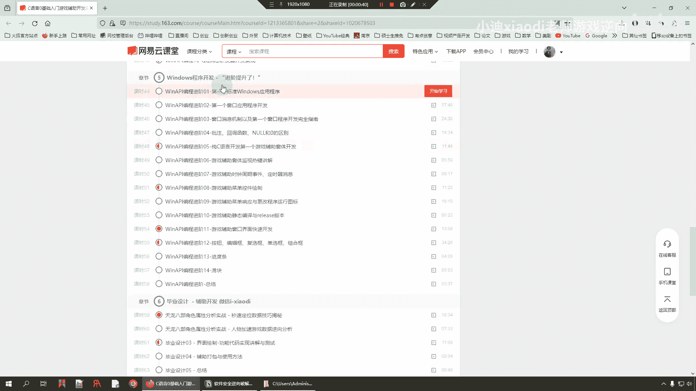
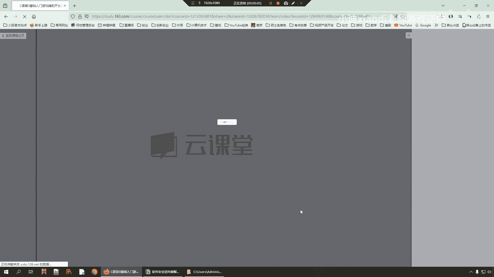
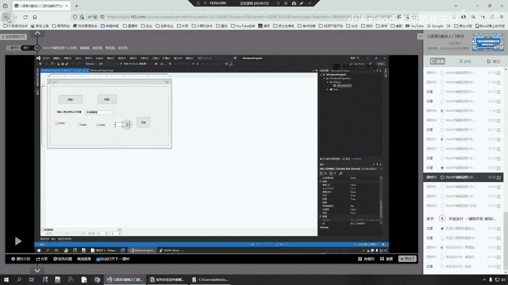
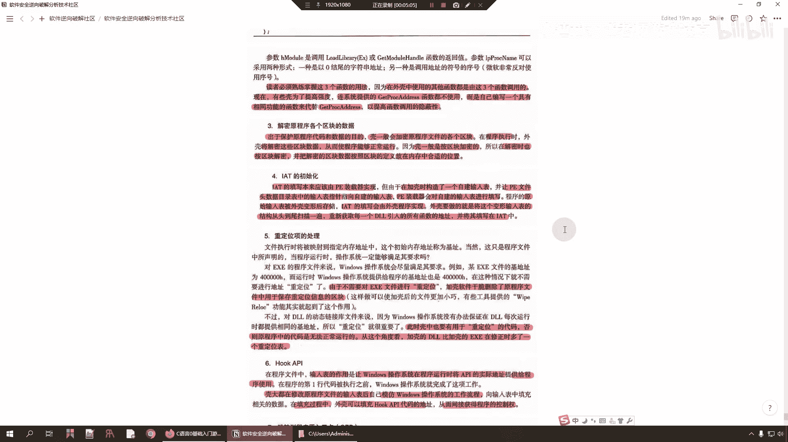

# 🧰 脱壳技术：2：脱壳机的应用

## 📚 脱壳技术：2.1：课程概述与学习路线

在本节课中我们将要学习脱壳机的应用。开始前先说明课程学习路线：跟着小迪老师学习软件安全逆向破解分析技术没有问题；加入社区后会有内部视频教学，基础版199，高级版249。高级版需要多学一些内容，下面先做一个整体介绍，方便初学者理解后续安排。

以下是高级版相对基础版增加的学习内容。

- C语言0基础入门游戏辅助开发实践。

- 先学习编程，理解怎么去写程序。



- 再学习开发Windows程序，开发存储器、标题破解修改工具等相应工具。



- 学习开发窗口程序，点进去可以简单看到编写一个小箭头，也就是开发一个窗口界面的程序。

- 毕业设计是开发一个辅助程序，辅助程序长这样，分析游戏后把辅助程序写出来。



基础版199，高级版249，只需要增加50，价格非常实惠。以上是课程信息，下面进入今天的内容：第十八课，脱壳机的应用。

## 🧩 脱壳技术：2.2：脱壳机的基本概念

上一节我们介绍了课程学习路线，本节中我们来看看脱壳机的基本概念。针对特定壳开发出来的脱壳软件称为脱壳机。脱壳就是将加壳后的程序恢复到原来的状态。脱壳成功的标志是文件正常运行，并且程序代码已经被还原。用公式描述如下。

```text
脱壳后程序 = 还原(加壳程序)

脱壳成功 = 文件正常运行 && 程序代码已还原
```

脱壳机一般分为专用脱壳机和通用脱壳机。专用脱壳机是针对某种壳专门编写的；通用脱壳机是根据加壳的本质编写一个通用型脱壳工具，但这种工具可能没有那么好用。可以用下面的公式理解分类。

```text
脱壳机 = 专用脱壳机 | 通用脱壳机
```

## 🔍 脱壳技术：2.3：脱壳前的查壳流程

上一节我们介绍了脱壳机的概念和分类，本节中我们来看看实际脱壳前应该先做什么。脱壳时如果要用脱壳机，第一步先用ESin或DIE工具查壳，查看壳的信息，例如判断是不是一个ABC壳。知道壳的信息后，再去网络上搜索ABC脱壳机、ABC脱壳工具、ABC脱壳器，或者搜索“xxx unpack”。其中pack是打包，unpack是解包，unpacker就是解包器，也就是脱壳器。整体流程如下。

```text
1. 用 ESin 或 DIE 查壳
2. 记录壳名称，例如 ABC
3. 搜索 ABC脱壳机 / ABC脱壳工具 / ABC脱壳器 / ABC unpacker
4. 使用对应脱壳机脱壳
```

以下是查壳后搜索时常用的关键词示例。

- `ABC脱壳机`

- `ABC脱壳工具`

- `ABC脱壳器`

- `ABC unpacker`

## 🛠️ 脱壳技术：2.4：常见脱壳器与工具准备

前面我们知道了如何查壳和搜索对应工具，本节中我们来看看常见脱壳器的准备。常见脱壳器有很多，讲师已经收集好，并会上传到软件安全逆向破解分析技术社区。点开社区内容可以看到准备好的常见脱壳器，直接用这些工具脱壳即可。以下是工具准备要点。

- 常见脱壳器已经收集。

- 工具会上传到软件安全逆向破解分析技术社区。

- 点开社区内容可以看到常见脱壳器。

- 查到壳信息后，对应使用相应脱壳器。

## 🧪 脱壳技术：2.5：UPX脱壳器实操演示

上一节我们准备了常见脱壳器，本节中我们用UPX脱壳器做一次实操演示。例如使用UPX Unpacker。上节课做过实验，几个程序是UPX壳；我们要通过脱壳器把这些已经加壳的程序变成原程序。运行工具后可以看到，这些工具的使用方法大同小异。把程序拖过来，会生成一个脱壳后的程序以及一个`.bak`文件；`.bak`文件就是刚才原来的程序，另一个是已经脱壳后的程序。如果看不到后缀，点击“查看”，再点击“文件扩展名”，就可以看到后缀。运行脱壳后的程序，程序可以正常运行。再把这个程序拖到ESin里查看，入口区段已经还原释放，代码段、只读数据段、数据段以及资源段都很干净，信息显示正常。没有脱壳的程序则不是这样。实操步骤可以概括如下。

```text
1. 运行 UPX Unpacker
2. 把 UPX 加壳程序拖入工具
3. 得到脱壳后程序与 .bak 备份
4. 如看不到后缀：查看 -> 文件扩展名
5. 运行脱壳后程序验证
6. 用 ESin 复查入口区段、代码段、只读数据段、数据段、资源段
```

以下是验证脱壳效果时关注的内容。

- 文件能够正常运行。

- 程序代码已经被还原。

- 入口区段已经还原释放。

- 代码段、只读数据段、数据段、资源段干净。

- 与未脱壳程序对比，信息不同。

## ✅ 脱壳技术：2.6：本节总结



本节课中我们一起学习了脱壳机的应用。先了解课程学习路线和高级版内容，再理解脱壳机、脱壳、脱壳成功标志以及专用脱壳机和通用脱壳机的分类。实际使用时，先用ESin或DIE查壳，根据壳信息搜索对应脱壳机或unpacker，使用已经收集的常见脱壳器，并通过UPX Unpacker完成拖拽脱壳、查看后缀、运行验证和ESin复查。整体来看，脱壳机的应用比较简单，核心就是查出壳的信息，然后对应选择脱壳工具。本节内容到这里，下期再见。

