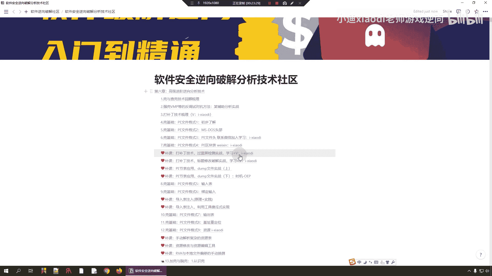

# 🛡️ 脱壳技术：3：手动脱壳之寻找OEP-内训方法1


## 📖 课程概述

本节课我们要学习手动脱壳过程中最关键的步骤之一——寻找OEP。我们会先回顾壳代码的基本执行流程，然后通过一个实际的加壳程序，演示如何使用单步跟踪法找到OEP，最后顺带介绍一下脱壳后的修复操作。学完本节课，你将理解OEP的含义，并能够用OllyDbg手动定位加壳程序的真正入口点。

## 🐢 为什么要脱壳：壳就像乌龟壳和快递包裹

我们知道，有些程序是加了壳的。加了壳的程序就像乌龟背上的龟壳一样，这个壳保护着程序内部的代码和数据。如果你想吃到乌龟肉，就必须把龟壳脱掉。再打个比方，你买了一个快递，快递外面有包裹，想拿到里面的东西，就必须把包裹打开。程序也是一样，很多程序用壳来保护，我们要做的就是把壳脱掉。而脱壳需要做一个关键步骤，就是寻找OEP。

## 🔄 回顾壳代码的基本流程

前边我们讲过壳代码的加载流程，一共分为六步。第一步是保存寄存器环境，使用的指令是`pushAD`或`pushFD`。最后一步是恢复寄存器环境。可以看到，这是一个有头有尾的过程，不可能无穷无尽。头和尾分别代表什么含义呢？`pushAD`和`pushFD`这些汇编指令本身的作用，前边已经讲解过。它们有一个专门的用途：保存当前执行环境。当前执行环境是由通用寄存器决定的，寄存器里存放的数据在后续代码执行中会用到，所以要先保存下来。保存的是原程序的执行环境，保存好之后，再执行壳的代码。中间的步骤就是壳代码要做的手脚，它确实能干扰一些软件分析工作。但是壳代码不能只是自己跑，原来的程序也得跑。因为用户买的是软件，不是壳，如果壳运行完程序却无法使用，那就说不过去了。所以壳最后要恢复寄存器环境。从哪里恢复？就从之前保存的地方，用`popAD` / `popFD`把这些数据弹出来，这样就恢复了之前的执行环境，也就是原程序原本的执行环境。最终，原程序的执行环境必须被恢复。既然这样，在`popAD`代码后面，它就要跳转到原程序的执行环境。这个跳转可能是紧接着执行，也可能是跳过去执行。脑袋里要有这个逻辑：有头有尾，到了尾巴的时候，要接着执行或者跳过去执行原本程序的代码。

壳的执行流程可以用公式表示：

```text
壳执行流程 = 保存寄存器环境(pushAD/pushFD) → 执行壳代码 → 恢复寄存器环境(popAD/popFD) → 跳转到原程序入口点
```

## 🎯 OEP 是什么

教材上是这样说的：当外壳所保护的程序运行时，会先执行外壳程序，这毋庸置疑。外壳程序负责在内存中把原程序解压还原，并把控制权还给解压后的真正程序，再跳到原来的程序入口点。一般的壳在这里会有一条明显的分界线。这个解压后真正的程序入口点称为OEP。这个名词很重要，它是`original entry point`，也就是原程序的入口点。加了壳的程序有一个入口点，但那个入口点只是壳的入口点。待会儿我们会看到，原程序入口点有一个专门的名词去说明，叫做`original entry point`。之前我们也提到过，脱壳最好在哪里？最好就在OEP处脱。一个没有壳的入口点，那肯定就是原程序入口点；但加了壳的入口点不是原程序入口点。这里有点绕，我们先回顾一下dump文件最好的时机是什么？dump文件最好的时机就是在OEP处，之前我们讲过了。那么怎么找到OEP，就是今天以及今后要探讨的非常重要的内容。

OEP的定义用公式表示：

```text
OEP = Original Entry Point = 原程序入口点（加壳程序解压还原后的真正入口）
```

## 🔍 大多数加壳程序会多一个区段

绝大多数加壳程序会在程序里多加一个区段，或者合并一些东西。如果是多加了一个区段，我们就可以根据跨区段的转移指令找到真正的程序入口点。因为壳最终要跳过去或者接着执行原本程序的执行环境。我们来实际操作一下。

## 🧪 实验：观察加壳程序的外观特征

实验程序已经准备好了。我们一步步来，先用`Stud_PE`打开程序看一下，点击“区段”按钮，你会看到代码段也在，`RDATA`、`DATA`、`RSSRC`、`PEDIY`这些东西都在。代码段在，但多了一个不正常的区段。看一下“概况”里面的“所在区段”，你会发现是`PEDIY`，不是正常的`text`段。正常情况下应该是`text`段才对。这是第一个被影响的地方。

第二个现象：如果用`ResHacker`查看这个程序，点击资源，你会发现乱码。程序的界面是看不到的。但是程序运行起来是有界面的，这个界面在资源查看器里显示不出来。所有资源都废掉了，没有办法去修改了。这是第二个现象。

第三个现象：我们去调试分析一下。把程序拖到OllyDbg里，会发现这边是`EntryPoint`入口点，你看入口点处有一条`pushAD`指令。当你看到`pushAD`时，就要开始推测了——一旦看到`pushAD`，大概率就有壳。也就是说，如果你把程序拖到OD里，看到`pushAD`，大概率有壳。而且有壳的话，它在做什么呢？它在保存寄存器环境。

## 🐾 单步跟踪法寻找 OEP


这个时候怎么去分析呢？我们可以单步分析。因为这个代码是一行行执行的，最终一定会来到一个`popAD`，它会还原原本程序的真实执行环境。我们先按一下`F8`。哎，`F8`后程序直接运行起来了，这也是有壳的一个表现。`F8`是单步执行，也就是“步过”。发现直接运行起来了，就是说我运行到这个坑，程序直接跑起来了。这种现象叫做“跑飞”。跑飞的意思就是：按F8执行代码时程序直接运行起来了，没有停在下一行。那怎么办呢？改用`F7`。`F7`也是单步，但它是“步进”，会进入`call`里面执行。遇到`call`的时候，`F7`会单步进入这个调用，而`F8`是不进入调用，直接“步过”。我们来重新试一下，点击重新开始。按`F7`，`F7`就进入这个`call`里了。进来之后我们就可以再按`F8`了。因为如果这儿有很多`call`，一个一个进的话代码太多了，所以在哪里跑飞了，我们就重新回过头用`F7`进入。进来之后，我们就可以用`F8`单步走了。


我们观察一下寄存器窗口，你会发现这边不停出现“kernel32.dll”之类的内容，实际上它是在获取API函数的地址，从这些DLL里获取。按`F8`，它获取到了一个`VirtualLock`函数。继续`F8`。注意这边有一个`JMP EAX`，我们看一下`EAX`是`680000`，有没有跨段？是不是发现跨区段了？也就是说，我从一个区段跨到另外一个区段，这种跳转叫做跨段。当我到这儿的时候，你看一下`JMP EAX`，`EAX`是`680000`。我们也可以点击内存布局查看，`680000`这个地址就是我们的程序所在段。它跳到哪里了？跳到这儿，是不是跨段了？它从这边直接跳到这儿了，所以它是一个跨段指令。跨段指令大概率是程序的入口点，但它不一定，可能经过多次跨段。我们看一下，现在按`F8`过去看看它跨段干什么用。按`F8`，它虽然跨段了，但不是跨到我们的程序代码段，而是跨到了一个线程的段。看一下它干什么用。这里有一个循环，如果这个循环比较少，我们就可以一直`F8`。我们按`F2`打断点试试。实际上这边也是跟API函数相关，也是从动态链接库里取出一些函数，比如`VirtualFree`等，做一些相关操作。按`F8`，然后跳转。注意这边有没有跨段？没有跨段，还是`680000`这个段。但它往上跳了，往上跳有一个循环，我们不想让它循环怎么办？我们先试一下，执行一遍又往上跳了。那就在这个跳转指令的下一行按`F2`打一个断点，然后运行。这样的话，它就自动把上面的循环代码运行完了，运行完之后就在这儿断下来了，然后再把断点取消，再按`F8`继续走。这样就避免我们一次次在循环里耗费时间了。按`F8`，有没有跨段？没有跨段，还是在这个段里面。注意，走，看到没有？开始使用其他DLL了。按`F8`，走，看到`SendMessageA`，开始调用`user32.dll`里面的函数了，就是开始取出里面的一些函数。这边又一个循环，是一个往上跳的跳转。不想让它往上跳怎么办？在这两个往上跳的跳转下面打一个断点，然后运行，可以绕过整个循环。然后继续`F8`单步，一步步走。走到这里，关键点就来了。大家会看到什么呢？看到`popAD`。`popAD`干什么？恢复寄存器环境了，对不对？这个时候恢复了。


注意这边的代码，在`popAD`之后，先`push`了一个`401130`。`401130`是什么？它是不是程序代码段里的一个地址？`00401000`是代码段的起始，`00401130`刚好在代码段里面。`push`加`ret`相当于什么？`push`加`ret`相当于一个跳转，也就是`JMP`。`push xxx; ret;`就等价于`JMP xxx`。我们看一下它是不是一个跨段指令。按`F8`，它是一个跨段的指令，因为它直接就跳过去了。按`F8`，直接就跨到这样一个位置。这个位置叫什么呢？这个位置就是程序代码段。当跑到`popAD`完事之后，`push; ret`跳过来的位置，接下来就叫做OEP了。这个位置就是OEP。`OEP`就是`original entry point`，我们把它写下来。

OEP的定位标志可以用代码描述：

```text
popAD            ; 恢复寄存器环境
push 401130      ; 压入原程序代码段地址
ret              ; 相当于 JMP 401130，跳转到OEP
```


## 💾 顺带演示：在OEP处脱壳并修复

我们再来看一下，先回顾一下。打开另一个程序，把程序拷贝一份副本，拖到OD里对比一下。这边标注是`EntryPoint`，它告诉你这是入口点，但这个入口点是加壳程序的入口点。它还没有把原始代码还原，不要受这个影响。一个是`EntryPoint`，无论加没加壳，OD都提示入口点。但脱壳后的程序就不一样了，它是解密完了代码、还原完了环境，然后来到代码段。这个大概率就是原程序入口点。本节课不会详细讲脱壳，但可以稍带着讲一讲。之前我们说过，脱壳最好在OEP处dump文件。OEP有没有来？来了，已经来到了。怎么dump文件呢？之前也讲了，点击插件，点击`OllyDump`，然后你看这边没有东西。点击`Rebuild Import`（重建导入表），点击“是”。然后可以点击`Get ImpRec`，这个就是输入表的意思。然后点击`Dump`按钮，点击`Dump`，弹出一个对话框，点击保存。这个时候我们去运行一下，你会发现“应用程序无法正常启动”。这是因为你dump之后，是需要修复的。我们先可以展开导入表，你会发现里边有一些有问题的东西。那怎么办呢？点击`Fix Dump`，点击`Fix`，选择刚才dump完的文件，点击打开。这个时候文件夹里边就会多出一个修复后的文件。运行一下，程序运行了。我们看一下程序有没有脱干净。打开`Stud_PE`，把我们脱壳后的程序拖过来，点击区段。虽然说区段没有扒干净，还是有那个多余区段，但是看一下入口点所在的区段，有没有变？程序是从哪里开始运行呢？是从我们真正程序的代码段开始执行的。而加了壳的程序是从哪里执行呢？是从壳段开始执行的。所以程序开始执行的位置不一样了。我们把加了壳的程序关掉，把我们脱壳后的程序拖过来，看到没有？它直接在原程序的原始入口点进行执行，这就是脱壳。


脱壳后的程序还有一个特征：我们可以直接用`ResHacker`去编辑它了。把脱壳后的程序拖过来，看一下，图标的资源数据都出来了。看界面，界面也出来了，之前的界面是出不来的。当然这边好像有一点点小问题，但大部分都是没问题的。你看图标，尤其是界面，这个界面现在可以随意修改。但是你看一下加了壳的程序，你拖过来，界面是打不开的，它会提示`unable to decomp this resource`，意思是无法解码这个资源。

## 📝 总结：单步跟踪法步骤

今天的内容就是找到OEP的方法。实际上你可以一直单步、一直单步，一直往下走，一直走到`popAD`。看到`popAD`后，再看后面有没有`push`加`ret`，它就相当于`JMP`，然后就回到了程序原本的代码段。这个代码段一般是`.text`段。然后你就可以进行脱壳、dump，dump完之后要修复，就是`Fix`修复一下，然后程序就可以用了。这就是寻找OEP的“单步跟踪法”。

总结一下单步跟踪法寻找OEP的完整步骤：

- 把程序拖入OD，看到`pushAD`，这是保存寄存器环境。
- 一直单步（遇到`call`跑飞时改用`F7`进入，循环用断点跳过）。
- 直到看到`popAD`，这是恢复寄存器环境。
- 后面出现`push + ret`，相当于`JMP`。
- 跳转到`.text`代码段的位置，就是OEP。
- 在此处进行`Dump`，然后`Fix`修复导入表。




本节课我们一起学习了手动脱壳中寻找OEP的第一种内训方法——单步跟踪法。你理解了壳代码的执行流程：保存环境、执行壳代码、恢复环境、跳转OEP。你也知道了如何用OD观察跨段跳转、如何绕过循环、如何识别`popAD`和`push+ret`组合，最终定位到OEP。脱壳并不是一次dump就结束了，还需要修复导入表才能正常运行。希望你能亲自实践，加深体会。下节课我们继续探讨寻找OEP的其他方法。
