# 🛡️ 脱壳技术：4：手动脱壳之寻找OEP-ESP定律脱壳，堆栈平衡法

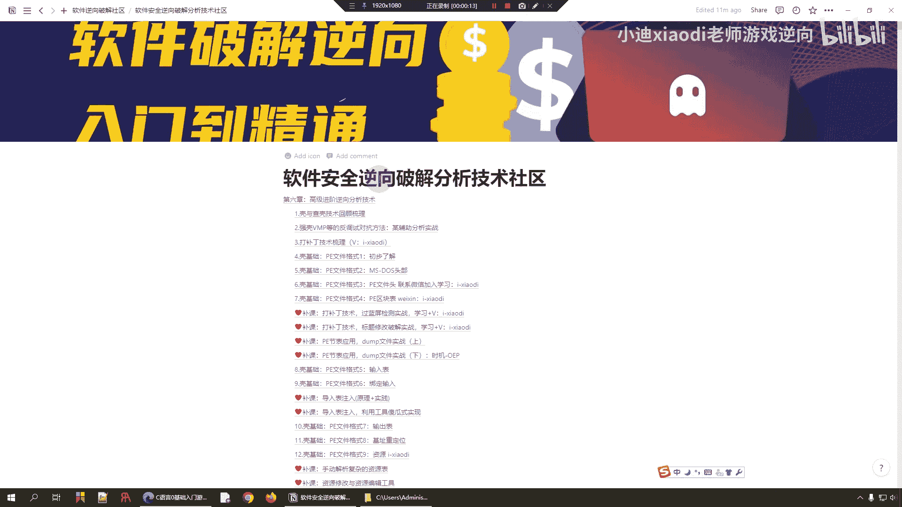

在本节课中，我们将学习手动脱壳时寻找 OEP 的一种高效方法——ESP 定律法，也叫堆栈平衡法。与上节课讲过的单步跟踪法相比，这种方法不需要反复按 F8，而是利用壳在保存和恢复寄存器环境时对栈顶地址的访问规律，配合调试器的硬件访问断点，快速定位到程序的原始入口点。我们依次介绍为什么要找 OEP、ESP 定律的原理、具体操作步骤，以及最终的脱壳与修复流程。课程由小迪老师讲解，适合软件安全、逆向分析、CTF 竞赛等方向的小白学习者。

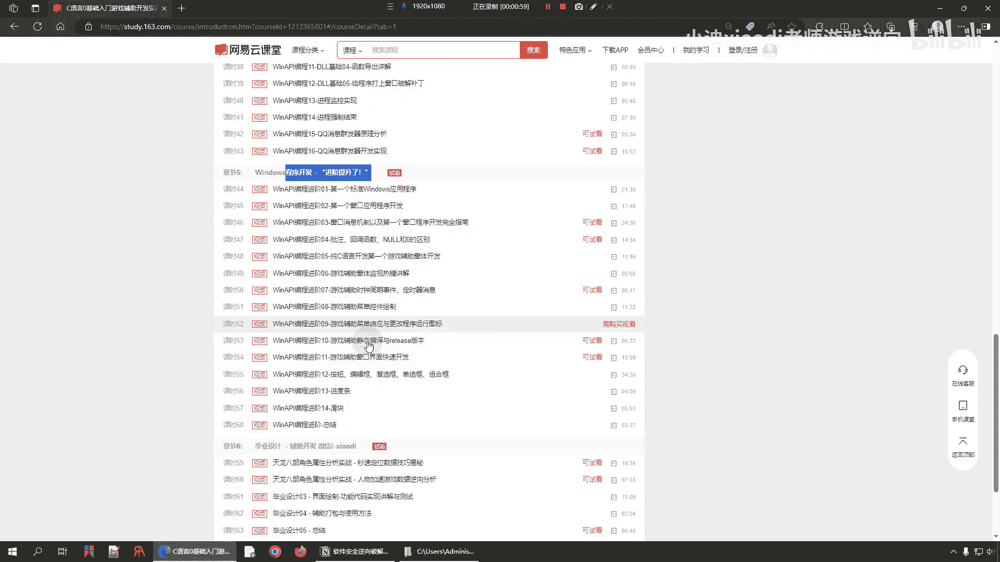

首先，课程目前有最新优惠活动，基础版为 199 元，高级版为 249 元。有同学经常问高级版比基础版多了哪些内容，这里说明一下：高级版在基础版内容之上，额外增加了一套“C 语言零基础入门游戏辅助开发实践”的课程。我们来看一下课程目录。

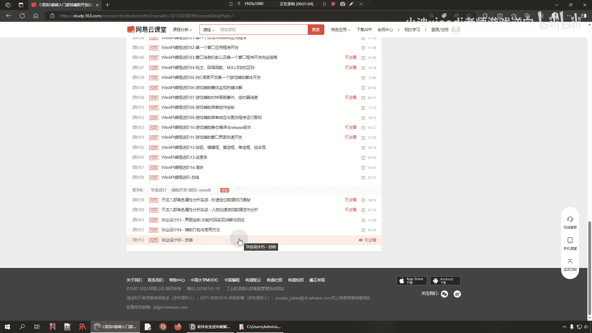


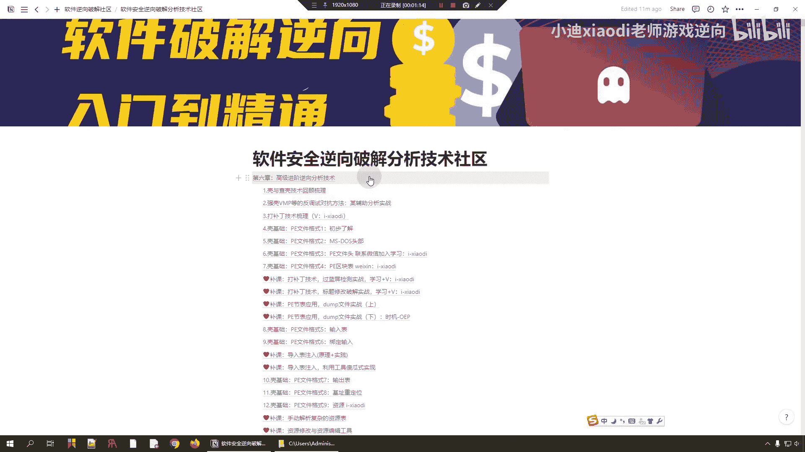

以下是高级版额外包含的内容：

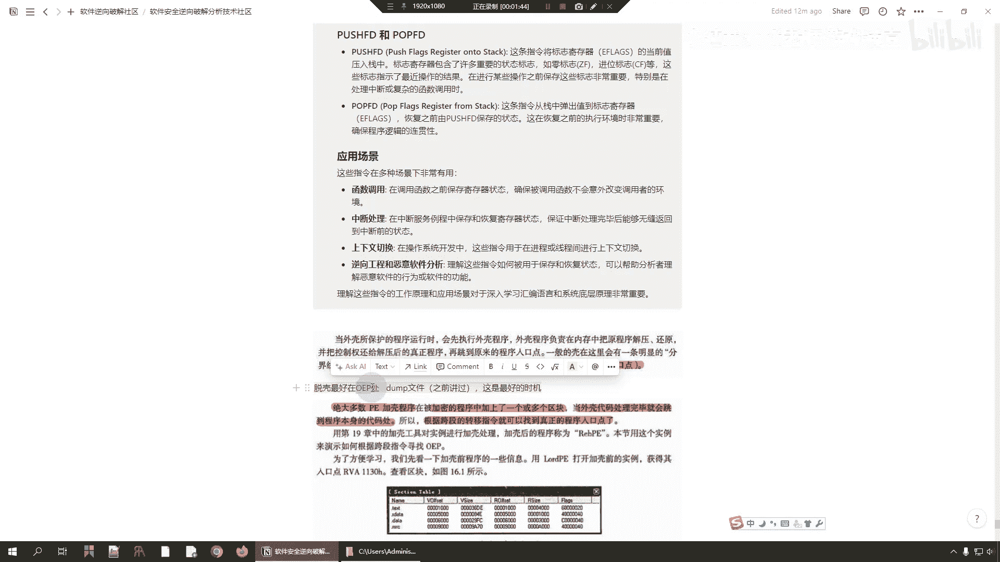

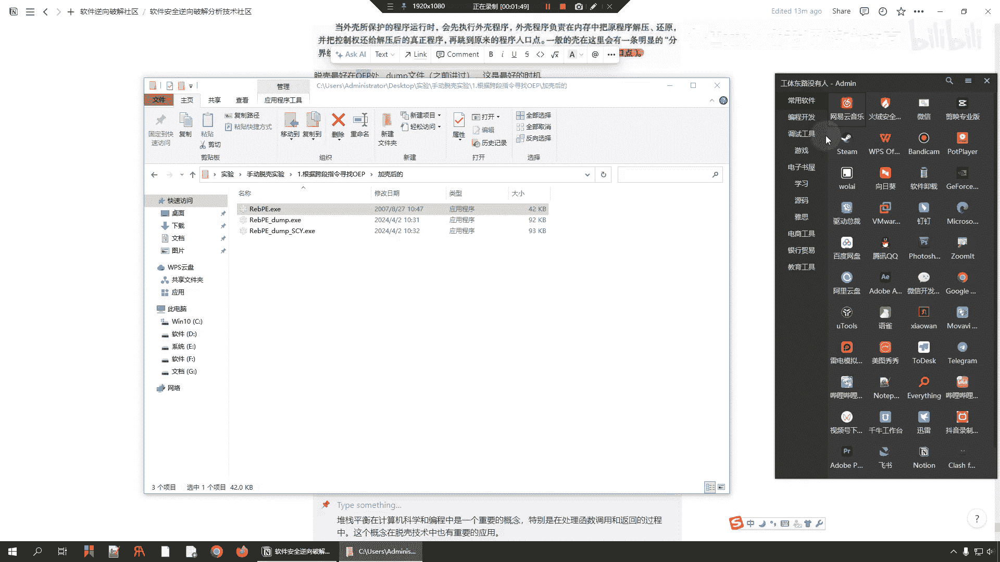

- 零基础入门 C 语言编程，课程与软件安全内容相互配套，从计算机基础开始，补足 C 语言编程基础。
- Windows 程序开发零基础入门，从零开始带你编写实际项目。
- 包含一些实战小项目，例如零基础写一个 QQ 寻霸器，这个项目是有的。
- 还有游戏辅助开发中的窗口界面设计，同样包含在内。
- 最后还有一个毕业设计级别的大项目，带大家完成一个实打实的完整作品。

这些内容都在高级版里，基础版 199 元，高级版 249 元，只多花 50 元就能升级，绝对是物超所值的。广告时间到此结束，我们开始正式内容。

本节课是第六章“高级进阶逆向分析技术”的第二十课，主题是脱壳技术中的手动脱壳之寻找 OEP（方法 2）。之前我们讲过，如果要脱壳，肯定要先找到 OEP，因为 OEP 才是 dump 文件的最佳时机。dump 下来之后，我们还要对程序进行修复，这时程序才算真正脱掉壳，之后它会从原始入口点开始执行。如果不脱壳，程序会从哪里开始执行呢？

我们打开 SPE 工具来看一下。如果没有脱壳，可以看到代码区段是 PEDIY 区段，也就是说程序会先从壳的区段加载代码。但一个正常的程序，按理说应该先从自身的代码段去执行，对吧？来看脱壳后的情况，它就是从一个真正的代码段去执行的。这就是我们为什么必须寻找 OEP 的原因。

上节课我们讲的是单步跟踪法寻找 OEP，这种方法需要不断按 F8，确实比较麻烦。虽然我们也提供了一个较好的辅助方法，比如自动按 F8、自动跟踪、步入步过，可以解放双手，但整体上还是不够简便。那么有没有更简单的方法呢？有，这就是今天的主角——ESP 定律法。这种方法在网络上很常见，有人叫它 ESP 定律法，也有人叫它堆栈平衡法，因为 ESP 就是堆栈寄存器，而堆栈平衡是其中的核心概念。

在汇编阶段学习正向开发时，我们提到过堆栈平衡。它是计算机科学和编程中一个非常重要的概念，特别是在处理函数调用和返回的过程中。函数调用和返回是通过堆栈来管理的，比如参数是怎么压入的，局部变量是怎么压入的，返回时已经用完的数据又是怎么被销毁的，这些事情都由堆栈统一管理。而最新的栈顶地址由谁存放？就是由 ESP 寄存器存放。那么栈底是什么呢？栈底是 EBP。我们再来回顾一下：栈底是一个地基，它基本不变；而 ESP 指向栈顶位置，它的值是不断变化的，可以理解为栈顶水平线。正因如此，堆栈平衡才如此重要。

壳在编写代码时，通常会这样处理：首先保存寄存器环境，一般会使用 pushad 指令。pushad 相当于把 EAX、ECX、EDX、EBX、ESP、EBP、ESI、EDI 这组寄存器依次压入栈中，其中就包含了当时栈顶 ESP 的值。然后，壳会执行自己的代码，这时栈顶数据会不断变化。保存过寄存器环境之后，有进还得有出，壳最后还要恢复寄存器环境，一般会使用 popad 将之前压入的寄存器依次弹出，ESP 就会恢复到原来的状态。我们可以用下面这段伪代码来表示这个过程：

```asm
pushad          ; 相当于将 EAX, ECX, EDX, EBX, ESP, EBP, ESI, EDI 压入栈
...             ; 壳的自有代码，执行过程中会改变栈顶内容
popad           ; 恢复上述寄存器，ESP 也恢复为 pushad 之前的值
```

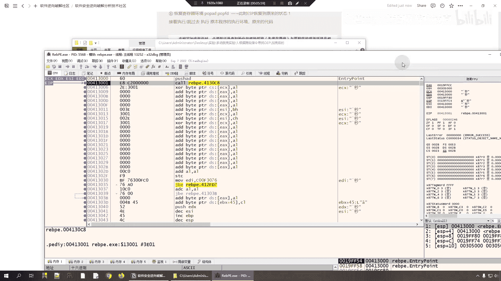

可以看到，ESP 一开始被保存，然后在壳代码执行过程中发生变化，最后又恢复原状。也就是说，它经历了一个从“原值”到“变化值”再到“原值”的过程。我们正好可以利用这种变化，再配合调试器（例如 x32dbg）强大的断点功能，快速到达 OEP。具体思路是：在保存后的 ESP 地址上设置一个硬件访问断点，当壳代码执行到恢复寄存器环境时，必然要去访问这个栈顶地址，于是断点就会命中，我们也就正好停在了恢复现场的位置，再往下走几步就能到达 OEP。操作手法很简单，就是在 ESP 地址下硬件访问断点即可。

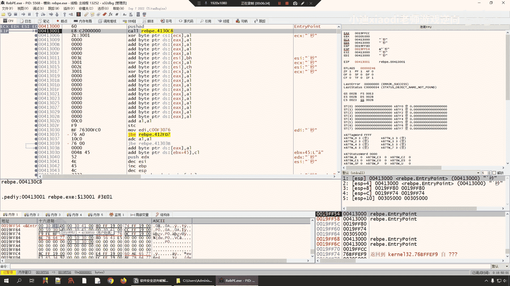

下面我们直接打开 x32dbg 来演示。先在选项中找到“入口断点”设置，然后把程序拖进来。载入后，先看 ESP 的值，记下来。比如这里 ESP 是某个地址，然后按一下 F8，它就会变成保存后的栈顶地址，比如本例中的 19FF54。此时这个地址里存放着之前 pushad 压入的数据，这些数据后续会被访问。

接下来我们要在这个 ESP 地址处下硬件访问断点，具体操作如下：

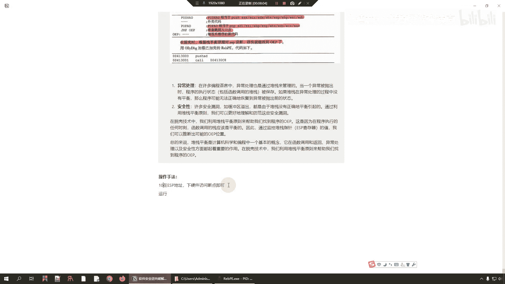

- 在调试器右侧的寄存器窗口中，找到当前 ESP 寄存器，鼠标右键点击它。
- 在弹出的菜单中选择“内存窗口中转到”，然后点击“内存一”，即可跳转到该 ESP 地址对应的内存区域。
- 在内存窗口中，选中四个字节。为什么要选四个字节呢？因为 ESP 本身是 32 位寄存器，长度就是 4 个字节。比如 00 是一个字节，19 是第二个字节，FF 是第三个字节，54 是第四个字节，正好四字节。同时，这个地址里存放的数据也是四个字节，比如 00413000，所以我们要选四个字节。
- 鼠标右键点击选中的四个字节，选择“断点”，再选择“硬件访问断点”，长度选四字节。
- 设置完成后，调试器会提示“已在处设置硬件断点”，同时可以在“断点”窗口中看到这条硬件断点记录，显示类型为硬件访问断点，地址为当前 ESP 值，状态为已启用，访问类型是访问（也可以说是读），长度是四字节。这样断点就设好了。

断点设置好之后，我们直接运行程序。第一步，点击运行按钮。第二步，再次点击运行按钮。当程序跑起来时，你会发现刚才那个地址 19FF54 里的数据又变回了 19FF74，也就是 ESP 恢复了原来的状态。断点此刻就生效了，程序停在了访问该地址的代码处。断点生效后，我们要把这个硬件断点删掉，否则后面调试时可能会干扰我们。删除的方法很简单：在断点窗口中，鼠标右键点击该断点，选择“删除”。删掉之后，我们就停在了“恢复寄存器环境”的位置，再往下看，可以看到 popad 指令，也就是恢复寄存器环境的关键指令。继续往下，还能看到一条 push 401130 的指令，这个 401130 就是 OEP 的地址。它把 OEP 压入栈中，然后紧跟着一条 ret 指令，程序就会跳转到原始 OEP 去执行。我们来按 F8 试一下。

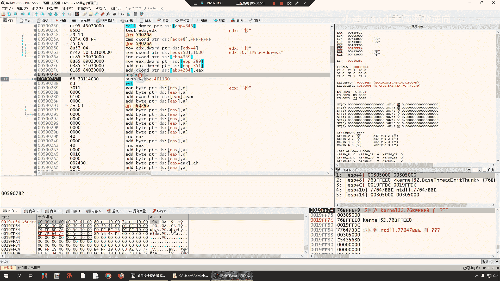

第一次按 F8，执行了 push 401130。第二次按 F8，执行了 ret，你会发现程序已经跳到了 40130A，这就是 OEP。到达 OEP 之后，我们再按照上节课讲的方法进行脱壳即可。可以使用调试器自带的脱壳插件，脱壳完成后还要记得进行 IAT 修复，这一步不能省略。

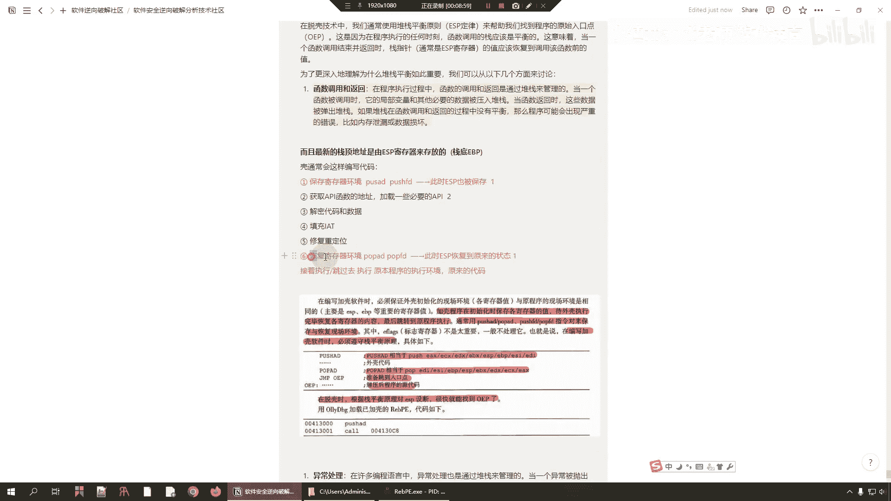

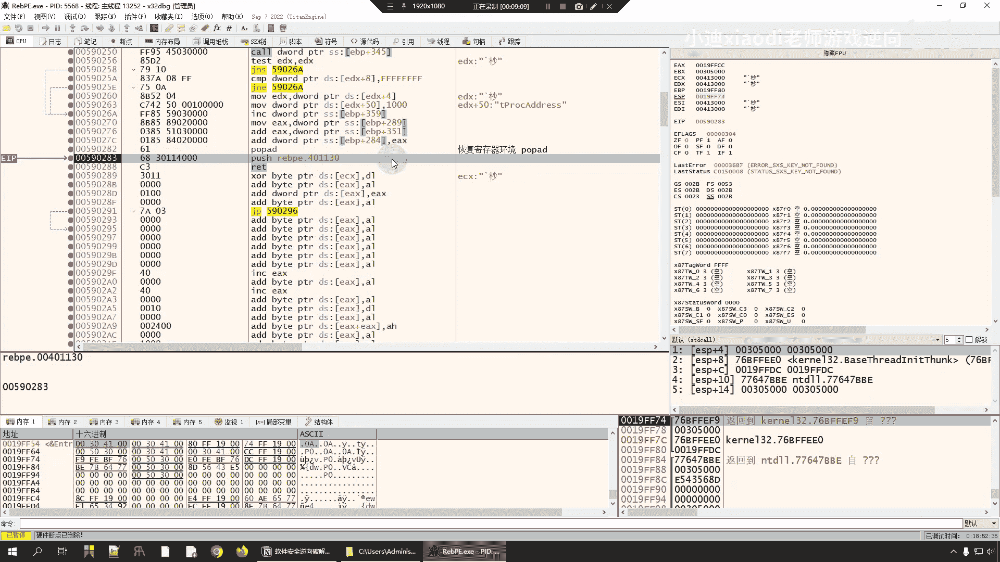

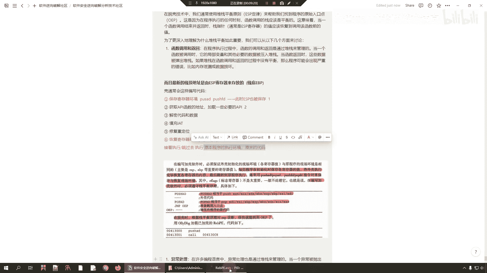

为了让你更好理解今天这一课的内容，有一点需要强调：前面讲到的汇编代码开发部分一定要看完，尤其是函数那一块内容。在 16 位汇编中，函数调用的知识也一定要看，同时你要清楚这些指令是干什么用的。例如 pushad、popad、ret 这些指令，我们是在讲 32 位汇编的时候详细介绍过的。所以整个课程是递进式的，不要跳着看。跳着看的话，你可能只能理解 60% 左右；如果前面都顺着看下来了，应该能理解百分之八九十；再经过实际动手操作，就能理解到 100%。这个顺序很重要，建议大家按顺序学习。

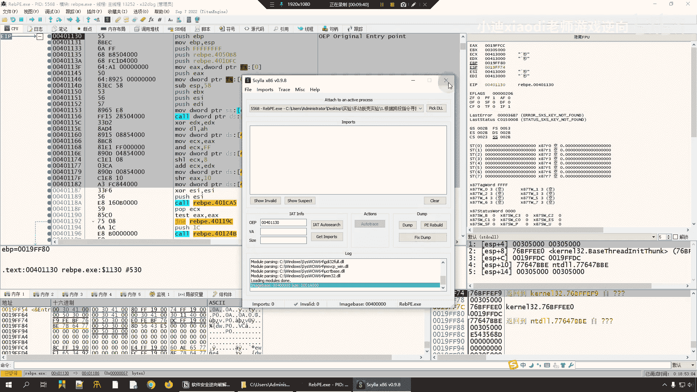

最后，我们把 ESP 定律法寻找 OEP 的完整操作流程总结一下。以下是一套标准步骤：

1. 用 x32dbg 载入目标程序，先按一下 F8，使 ESP 变为保存后的栈顶地址。
2. 在当前 ESP 地址处，设置硬件访问断点，长度为四字节。
3. 运行程序，等待断点命中，此时程序会停在恢复寄存器环境的位置。
4. 删除硬件断点，避免干扰后续操作。
5. 连续按 F8，经过 push OEP 和 ret 两条指令后，即可到达 OEP。
6. 使用脱壳插件进行 dump 脱壳。
7. 最后修复 IAT 导入表。

以上就是 ESP 定律法，也就是堆栈平衡法的完整原理和操作手法。另外提醒一下，如果想要跟着学习，要抓紧时间，现在最新的优惠是基础版 199 元、高级版 299 元，有需要的同学请抓紧联系。

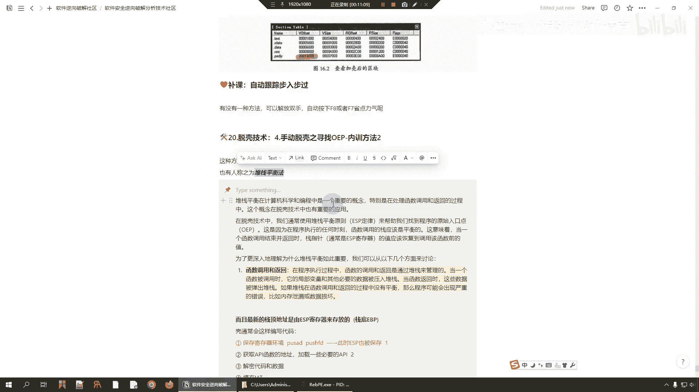


本节课中我们一起学习了 ESP 定律法脱壳的核心原理与操作步骤。我们知道了为什么要寻找 OEP，理解了壳通过 pushad 和 popad 来保存及恢复寄存器环境，也掌握了在 ESP 地址下硬件访问断点并快速到达 OEP 的方法。最后还总结了从 F8 到断点、运行、删除断点、到达 OEP、脱壳、修复 IAT 的完整流程。希望大家在理解原理的基础上多动手实践，这样才能真正掌握这门技术。
